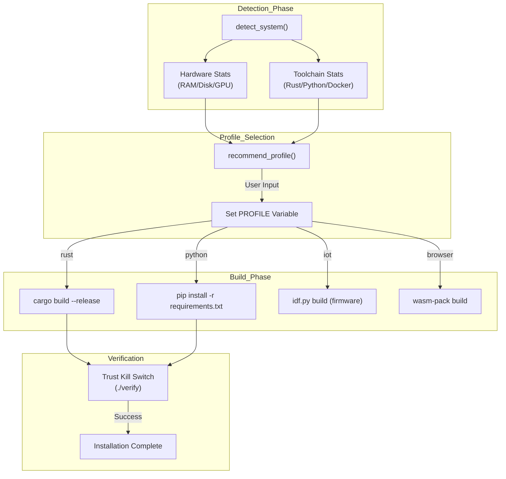
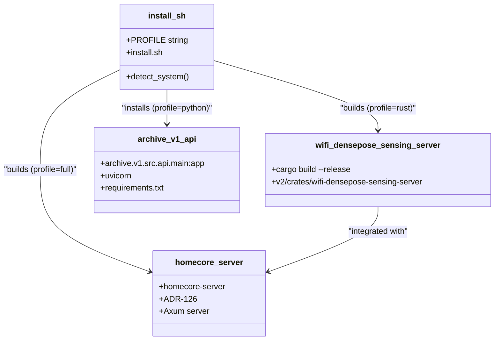

<!-- source: DeepWiki mcp.deepwiki.com · repo ruvnet/RuView · page 2.1 Installation Profiles · fetched 2026-10-30 -->

# Installation Profiles

Relevant source files

The following files were used as context for generating this wiki page:

- [.claude-flow/daemon-state.json](.claude-flow/daemon-state.json)
- [.claude-flow/metrics/codebase-map.json](.claude-flow/metrics/codebase-map.json)
- [.claude-flow/metrics/consolidation.json](.claude-flow/metrics/consolidation.json)
- [.claude-flow/metrics/performance.json](.claude-flow/metrics/performance.json)
- [.claude-flow/metrics/security-audit.json](.claude-flow/metrics/security-audit.json)
- [.claude-flow/metrics/test-gaps.json](.claude-flow/metrics/test-gaps.json)
- [.claude/scheduled_tasks.lock](.claude/scheduled_tasks.lock)
- [Makefile](Makefile)
- [docs/adr/ADR-126-ruview-native-ha-port-master.md](docs/adr/ADR-126-ruview-native-ha-port-master.md)
- [example.env](example.env)
- [install.sh](install.sh)
- [requirements-dev.txt](requirements-dev.txt)
- [requirements.txt](requirements.txt)

This page details the available installation profiles for RuView, the dependencies each profile manages, and the logic used by the system to recommend a profile based on hardware detection.

RuView uses a multi-tier installation strategy to support environments ranging from low-power ESP32 nodes to high-performance GPU-accelerated sensing servers. The primary entry point for installation is the `install.sh` script, which orchestrates system detection, toolchain verification, and profile-specific builds `[install.sh:1-23]()`.

---

## Profile Definitions

The system defines eight distinct profiles, each targeting a specific deployment scenario or development need.

| Profile | Purpose | Key Dependencies | Footprint |
|:---|:---|:---|:---|
| `verify` | Minimal validation of the signal processing pipeline | Python 3.9+, `numpy`, `scipy` `[install.sh:97]()`, `[requirements.txt:2-3]()` | ~5 MB |
| `python` | Full Python pipeline (API server, sensing, analytics) | `fastapi`, `uvicorn`, `torch`, `opencv-python` `[install.sh:98]()`, `[requirements.txt:4-34]()` | ~500 MB |
| `rust` | High-performance core sensing engine (Rust pipeline) | Rust 1.89+, Cargo, OpenBLAS, `pkg-config` `[install.sh:99]()`, `[install.sh:60-61]()` | ~132 MB |
| `browser` | WASM build for browser deployment | `wasm-pack`, `wasm32-unknown-unknown` target `[install.sh:100]()`, `[install.sh:51-52]()` | ~10 MB |
| `iot` | ESP32 sensor mesh + aggregator | ESP-IDF, `esptool`, `provision.py` `[install.sh:101]()`, `[install.sh:56]()` | Variable |
| `docker` | Containerized deployment using Docker Compose | Docker 20+, Docker Compose 3.9+ `[install.sh:102]()` | ~1 GB |
| `field` | Disaster response (WiFi-Mat) field deployment | `wifi-densepose-mat` crate, optimized WASM `[install.sh:103]()` | ~62 MB |
| `full` | Complete development environment (Everything) | All toolchains (Rust, Python, Node, ESP-IDF) `[install.sh:104]()` | ~2 GB+ |

Sources: `[install.sh:14-23]()`, `[install.sh:96-104](), [requirements.txt:1-39]()`

---

## Implementation & Data Flow

The `install.sh` script implements a multi-step process to ensure the environment matches the chosen profile's requirements.

### System Detection Logic
The installer first probes the host for hardware capabilities, including RAM, disk space, and GPU availability. It uses `sysctl` on macOS and `/proc/meminfo` on Linux to determine if the system meets the 4096MB minimum (8192MB recommended) RAM threshold `[install.sh:132-171]()`. It also checks for the presence of development tools like `python3`, `cargo`, `docker`, and `npm` `[install.sh:48-57]()`.

### Profile Recommendation
Based on detected tools, the script suggests a profile:
*   If `cargo` is found: Enables Rust pipeline capabilities `[install.sh:49-50]()`.
*   If `docker` is found: Enables containerized deployment paths `[install.sh:53]()`.
*   If `esp-idf` is found: Enables IoT firmware building `[install.sh:56]()`.

### Data Flow: Installation to Execution

Title: "InstallationPipelineDataFlow"

Sources: `[install.sh:132-158](), [requirements.txt:1-39]()`

---

## Profile Technical Details

### 1. Verification Profile (`verify`)
*   **Purpose**: Minimal validation script execution.
*   **Dependencies**: Python 3.9+, `numpy`, `scipy` `[install.sh:97](), [requirements.txt:2-3]()`.
*   **Shortcut**: `make install-verify` `[Makefile:14-15]()`.

### 2. Python Profile (`python`)
*   **Purpose**: Full Python pipeline for API serving (`fastapi`, `uvicorn`), model execution (`torch`), and analytics `[install.sh:98](), [requirements.txt:4-34]()`.
*   **Shortcut**: `make install-python` `[Makefile:17-18]()`.
*   **Execution**: `python -m archive.v1.src.api.main` `[Makefile:69-70]()`.

### 3. Rust Profile (`rust`)
*   **Purpose**: High-performance core sensing engine and server binaries.
*   **Dependencies**: Rust 1.89+, Cargo, OpenBLAS, `pkg-config` `[install.sh:99](), [install.sh:60-61]()`.
*   **Shortcut**: `make install-rust` `[Makefile:20-21]()`.
*   **Build Command**: `cd v2 && cargo build --release` `[Makefile:53-54]()`.

### 4. Browser Profile (`browser`)
*   **Purpose**: WASM compilation for browser deployment and client-side inference `[install.sh:100]()`.
*   **Dependencies**: `wasm-pack`, target `wasm32-unknown-unknown` `[install.sh:51-52]()`.
*   **Shortcut**: `make install-browser` `[Makefile:23-24]()`.
*   **Build Command**: `cd v2 && wasm-pack build crates/wifi-densepose-wasm --target web --release` `[Makefile:56-57]()`.

### 5. IoT Profile (`iot`)
*   **Purpose**: ESP32 sensor mesh deployment, NVS configuration, and firmware flashing `[install.sh:101]()`.
*   **Dependencies**: ESP-IDF v5.4, `esptool`, Python provisioning utilities `[install.sh:56]()`.
*   **Shortcut**: `make install-iot` `[Makefile:29-30]()` (invokes `install.sh --profile iot --yes`).

### 6. Docker Profile (`docker`)
*   **Purpose**: Containerized deployment using Docker Compose `[install.sh:102]()`.
*   **Dependencies**: Docker 20+, Docker Compose 3.9+ `[install.sh:102]()`.
*   **Shortcut**: `make install-docker` `[Makefile:26-27]()`.
*   **Execution**: `docker compose up` `[Makefile:78-79]()`.

### 7. Field Profile (`field`)
*   **Purpose**: Mass Casualty Assessment Tool (WiFi-Mat) field deployment kit `[install.sh:103]()`.
*   **Dependencies**: `wifi-densepose-mat` crate, optimized WASM components `[install.sh:103]()`.
*   **Shortcut**: `make install-field` `[Makefile:29-30]()`.
*   **Build Target**: `make build-wasm-mat` `[Makefile:59-60]()`.

### 8. Full Profile (`full`)
*   **Purpose**: Complete development environment containing all toolchains (Rust, Python, Node, ESP-IDF) `[install.sh:104]()`.
*   **Shortcut**: `make install-full` `[Makefile:32-33]()`.

Sources: `[install.sh:96-104](), [Makefile:14-34]()`

---

## Makefile Shortcuts

The `Makefile` provides standardized entry points for common operations across profiles, abstracting the underlying `install.sh` flags.

| Command | Action |
|:---|:---|
| `make install-verify` | Non-interactive install of the `verify` profile `[Makefile:14-15]()` |
| `make install-rust` | Non-interactive install of the `rust` profile `[Makefile:20-21]()` |
| `make build-rust` | Compiles the Rust workspace in release mode `[Makefile:53-54]()` |
| `make verify` | Runs the "Trust Kill Switch" proof replay `[Makefile:41-42]()` |
| `make check` | Runs hardware/environment checks only `[Makefile:36-37]()` |
| `make run-api` | Starts the Python FastAPI server `[Makefile:69-70]()` |

Sources: `[Makefile:1-123]()`

---

## Code Entity Map

The following diagram maps high-level profile concepts to specific code entities and files within the RuView architecture, bridging natural language requirements to code elements.

Title: "ProfileToCodeEntityMapping"

Sources: `[install.sh:41-67](), [Makefile:53-70](), [requirements.txt:1-17]()`

---

