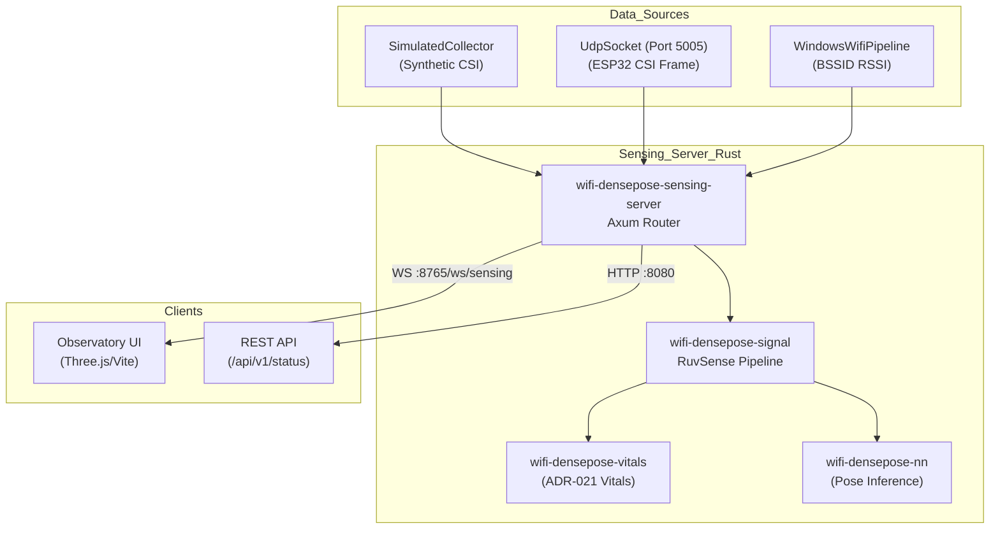
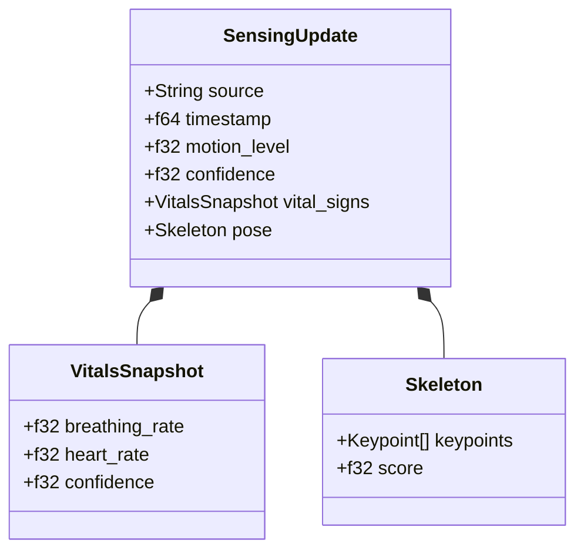

<!-- source: DeepWiki mcp.deepwiki.com · repo ruvnet/RuView · page 2.2 Running Your First Demo · fetched 2026-10-30 -->

# Running Your First Demo

<details>
<summary>Relevant source files</summary>

The following files were used as context for generating this wiki page:

- [CHANGELOG.md](CHANGELOG.md)
- [CLAUDE.md](CLAUDE.md)
- [README.md](README.md)
- [assets/ruview-hero-h3-v3.gif](assets/ruview-hero-h3-v3.gif)
- [assets/screen.png](assets/screen.png)
- [docker/Dockerfile.rust](docker/Dockerfile.rust)
- [docker/docker-compose.yml](docker/docker-compose.yml)
- [docker/docker-entrypoint.sh](docker/docker-entrypoint.sh)
- [docs/TROUBLESHOOTING.md](docs/TROUBLESHOOTING.md)
- [docs/adr/ADR-355-local-empty-room-bootstrap-prior.md](docs/adr/ADR-355-local-empty-room-bootstrap-prior.md)
- [docs/adr/ADR-357-raw-csi-calibration-sample-integrity.md](docs/adr/ADR-357-raw-csi-calibration-sample-integrity.md)
- [docs/readme-details.md](docs/readme-details.md)
- [docs/user-guide.md](docs/user-guide.md)
- [firmware/esp32-csi-node/components/wasm3/CMakeLists.txt](firmware/esp32-csi-node/components/wasm3/CMakeLists.txt)
- [firmware/esp32-csi-node/main/swarm_bridge.c](firmware/esp32-csi-node/main/swarm_bridge.c)
- [plans/overview.md](plans/overview.md)
- [scripts/udp-relay.py](scripts/udp-relay.py)
- [tests/test_docker_entrypoint.sh](tests/test_docker_entrypoint.sh)
- [ui/README.md](ui/README.md)
- [ui/config/api.config.js](ui/config/api.config.js)
- [ui/start-ui.sh](ui/start-ui.sh)
- [ui/tests/integration-test.html](ui/tests/integration-test.html)
- [ui/utils/backend-detector.js](ui/utils/backend-detector.js)
- [v2/Cargo.lock](v2/Cargo.lock)
- [v2/Cargo.toml](v2/Cargo.toml)
- [v2/crates/wifi-densepose-desktop/src/commands/server.rs](v2/crates/wifi-densepose-desktop/src/commands/server.rs)
- [v2/crates/wifi-densepose-sensing-server/Cargo.toml](v2/crates/wifi-densepose-sensing-server/Cargo.toml)
- [v2/crates/wifi-densepose-sensing-server/README.md](v2/crates/wifi-densepose-sensing-server/README.md)
- [v2/crates/wifi-densepose-sensing-server/src/bootstrap_baseline.rs](v2/crates/wifi-densepose-sensing-server/src/bootstrap_baseline.rs)
- [v2/crates/wifi-densepose-sensing-server/src/field_bridge.rs](v2/crates/wifi-densepose-sensing-server/src/field_bridge.rs)
- [v2/crates/wifi-densepose-sensing-server/src/lib.rs](v2/crates/wifi-densepose-sensing-server/src/lib.rs)
- [v2/crates/wifi-densepose-sensing-server/src/main.rs](v2/crates/wifi-densepose-sensing-server/src/main.rs)
- [v2/crates/wifi-densepose-signal/src/ruvsense/field_model.rs](v2/crates/wifi-densepose-signal/src/ruvsense/field_model.rs)

</details>


This guide walks you through launching the RuView sensing server, connecting the Observatory UI, and interpreting the first pose and vital signs output. It covers both the high-fidelity **ESP32 hardware path** and the **simulated data path** for immediate testing.

Sources: [README.md:24-35](), [docs/user-guide.md:19-24](), [CLAUDE.md:18-21]()

---

## 1. Launching the Sensing Server

The sensing server (implemented in the `wifi-densepose-sensing-server` crate) is a lightweight Axum-based application that acts as the central hub for the RuView ecosystem. It aggregates CSI data from hardware or simulation, processes it using the `wifi-densepose-signal` crate, and broadcasts real-time updates via WebSockets.

Sources: [v2/crates/wifi-densepose-sensing-server/src/main.rs:1-9](), [CLAUDE.md:18-19]()

### Option A: Simulated Mode (No Hardware)
Ideal for verifying the installation and exploring the UI features immediately. The server generates synthetic CSI frames that mimic human movement and breathing patterns.

```bash
# Using Docker
docker run -e CSI_SOURCE=simulated -p 8080:8080 -p 8765:8765 ruvnet/wifi-densepose:latest

# Using the Rust binary (from v2 workspace)
cd v2
cargo run -p wifi-densepose-sensing-server -- --source simulate
```
Sources: [docs/user-guide.md:96-105](), [v2/crates/wifi-densepose-sensing-server/src/main.rs:118-120]()

### Option B: Hardware Mode (ESP32-S3)
Connects to real sensors for live environment monitoring. The server listens for UDP packets containing CSI data (default port 5005).

```bash
# Start server to listen for UDP CSI frames from ESP32
docker run -e CSI_SOURCE=esp32 -p 8080:8080 -p 5005:5005/udp ruvnet/wifi-densepose:latest
```
Sources: [docs/user-guide.md:105-105](), [v2/crates/wifi-densepose-sensing-server/src/main.rs:80-82](), [CLAUDE.md:80-82]()

**Sensing Server Component Flow**:


Sources: [v2/crates/wifi-densepose-sensing-server/src/main.rs:1-9](), [v2/crates/wifi-densepose-sensing-server/src/main.rs:58-60](), [CLAUDE.md:10-21]()

---

## 2. Connecting the Observatory UI

The Observatory UI is a modular web interface served by the sensing server. It auto-detects the backend and establishes a WebSocket connection for real-time visualization.

1.  **Open the Browser**: Navigate to `http://localhost:8080`.
2.  **Verify Connection**: The UI establishes a connection to the WebSocket endpoint at `ws://localhost:8765/ws/sensing`.
3.  **Data Source Label**: The UI displays the current data source state managed by `SensingService`:
    *   **live**: Real ESP32 hardware connected.
    *   **server-simulated**: Server is running but using synthetic data.
    *   **reconnecting**: WebSocket disconnected; the service is retrying.
    *   **simulated**: Client-side fallback simulation (used if the server is unreachable).

Sources: [v2/crates/wifi-densepose-sensing-server/src/main.rs:72-78]()

### UI Service Architecture
The `SensingService` in the browser manages the lifecycle of the data stream and provides the fallback logic.

| State | Logic | Source |
|-------|-------|--------|
| **connected** | Receives `SensingUpdate` JSON | `v2/crates/wifi-densepose-sensing-server/src/main.rs` |
| **reconnecting** | Exponential backoff (max 20 attempts) | `v2/crates/wifi-densepose-sensing-server/src/main.rs` |
| **simulated** | Client-side fallback after 5 failed retries | `v2/crates/wifi-densepose-sensing-server/src/main.rs` |

Sources: [v2/crates/wifi-densepose-sensing-server/src/main.rs:1-9]()

---

## 3. Interpreting the Output

The system outputs a unified update message containing signal metrics, vital signs, and pose data.

### Vital Signs Panel
RuView extracts micro-vibrations from the CSI phase using the `wifi-densepose-vitals` crate.
*   **Breathing Rate**: Extracted via bandpass (0.1-0.5 Hz). Normal: 6-30 BPM.
*   **Heart Rate**: Extracted via bandpass (0.8-2.0 Hz). Normal: 40-120 BPM.
*   **Confidence Score**: A value [0.0, 1.0] indicating signal quality and SNR.

Sources: [README.md:55-58](), [v2/crates/wifi-densepose-sensing-server/src/main.rs:54-56]()

### 3D Pose Skeleton
The UI renders a 17-keypoint COCO skeleton based on the inference mode:
*   **Signal-Derived**: Procedural animation driven by motion variance and presence detection from `wifi-densepose-signal`.
*   **Model Inference**: High-fidelity pose reconstruction from a loaded RuVector (`.rvf`) model container via `wifi-densepose-nn`.

Sources: [README.md:61-61](), [v2/crates/wifi-densepose-sensing-server/src/main.rs:17-20](), [CLAUDE.md:11-13]()

**Data to Code Mapping (SensingUpdate)**:


Sources: [CHANGELOG.md:12-12](), [v2/crates/wifi-densepose-sensing-server/src/main.rs:54-56](), [CLAUDE.md:11-13]()

---

## 4. First Run Verification Checklist

To ensure your demo is running correctly, verify the following:

| Check | Component | Expected Result |
|-------|-----------|-----------------|
| **Backend Health** | `Axum Router` | Server starts on port 8080, logs "Connected" on startup |
| **WebSocket** | `SensingService` | Connection state moves to `connected`, `onData` callbacks receive JSON frames |
| **CSI Stream** | `SensingTab` | Real-time RSSI sparkline updating in the UI |
| **Vitals** | `VitalSignDetector` | BPM values appearing in the vital signs panel |
| **Pose** | `PoseTracker` | 17-keypoint skeleton rendering in the 3D viewport |

Sources: [v2/crates/wifi-densepose-sensing-server/src/main.rs:62-65]()

---

