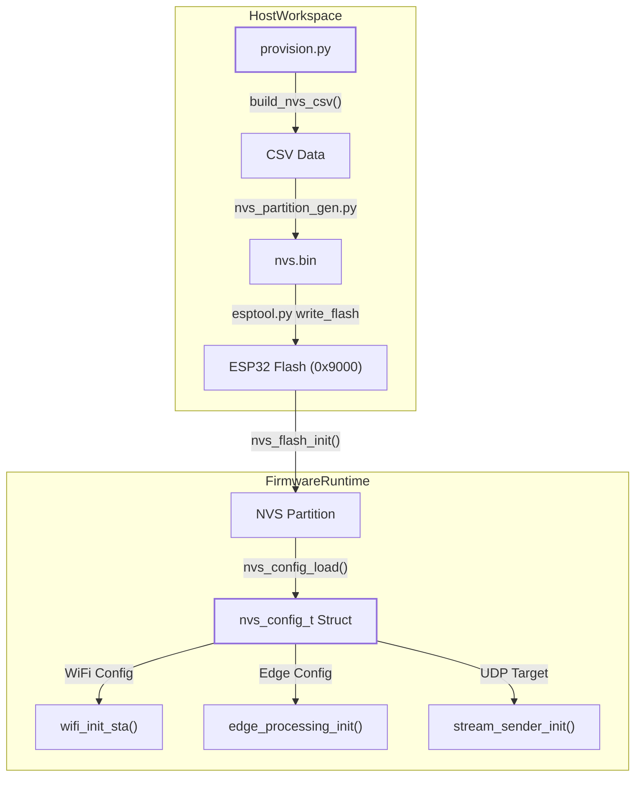
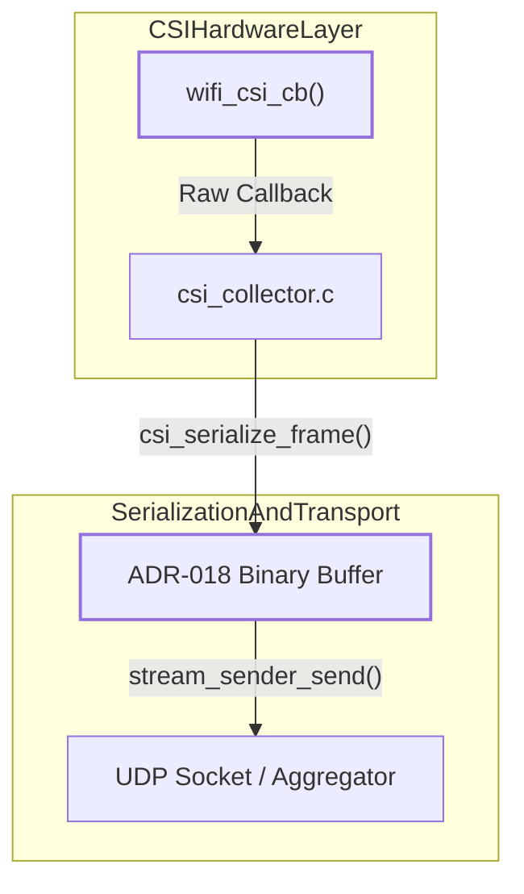

<!-- source: DeepWiki mcp.deepwiki.com · repo ruvnet/RuView · page 3.1 ESP32 Setup & Provisioning · fetched 2026-10-30 -->

# ESP32 Setup & Provisioning

Relevant source files

The following files were used as context for generating this wiki page:

- [docs/adr/ADR-057-firmware-csi-build-guard.md](docs/adr/ADR-057-firmware-csi-build-guard.md)
- [docs/adr/ADR-346-fail-closed-edge-occupancy-evidence.md](docs/adr/ADR-346-fail-closed-edge-occupancy-evidence.md)
- [docs/adr/ADR-362-on-node-log-access-is-on-demand.md](docs/adr/ADR-362-on-node-log-access-is-on-demand.md)
- [docs/validation/2026-08-31-esp32-c6-node7-rate-aware-sensing.md](docs/validation/2026-08-31-esp32-c6-node7-rate-aware-sensing.md)
- [docs/validation/2026-08-31-esp32-c6-occupancy-integrity.md](docs/validation/2026-08-31-esp32-c6-occupancy-integrity.md)
- [firmware/esp32-csi-node/main/csi_collector.c](firmware/esp32-csi-node/main/csi_collector.c)
- [firmware/esp32-csi-node/main/csi_collector.h](firmware/esp32-csi-node/main/csi_collector.h)
- [firmware/esp32-csi-node/main/node_log.c](firmware/esp32-csi-node/main/node_log.c)
- [firmware/esp32-csi-node/main/node_log.h](firmware/esp32-csi-node/main/node_log.h)
- [firmware/esp32-csi-node/main/ota_update.c](firmware/esp32-csi-node/main/ota_update.c)
- [firmware/esp32-csi-node/partitions_16mb.csv](firmware/esp32-csi-node/partitions_16mb.csv)
- [firmware/esp32-csi-node/provision.py](firmware/esp32-csi-node/provision.py)
- [firmware/esp32-csi-node/release_bins/bootloader.bin](firmware/esp32-csi-node/release_bins/bootloader.bin)
- [firmware/esp32-csi-node/release_bins/c6-adr110/SHA256SUMS.txt](firmware/esp32-csi-node/release_bins/c6-adr110/SHA256SUMS.txt)
- [firmware/esp32-csi-node/release_bins/c6-adr110/bootloader.bin](firmware/esp32-csi-node/release_bins/c6-adr110/bootloader.bin)
- [firmware/esp32-csi-node/release_bins/c6-adr110/esp32-csi-node.bin](firmware/esp32-csi-node/release_bins/c6-adr110/esp32-csi-node.bin)
- [firmware/esp32-csi-node/release_bins/esp32-csi-node-4mb.bin](firmware/esp32-csi-node/release_bins/esp32-csi-node-4mb.bin)
- [firmware/esp32-csi-node/release_bins/esp32-csi-node.bin](firmware/esp32-csi-node/release_bins/esp32-csi-node.bin)
- [firmware/esp32-csi-node/release_bins/partition-table-4mb.bin](firmware/esp32-csi-node/release_bins/partition-table-4mb.bin)
- [firmware/esp32-csi-node/release_bins/s3-adr110/SHA256SUMS.txt](firmware/esp32-csi-node/release_bins/s3-adr110/SHA256SUMS.txt)
- [firmware/esp32-csi-node/release_bins/s3-adr110/bootloader.bin](firmware/esp32-csi-node/release_bins/s3-adr110/bootloader.bin)
- [firmware/esp32-csi-node/release_bins/s3-adr110/esp32-csi-node.bin](firmware/esp32-csi-node/release_bins/s3-adr110/esp32-csi-node.bin)
- [firmware/esp32-csi-node/release_bins/version.txt](firmware/esp32-csi-node/release_bins/version.txt)
- [firmware/esp32-csi-node/sdkconfig.defaults](firmware/esp32-csi-node/sdkconfig.defaults)
- [firmware/esp32-csi-node/sdkconfig.defaults.16mb](firmware/esp32-csi-node/sdkconfig.defaults.16mb)
- [firmware/esp32-csi-node/sdkconfig.defaults.4mb](firmware/esp32-csi-node/sdkconfig.defaults.4mb)
- [firmware/esp32-csi-node/sdkconfig.defaults.template](firmware/esp32-csi-node/sdkconfig.defaults.template)
- [firmware/esp32-csi-node/tests/test_provision.py](firmware/esp32-csi-node/tests/test_provision.py)
- [firmware/esp32-csi-node/tests/test_provision_state.py](firmware/esp32-csi-node/tests/test_provision_state.py)
- [scripts/provision.py](scripts/provision.py)
- [verify](verify)

## Purpose and Scope

This page documents the setup, provisioning, and firmware configuration for ESP32 nodes (including ESP32-S3 and ESP32-C6 targets) within the RuView/WiFi DensePose system. Provisioning allows for the deployment of a unified firmware binary across multiple nodes by writing device-specific configurations—such as WiFi credentials, aggregator target IP, TDM slots, and edge intelligence tiers—to the Non-Volatile Storage (NVS) partition. This approach enables users to configure pre-built firmware binaries without recompiling the entire project [firmware/esp32-csi-node/provision.py:5-8]().

For information about:
- **Edge processing tiers** (Tier 0-3), see [Edge Intelligence Tiers](3.2)
- **Multi-node TDM coordination**, see [Multistatic Mesh & TDM Protocol](3.3)
- **Building from source**, see [Building from Source](10.1)

Sources: [firmware/esp32-csi-node/provision.py:5-8]()

---

## Overview

The provisioning system utilizes the ESP-IDF NVS (Non-Volatile Storage) component to store runtime parameters. The firmware is designed to prioritize NVS values found in the `csi_cfg` namespace, falling back to compile-time Kconfig defaults only if NVS keys are absent [firmware/esp32-csi-node/main/nvs_config.c:101-105]().

**Key Components:**
- **`provision.py`**: A Python utility that merges CLI flags with stored per-port state to generate and flash NVS partitions using `esptool.py` and `nvs-partition-gen` [firmware/esp32-csi-node/provision.py:14-33]().
- **`csi_collector.c`**: Registers the ESP-IDF WiFi CSI callback, applies rate-limiting and window gating, and serializes frames into the ADR-018 binary layout [firmware/esp32-csi-node/main/csi_collector.c:1-12]().
- **`sdkconfig.defaults.16mb`**: Configures extended flash layouts, coredumps to flash, and FAT storage volumes for on-node logging on 16MB variants [firmware/esp32-csi-node/sdkconfig.defaults.16mb:15-41]().

Sources: [firmware/esp32-csi-node/provision.py:14-33](), [firmware/esp32-csi-node/main/csi_collector.c:1-12](), [firmware/esp32-csi-node/sdkconfig.defaults.16mb:15-41]()

---

## NVS Configuration & Additive Provisioning

The system state is managed via the `nvs_config_t` structure, which aggregates network, sensing, and edge intelligence settings [firmware/esp32-csi-node/main/nvs_config.h:25-65]().

### Data Flow: Provisioning to Runtime

The following diagram illustrates how configuration moves from the host provisioning script into the active ESP32 firmware memory, mapping physical system interactions to specific code entities.

**Configuration Flow (Provisioning to Firmware)**

Sources: [firmware/esp32-csi-node/provision.py:53-57](), [firmware/esp32-csi-node/main/nvs_config.c:19-74]()

### Additive-by-Default Merging (Issues #391, #574)
Earlier versions of `provision.py` replaced the entire `csi_cfg` NVS namespace on every invocation, wiping any keys omitted from the command line. The script now implements an additive merge strategy:
1. Reads prior per-port state from the user's config directory (`.config/wifi-densepose/esp32-provision-state/`) [firmware/esp32-csi-node/provision.py:114-144]().
2. Overlays new CLI flags onto the stored state dictionary via `merge_state_into_args()` [firmware/esp32-csi-node/provision.py:160-175]().
3. Generates and flashes the updated NVS partition [firmware/esp32-csi-node/provision.py:25-30]().

Sources: [firmware/esp32-csi-node/provision.py:114-175]()

---

## Firmware Flashing & Flash Variants

Pre-built release binaries and SDK configurations support multiple flash capacities and SoC targets:

| Flash Variant | Partition CSV | Target SoC | Key Configuration Features |
| :--- | :--- | :--- | :--- |
| **4MB** | `partitions_display.csv` | ESP32-S3 / C6 | Compact layout for 4MB flash modules [firmware/esp32-csi-node/sdkconfig.defaults:7-13]() |
| **8MB** | `partitions_display.csv` | ESP32-S3 | OTA support, custom display partitions, 8MB Quad SPI [firmware/esp32-csi-node/sdkconfig.defaults:7-13]() |
| **16MB** | `partitions_16mb.csv` | ESP32-C6 | Extended OTA slots (1.9MB), flash coredump (`CONFIG_ESP_COREDUMP_ENABLE_TO_FLASH`), FAT storage volume (`storage` partition) [firmware/esp32-csi-node/sdkconfig.defaults.16mb:15-41]() |

Sources: [firmware/esp32-csi-node/sdkconfig.defaults:7-13](), [firmware/esp32-csi-node/sdkconfig.defaults.16mb:15-41]()

---

## ADR-018 CSI Frame Format & Pipeline

CSI data captured by the WiFi driver is serialized into the ADR-018 binary layout for UDP transmission [firmware/esp32-csi-node/main/csi_collector.c:3-6]().

### Binary Layout Structure
- **[0..3] Magic Number**: `0xC5110001` (Little Endian) [firmware/esp32-csi-node/main/csi_collector.h:14-15]()
- **[4] Node ID**: Unique identifier for the source node [firmware/esp32-csi-node/main/csi_collector.c:144]()
- **[5] Antennas**: Number of active RX antennas [firmware/esp32-csi-node/main/csi_collector.c:160]()
- **[6..7] Subcarriers**: Little-endian `uint16_t` count [firmware/esp32-csi-node/main/csi_collector.c:161]()
- **[8..11] Frequency**: Derived frequency in MHz (`uint32_t`) [firmware/esp32-csi-node/main/csi_collector.c:171]()
- **[12..15] Sequence Number**: Monotonically increasing frame sequence [firmware/esp32-csi-node/main/csi_collector.c:148]()
- **[16..17] RSSI / Noise Floor**: Signed 8-bit signal metrics [firmware/esp32-csi-node/main/csi_collector.c:149-150]()
- **[20..] I/Q Payload**: Raw subcarrier phase and amplitude data bytes [firmware/esp32-csi-node/main/csi_collector.c:152]()

### Serialization Architecture

The following diagram maps the CSI data collection flow from hardware callbacks to network serialization.

**CSI Serialization Pipeline**

Sources: [firmware/esp32-csi-node/main/csi_collector.c:3-172](), [firmware/esp32-csi-node/main/csi_collector.h:14-65]()

---

## On-Node Logging & Diagnostics

For 16MB targets, `sdkconfig.defaults.16mb` enables flash-based coredumps and a FAT filesystem storage partition (`storage`) managed by `node_log.c` [firmware/esp32-csi-node/sdkconfig.defaults.16mb:34-40](). 
- **Crash Recovery**: Coredumps are written in ELF format with CRC32 checksums (`CONFIG_ESP_COREDUMP_ENABLE_TO_FLASH`) to diagnose watchdog resets and memory faults [firmware/esp32-csi-node/sdkconfig.defaults.16mb:34-37]().
- **On-Demand Access**: In accordance with ADR-362, raw log access is handled on-demand via HTTP/Serial endpoints rather than continuous verbose spamming.

Sources: [firmware/esp32-csi-node/sdkconfig.defaults.16mb:34-40](), [docs/adr/ADR-362-on-node-log-access-is-on-demand.md:1-1]()

---

## Security & Operational Hardening

- **OTA Authentication (ADR-050)**: The HTTP OTA server runs on port 8032 (`/ota` and `/ota/status`) [firmware/esp32-csi-node/main/ota_update.c:23-104](). Unprovisioned nodes fail closed, rejecting all firmware uploads until a valid Bearer token matching `ota_psk` is presented [firmware/esp32-csi-node/main/ota_update.c:45-80]().
- **Fail-Closed Occupancy Evidence (ADR-346)**: Firmware person slots are subordinate to the debounced presence gate. When presence is false, person counts and slot histories are explicitly cleared to prevent empty-room calibration contamination [docs/adr/ADR-346-fail-closed-edge-occupancy-evidence.md:17-27]().

Sources: [firmware/esp32-csi-node/main/ota_update.c:23-104](), [docs/adr/ADR-346-fail-closed-edge-occupancy-evidence.md:17-27]()

---

