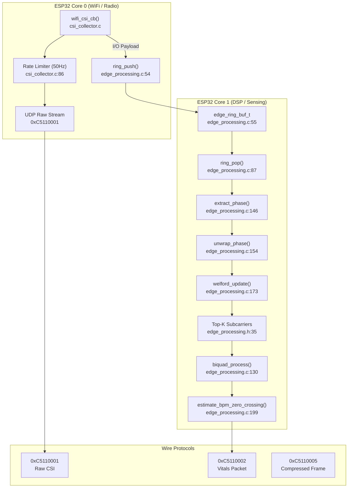
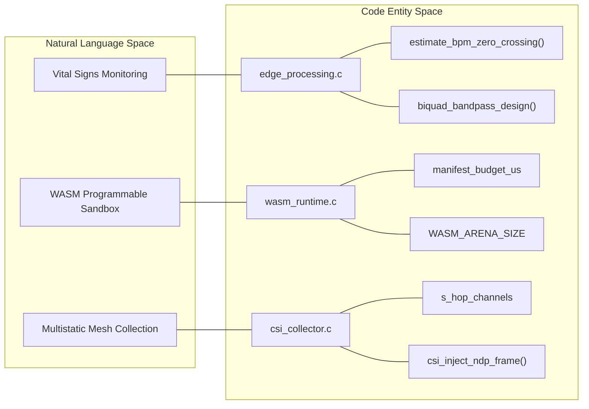
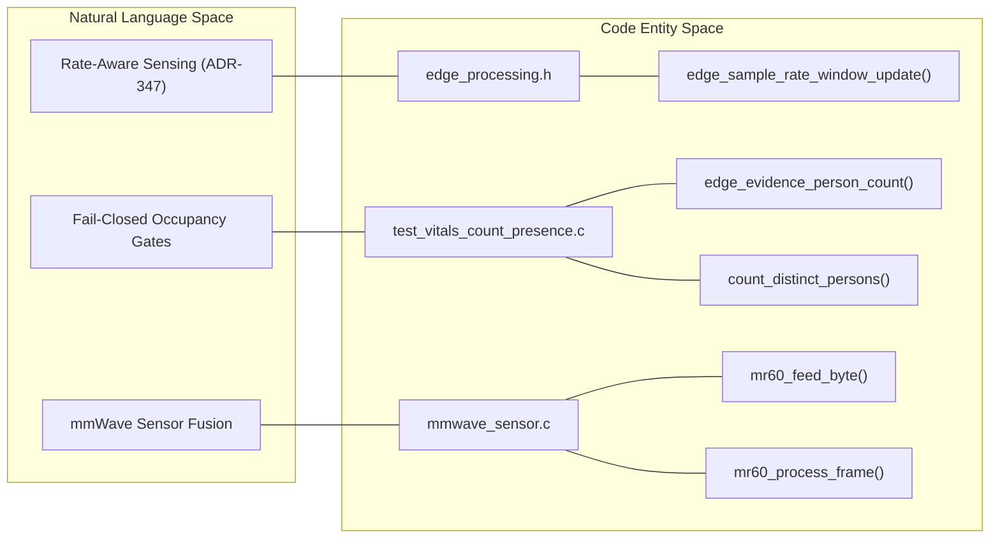

<!-- source: DeepWiki mcp.deepwiki.com · repo ruvnet/RuView · page 3.2 Edge Intelligence Tiers · fetched 2026-10-30 -->

# Edge Intelligence Tiers

Relevant source files

The following files were used as context for generating this wiki page:

- [docs/adr/ADR-018-esp32-dev-implementation.md](docs/adr/ADR-018-esp32-dev-implementation.md)
- [docs/adr/ADR-029-ruvsense-multistatic-sensing-mode.md](docs/adr/ADR-029-ruvsense-multistatic-sensing-mode.md)
- [docs/adr/ADR-039-esp32-edge-intelligence.md](docs/adr/ADR-039-esp32-edge-intelligence.md)
- [docs/adr/ADR-066-esp32-swarm-seed-coordinator.md](docs/adr/ADR-066-esp32-swarm-seed-coordinator.md)
- [docs/adr/ADR-068-per-node-state-pipeline.md](docs/adr/ADR-068-per-node-state-pipeline.md)
- [docs/adr/ADR-069-cognitum-seed-csi-pipeline.md](docs/adr/ADR-069-cognitum-seed-csi-pipeline.md)
- [docs/adr/ADR-347-rate-aware-esp32-temporal-sensing.md](docs/adr/ADR-347-rate-aware-esp32-temporal-sensing.md)
- [docs/research/architecture/implementation-plan.md](docs/research/architecture/implementation-plan.md)
- [docs/research/architecture/ruvsense-multistatic-fidelity-architecture.md](docs/research/architecture/ruvsense-multistatic-fidelity-architecture.md)
- [docs/research/arena-physica/arena-physica-analysis.md](docs/research/arena-physica/arena-physica-analysis.md)
- [docs/research/arena-physica/arena-physica-studio-analysis.md](docs/research/arena-physica/arena-physica-studio-analysis.md)
- [docs/validation/2026-08-31-esp32-c6-rate-aware-sensing.md](docs/validation/2026-08-31-esp32-c6-rate-aware-sensing.md)
- [docs/validation/2026-08-31-esp32-s3-rate-aware-transport.md](docs/validation/2026-08-31-esp32-s3-rate-aware-transport.md)
- [examples/happiness-vector/provision_swarm.sh](examples/happiness-vector/provision_swarm.sh)
- [firmware/esp32-csi-node/main/display_ui.c](firmware/esp32-csi-node/main/display_ui.c)
- [firmware/esp32-csi-node/main/edge_processing.c](firmware/esp32-csi-node/main/edge_processing.c)
- [firmware/esp32-csi-node/main/edge_processing.h](firmware/esp32-csi-node/main/edge_processing.h)
- [firmware/esp32-csi-node/main/mmwave_detect.h](firmware/esp32-csi-node/main/mmwave_detect.h)
- [firmware/esp32-csi-node/main/mmwave_sensor.c](firmware/esp32-csi-node/main/mmwave_sensor.c)
- [firmware/esp32-csi-node/main/wasm_runtime.c](firmware/esp32-csi-node/main/wasm_runtime.c)
- [firmware/esp32-csi-node/release_bins/c6-onboarding/SHA256SUMS.txt](firmware/esp32-csi-node/release_bins/c6-onboarding/SHA256SUMS.txt)
- [firmware/esp32-csi-node/release_bins/c6-onboarding/bootloader.bin](firmware/esp32-csi-node/release_bins/c6-onboarding/bootloader.bin)
- [firmware/esp32-csi-node/release_bins/c6-onboarding/esp32-csi-node.bin](firmware/esp32-csi-node/release_bins/c6-onboarding/esp32-csi-node.bin)
- [firmware/esp32-csi-node/release_bins/c6-onboarding/ota_data_initial.bin](firmware/esp32-csi-node/release_bins/c6-onboarding/ota_data_initial.bin)
- [firmware/esp32-csi-node/release_bins/c6-onboarding/partition-table.bin](firmware/esp32-csi-node/release_bins/c6-onboarding/partition-table.bin)
- [firmware/esp32-csi-node/sdkconfig.defaults.esp32c6](firmware/esp32-csi-node/sdkconfig.defaults.esp32c6)
- [firmware/esp32-csi-node/test/test_mmwave_detect.c](firmware/esp32-csi-node/test/test_mmwave_detect.c)
- [firmware/esp32-csi-node/test/test_vitals_count_presence.c](firmware/esp32-csi-node/test/test_vitals_count_presence.c)
- [v2/crates/wifi-densepose-sensing-server/src/types.rs](v2/crates/wifi-densepose-sensing-server/src/types.rs)

This page details the on-device edge processing and intelligence tiers implemented on ESP32-S3 and ESP32-C6 nodes within the RuView system. These tiers execute signal conditioning, vital sign estimation, mmWave sensor fusion, rate-aware temporal tracking, and programmable WASM logic locally on the edge node before transmitting compact payloads to the sensing server. This architecture minimizes network bandwidth, reduces latency for safety-critical events like falls, and offloads computation from the central aggregator.

For hardware setup and provisioning, see [3.1 ESP32 Setup & Provisioning](). For multistatic node synchronization and TDM protocols, see [3.3 Multistatic Mesh & TDM Protocol]().

---

## Overview & Tier Matrix

The edge intelligence architecture uses a progressive enhancement strategy governed by active NVS configuration (`edge_tier`) [docs/adr/ADR-039-esp32-edge-intelligence.md:93](). A single firmware binary supports all four operating tiers depending on available hardware resources and power constraints.

| Tier | Name | Processing Pipeline | RAM Overhead | Bandwidth | Latency | Target Use Case |
|------|------|---------------------|--------------|-----------|---------|-----------------|
| **0** | Raw Passthrough | None (direct frame serialization) | 0 KB | ~100 KB/s/node | ~500 ms (server RTT) | Full server-side algorithm flexibility [docs/adr/ADR-039-esp32-edge-intelligence.md:20-21]() |
| **1** | Signal Processing | Phase unwrap, Welford variance, top-K selection, delta compression | ~30 KB | 30-50 KB/s/node | ~500 ms | Bandwidth-constrained mesh links [docs/adr/ADR-039-esp32-edge-intelligence.md:23-28]() |
| **2** | Vital Signs | Tier 1 + biquad bandpass filters, zero-crossing BPM, adaptive presence, fall detection, mmWave fusion | ~33 KB | 32 bytes @ 1 Hz | <50 ms (on-device) | Battery-powered, safety-critical occupancy monitoring [docs/adr/ADR-039-esp32-edge-intelligence.md:29-37]() |
| **3** | WASM Modules | Custom user-defined logic via WASM3 interpreter in PSRAM arena | ~160 KB/slot | Variable | Variable | Programmable edge analytics & modular detectors [docs/adr/ADR-040-wasm-programmable-sensing.md:1-20]() |

Sources: [firmware/esp32-csi-node/main/edge_processing.h:157-164](), [docs/adr/ADR-039-esp32-edge-intelligence.md:20-37]()

---

## Dual-Core DSP Pipeline & SPSC Ring Buffer

The edge processing pipeline leverages the dual-core architecture of the ESP32-S3 (or pinned tasks on unicore targets like the ESP32-C6). Core 0 handles the high-frequency Wi-Fi radio callbacks (`wifi_csi_cb`) and pushes raw CSI frames into a lock-free Single-Producer Single-Consumer (SPSC) ring buffer (`edge_ring_buf_t`). Core 1 runs the DSP task, popping frames from the ring buffer to execute the signal processing and vital signs pipelines without blocking radio interrupts [firmware/esp32-csi-node/main/edge_processing.c:3-19]().

**Diagram: Dual-Core SPSC Pipeline Architecture**

Sources: [firmware/esp32-csi-node/main/edge_processing.c:3-19](), [firmware/esp32-csi-node/main/edge_processing.h:31-35](), [docs/adr/ADR-039-esp32-edge-intelligence.md:41-55]()

---

## The Four Edge Intelligence Tiers

### Tier 0 — Raw Passthrough
No on-device filtering is performed. CSI frames are captured via the Wi-Fi driver, packaged into the ADR-018 binary frame layout with magic `0xC5110001`, and transmitted over UDP to the central aggregator [firmware/esp32-csi-node/main/csi_collector.c:122-184](). Rate-limiting guards are enforced to prevent `ENOMEM` buffer exhaustion in the lwIP stack [firmware/esp32-csi-node/main/csi_collector.c:69-70]().

Sources: [firmware/esp32-csi-node/main/csi_collector.c:63-89](), [docs/adr/ADR-018-esp32-dev-implementation.md:36-50]()

### Tier 1 — Signal Processing
Tier 1 introduces local signal conditioning to reduce network bandwidth without sacrificing analytical fidelity:
1. **Phase Extraction & Unwrapping:** Converts raw I/Q pairs into radians via `atan2f` and eliminates $2\pi$ phase jumps to preserve continuous wave trains [firmware/esp32-csi-node/main/edge_processing.c:146-160]().
2. **Welford Running Variance:** Maintains online running mean and variance (`edge_welford_t`) per subcarrier to evaluate motion energy without large memory overhead [firmware/esp32-csi-node/main/edge_processing.c:166-185]().
3. **Top-K Subcarrier Selection:** Selects the top $K$ subcarriers (`EDGE_TOP_K = 8`) exhibiting the highest variance for subsequent vital sign extraction [firmware/esp32-csi-node/main/edge_processing.h:35]().
4. **Delta Compression:** Compresses frames using XOR delta encoding combined with Run-Length Encoding (RLE), transmitting under magic `0xC5110005` to achieve a 30% to 70% bandwidth reduction [docs/adr/ADR-039-esp32-edge-intelligence.md:76-86]().

Sources: [firmware/esp32-csi-node/main/edge_processing.c:8-11](), [firmware/esp32-csi-node/main/edge_processing.h:29-35]()

### Tier 2 — Vital Signs & Sensor Fusion
Tier 2 runs full on-device telemetry extraction:
- **Biquad IIR Bandpass Filters:** 2nd-order Butterworth filters isolate respiration (0.1–0.5 Hz) and heart rate (0.8–2.0 Hz) bands [firmware/esp32-csi-node/main/edge_processing.c:112-139]().
- **Zero-Crossing BPM Estimator:** Evaluates positive zero-crossings over the phase history buffer (`EDGE_PHASE_HISTORY_LEN`) to derive breathing and heart rate [firmware/esp32-csi-node/main/edge_processing.c:189-200]().
- **Adaptive Presence Detection:** Calibrates against ambient baseline noise over 1,200 frames (~60 seconds) using a $3\sigma$ threshold multiplier (`EDGE_CALIB_SIGMA_MULT`) [firmware/esp32-csi-node/main/edge_processing.h:136-141]().

Sources: [firmware/esp32-csi-node/main/edge_processing.c:12-16](), [firmware/esp32-csi-node/main/edge_processing.h:136-141]()

### Tier 3 — WASM Runtime & Budget Guard
Tier 3 executes user-defined WebAssembly modules loaded into PSRAM:
- **Sandbox Interpreter:** Uses the WASM3 runtime engine to execute compiled `.rvf` modules safely on-device [firmware/esp32-csi-node/main/wasm_runtime.c:48]().
- **Budget Guard:** Enforces `manifest_budget_us` execution time limits per module invocation. If execution exceeds the allocated budget, the runtime preempts the module to protect critical Wi-Fi and DSP task schedulers [firmware/esp32-csi-node/main/wasm_runtime.c:61-63]().
- **Host Imports:** Exposes safe host functions (`host_csi_get_phase`, `host_csi_get_bpm_breathing`) for module interaction [firmware/esp32-csi-node/main/wasm_runtime.c:112-169]().

Sources: [firmware/esp32-csi-node/main/wasm_runtime.c:1-77](), [docs/adr/ADR-040-wasm-programmable-sensing.md:1-20]()

---

## Rate-Aware Sensing (ADR-347)

Delivered via firmware version 0.8.8 and ADR-347, rate-aware temporal sensing decouples raw Wi-Fi probe packet transmission from the edge DSP processing clock [docs/adr/ADR-347-rate-aware-esp32-temporal-sensing.md:1-10]().

- **Independent Cadence Contracts:** While the connected STA probe can burst up to 50 Hz to maintain network link activity, temporal filters cannot reliably assume a uniform frame arrival cadence due to channel contention and callback gating [docs/adr/ADR-347-rate-aware-esp32-temporal-sensing.md:10-31]().
- **Measured Sample-Rate Tracking:** `edge_sample_rate_window_update()` tracks actual delivered frame intervals over one-to-three-second timestamp windows, smoothing instantaneous frequency through an Exponential Moving Average (EMA) with $\alpha = 0.25$ within an 8 to 60 Hz valid range (`EDGE_SAMPLE_RATE_MIN_HZ`, `EDGE_SAMPLE_RATE_MAX_HZ`) [firmware/esp32-csi-node/main/edge_processing.h:71-93]().
- **Hardware-Specific Target Clocks:** Unicore ESP32-C6 nodes limit Tier 2 DSP ingestion to a sustainable 8 Hz (`CONFIG_EDGE_DSP_SAMPLE_HZ`), maintaining a 4 Hz Nyquist limit for vital bands without buffer starvation, whereas ESP32-S3 nodes default to 20 Hz [firmware/esp32-csi-node/sdkconfig.defaults.esp32c6:63-64](), [docs/adr/ADR-347-rate-aware-esp32-temporal-sensing.md:55-60]().

Sources: [firmware/esp32-csi-node/main/edge_processing.h:71-93](), [firmware/esp32-csi-node/sdkconfig.defaults.esp32c6:63-64](), [docs/adr/ADR-347-rate-aware-esp32-temporal-sensing.md:1-85]()

---

## mmWave Sensor Fusion

Tier 2 and fused edge nodes integrate serial UART drivers for 60 GHz and 24 GHz mmWave radar modules (such as the Seeed MR60BHA2 and HLK-LD2410) via `mmwave_sensor.c` [firmware/esp32-csi-node/main/mmwave_sensor.c:1-30]().

- **Frame Parsing:** Asynchronously parses binary packets (such as the Seeed protocol starting with SOF `0x01`, frame type headers, and XOR checksum validation) [firmware/esp32-csi-node/main/mmwave_sensor.c:55-85]().
- **Cross-Modal Telemetry:** Extracts breathing rate (`MR60_TYPE_BREATHING`), heart rate (`MR60_TYPE_HEARTRATE`), target distance (`MR60_TYPE_DISTANCE`), and presence state (`MR60_TYPE_PRESENCE`), combining radar telemetry with Wi-Fi CSI features in fused broadcast packets [firmware/esp32-csi-node/main/mmwave_sensor.c:106-155]().
- **Mock Simulation:** Under QEMU or test configurations (`CONFIG_CSI_MOCK_ENABLED`), a synthetic data generator supplies deterministic vital sign streams for pipeline verification [firmware/esp32-csi-node/main/mmwave_sensor.c:39-42]().

Sources: [firmware/esp32-csi-node/main/mmwave_sensor.c:1-55](), [firmware/esp32-csi-node/main/mmwave_sensor.h:1-50]()

---

## Fail-Closed Occupancy Evidence

To eliminate over-counting anomalies and occupancy flickers (addressed in issues #998 and #996), the edge firmware enforces strict wire-level occupancy invariants and robustness gates [firmware/esp32-csi-node/main/edge_processing.h:99-135]().

- **Presence Gate Invariant:** Subcarrier group count estimates are strictly subordinate to the independent presence detection flag. If the presence gate is false, occupancy evidence cannot assert an occupant (`edge_evidence_person_count`) [firmware/esp32-csi-node/main/edge_processing.h:106-110]().
- **Energy Gate:** Subcarrier clusters must exhibit phase variance exceeding a minimum fraction of the dominant group's variance (`EDGE_PERSON_MIN_ENERGY_RATIO = 0.35`) to be considered valid human presence rather than multipath noise [firmware/esp32-csi-node/main/edge_processing.h:132]().
- **Spatial Deduplication:** Candidate subcarrier groups whose peak bins sit within `EDGE_PERSON_MIN_SC_SEP` (4 subcarriers) of each other are merged to prevent reflection splitting from registering phantom individuals [firmware/esp32-csi-node/main/edge_processing.h:133]().
- **Persistence Debounce:** Count changes must persist for `EDGE_PERSON_PERSIST_FRAMES` (3 consecutive decisions) before emission [firmware/esp32-csi-node/main/edge_processing.h:134]().

Sources: [firmware/esp32-csi-node/main/edge_processing.h:99-135](), [firmware/esp32-csi-node/test/test_vitals_count_presence.c:1-40]()

---

## Code-Entity Mapping

The following diagrams bridge natural language concepts to concrete code symbols in the repository.

**Diagram: Concepts to Code Entities (Part 1)**

Sources: [firmware/esp32-csi-node/main/edge_processing.c:112](), [firmware/esp32-csi-node/main/wasm_runtime.c:48](), [firmware/esp32-csi-node/main/csi_collector.c:70]()

**Diagram: Concepts to Code Entities (Part 2)**

Sources: [firmware/esp32-csi-node/main/edge_processing.h:77](), [firmware/esp32-csi-node/test/test_vitals_count_presence.c:48](), [firmware/esp32-csi-node/main/mmwave_sensor.c:106]()

---

