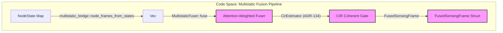

<!-- source: DeepWiki mcp.deepwiki.com · repo ruvnet/RuView · page 3.3 Multistatic Mesh & TDM Protocol · fetched 2026-10-30 -->

# Multistatic Mesh & TDM Protocol

<details>
<summary>Relevant source files</summary>

The following files were used as context for generating this wiki page:

- [docs/adr/ADR-012-esp32-csi-sensor-mesh.md](docs/adr/ADR-012-esp32-csi-sensor-mesh.md)
- [docs/adr/ADR-052-tauri-desktop-frontend.md](docs/adr/ADR-052-tauri-desktop-frontend.md)
- [docs/adr/ADR-148-drone-swarm-control-system.md](docs/adr/ADR-148-drone-swarm-control-system.md)
- [docs/adr/ADR-164-adr-corpus-gap-analysis.md](docs/adr/ADR-164-adr-corpus-gap-analysis.md)
- [docs/adr/ADR-166-quality-engineering-security-hardening.md](docs/adr/ADR-166-quality-engineering-security-hardening.md)
- [docs/adr/ADR-167-ddd-bounded-contexts.md](docs/adr/ADR-167-ddd-bounded-contexts.md)
- [docs/adr/ADR-168-benchmark-proof.md](docs/adr/ADR-168-benchmark-proof.md)
- [docs/adr/ADR-169-adam-mode-light-theme.md](docs/adr/ADR-169-adam-mode-light-theme.md)
- [docs/adr/gap-analysis/census.md](docs/adr/gap-analysis/census.md)
- [docs/adr/gap-analysis/lens-findings.md](docs/adr/gap-analysis/lens-findings.md)
- [docs/research/ruview-beyond-sota/01-sota-landscape-2026.md](docs/research/ruview-beyond-sota/01-sota-landscape-2026.md)
- [docs/research/ruview-beyond-sota/02-beyond-sota-architecture.md](docs/research/ruview-beyond-sota/02-beyond-sota-architecture.md)
- [docs/research/ruview-beyond-sota/04-optimization-roadmap.md](docs/research/ruview-beyond-sota/04-optimization-roadmap.md)
- [firmware/esp32-csi-node/main/c6_antenna_select.c](firmware/esp32-csi-node/main/c6_antenna_select.c)
- [firmware/esp32-csi-node/main/c6_antenna_select.h](firmware/esp32-csi-node/main/c6_antenna_select.h)
- [firmware/esp32-csi-node/main/c6_lp_core.c](firmware/esp32-csi-node/main/c6_lp_core.c)
- [firmware/esp32-csi-node/main/rv_mesh.c](firmware/esp32-csi-node/main/rv_mesh.c)
- [firmware/esp32-csi-node/main/stream_sender.c](firmware/esp32-csi-node/main/stream_sender.c)
- [firmware/esp32-csi-node/main/stream_sender.h](firmware/esp32-csi-node/main/stream_sender.h)
- [firmware/esp32-csi-node/sdkconfig.defaults.xiao-external](firmware/esp32-csi-node/sdkconfig.defaults.xiao-external)
- [firmware/esp32-csi-node/sdkconfig.defaults.xiao-internal](firmware/esp32-csi-node/sdkconfig.defaults.xiao-internal)
- [v2/crates/wifi-densepose-engine/Cargo.toml](v2/crates/wifi-densepose-engine/Cargo.toml)
- [v2/crates/wifi-densepose-engine/benches/engine_cycle.rs](v2/crates/wifi-densepose-engine/benches/engine_cycle.rs)
- [v2/crates/wifi-densepose-engine/src/lib.rs](v2/crates/wifi-densepose-engine/src/lib.rs)
- [v2/crates/wifi-densepose-sensing-server/src/engine_bridge.rs](v2/crates/wifi-densepose-sensing-server/src/engine_bridge.rs)
- [v2/crates/wifi-densepose-sensing-server/src/multistatic_bridge.rs](v2/crates/wifi-densepose-sensing-server/src/multistatic_bridge.rs)
- [v2/crates/wifi-densepose-signal/src/hardware_norm.rs](v2/crates/wifi-densepose-signal/src/hardware_norm.rs)
- [v2/crates/wifi-densepose-signal/src/ruvsense/evolution.rs](v2/crates/wifi-densepose-signal/src/ruvsense/evolution.rs)
- [v2/crates/wifi-densepose-signal/src/ruvsense/multistatic.rs](v2/crates/wifi-densepose-signal/src/ruvsense/multistatic.rs)

</details>


## Purpose and Scope

This document details the Time Division Multiplexing (TDM) coordination protocol that enables multistatic WiFi sensing across multiple ESP32 edge nodes. The TDM protocol orchestrates $N \times (N-1)$ bistatic links from $N$ nodes by scheduling each node to transmit in a dedicated time slot while all others receive, producing multi-viewpoint geometric diversity for pose estimation and vital sign monitoring.

**Scope**: TDM sync beacons, slot scheduling, clock drift handling, ESP-NOW epoch alignment (ADR-110), secure TDM transport, C6 low-power core hibernation, antenna selection, and QEMU swarm testing.

Sources: [v2/crates/wifi-densepose-signal/src/ruvsense/multistatic.rs:1-28](), [firmware/esp32-csi-node/main/c6_lp_core.c:1-22]()

---

## TDM Protocol & Multistatic Fusion Architecture

The TDM protocol coordinates a mesh of ESP32 nodes where each node alternates between transmitter (TX) and receiver (RX) roles in a synchronous schedule. 

In the Rust sensing library, `MultistaticFuser` and `MultistaticConfig` coordinate incoming frames across nodes. Due to real-world slot offsets in an $N$-slot TDMA mesh, the timestamp spread across node frames within a single cycle corresponds to the slot duration rather than clock jitter [v2/crates/wifi-densepose-signal/src/ruvsense/multistatic.rs:91-111](). Accordingly, `MultistaticConfig` defines a hard guard interval of **60,000 µs (60 ms)** and a soft guard interval of **20,000 µs (20 ms)** [v2/crates/wifi-densepose-signal/src/ruvsense/multistatic.rs:134-148]().


*Diagram 1: Multistatic fusion pipeline mapping configuration and data flow across code entities.*

Sources: [v2/crates/wifi-densepose-signal/src/ruvsense/multistatic.rs:91-148](), [v2/crates/wifi-densepose-sensing-server/src/multistatic_bridge.rs:98-121]()

---

## UDP Transport, Buffer Management & ENOMEM Backoff

High-rate CSI streaming from ESP32 nodes to the aggregator can saturate `lwIP` network buffers. To prevent device crashes (`Guru Meditation`), the firmware implements strict rate control and exponential backoff on `sendto()` failures.

When `sendto()` returns `ENOMEM`, `stream_sender_send()` suppresses subsequent bulk packets and engages an exponential backoff cooldown (`s_enomem_streak`) ranging from 100 ms up to 2,000 ms [firmware/esp32-csi-node/main/stream_sender.c:23-45](). Low-rate control packets (≤48 bytes, ≤1 Hz) bypass this global backoff via `stream_sender_send_priority()` to ensure mesh sync and telemetry traffic are never starved [firmware/esp32-csi-node/main/stream_sender.c:131-161]().

```mermaid
graph TD
    subgraph "Code Space: Stream Sender Transmission & Backoff"
        CSIEvent["CSI Packet Ready"] -->| "stream_sender_send()" | BackoffCheck{"s_backoff_until_us expired?"}
        BackoffCheck -->| "No" | DropPacket["Drop & Increment s_enomem_suppressed"]
        BackoffCheck -->| "Yes" | SocketSend["sendto() Socket Call"]
        SocketSend -->| "Success" | ResetStreak["s_enomem_streak = 0, s_last_success_us updated"]
        SocketSend -->| "ENOMEM Error" | ApplyBackoff["Double Backoff & Set s_backoff_until_us"]
        PriorityEvent["Control Packet"] -->| "stream_sender_send_priority()" | PrioritySend["Bypass Backoff & sendto()"]
    end
```
*Diagram 2: UDP packet transmission flow illustrating the ENOMEM backoff state machine in `stream_sender.c`.*

Sources: [firmware/esp32-csi-node/main/stream_sender.c:23-161](), [firmware/esp32-csi-node/main/stream_sender.h:31-52]()

---

## C6 Low-Power Core & Antenna Selection

For deployments utilizing the ESP32-C6 target, ADR-110 Phase 5 defines wake-on-motion hibernation via the ultra-low power (ULP) RISC-V coprocessor [firmware/esp32-csi-node/main/c6_lp_core.c:1-22](). 

- **LP-Core Arming (`c6_lp_core_arm`)**: Configures an LP-timer wake period (default 10 ms) and debounce sample count to poll motion GPIOs while the main high-performance (HP) core resides in deep sleep, achieving an operating floor of ~5 µA [firmware/esp32-csi-node/main/c6_lp_core.c:60-134]().
- **Antenna Selection**: Board-specific configuration flags such as `CONFIG_C6_XIAO_ANTENNA_EXTERNAL` allow dynamic selection between internal trace antennas and external U.FL antenna overlays [firmware/esp32-csi-node/sdkconfig.defaults.xiao-external:1-4]().

Sources: [firmware/esp32-csi-node/main/c6_lp_core.c:60-176](), [firmware/esp32-csi-node/sdkconfig.defaults.xiao-external:1-4]()

---

## Engine Integration & Trust Traceability

The live sensing server routes multi-node frames through an engine bridge (`EngineBridge`) that wraps the Rust composition root (`StreamingEngine`) [v2/crates/wifi-densepose-sensing-server/src/engine_bridge.rs:1-33](). 

Each execution cycle performs:
1. **Multistatic Fusion**: Aggregates canonicalized CSI frames using `MultistaticFuser` [v2/crates/wifi-densepose-signal/src/ruvsense/multistatic.rs:59-88]().
2. **Provenance Stamping**: Attaches calibration epochs (`CalibrationId`) and model versions to ensure cryptographic reproducibility [v2/crates/wifi-densepose-engine/src/lib.rs:15-30]().
3. **Privacy Gate Enforcement**: Evaluates privacy mode registries (`PrivacyModeRegistry`) to demote or restrict raw stream outputs if contradictions occur [v2/crates/wifi-densepose-engine/src/lib.rs:115-144]().
4. **Witness Generation**: Computes a BLAKE3 witness over the trust decision (`TrustedOutput::witness`) [v2/crates/wifi-densepose-engine/src/lib.rs:81-112]().

Sources: [v2/crates/wifi-densepose-engine/src/lib.rs:1-48](), [v2/crates/wifi-densepose-sensing-server/src/engine_bridge.rs:54-122]()

---

## QEMU Swarm Testing Environment

To validate multi-node TDM synchronization and parsing pipelines without physical hardware, the codebase provides QEMU swarm testing harnesses and NVS partition generators [docs/adr/ADR-012-esp32-csi-sensor-mesh.md:108-133](). Simulated instances generate synthetic ADR-018 binary streams that test aggregator ingest capacity and fallback logic under packet loss or clock drift scenarios.

Sources: [docs/adr/ADR-012-esp32-csi-sensor-mesh.md:108-143]()

---

