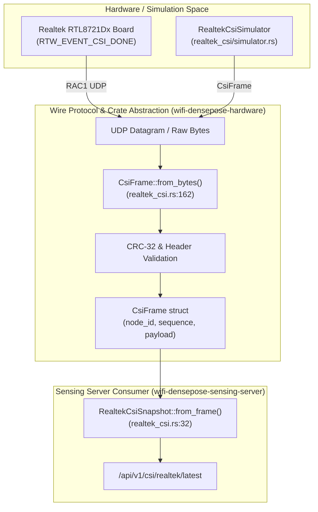
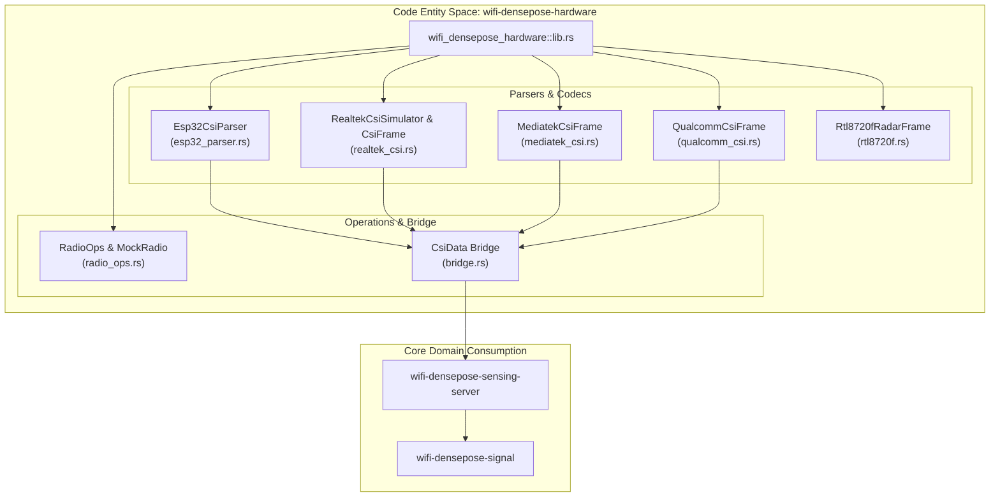

<!-- source: DeepWiki mcp.deepwiki.com · repo ruvnet/RuView · page 3.4 Alternate Radio Hardware & WiFi Scanning · fetched 2026-10-30 -->

# Alternate Radio Hardware & WiFi Scanning

Relevant source files

The following files were used as context for generating this wiki page:

- [docs/adr/ADR-157-hardware-sensing-beyond-sota.md](docs/adr/ADR-157-hardware-sensing-beyond-sota.md)
- [docs/adr/ADR-323-rtl8721dx-ameba-csi-wire-protocol.md](docs/adr/ADR-323-rtl8721dx-ameba-csi-wire-protocol.md)
- [docs/adr/ADR-356-rate-truthful-csi-and-reliability-gated-adaptation.md](docs/adr/ADR-356-rate-truthful-csi-and-reliability-gated-adaptation.md)
- [firmware/esp32-csi-node/test/fuzz_csi_serialize.c](firmware/esp32-csi-node/test/fuzz_csi_serialize.c)
- [firmware/esp32-csi-node/test/stubs/esp_stubs.h](firmware/esp32-csi-node/test/stubs/esp_stubs.h)
- [firmware/esp32-csi-node/test/test_csi_sanitize.c](firmware/esp32-csi-node/test/test_csi_sanitize.c)
- [scripts/benchmark-rtl8721dx-csi.py](scripts/benchmark-rtl8721dx-csi.py)
- [v2/crates/wifi-densepose-hardware/benches/realtek_csi_bench.rs](v2/crates/wifi-densepose-hardware/benches/realtek_csi_bench.rs)
- [v2/crates/wifi-densepose-hardware/src/bin/realtek-csi-sim.rs](v2/crates/wifi-densepose-hardware/src/bin/realtek-csi-sim.rs)
- [v2/crates/wifi-densepose-hardware/src/csi_frame.rs](v2/crates/wifi-densepose-hardware/src/csi_frame.rs)
- [v2/crates/wifi-densepose-hardware/src/esp32/secure_tdm.rs](v2/crates/wifi-densepose-hardware/src/esp32/secure_tdm.rs)
- [v2/crates/wifi-densepose-hardware/src/esp32_parser.rs](v2/crates/wifi-densepose-hardware/src/esp32_parser.rs)
- [v2/crates/wifi-densepose-hardware/src/lib.rs](v2/crates/wifi-densepose-hardware/src/lib.rs)
- [v2/crates/wifi-densepose-hardware/src/realtek_csi.rs](v2/crates/wifi-densepose-hardware/src/realtek_csi.rs)
- [v2/crates/wifi-densepose-sensing-server/src/adaptive_classifier.rs](v2/crates/wifi-densepose-sensing-server/src/adaptive_classifier.rs)
- [v2/crates/wifi-densepose-sensing-server/src/csi.rs](v2/crates/wifi-densepose-sensing-server/src/csi.rs)
- [v2/crates/wifi-densepose-sensing-server/src/matter/mod.rs](v2/crates/wifi-densepose-sensing-server/src/matter/mod.rs)
- [v2/crates/wifi-densepose-sensing-server/src/realtek_csi.rs](v2/crates/wifi-densepose-sensing-server/src/realtek_csi.rs)
- [v2/crates/wifi-densepose-wifiscan/src/adapter/mod.rs](v2/crates/wifi-densepose-wifiscan/src/adapter/mod.rs)
- [v2/crates/wifi-densepose-wifiscan/src/adapter/wlanapi_native.rs](v2/crates/wifi-densepose-wifiscan/src/adapter/wlanapi_native.rs)
- [v2/crates/wifi-densepose-wifiscan/src/adapter/wlanapi_scanner.rs](v2/crates/wifi-densepose-wifiscan/src/adapter/wlanapi_scanner.rs)

## Overview & Scope

The alternate radio hardware and WiFi scanning subsystem provides platform-agnostic data capture paths for non-ESP32 chipsets and native operating system Wi-Fi scanning APIs [v2/crates/wifi-densepose-hardware/src/lib.rs:1-12](). While ESP32 nodes stream high-fidelity CSI over UDP [v2/crates/wifi-densepose-hardware/src/esp32_parser.rs:1-6], many deployments utilize commodity operating systems (Windows WLANAPI, Linux, macOS) or alternate silicon such as Realtek RTL8721Dx (AmebaDplus) [docs/adr/ADR-323-rtl8721dx-ameba-csi-wire-protocol.md:1-21], MediaTek [v2/crates/wifi-densepose-hardware/src/lib.rs:58-59], and Qualcomm [v2/crates/wifi-densepose-hardware/src/lib.rs:60-61]. The `wifi-densepose-hardware` and `wifi-densepose-wifiscan` crates encapsulate these heterogeneous sources into normalized frames, ensuring the core sensing and signal processing pipelines remain decoupled from low-level driver constraints [v2/crates/wifi-densepose-hardware/src/lib.rs:10-16]().

Sources: `[v2/crates/wifi-densepose-hardware/src/lib.rs:1-16]`, `[docs/adr/ADR-323-rtl8721dx-ameba-csi-wire-protocol.md:1-21]`

---

## Realtek RTL8721Dx Ameba CSI Wire Protocol (ADR-323)

The Realtek RTL8721Dx ("AmebaDplus") 1x1 Wi-Fi 4 chip exposes a callback-driven CSI API via the official Ameba RTOS SDK (`wifi_csi_config()` and `RTW_EVENT_CSI_DONE`) [docs/adr/ADR-323-rtl8721dx-ameba-csi-wire-protocol.md:1-17]. To stream these reports safely across network boundaries without relying on vendor-specific raw structures or C flexible array members, RuView defines the `RAC1` ("Realtek Ameba CSI", version 1) little-endian wire protocol [docs/adr/ADR-323-rtl8721dx-ameba-csi-wire-protocol.md:24-44].

The wire envelope consists of a fixed 49-byte header (`RAC1_HEADER_LEN`) followed by the subcarrier payload and a 4-byte IEEE CRC-32 checksum [docs/adr/ADR-323-rtl8721dx-ameba-csi-wire-protocol.md:46-79]:

| Field | Type | Description |
| :--- | :--- | :--- |
| `magic` | `u32` (LE) | `0x3143_4152` ("RAC1") [docs/adr/ADR-323-rtl8721dx-ameba-csi-wire-protocol.md:51-51] |
| `version` | `u8` | Protocol version (`1`) [docs/adr/ADR-323-rtl8721dx-ameba-csi-wire-protocol.md:52-52] |
| `header_len` | `u16` (LE) | Fixed header length (`49`) [docs/adr/ADR-323-rtl8721dx-ameba-csi-wire-protocol.md:53-53] |
| `frame_len` | `u32` (LE) | Total frame length including header, payload, and CRC [docs/adr/ADR-323-rtl8721dx-ameba-csi-wire-protocol.md:54-54] |
| `node_id` | `u8` | Disambiguates multi-board illuminator/receiver deployments [docs/adr/ADR-323-rtl8721dx-ameba-csi-wire-protocol.md:55-55] |
| `csi_mode` | `u8` | Capture mode: `0` = Passive, `1` = Active, `2` = Board-to-Board [docs/adr/ADR-323-rtl8721dx-ameba-csi-wire-protocol.md:56-56] |
| `sequence` | `u32` (LE) | Firmware-assigned sequence number [docs/adr/ADR-323-rtl8721dx-ameba-csi-wire-protocol.md:57-57] |
| `timestamp_us`| `u32` (LE) | Hardware-clock microseconds (wraps ~71 minutes) [docs/adr/ADR-323-rtl8721dx-ameba-csi-wire-protocol.md:58-58] |
| `peer_mac` / `trig_mac` | `[u8; 6]` | Peer and trigger MAC addresses [docs/adr/ADR-323-rtl8721dx-ameba-csi-wire-protocol.md:59-60] |
| `num_sub_carrier` | `u16` (LE) | Number of subcarrier tones reported in payload [docs/adr/ADR-323-rtl8721dx-ameba-csi-wire-protocol.md:65-65] |
| `num_bit_per_tone`| `u8` | Precision: `16` (8-bit I + 8-bit Q) or `32` (16-bit I + 16-bit Q) [docs/adr/ADR-323-rtl8721dx-ameba-csi-wire-protocol.md:66-66] |

The Rust implementation is housed in `wifi_densepose_hardware::realtek_csi`, offering parsing, serialization, and a deterministic simulator (`RealtekCsiSimulator`) [v2/crates/wifi-densepose-hardware/src/realtek_csi.rs:1-100]. Bounded summaries are converted into `RealtekCsiSnapshot` objects within `wifi-densepose-sensing-server` for exposure over REST and WebSocket endpoints [v2/crates/wifi-densepose-sensing-server/src/realtek_csi.rs:1-67].

Sources: `[docs/adr/ADR-323-rtl8721dx-ameba-csi-wire-protocol.md:1-134]`, `[v2/crates/wifi-densepose-hardware/src/realtek_csi.rs:1-110]`, `[v2/crates/wifi-densepose-sensing-server/src/realtek_csi.rs:1-67]`

**Diagram: Realtek RTL8721Dx Frame Processing Pipeline**

Sources: `[v2/crates/wifi-densepose-hardware/src/realtek_csi.rs:110-190]`, `[v2/crates/wifi-densepose-sensing-server/src/realtek_csi.rs:31-67]`

---

## wifiscan Adapters (Windows WLANAPI, Linux, macOS)

When low-level CSI capture hardware is absent, RuView falls back to operating system Wi-Fi scanning APIs via the `wifi-densepose-wifiscan` crate. These adapters poll visible access points to extract Received Signal Strength Indicator (RSSI) timelines and BSSID multi-channel features.

*   **Windows WLANAPI (`wlanapi_scanner.rs` & `wlanapi_native.rs`)**: Interfaces directly with the Windows Native Wifi API via FFI bindings to query available networks, connection states, and per-BSSID signal qualities.
*   **Linux / macOS Scanners**: Execute platform-specific shell utilities or system bindings (e.g., `iwlist`, `airport`) to collect periodic ambient signal measurements.

The collected scans pass through a correlation and breathing extraction pipeline (`wifiscan/pipeline/`) to approximate slow-moving vital sign signatures and coarse presence indicators from RSSI variance over sliding time windows.

Sources: `[v2/crates/wifi-densepose-wifiscan/src/adapter/wlanapi_scanner.rs:1-50]`, `[docs/adr/ADR-157-hardware-sensing-beyond-sota.md:1-53]`

---

## Hardware Normalization & Chipset Abstractions

The `wifi-densepose-hardware` crate acts as the central hub for multi-chipset normalization. It defines vendor-neutral abstractions for several transceiver families:

*   **ESP32 / ESP32-S3 (`esp32_parser.rs`)**: Parses ADR-018 binary UDP frames containing magic `0xC5110001`, antenna counts, subcarrier measurements, and multiplexed sibling packets (vitals, feature states) [v2/crates/wifi-densepose-hardware/src/esp32_parser.rs:1-77].
*   **MediaTek Filogic (`mediatek_csi.rs`)**: Provides framing and simulation models for MediaTek MIMO CSI reports (ADR-267) [v2/crates/wifi-densepose-hardware/src/lib.rs:58-59].
*   **Qualcomm Atheros (`qualcomm_csi.rs`)**: Implements framing structures for Qualcomm Atheros chipset CSI extraction (ADR-269) [v2/crates/wifi-densepose-hardware/src/lib.rs:60-61].
*   **Realtek RTL8720F Radar (`rtl8720f.rs`)**: Encapsulates host-side framing for RTL8720F CFR and FMCW radar reports (ADR-264) [v2/crates/wifi-densepose-hardware/src/lib.rs:59-64].
*   **Radio Operations (`radio_ops.rs`)**: Mirrors firmware radio abstraction layers (L1) and mesh sensing planes (L3) for host testing and coordinators [v2/crates/wifi-densepose-hardware/src/lib.rs:53-57].

Sources: `[v2/crates/wifi-densepose-hardware/src/lib.rs:37-111]`, `[v2/crates/wifi-densepose-hardware/src/esp32_parser.rs:1-85]`

**Diagram: Hardware Abstraction & Code Entity Space Mapping**

Sources: `[v2/crates/wifi-densepose-hardware/src/lib.rs:1-112]`, `[v2/crates/wifi-densepose-hardware/src/esp32_parser.rs:80-96]`, `[v2/crates/wifi-densepose-hardware/src/realtek_csi.rs:70-110]`

---

