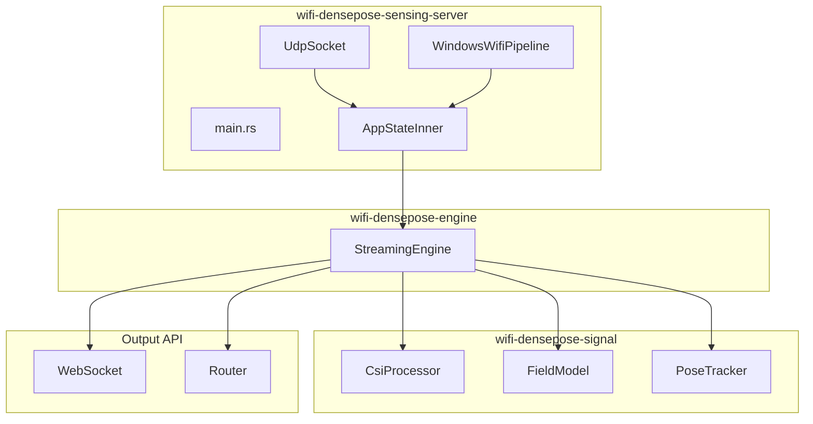
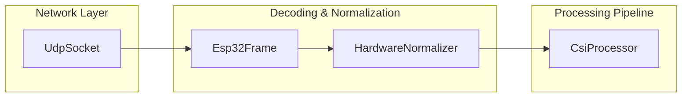

<!-- source: DeepWiki mcp.deepwiki.com · repo ruvnet/RuView · page 4 Core Sensing Engine · fetched 2026-10-30 -->

# Core Sensing Engine

Relevant source files

The following files were used as context for generating this wiki page:

- [CHANGELOG.md](CHANGELOG.md)
- [CLAUDE.md](CLAUDE.md)
- [README.md](README.md)
- [assets/ruview-hero-h3-v3.gif](assets/ruview-hero-h3-v3.gif)
- [assets/screen.png](assets/screen.png)
- [docs/adr/ADR-355-local-empty-room-bootstrap-prior.md](docs/adr/ADR-355-local-empty-room-bootstrap-prior.md)
- [docs/adr/ADR-357-raw-csi-calibration-sample-integrity.md](docs/adr/ADR-357-raw-csi-calibration-sample-integrity.md)
- [docs/readme-details.md](docs/readme-details.md)
- [docs/user-guide.md](docs/user-guide.md)
- [v2/Cargo.lock](v2/Cargo.lock)
- [v2/Cargo.toml](v2/Cargo.toml)
- [v2/crates/wifi-densepose-core/Cargo.toml](v2/crates/wifi-densepose-core/Cargo.toml)
- [v2/crates/wifi-densepose-hardware/Cargo.toml](v2/crates/wifi-densepose-hardware/Cargo.toml)
- [v2/crates/wifi-densepose-mat/Cargo.toml](v2/crates/wifi-densepose-mat/Cargo.toml)
- [v2/crates/wifi-densepose-nn/Cargo.toml](v2/crates/wifi-densepose-nn/Cargo.toml)
- [v2/crates/wifi-densepose-ruvector/Cargo.toml](v2/crates/wifi-densepose-ruvector/Cargo.toml)
- [v2/crates/wifi-densepose-sensing-server/Cargo.toml](v2/crates/wifi-densepose-sensing-server/Cargo.toml)
- [v2/crates/wifi-densepose-sensing-server/README.md](v2/crates/wifi-densepose-sensing-server/README.md)
- [v2/crates/wifi-densepose-sensing-server/examples/mqtt_publisher.rs](v2/crates/wifi-densepose-sensing-server/examples/mqtt_publisher.rs)
- [v2/crates/wifi-densepose-sensing-server/src/bootstrap_baseline.rs](v2/crates/wifi-densepose-sensing-server/src/bootstrap_baseline.rs)
- [v2/crates/wifi-densepose-sensing-server/src/cli.rs](v2/crates/wifi-densepose-sensing-server/src/cli.rs)
- [v2/crates/wifi-densepose-sensing-server/src/field_bridge.rs](v2/crates/wifi-densepose-sensing-server/src/field_bridge.rs)
- [v2/crates/wifi-densepose-sensing-server/src/lib.rs](v2/crates/wifi-densepose-sensing-server/src/lib.rs)
- [v2/crates/wifi-densepose-sensing-server/src/main.rs](v2/crates/wifi-densepose-sensing-server/src/main.rs)
- [v2/crates/wifi-densepose-sensing-server/src/mqtt/config.rs](v2/crates/wifi-densepose-sensing-server/src/mqtt/config.rs)
- [v2/crates/wifi-densepose-signal/Cargo.toml](v2/crates/wifi-densepose-signal/Cargo.toml)
- [v2/crates/wifi-densepose-signal/src/ruvsense/field_model.rs](v2/crates/wifi-densepose-signal/src/ruvsense/field_model.rs)
- [v2/crates/wifi-densepose-train/Cargo.toml](v2/crates/wifi-densepose-train/Cargo.toml)
- [v2/crates/wifi-densepose-vitals/Cargo.toml](v2/crates/wifi-densepose-vitals/Cargo.toml)
- [v2/crates/wifi-densepose-wifiscan/Cargo.toml](v2/crates/wifi-densepose-wifiscan/Cargo.toml)
- [v2/rust-toolchain.toml](v2/rust-toolchain.toml)

## Purpose and Scope

The Core Sensing Engine is the Rust-based sensing server (`sensing-server` binary) that orchestrates CSI data ingestion, signal processing, feature extraction, classification, and real-time broadcasting. It receives raw WiFi Channel State Information frames from hardware nodes, processes them through multiple analysis pipelines, and outputs structured sensing data via WebSocket and REST APIs [v2/crates/wifi-densepose-sensing-server/src/main.rs:1-9]().

This page provides a high-level overview of the sensing server architecture and its major subsystems. For deep technical details, refer to the child pages:
- Signal processing algorithms and UDP frame parsing: [Signal Processing Pipeline](#4.1)
- Breathing and heart rate extraction: [Vital Signs Detection](#4.2)
- Pose models, keypoints, and DensePose UV mapping: [Pose Estimation & DensePose](#4.3)
- Empty-room bootstrap priors and room calibration: [Calibration & Adaptive Classifier](#4.4)
- Streaming composition root and WorldGraph digital twin: [Streaming Engine & WorldGraph](#4.5)

---

## Server Architecture

The sensing server is an Axum-based HTTP/WebSocket service that runs independently of edge hardware, supporting live ESP32 UDP streams, commodity Wi-Fi data, or simulated frames [v2/crates/wifi-densepose-sensing-server/src/main.rs:33-48]().

### Diagram: Architecture to Code Entity Space

**Sources:** [v2/crates/wifi-densepose-sensing-server/src/main.rs:11-21](), [v2/crates/wifi-densepose-sensing-server/src/main.rs:58-67](), [v2/crates/wifi-densepose-engine/src/lib.rs:15-26]()

---

## Core Data Structures and Ingestion

Incoming UDP packets are decoded into structured frames and normalized before entering the analytical pipeline [v2/crates/wifi-densepose-sensing-server/src/main.rs:14-14]().

| Type | Purpose | Location |
|------|---------|----------|
| `Esp32Frame` | Decoded CSI frame from ESP32 UDP packet (ADR-018) | [v2/crates/wifi-densepose-sensing-server/src/main.rs:14-14]() |
| `TrustedOutput` | Auditable result of an engine cycle (provenance + witness) | [v2/crates/wifi-densepose-engine/src/lib.rs:80-100]() |
| `SensingUpdate` | JSON message broadcast to WebSocket clients | [v2/crates/wifi-densepose-sensing-server/src/main.rs:190-220]() |
| `CsiFrame` | Normalized hardware-abstracted frame | [v2/crates/wifi-densepose-core/src/lib.rs]() |
| `RvfContainerInfo` | Metadata for binary model containers | [v2/crates/wifi-densepose-sensing-server/src/rvf_container.rs:54-54]() |

### Diagram: CSI Frame Ingestion to Normalization Space

**Sources:** [v2/crates/wifi-densepose-sensing-server/src/main.rs:14-14](), [v2/crates/wifi-densepose-signal/src/hardware_norm.rs:1-25]()

---

## Signal Processing Pipeline

For details on UDP frame parsing, phase sanitization, Hampel filtering, CIR estimation, BVP extraction, and spectrogram generation, see [Signal Processing Pipeline](#4.1).

**Sources:** [v2/crates/wifi-densepose-signal/src/lib.rs:1-50]()

---

## Vital Signs Detection

For details on breathing and heart rate extraction, presence detection, EMA smoothing, and hysteresis states, see [Vital Signs Detection](#4.2).

**Sources:** [v2/crates/wifi-densepose-sensing-server/src/vital_signs.rs:1-40]()

---

## Pose Estimation & DensePose

For details on the pose model, COCO keypoints, DensePose UV mapping, multi-person tracking, and AETHER re-ID embeddings, see [Pose Estimation & DensePose](#4.3).

**Sources:** [v2/crates/wifi-densepose-sensing-server/src/pose.rs:1-30]()

---

## Calibration & Adaptive Classifier

For details on the empty-room bootstrap prior (ADR-355), raw CSI calibration sample integrity (ADR-357), and adaptive logistic classification, see [Calibration & Adaptive Classifier](#4.4).

**Sources:** [v2/crates/wifi-densepose-sensing-server/src/bootstrap_baseline.rs:1-30]()

---

## Streaming Engine & WorldGraph

For details on the `StreamingEngine` composition root, frame contracts (ADR-136), fusion quality scoring (ADR-137), and the WorldGraph digital twin (ADR-139), see [Streaming Engine & WorldGraph](#4.5).

**Sources:** [v2/crates/wifi-densepose-engine/src/lib.rs:1-50]()

---

