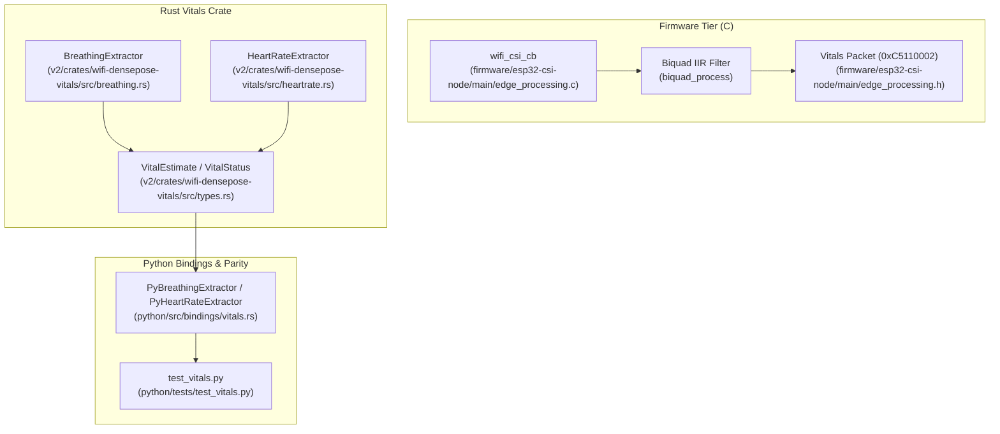

<!-- source: DeepWiki mcp.deepwiki.com · repo ruvnet/RuView · page 4.2 Vital Signs Detection · fetched 2026-10-30 -->

# Vital Signs Detection

Relevant source files

The following files were used as context for generating this wiki page:

- [docs/adr/ADR-021-vital-sign-detection-rvdna-pipeline.md](docs/adr/ADR-021-vital-sign-detection-rvdna-pipeline.md)
- [docs/adr/ADR-347-rate-aware-esp32-temporal-sensing.md](docs/adr/ADR-347-rate-aware-esp32-temporal-sensing.md)
- [docs/validation/2026-08-31-esp32-c6-rate-aware-sensing.md](docs/validation/2026-08-31-esp32-c6-rate-aware-sensing.md)
- [docs/validation/2026-08-31-esp32-s3-rate-aware-transport.md](docs/validation/2026-08-31-esp32-s3-rate-aware-transport.md)
- [firmware/esp32-csi-node/main/edge_processing.c](firmware/esp32-csi-node/main/edge_processing.c)
- [firmware/esp32-csi-node/main/edge_processing.h](firmware/esp32-csi-node/main/edge_processing.h)
- [firmware/esp32-csi-node/sdkconfig.defaults.esp32c6](firmware/esp32-csi-node/sdkconfig.defaults.esp32c6)
- [firmware/esp32-csi-node/test/test_vitals_count_presence.c](firmware/esp32-csi-node/test/test_vitals_count_presence.c)
- [python/bench/test_bench_vitals.py](python/bench/test_bench_vitals.py)
- [python/src/bindings/vitals.rs](python/src/bindings/vitals.rs)
- [python/tests/test_vitals.py](python/tests/test_vitals.py)
- [v2/crates/wifi-densepose-sensing-server/src/field_localize.rs](v2/crates/wifi-densepose-sensing-server/src/field_localize.rs)
- [v2/crates/wifi-densepose-sensing-server/src/pose.rs](v2/crates/wifi-densepose-sensing-server/src/pose.rs)
- [v2/crates/wifi-densepose-sensing-server/src/tracker_bridge.rs](v2/crates/wifi-densepose-sensing-server/src/tracker_bridge.rs)
- [v2/crates/wifi-densepose-sensing-server/src/types.rs](v2/crates/wifi-densepose-sensing-server/src/types.rs)
- [v2/crates/wifi-densepose-vitals/src/breathing.rs](v2/crates/wifi-densepose-vitals/src/breathing.rs)
- [v2/crates/wifi-densepose-vitals/src/heartrate.rs](v2/crates/wifi-densepose-vitals/src/heartrate.rs)

This page documents the vital sign extraction subsystem that estimates breathing rate and heart rate from WiFi Channel State Information (CSI) or RSSI variance. The system implements frequency-domain analysis and Fresnel zone modeling to detect micro-movements of the chest and torso, enabling non-contact physiological monitoring.

---

## Overview

The vital signs detection pipeline extracts physiological signals from radio frequency disturbances caused by chest wall displacement. The system targets two primary frequency bands:

| Signal | Frequency Band | BPM Range | Method |
|--------|---------------|-----------|--------|
| **Breathing Rate** | 0.1–0.5 Hz | 6–30 BPM | Bandpass + Zero-crossing |
| **Heart Rate** | 0.8–2.0 Hz | 48–120 BPM | Bandpass + Autocorrelation peak detection |

The system supports both server-side detection using the `wifi-densepose-vitals` crate and **Tier 2 Edge Intelligence** (ADR-039) where ESP32 nodes perform on-device Biquad IIR filtering and zero-crossing/autocorrelation estimation.

Sources: [README.md:57-58](), [docs/adr/ADR-039-esp32-edge-intelligence.md:29-37](), [v2/crates/wifi-densepose-sensing-server/src/main.rs:56-56]()

---

## System Architecture & Code Entity Mapping

The vital signs subsystem bridges embedded device firmware (`edge_processing.c`) with host-side Rust processing (`wifi-densepose-vitals`) and PyO3 Python bindings (`vitals.rs`). The following diagram associates system functional roles with concrete code entities in the codebase.

Sources: [firmware/esp32-csi-node/main/edge_processing.c:1-50](), [firmware/esp32-csi-node/main/edge_processing.h:20-40](), [v2/crates/wifi-densepose-vitals/src/breathing.rs:35-70](), [v2/crates/wifi-densepose-vitals/src/heartrate.rs:45-65](), [python/src/bindings/vitals.rs:20-50](), [python/tests/test_vitals.py:1-35]()

---

## Per-Node State Pipeline (ADR-068)

To support multistatic sensing without cross-contamination between viewpoints or physical nodes, the sensing server maintains state via the **Per-Node State Pipeline (ADR-068)**. Each node (`node_id`) manages its own independent temporal history and smoothing buffers.

### NodeState Components

| Component | Code Reference | Purpose |
|-----------|----------------|---------|
| `VitalSignDetector` | `v2/crates/wifi-densepose-sensing-server/src/vital_signs.rs` | Instance per node for independent signal processing and windowing. |
| `NodeState` | `v2/crates/wifi-densepose-sensing-server/src/types.rs` | Per-node tracking containing RSSI, position, amplitude arrays, and vital state. |
| `Esp32VitalsPacket` | `firmware/esp32-csi-node/main/edge_processing.h` | 32-byte binary packet (Magic `0xC5110002`) carrying edge-computed metrics. |

Sources: [CHANGELOG.md:12-13](), [docs/adr/ADR-039-esp32-edge-intelligence.md:59-75](), [v2/crates/wifi-densepose-sensing-server/src/types.rs:80-160]()

---

## Signal Processing Pipeline (`wifi-densepose-vitals`)

The host-side processing is implemented in the `wifi-densepose-vitals` crate, featuring specialized extractors for breathing and heart rate.

### Breathing Rate Extraction (`BreathingExtractor`)
The respiratory extractor processes amplitude residuals from subcarriers using a 2nd-order Butterworth bandpass filter (`0.1–0.5 Hz`) and zero-crossing analysis (`breathing.rs`).

- **Sliding Window:** Uses `VecDeque` for $O(1)$ push/pop operations across the analysis window (default 30 seconds).
- **Stale Reset Protection:** Automatically resets history if consecutive out-of-band rejections occur (`STALE_RESET_REJECTIONS = 1`), preventing stale locks when a subject departs.

Sources: [v2/crates/wifi-densepose-vitals/src/breathing.rs:35-110]()

### Heart Rate Extraction (`HeartRateExtractor`)
Because cardiac surface displacements ($0.1–0.5\text{ mm}$) are significantly smaller than respiratory excursions ($1–5\text{ mm}$), the cardiac pipeline utilizes inter-subcarrier phase coherence alongside amplitude residuals (`heartrate.rs`).

- **Bandpass Filter:** Configured for the cardiac frequency band (`0.8–2.0 Hz`, corresponding to $48\text{--}120\text{ BPM}$).
- **Autocorrelation Peak Detection:** Evaluates periodicity on the filtered phase-coherence signal over a 15-second window.
- **Physiological Guard Bands:** Rejects estimates falling outside `[40.0, 180.0] BPM` (`HR_PLAUSIBLE_MIN_BPM` / `HR_PLAUSIBLE_MAX_BPM`) to prevent harmonic lock-on.

Sources: [v2/crates/wifi-densepose-vitals/src/heartrate.rs:35-100]()

---

## EMA Smoothing, Dead-Band & Hysteresis

To eliminate UI jitter and prevent rapid value fluctuations in static environments, the server applies exponential smoothing layers:

- **Dead-Band Thresholds:** Updates are suppressed unless the change exceeds specific margins (`HR_DEAD_BAND = 2.0 BPM`, `BR_DEAD_BAND = 0.5 BPM`).
- **Outlier Rejection:** Maximum jump limits (`HR_MAX_JUMP = 8.0`, `BR_MAX_JUMP = 2.0`) reject single-frame anomalous spikes.
- **Hysteresis Debouncing:** Presence and occupancy scores employ Schmitt triggers with clearing frames (`EDGE_PRESENCE_CLEAR_FRAMES`) to prevent flickering.

Sources: [v2/crates/wifi-densepose-sensing-server/src/types.rs:65-78](), [firmware/esp32-csi-node/main/edge_processing.h:100-140]()

---

## Python Parity Tests & PyO3 Bindings

The vital sign extractors are exposed to Python via PyO3 bindings in `python/src/bindings/vitals.rs` and validated through parity tests in `python/tests/test_vitals.py`.

- **GIL Release:** Pure-sync DSP extraction loops release the Python Global Interpreter Lock via `py.allow_threads(|| ...)` to prevent event loop starvation in async servers.
- **Parity Verification:** Test suites verify structure construction, immutability (`frozen`), enum serialization, and synthetic signal processing recovery.

Sources: [python/src/bindings/vitals.rs:1-25](), [python/tests/test_vitals.py:1-40]()

---

