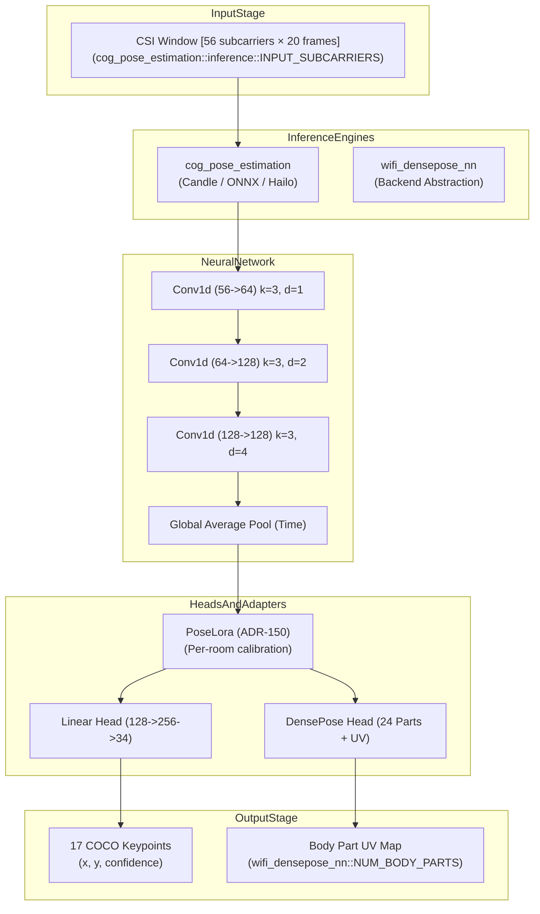
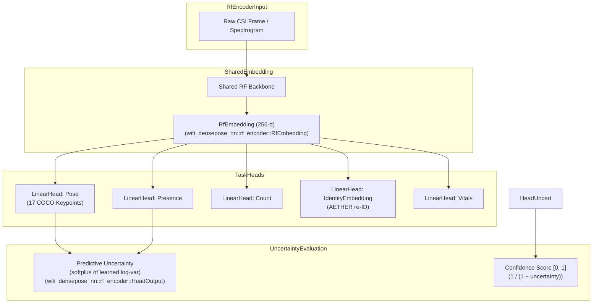

<!-- source: DeepWiki mcp.deepwiki.com · repo ruvnet/RuView · page 4.3 Pose Estimation & DensePose · fetched 2026-10-30 -->

# Pose Estimation & DensePose

Relevant source files

The following files were used as context for generating this wiki page:

- [docs/adr/ADR-155-nn-training-beyond-sota.md](docs/adr/ADR-155-nn-training-beyond-sota.md)
- [docs/adr/ADR-179-occworld-candle-checkpoint-load-hardening.md](docs/adr/ADR-179-occworld-candle-checkpoint-load-hardening.md)
- [docs/tutorials/coherent-rf-tomography-backprojection.md](docs/tutorials/coherent-rf-tomography-backprojection.md)
- [v2/crates/nvsim-server/Cargo.toml](v2/crates/nvsim-server/Cargo.toml)
- [v2/crates/wifi-densepose-nn/benches/native_conv_bench.rs](v2/crates/wifi-densepose-nn/benches/native_conv_bench.rs)
- [v2/crates/wifi-densepose-nn/src/densepose.rs](v2/crates/wifi-densepose-nn/src/densepose.rs)
- [v2/crates/wifi-densepose-nn/src/lib.rs](v2/crates/wifi-densepose-nn/src/lib.rs)
- [v2/crates/wifi-densepose-nn/src/rf_encoder.rs](v2/crates/wifi-densepose-nn/src/rf_encoder.rs)
- [v2/crates/wifi-densepose-occworld-candle/src/cnn.rs](v2/crates/wifi-densepose-occworld-candle/src/cnn.rs)
- [v2/crates/wifi-densepose-occworld-candle/src/inference.rs](v2/crates/wifi-densepose-occworld-candle/src/inference.rs)
- [v2/crates/wifi-densepose-occworld-candle/src/lib.rs](v2/crates/wifi-densepose-occworld-candle/src/lib.rs)
- [v2/crates/wifi-densepose-occworld-candle/src/model.rs](v2/crates/wifi-densepose-occworld-candle/src/model.rs)
- [v2/crates/wifi-densepose-occworld-candle/src/transformer.rs](v2/crates/wifi-densepose-occworld-candle/src/transformer.rs)
- [v2/crates/wifi-densepose-occworld-candle/src/vqvae.rs](v2/crates/wifi-densepose-occworld-candle/src/vqvae.rs)
- [v2/crates/wifi-densepose-occworld-candle/tests/checkpoint_loading.rs](v2/crates/wifi-densepose-occworld-candle/tests/checkpoint_loading.rs)
- [v2/crates/wifi-densepose-occworld-candle/tests/input_validation.rs](v2/crates/wifi-densepose-occworld-candle/tests/input_validation.rs)
- [v2/crates/wifi-densepose-occworld-candle/tests/predict_honesty.rs](v2/crates/wifi-densepose-occworld-candle/tests/predict_honesty.rs)
- [v2/crates/wifi-densepose-pointcloud/Cargo.toml](v2/crates/wifi-densepose-pointcloud/Cargo.toml)
- [v2/crates/wifi-densepose-pointcloud/benches/splats_bench.rs](v2/crates/wifi-densepose-pointcloud/benches/splats_bench.rs)
- [v2/crates/wifi-densepose-pointcloud/src/pointcloud.rs](v2/crates/wifi-densepose-pointcloud/src/pointcloud.rs)
- [v2/crates/wifi-densepose-sar/Cargo.toml](v2/crates/wifi-densepose-sar/Cargo.toml)
- [v2/crates/wifi-densepose-sar/README.md](v2/crates/wifi-densepose-sar/README.md)
- [v2/crates/wifi-densepose-sar/src/geometry.rs](v2/crates/wifi-densepose-sar/src/geometry.rs)
- [v2/crates/wifi-densepose-sar/src/lib.rs](v2/crates/wifi-densepose-sar/src/lib.rs)
- [v2/crates/wifi-densepose-sar/src/measurement.rs](v2/crates/wifi-densepose-sar/src/measurement.rs)
- [v2/crates/wifi-densepose-sar/src/pointcloud.rs](v2/crates/wifi-densepose-sar/src/pointcloud.rs)
- [v2/crates/wifi-densepose-sar/src/reconstruct.rs](v2/crates/wifi-densepose-sar/src/reconstruct.rs)
- [v2/crates/wifi-densepose-sar/src/resolution.rs](v2/crates/wifi-densepose-sar/src/resolution.rs)
- [v2/crates/wifi-densepose-sar/tests/physics_validation.rs](v2/crates/wifi-densepose-sar/tests/physics_validation.rs)
- [v2/crates/wifi-densepose-train/src/domain.rs](v2/crates/wifi-densepose-train/src/domain.rs)
- [v2/crates/wifi-densepose-train/src/eval.rs](v2/crates/wifi-densepose-train/src/eval.rs)
- [v2/crates/wifi-densepose-train/src/geometry.rs](v2/crates/wifi-densepose-train/src/geometry.rs)
- [v2/crates/wifi-densepose-train/src/metrics_core.rs](v2/crates/wifi-densepose-train/src/metrics_core.rs)
- [v2/crates/wifi-densepose-train/src/rapid_adapt.rs](v2/crates/wifi-densepose-train/src/rapid_adapt.rs)

This page describes the pose estimation inference pipeline that converts WiFi Channel State Information (CSI) into human body keypoints, surface mappings, spatial point clouds, and world model trajectories. The system outputs 17 COCO keypoints per person, DensePose part segmentation, UV surface coordinates, multi-person tracking via AETHER re-identification embeddings, and 3D radar/occupancy world modeling (`OccWorldCandle`).

**Scope**: This page covers inference-time pose estimation and dense reconstruction from live CSI data. For model training, dataset preparation, and loss functions, see [6. Training & Model Deployment](). For signal processing preparing CSI features before pose estimation, see [4.1. Signal Processing Pipeline]().

---

## 1. Model Architecture & CSI-to-Pose Pipeline

The WiFi-DensePose model transforms raw CSI measurements into structured pose representations. The architecture utilizes a `Conv1d` or temporal convolutional backbone to process temporal CSI windows and a multi-head decoder for keypoints and body segmentation.

Sources: `[v2/crates/cog-pose-estimation/src/inference.rs:6-13](), [v2/crates/cog-pose-estimation/src/inference.rs:26-28](), [v2/crates/cog-pose-estimation/src/inference.rs:151-172](), [v2/crates/wifi-densepose-nn/src/lib.rs:66-70](), [docs/adr/ADR-101-pose-estimation-cog.md:62-70]()`

---

## 2. Cognitum Cog Integration (ADR-101)

The pose estimation system is packaged as a **Cognitum Cog**, a self-contained unit following the ADR-100 specification for deployment on the RuView appliance.

### Runtime Contract
The `cog-pose-estimation` binary implements the standard CLI contract `[v2/crates/cog-pose-estimation/src/main.rs:32-53]()`:
*   `version`: Reports the current semantic version.
*   `manifest`: Emits the signed JSON manifest including weights SHA256 and Ed25519 signature `[v2/crates/cog-pose-estimation/src/main.rs:91-95]()`.
*   `health`: Performs a synthetic forward pass to verify the inference backend (Candle/CUDA) and weights `[v2/crates/cog-pose-estimation/src/main.rs:97-107]()`.
*   `run`: Long-running loop that polls `sensing-server` and emits `pose.frame` events `[v2/crates/cog-pose-estimation/src/main.rs:109-125]()`.

### Hardware Targets
The system is optimized for multiple hardware backends through the `InferenceEngine` `[v2/crates/cog-pose-estimation/src/inference.rs:175-178]()`:
| Target | Backend | Latency (v0.0.1) |
|--------|---------|------------------|
| ruvultra (RTX 5080) | `candle-cuda` | < 1 ms |
| Raspberry Pi 5 | `candle-cpu` | ~8.4 ms (cold start) |
| Pi + Hailo-8 | `hailo-hef` | ~2 ms |

Sources: `[docs/adr/ADR-100-cog-packaging-specification.md:117-132](), [docs/adr/ADR-101-pose-estimation-cog.md:94-116](), [docs/benchmarks/pose-estimation-cog.md:83-91](), [v2/crates/cog-pose-estimation/src/main.rs:12-30]()`

---

## 3. Per-Room Calibration & LoRA (ADR-150 / ADR-155)

To overcome environment-specific signal multipath issues, the system supports **PoseLora** adapters. These are low-rank deltas applied to pose head layers `[v2/crates/cog-pose-estimation/src/inference.rs:49-58]()`.

### LoRA Mechanism & Rapid Adaptation
*   **Adapter Structure**: Small `safetensors` files containing `fc1.a`, `fc1.b`, `fc2.a`, and `fc2.b` tensors `[v2/crates/cog-pose-estimation/src/inference.rs:53-58]()`.
*   **Application**: The forward pass computes `y + (x · A) · B`, where `A` and `B` are low-rank deltas `[v2/crates/cog-pose-estimation/src/inference.rs:75-80]()`.
*   **Few-Shot Adaptation (`wifi-densepose-train/src/rapid_adapt.rs`)**: Unlabeled calibration frames are buffered via `RapidAdaptation` and minimized using self-supervised temporal-contrastive and prediction-entropy objectives with finite-difference gradients `[v2/crates/wifi-densepose-train/src/rapid_adapt.rs:114-178]()`.

Sources: `[v2/crates/cog-pose-estimation/src/inference.rs:49-81](), [v2/crates/wifi-densepose-train/src/rapid_adapt.rs:114-189](), [v2/crates/cog-pose-estimation/tests/smoke.rs:67-134]()`

---

## 4. Multi-Task Heads & Uncertainty (ADR-146)

The `wifi-densepose-nn` crate provides a multi-task RF encoder that produces shared embeddings for various sensing tasks.

### Shared AETHER Embedding & Task Kinds
The encoder produces a 256-dimensional `RfEmbedding` (AETHER) `[v2/crates/wifi-densepose-nn/src/rf_encoder.rs:11-16]()`. This serves as input for seven specialized task heads `[v2/crates/wifi-densepose-nn/src/rf_encoder.rs:33-50]()`:
1.  **Pose**: 17-keypoint COCO joints.
2.  **Presence**: Binary detection.
3.  **Count**: Number of people.
4.  **Activity**: Classification (e.g., falling, walking).
5.  **Vitals**: Heart and breathing rates.
6.  **Gait**: Identity-linked gait signatures.
7.  **IdentityEmbedding**: AETHER re-ID embeddings.

### Uncertainty Quantification
Each `LinearHead` outputs task values alongside a predictive `uncertainty` score, calculated as the softplus of a learned log-variance `[v2/crates/wifi-densepose-nn/src/rf_encoder.rs:65-76]()`. This allows reporting a `confidence` metric in `[0, 1]` for every inferred pose `[v2/crates/wifi-densepose-nn/src/rf_encoder.rs:78-85]()`.

Sources: `[v2/crates/wifi-densepose-nn/src/rf_encoder.rs:11-50](), [v2/crates/wifi-densepose-nn/src/rf_encoder.rs:65-85](), [v2/crates/wifi-densepose-nn/src/rf_encoder.rs:148-187]()`

---

## 5. Kinematic Constraints & DensePose

The model enforces anatomical plausibility and generates dense surface mappings.

### Keypoint Configuration
The system uses the COCO 17-joint skeleton `[v2/crates/cog-pose-estimation/src/inference.rs:28-29]()`. During inference, `PoseNet` regresses 34 values (17 pairs of x, y coordinates) normalized to `[0, 1]` `[v2/crates/cog-pose-estimation/src/inference.rs:11-12]()`.

### DensePose Segmentation
The `wifi-densepose-nn` crate handles body part segmentation (24 parts) and UV coordinate regression `[v2/crates/wifi-densepose-nn/src/lib.rs:9-10]()`.
*   **NUM_BODY_PARTS**: 24 standard classes `[v2/crates/wifi-densepose-nn/src/lib.rs:67]()`.
*   **UV Mapping**: 2 coordinates (U and V) projecting signal perturbations onto 3D body surfaces `[v2/crates/wifi-densepose-nn/src/lib.rs:70]()`.

Sources: `[v2/crates/cog-pose-estimation/src/inference.rs:11-41](), [v2/crates/wifi-densepose-nn/src/lib.rs:63-73]()`

---

## 6. Advanced Spatial Reconstruction & World Modeling (SAR, Point Cloud, OccWorld)

Beyond skeletal pose and DensePose UV coordinates, the RuView pipeline incorporates advanced spatial reconstruction sub-crates for through-wall tomography and occupancy forecasting.

### Coherent Wideband RF Tomography (`wifi-densepose-sar`)
*   **Backprojection (`wifi_densepose_sar::reconstruct::backproject`)**: Implements matched-filter / frequency-domain backprojection from simulated or measured stepped-frequency antenna sweeps (`FrequencySweep`) onto a regular 3D `VoxelGrid` `[v2/crates/wifi-densepose-sar/src/reconstruct.rs:1-21]()`.
*   **Incremental Phasor Optimization**: Evaluates the per-term phase via incremental complex multiplication per frequency step, accelerating reconstruction performance `[v2/crates/wifi-densepose-sar/src/reconstruct.rs:152-166]()`.

### Gaussian Splat Point Cloud (`wifi-densepose-pointcloud`)
*   **Voxelization & Fused Splats**: Aggregates point clouds into Gaussian splats using a 2-pass fused accumulation kernel (`to_gaussian_splats`) over spatial occupancy cells `[v2/crates/wifi-densepose-pointcloud/benches/splats_bench.rs:76-113]()`.

### OccWorld World Modeling (`wifi-densepose-occworld-candle`)
*   **Native Candle Engine (`OccWorldCandle`)**: Predicts future 3D occupancy and semantic trajectories (`TrajectoryWaypoint`) over future horizons using VQ-VAE quantization (`VQCodebook`, `ClassEmbedding`) and transformer sequence models `[v2/crates/wifi-densepose-occworld-candle/src/inference.rs:1-76]()`.
*   **Honesty & Weights Gate**: Exposes `weights_trained` flag (`true` when loaded via `OccWorldCandle::load` from SafeTensors, `false` for deterministic untrained `dummy` constructor) to gate data-driven accuracy claims `[v2/crates/wifi-densepose-occworld-candle/src/inference.rs:60-76]()`.

Sources: `[v2/crates/wifi-densepose-sar/src/reconstruct.rs:1-35](), [v2/crates/wifi-densepose-sar/src/measurement.rs:1-50](), [v2/crates/wifi-densepose-pointcloud/benches/splats_bench.rs:76-113](), [v2/crates/wifi-densepose-occworld-candle/src/inference.rs:1-76]()`

---

