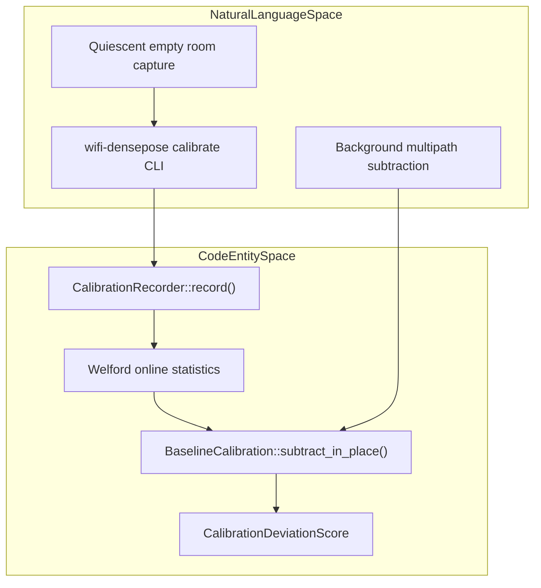
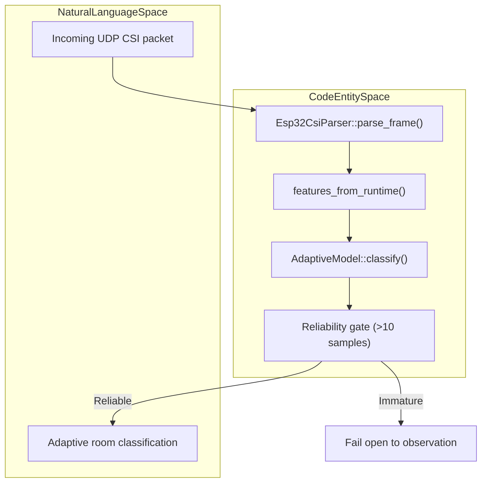

<!-- source: DeepWiki mcp.deepwiki.com · repo ruvnet/RuView · page 4.4 Calibration & Adaptive Classifier · fetched 2026-10-30 -->

# Calibration & Adaptive Classifier

Relevant source files

The following files were used as context for generating this wiki page:

- [docs/adr/ADR-151-room-calibration-specialist-training.md](docs/adr/ADR-151-room-calibration-specialist-training.md)
- [docs/adr/ADR-152-wifi-pose-sota-2026-intake.md](docs/adr/ADR-152-wifi-pose-sota-2026-intake.md)
- [docs/adr/ADR-172-cli-core-csi-deserialiser-security-review.md](docs/adr/ADR-172-cli-core-csi-deserialiser-security-review.md)
- [docs/adr/ADR-356-rate-truthful-csi-and-reliability-gated-adaptation.md](docs/adr/ADR-356-rate-truthful-csi-and-reliability-gated-adaptation.md)
- [docs/integration/calibration-appliance-integration.md](docs/integration/calibration-appliance-integration.md)
- [firmware/esp32-csi-node/test/fuzz_csi_serialize.c](firmware/esp32-csi-node/test/fuzz_csi_serialize.c)
- [firmware/esp32-csi-node/test/stubs/esp_stubs.h](firmware/esp32-csi-node/test/stubs/esp_stubs.h)
- [firmware/esp32-csi-node/test/test_csi_sanitize.c](firmware/esp32-csi-node/test/test_csi_sanitize.c)
- [scripts/csi-udp-relay.py](scripts/csi-udp-relay.py)
- [v2/.gitignore](v2/.gitignore)
- [v2/crates/wifi-densepose-calibration/src/anchor.rs](v2/crates/wifi-densepose-calibration/src/anchor.rs)
- [v2/crates/wifi-densepose-calibration/src/bank.rs](v2/crates/wifi-densepose-calibration/src/bank.rs)
- [v2/crates/wifi-densepose-calibration/src/enrollment.rs](v2/crates/wifi-densepose-calibration/src/enrollment.rs)
- [v2/crates/wifi-densepose-calibration/src/extract.rs](v2/crates/wifi-densepose-calibration/src/extract.rs)
- [v2/crates/wifi-densepose-calibration/src/multistatic.rs](v2/crates/wifi-densepose-calibration/src/multistatic.rs)
- [v2/crates/wifi-densepose-calibration/src/specialist.rs](v2/crates/wifi-densepose-calibration/src/specialist.rs)
- [v2/crates/wifi-densepose-cli/src/calibrate.rs](v2/crates/wifi-densepose-cli/src/calibrate.rs)
- [v2/crates/wifi-densepose-core/src/lib.rs](v2/crates/wifi-densepose-core/src/lib.rs)
- [v2/crates/wifi-densepose-core/src/traits.rs](v2/crates/wifi-densepose-core/src/traits.rs)
- [v2/crates/wifi-densepose-core/src/types.rs](v2/crates/wifi-densepose-core/src/types.rs)
- [v2/crates/wifi-densepose-hardware/src/csi_frame.rs](v2/crates/wifi-densepose-hardware/src/csi_frame.rs)
- [v2/crates/wifi-densepose-hardware/src/esp32_parser.rs](v2/crates/wifi-densepose-hardware/src/esp32_parser.rs)
- [v2/crates/wifi-densepose-sensing-server/src/adaptive_classifier.rs](v2/crates/wifi-densepose-sensing-server/src/adaptive_classifier.rs)
- [v2/crates/wifi-densepose-sensing-server/src/csi.rs](v2/crates/wifi-densepose-sensing-server/src/csi.rs)
- [v2/crates/wifi-densepose-signal/benches/calibration_bench.rs](v2/crates/wifi-densepose-signal/benches/calibration_bench.rs)
- [v2/crates/wifi-densepose-signal/src/ruvsense/calibration.rs](v2/crates/wifi-densepose-signal/src/ruvsense/calibration.rs)
- [v2/crates/wifi-densepose-signal/tests/calibration_synthetic.rs](v2/crates/wifi-densepose-signal/tests/calibration_synthetic.rs)

## Purpose and Scope

The Calibration & Adaptive Classifier subsystem provides environment-specific learning and real-time reliability validation for RuView's WiFi sensing server. Because indoor radio propagation varies significantly across rooms, furniture configurations, and hardware placements, static thresholds fail in uncalibrated deployments. This module handles:

1. **Empty-Room Bootstrap Prior**: Capturing quiescent background statistics using Welford's online algorithm to establish baseline amplitude and phase distributions (`BaselineCalibration`, `CalibrationRecorder`) [v2/crates/wifi-densepose-signal/src/ruvsense/calibration.rs:1-5]() [v2/crates/wifi-densepose-cli/src/calibrate.rs:1-7]().
2. **Raw CSI Calibration Sample Integrity**: Sanitizing hardware-level artifacts (such as invalid first-word prefixes from ESP32 chips) before feature extraction or baseline recording (ADR-356 / ADR-357) [docs/adr/ADR-356-rate-truthful-csi-and-reliability-gated-adaptation.md:44-53]().
3. **Room Calibration Specialists**: Deploying lightweight, specialized models per biological signal (respiration, heart rate, presence, posture, anomaly detection) fit from labeled enrollment anchors (ADR-151) [v2/crates/wifi-densepose-calibration/src/specialist.rs:1-11]().
4. **Adaptive Logistic Classifier**: Extracting a 15-dimensional feature vector (server-computed features plus raw subcarrier statistics) to classify multi-class motion states (`absent`, `present_still`, `present_moving`, `active`) via gradient-descent-trained logistic weights [v2/crates/wifi-densepose-sensing-server/src/adaptive_classifier.rs:1-16]().
5. **Relireliability-Gated Adaptation**: Ensuring background models remain uncommitted until a minimum threshold of finite, nonnegative residual references is met, failing open to observation and failing closed for suppression (ADR-356) [docs/adr/ADR-356-rate-truthful-csi-and-reliability-gated-adaptation.md:78-84]().

Sources: [v2/crates/wifi-densepose-signal/src/ruvsense/calibration.rs:1-7](), [v2/crates/wifi-densepose-sensing-server/src/adaptive_classifier.rs:1-16](), [v2/crates/wifi-densepose-calibration/src/specialist.rs:1-12](), [docs/adr/ADR-356-rate-truthful-csi-and-reliability-gated-adaptation.md:44-84]()

---

## 1. Empty-Room Bootstrap Prior & Calibration

Before any sensing or occupancy estimation takes place, the environment must be calibrated via an empty-room capture phase. The `wifi-densepose-cli calibrate` subcommand listens for UDP CSI frames, feeds them into `CalibrationRecorder`, and outputs a binary baseline file conforming to ADR-135 [v2/crates/wifi-densepose-cli/src/calibrate.rs:1-7]().

### Calibration Workflow
- **Data Collection**: Welford's online algorithm calculates running means and variances for amplitude and circular phase across all active subcarriers without requiring unbounded memory.
- **PHY Tiers**: Supports `Ht20`, `Ht40`, `He20`, and `He40` tiers with tier-specific subcarrier expectations (e.g., 52 active tones for HT20, 256 delivered bins for HE20 on ESP32-C6) [v2/crates/wifi-densepose-signal/src/ruvsense/calibration.rs:74-161]().
- **Deviation Scoring**: During runtime, `BaselineCalibration::subtract_in_place()` removes the static background multipath, and `deviation()` computes amplitude z-scores and phase drift to detect motion [v2/crates/wifi-densepose-signal/src/ruvsense/calibration.rs:1-65]().

Title: "CalibrationPipelineMapping"

Sources: [v2/crates/wifi-densepose-signal/src/ruvsense/calibration.rs:1-65](), [v2/crates/wifi-densepose-cli/src/calibrate.rs:1-91]()

---

## 2. Raw CSI Calibration Sample Integrity

Under ADR-356 and ADR-357, raw CSI frames received from edge nodes undergo strict integrity and sanitation steps before processing.

- **First-Word Sanitization**: ESP-IDF firmware flags instances where the first CSI word is invalid due to hardware constraints (`wifi_csi_info_t.first_word_invalid`) [docs/adr/ADR-356-rate-truthful-csi-and-reliability-gated-adaptation.md:20-23](). The ingestion and serialization pipeline automatically zeroes the first four bytes of the payload while retaining the fixed frame shape [docs/adr/ADR-356-rate-truthful-csi-and-reliability-gated-adaptation.md:46-47]().
- **Provenance Flagging**: ADR-018 byte 19 bit 5 (`first_word_sanitized`) is set to record that sanitation occurred [v2/crates/wifi-densepose-hardware/src/csi_frame.rs:150-178]() [docs/adr/ADR-356-rate-truthful-csi-and-reliability-gated-adaptation.md:48]().
- **Fail-Closed Defensive Design**: Non-finite samples (`NaN`, `±inf`) are dropped upstream in feature extraction, preventing corrupted hardware buffers from propagating `NaN` values through statistical accumulators or adaptive classifiers [v2/crates/wifi-densepose-sensing-server/src/adaptive_classifier.rs:190-197]() [v2/crates/wifi-densepose-calibration/src/extract.rs:100-106]().

Sources: [v2/crates/wifi-densepose-hardware/src/csi_frame.rs:150-178](), [docs/adr/ADR-356-rate-truthful-csi-and-reliability-gated-adaptation.md:20-53](), [v2/crates/wifi-densepose-calibration/src/extract.rs:100-106]()

---

## 3. Room Calibration Specialists

ADR-151 introduces **specialization over scale**: rather than relying on a single monolithic neural network, the system fits tiny, room-calibrated models (specialists) per biological signal using labeled enrollment anchors [v2/crates/wifi-densepose-calibration/src/specialist.rs:1-12]().

### Specialist Types and Implementation
- **PresenceSpecialist**: Uses a dual-channel gate combining scalar **variance** (motion energy) and **mean shift** ($|\text{mean} - \text{empty\_mean}|$ to detect motionless occupants). Includes a `VARIANCE_SEPARATION_MARGIN` guard to prevent false presence alarms when ambient noise drops below empty-room baselines [v2/crates/wifi-densepose-calibration/src/specialist.rs:41-115]().
- **BreathingSpecialist & HeartbeatSpecialist**: Extract band-limited periodicity via autocorrelation over specific frequency bands ($0.1\text{--}0.6\text{ Hz}$ for respiration; $0.8\text{--}3.0\text{ Hz}$ for heart rates) with strict interior local maximum validation to avoid harmonic leakage [v2/crates/wifi-densepose-calibration/src/specialist.rs:18-32]() [v2/crates/wifi-densepose-calibration/src/extract.rs:119-172]().
- **AnomalySpecialist**: Measures Euclidean distance from enrolled prototype features to detect out-of-distribution or physically implausible states [v2/crates/wifi-densepose-calibration/src/specialist.rs:33-40]().

Sources: [v2/crates/wifi-densepose-calibration/src/specialist.rs:1-149](), [v2/crates/wifi-densepose-calibration/src/extract.rs:119-172]()

---

## 4. Adaptive Logistic Classifier & Feature Extraction

The adaptive activity classifier learns environment-specific decision boundaries from labeled JSONL recordings or runtime feature updates [v2/crates/wifi-densepose-sensing-server/src/adaptive_classifier.rs:1-16]().

### Feature Vector Structure (15 Dimensions)
Every CSI frame is mapped to a 15-dimensional vector combining server-computed aggregate metrics and subcarrier-level statistical moments:

| Category | Features Included | Code Entity |
| :--- | :--- | :--- |
| **Server Features (7)** | Variance, Motion Band Power, Breathing Band Power, Spectral Power, Dominant Freq, Change Points, Mean RSSI | `features_from_frame()` / `features_from_runtime()` [v2/crates/wifi-densepose-sensing-server/src/adaptive_classifier.rs:31-140]() |
| **Subcarrier Stats (8)** | Mean, StdDev, Skewness, Kurtosis, IQR, Entropy, Max, Range | `subcarrier_stats()` [v2/crates/wifi-densepose-sensing-server/src/adaptive_classifier.rs:175-197]() |

### Backward Compatibility & Temporal Frequency
To prevent server upgrades from shifting input distributions on existing models, `compatible_dominant_frequency()` handles model version mapping: version 1 models receive historical subcarrier-index proxies, while version 2+ models consume the true measured temporal frequency in Hertz derived via Hann-windowed DFT [v2/crates/wifi-densepose-sensing-server/src/adaptive_classifier.rs:150-174]().

Sources: [v2/crates/wifi-densepose-sensing-server/src/adaptive_classifier.rs:1-197]()

---

## 5. Reliability-Gated Adaptation & Data Flow

To prevent erratic environment changes or sparse calibration points from corrupting inference, RuView enforces reliability gates (ADR-356) [docs/adr/ADR-356-rate-truthful-csi-and-reliability-gated-adaptation.md:72-85]().

- **Maturity Threshold**: A background model or adaptive calibration state is deemed unreliable until it contains at least 10 finite, nonnegative residual references [docs/adr/ADR-356-rate-truthful-csi-and-reliability-gated-adaptation.md:78-79]().
- **Fail-Closed Rule**: An unreliable model cannot suppress runtime changes, nor does it expose conformance scores [docs/adr/ADR-356-rate-truthful-csi-and-reliability-gated-adaptation.md:79-80](). Sparse or immature background samples fail open to raw observation and fail closed for suppression [docs/adr/ADR-356-rate-truthful-csi-and-reliability-gated-adaptation.md:114]().

Title: "AdaptiveClassifierRuntimeDataFlow"

Sources: [v2/crates/wifi-densepose-hardware/src/esp32_parser.rs:90-110](), [v2/crates/wifi-densepose-sensing-server/src/adaptive_classifier.rs:95-140](), [docs/adr/ADR-356-rate-truthful-csi-and-reliability-gated-adaptation.md:72-115]()

---

