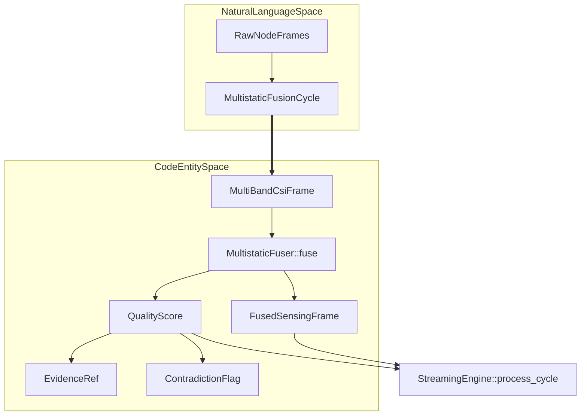
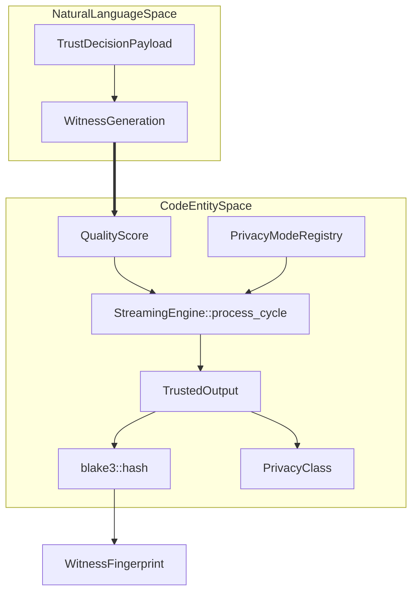

<!-- source: DeepWiki mcp.deepwiki.com · repo ruvnet/RuView · page 4.5 Streaming Engine & WorldGraph · fetched 2026-10-30 -->

# Streaming Engine & WorldGraph

<details>
<summary>Relevant source files</summary>

The following files were used as context for generating this wiki page:

- [docs/adr/ADR-136-ruview-streaming-engine-frame-contracts.md](docs/adr/ADR-136-ruview-streaming-engine-frame-contracts.md)
- [docs/adr/ADR-137-fusion-engine-quality-scoring-evidence.md](docs/adr/ADR-137-fusion-engine-quality-scoring-evidence.md)
- [docs/adr/ADR-138-linkgroup-array-coordinator-clock-quality.md](docs/adr/ADR-138-linkgroup-array-coordinator-clock-quality.md)
- [docs/adr/ADR-139-worldgraph-environmental-digital-twin.md](docs/adr/ADR-139-worldgraph-environmental-digital-twin.md)
- [docs/adr/ADR-140-semantic-state-record-and-agent-bridge.md](docs/adr/ADR-140-semantic-state-record-and-agent-bridge.md)
- [docs/adr/ADR-141-bfld-privacy-control-plane-modes-attestation.md](docs/adr/ADR-141-bfld-privacy-control-plane-modes-attestation.md)
- [docs/adr/ADR-142-evolution-tracker-temporal-voxel-aggregation.md](docs/adr/ADR-142-evolution-tracker-temporal-voxel-aggregation.md)
- [docs/adr/ADR-143-rf-slam-reflector-discovery-anchor-learning.md](docs/adr/ADR-143-rf-slam-reflector-discovery-anchor-learning.md)
- [docs/adr/ADR-144-uwb-range-constraint-fusion.md](docs/adr/ADR-144-uwb-range-constraint-fusion.md)
- [docs/adr/ADR-145-ablation-eval-harness-privacy-leakage.md](docs/adr/ADR-145-ablation-eval-harness-privacy-leakage.md)
- [docs/adr/ADR-146-rf-encoder-multitask-heads-uncertainty.md](docs/adr/ADR-146-rf-encoder-multitask-heads-uncertainty.md)
- [docs/adr/ADR-260-rufield-mfs.md](docs/adr/ADR-260-rufield-mfs.md)
- [docs/adr/ADR-262-rufield-ruview-integration.md](docs/adr/ADR-262-rufield-ruview-integration.md)
- [docs/research/ruview-beyond-sota/01-sota-landscape-2026.md](docs/research/ruview-beyond-sota/01-sota-landscape-2026.md)
- [docs/research/ruview-beyond-sota/02-beyond-sota-architecture.md](docs/research/ruview-beyond-sota/02-beyond-sota-architecture.md)
- [docs/research/ruview-beyond-sota/04-optimization-roadmap.md](docs/research/ruview-beyond-sota/04-optimization-roadmap.md)
- [firmware/esp32-csi-node/main/rv_mesh.c](firmware/esp32-csi-node/main/rv_mesh.c)
- [firmware/esp32-csi-node/main/stream_sender.c](firmware/esp32-csi-node/main/stream_sender.c)
- [firmware/esp32-csi-node/main/stream_sender.h](firmware/esp32-csi-node/main/stream_sender.h)
- [v2/crates/wifi-densepose-engine/Cargo.toml](v2/crates/wifi-densepose-engine/Cargo.toml)
- [v2/crates/wifi-densepose-engine/benches/engine_cycle.rs](v2/crates/wifi-densepose-engine/benches/engine_cycle.rs)
- [v2/crates/wifi-densepose-engine/src/lib.rs](v2/crates/wifi-densepose-engine/src/lib.rs)
- [v2/crates/wifi-densepose-rufield/Cargo.toml](v2/crates/wifi-densepose-rufield/Cargo.toml)
- [v2/crates/wifi-densepose-rufield/src/bridge.rs](v2/crates/wifi-densepose-rufield/src/bridge.rs)
- [v2/crates/wifi-densepose-rufield/src/lib.rs](v2/crates/wifi-densepose-rufield/src/lib.rs)
- [v2/crates/wifi-densepose-rufield/src/ultrasonic.rs](v2/crates/wifi-densepose-rufield/src/ultrasonic.rs)
- [v2/crates/wifi-densepose-rufield/tests/fixtures/batvu_living_room.ultrasonic.jsonl](v2/crates/wifi-densepose-rufield/tests/fixtures/batvu_living_room.ultrasonic.jsonl)
- [v2/crates/wifi-densepose-rufield/tests/ultrasonic_gates.rs](v2/crates/wifi-densepose-rufield/tests/ultrasonic_gates.rs)
- [v2/crates/wifi-densepose-sensing-server/src/engine_bridge.rs](v2/crates/wifi-densepose-sensing-server/src/engine_bridge.rs)
- [v2/crates/wifi-densepose-sensing-server/src/multistatic_bridge.rs](v2/crates/wifi-densepose-sensing-server/src/multistatic_bridge.rs)
- [v2/crates/wifi-densepose-signal/src/hardware_norm.rs](v2/crates/wifi-densepose-signal/src/hardware_norm.rs)
- [v2/crates/wifi-densepose-signal/src/ruvsense/evolution.rs](v2/crates/wifi-densepose-signal/src/ruvsense/evolution.rs)
- [v2/crates/wifi-densepose-signal/src/ruvsense/multistatic.rs](v2/crates/wifi-densepose-signal/src/ruvsense/multistatic.rs)

</details>


## Purpose and Scope

This page documents the architecture and implementation of the RuView streaming engine, hosted primarily in the `wifi-densepose-engine` and `wifi-densepose-signal` crates. The streaming engine serves as the **composition root** that wires architectural building blocks (ADR-135 through ADR-146) into a unified, trust-traceable pipeline cycle. It combines multistatic CSI fusion, quality scoring, environmental digital twin representation via WorldGraph, evolution tracking, RF-SLAM, and privacy-governed export interfaces.

Sources: `v2/crates/wifi-densepose-engine/src/lib.rs:1-30`

---

## 1. StreamingEngine Composition Root & Frame Contracts (ADR-136)

The core orchestration logic resides in `StreamingEngine`, defined in `wifi-densepose-engine`. Each execution of `StreamingEngine::process_cycle` performs a deterministic sequence of operations to transform raw node sensor frames into auditable beliefs.

```
+-----------------------------------------------------------------+
| Natural Language: Live Multistatic Sensor Frames                |
+-----------------------------------------------------------------+
                                  |
                                  v
+-----------------------------------------------------------------+
| Code Entity Space: node_frames_from_states_with_guard()         |
| -> FusedSensingFrame produced by MultistaticFuser               |
+-----------------------------------------------------------------+
                                  |
                                  v
+-----------------------------------------------------------------+
| Code Entity Space: StreamingEngine::process_cycle()             |
| -> QualityScore (ADR-137)                                       |
| -> PrivacyModeRegistry / PrivacyGate (ADR-141)                  |
| -> WorldGraph & SemanticProvenance (ADR-139 / ADR-140)          |
+-----------------------------------------------------------------+
                                  |
                                  v
+-----------------------------------------------------------------+
| Code Entity Space: TrustedOutput { witness, effective_class }   |
+-----------------------------------------------------------------+
```

### Key Components & Data Flow

- **`StreamingEngine`**: Manages internal state including the multistatic fuser, privacy registries, spatial graphs, and model versioning.
- **`TrustedOutput`**: The auditable result structure containing semantic node IDs, quality score records, privacy classes, structural flags, and a BLAKE3 witness cryptographic fingerprint.

Sources: `v2/crates/wifi-densepose-engine/src/lib.rs:83-144`, `v2/crates/wifi-densepose-sensing-server/src/engine_bridge.rs:1-80`

---

## 2. Fusion Quality Scoring & Evidence References (ADR-137)

Multistatic fusion evaluates incoming node telemetry through attention-weighted pooling. To prevent silent failures or uncalibrated dominance, the fusion engine produces a `QualityScore` alongside the `FusedSensingFrame`.

### Validation and Coherence Checks

- **Timestamp Alignment**: Hard and soft guard intervals (`guard_interval_us` and `soft_guard_us`) validate inter-node capture synchronization to reject out-of-cycle frames or tag loose alignments as contradictions.
- **Attention Entropy**: Computes weights across subcarriers using normalized Shannon entropy over attention logits.
- **Contradiction Flags**: When validations fail gracefully (tolerated discrepancies), contradiction flags force a monotonic privacy demotion before emission.



Sources: `v2/crates/wifi-densepose-signal/src/ruvsense/multistatic.rs:63-148`, `docs/adr/ADR-137-fusion-engine-quality-scoring-evidence.md:1-60`

---

## 3. WorldGraph Environmental Digital Twin (ADR-139) & Semantic State (ADR-140)

The `WorldGraph` subsystem provides a spatial-semantic environmental model. Every engine cycle appends a `SemanticState` node to the graph, bound via `DerivedFrom` edges to the corresponding room and sensor entities.

### Key Structs & Management

- **`WorldGraph`**: Stores nodes (`WorldNode`) and edges (`WorldEdge`) representing spatial zones, anchor points, and occupancy states.
- **Semantic Retention**: Bounded graph history to prevent unbounded memory growth on live deployments. Old beliefs are deterministically evicted past the retention cap.

Sources: `v2/crates/wifi-densepose-engine/src/lib.rs:44-48`, `v2/crates/wifi-densepose-engine/src/lib.rs:115-144`

---

## 4. Evolution Tracker & Temporal Voxel Map (ADR-142)

Channel-state evolution and volumetric occupancy tracking extend the field-model layer via two main structures:

1. **`EvolutionTracker`**: Maintains rolling `WelfordStats` baselines per link with a cross-link change-point detector.
2. **`TemporalVoxelMap`**: Accumulates spatial evidence using Bayesian log-odds updates per voxel, tracking variance and update timestamps.

```rust
// Example structure representation in wifi-densepose-signal
pub struct TemporalVoxel {
    pub center: [f64; 3],
    pub occupancy: f64,
    pub confidence: f64,
    pub evidence_count: u64,
    pub doppler_velocity: Option<f64>,
    pub last_update_ns: u64,
}
```

- **`VoxelGate`**: Enforces privacy demotions (`VoxelPrivacy::Full`, `Anonymous`, `Restricted`) to control voxel data exposure.

Sources: `v2/crates/wifi-densepose-signal/src/ruvsense/evolution.rs:1-48`, `v2/crates/wifi-densepose-signal/src/ruvsense/evolution.rs:154-183`

---

## 5. RF-SLAM & RuField MFS Integration (ADR-143 & ADR-262)

### RF-SLAM (ADR-143)
Persistent reflector discovery and anchor learning identify static multipath reflectors in the environment, stabilizing tracking maps across moving occlusion events.

### RuField Bridge (`wifi-densepose-rufield`, ADR-262)
The anti-corruption layer bridges RuView's live streaming engine output to the standalone RuField Multi-Modal Field Sensing (MFS) specification.

- **Input Translation**: Converts `SensingSnapshot` structures into signed `FieldEvent` instances (`Modality::WifiCsi`).
- **Privacy Mapping**: Enforces fail-closed rules where raw data maps to `P0` and derived presence maps to safe egress tiers (`P2`), ensuring sensitive classifications never leak onto untrusted surfaces.

Sources: `v2/crates/wifi-densepose-rufield/Cargo.toml:10-28`, `docs/adr/ADR-262-rufield-ruview-integration.md:24-42`

---

## 6. Trust Witness Generation & Privacy Control Plane (ADR-141)

The streaming engine guarantees provenance traceability by sealing every cycle with a cryptographic witness.

### Witness & Attestation Pipeline
- **BLAKE3 Fingerprint**: Computed deterministically over `provenance ‖ effective_class ‖ calibration_id`.
- **Monotonic Demotion**: If fusion encounters tolerated contradictions or mesh partition risks, the BFLD privacy class is demoted one step, stripping amplitude/phase proxies before wire serialization.



Sources: `docs/adr/ADR-141-bfld-privacy-control-plane-modes-attestation.md:1-55`, `v2/crates/wifi-densepose-engine/src/lib.rs:83-112`

---

