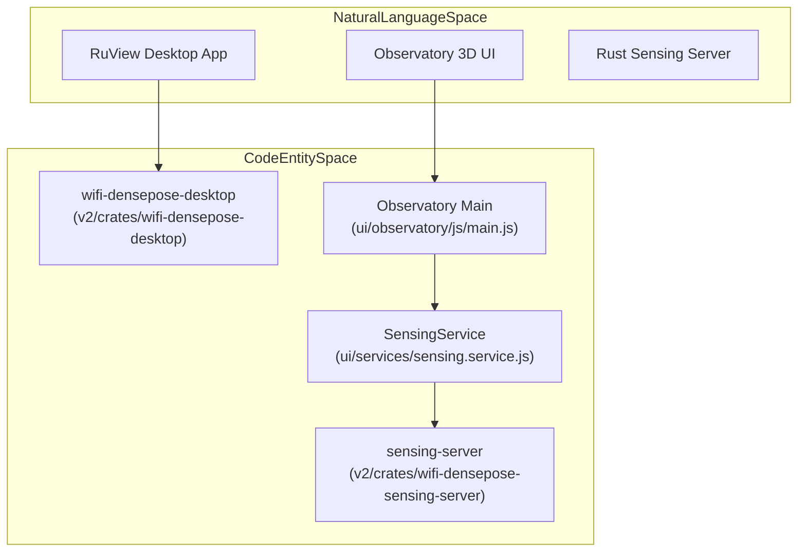
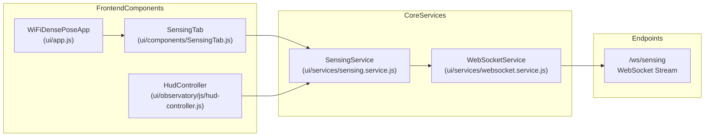

<!-- source: DeepWiki mcp.deepwiki.com · repo ruvnet/RuView · page 5 Applications · fetched 2026-10-30 -->

# Applications

Relevant source files

The following files were used as context for generating this wiki page:

- [plans/overview.md](plans/overview.md)
- [ui/README.md](ui/README.md)
- [ui/config/api.config.js](ui/config/api.config.js)
- [ui/start-ui.sh](ui/start-ui.sh)
- [ui/tests/integration-test.html](ui/tests/integration-test.html)
- [ui/utils/backend-detector.js](ui/utils/backend-detector.js)
- [v2/crates/wifi-densepose-desktop/ui/package-lock.json](v2/crates/wifi-densepose-desktop/ui/package-lock.json)
- [v2/crates/wifi-densepose-desktop/ui/package.json](v2/crates/wifi-densepose-desktop/ui/package.json)

## Purpose and Scope

This page provides a high-level overview of the primary application interfaces for interacting with the RuView WiFi sensing system. These interfaces range from native desktop applications and immersive 3D web visualizations to command-line utilities, Python packages, and AI agent integrations.

For deep technical details on each interface, refer to the respective child pages:
- [RuView Desktop](#5.1) — Tauri desktop app: node discovery, serial provisioning, OTA updates, and server lifecycle [v2/crates/wifi-densepose-desktop/ui/package.json:1-26]().
- [Observatory Web UI & Dashboard](#5.2) — The Three.js Observatory visualization, HUD, post-processing, demo mode, and Vite dashboard app [ui/README.md:51-82]().
- [CLI Tools & Examples](#5.3) — Command-line interfaces, MAT CLI, and the examples script tree [ui/README.md:109-148]().
- [Python Package & MCP Integration](#5.4) — The `wifi-densepose` PyPI package, PyO3 bindings, and MCP server plugins [v2/crates/wifi-densepose-desktop/ui/package.json:1-26]().

---

## Application Ecosystem Architecture

RuView uses a decoupled architecture where multiple frontend clients consume data from a unified Rust-based sensing server (`wifi-densepose-sensing-server`). The web interface is structured as a modular system where `WiFiDensePoseApp` coordinates various functional tabs [ui/app.js:32-36](), and `SensingService` orchestrates connections to the sensing stream [ui/services/sensing.service.js:38-43]().

The following diagram bridges natural language interface descriptions to the actual code entities implementing them across the repository.

### System-to-Code Entity Map

Sources: [ui/config/api.config.js:9-70](), [v2/crates/wifi-densepose-desktop/ui/package.json:1-26](), [ui/services/sensing.service.js:12-18]()

---

## RuView Desktop (5.1)

RuView Desktop is the primary administrative and operational client built using **Tauri** and React [v2/crates/wifi-densepose-desktop/ui/package.json:1-26](). It provides native system access for hardware management and server orchestration.

- **Node Discovery & Provisioning**: Combines mDNS and UDP broadcast to locate ESP32 nodes, rendering them within the `HardwareTab` [ui/README.md:77-82]().
- **Server Lifecycle**: Manages the local `sensing-server` instance using Tauri IPC commands and monitors liveness via `healthService` [ui/app.js:93-99]().
- **Maintenance & Modules**: Orchestrates OTA firmware updates and WASM edge module deployments securely under least-privilege capability rules (ADR-178).

For details, see [RuView Desktop](#5.1).

Sources: [v2/crates/wifi-densepose-desktop/ui/package.json:1-26](), [ui/app.js:93-104](), [ui/services/health.service.js:1-10]()

---

## Observatory Web UI & Dashboard (5.2)

The Observatory and Vite dashboard applications provide immersive 3D visualization and real-time operational telemetry using **Three.js** [ui/README.md:33-35]().

- **3D Visualization**: Renders human skeletons, Gaussian-splat signal fields, and room environments [ui/README.md:51-57]().
- **Heads-Up Display (HUD)**: `HudController` manages real-time metrics with smooth transitions, threshold alerts, and post-processing bloom/vignette effects [ui/observatory/js/hud-controller.js:21-35]().
- **Data Source Modes**: Automatically transitions between live ESP32 streams, reconnection backoff states, and client-side simulation fallbacks [ui/README.md:83-94]().

For details, see [Observatory Web UI & Dashboard](#5.2).

Sources: [ui/README.md:33-94](), [ui/observatory/js/hud-controller.js:116-135]()

---

## CLI Tools & Examples (5.3)

RuView provides a comprehensive suite of command-line tools and example scripts for automation, testing, and research deployments [ui/README.md:109-148]().

- **Command-Line Interfaces**: Includes `wifi-densepose-cli`, `ruview-cli`, `aa_score_runner`, and the Mass Casualty Assessment Tool (MAT) CLI.
- **Example Scripts**: Located in the `examples/` tree (`ruview_live.py`, medical vitals, sleep apnea, HRV stress, and room monitors).
- **Testing Suites**: Includes integration test runners and mock server harnesses [ui/tests/integration-test.html:95-106]().

For details, see [CLI Tools & Examples](#5.3).

Sources: [ui/README.md:109-148](), [ui/tests/integration-test.html:95-106]()

---

## Python Package & MCP Integration (5.4)

Programmatic access and AI assistant integration are provided via the `wifi-densepose` PyPI package and model-context-protocol (MCP) servers.

- **PyO3 Bindings**: Exposes high-performance Rust signal processing, vital sign extractors, and AETHER client models directly to Python.
- **MCP Server & Plugins**: `ruview-mcp` and the `plugins/ruview` agent plugin enable large language models and automation frameworks to query real-time sensing telemetry.

For details, see [Python Package & MCP Integration](#5.4).

Sources: [ui/config/api.config.js:9-70](), [ui/README.md:95-108]()

---

## Interface Connectivity Matrix

The following diagram maps frontend UI components to their underlying service abstractions and transport endpoints.

### Component-to-Code Mapping

Sources: [ui/app.js:32-36](), [ui/services/sensing.service.js:81-87](), [ui/services/websocket.service.js:38-42](), [ui/observatory/js/hud-controller.js:143-149]()

---

