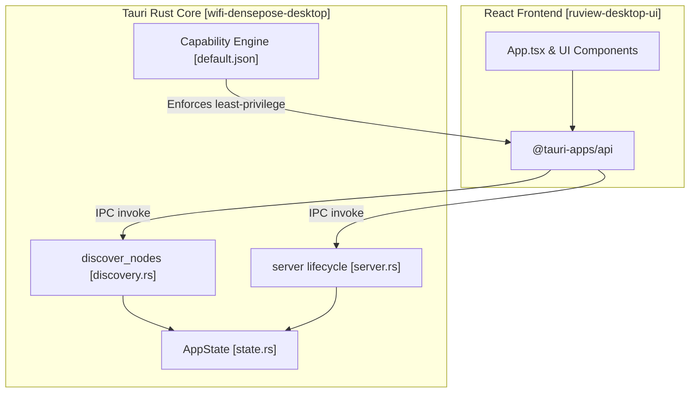
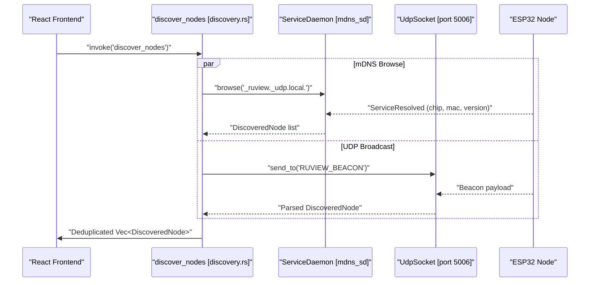

<!-- source: DeepWiki mcp.deepwiki.com · repo ruvnet/RuView · page 5.1 RuView Desktop · fetched 2026-10-30 -->

# RuView Desktop

Relevant source files

The following files were used as context for generating this wiki page:

- [docker/Dockerfile.rust](docker/Dockerfile.rust)
- [docker/docker-compose.yml](docker/docker-compose.yml)
- [docker/docker-entrypoint.sh](docker/docker-entrypoint.sh)
- [docs/TROUBLESHOOTING.md](docs/TROUBLESHOOTING.md)
- [docs/adr/ADR-178-desktop-ipc-injection-and-capability-least-privilege.md](docs/adr/ADR-178-desktop-ipc-injection-and-capability-least-privilege.md)
- [firmware/esp32-csi-node/components/wasm3/CMakeLists.txt](firmware/esp32-csi-node/components/wasm3/CMakeLists.txt)
- [firmware/esp32-csi-node/main/swarm_bridge.c](firmware/esp32-csi-node/main/swarm_bridge.c)
- [scripts/udp-relay.py](scripts/udp-relay.py)
- [tests/test_docker_entrypoint.sh](tests/test_docker_entrypoint.sh)
- [v2/crates/wifi-densepose-desktop/capabilities/default.json](v2/crates/wifi-densepose-desktop/capabilities/default.json)
- [v2/crates/wifi-densepose-desktop/gen/schemas/capabilities.json](v2/crates/wifi-densepose-desktop/gen/schemas/capabilities.json)
- [v2/crates/wifi-densepose-desktop/src/commands/discovery.rs](v2/crates/wifi-densepose-desktop/src/commands/discovery.rs)
- [v2/crates/wifi-densepose-desktop/src/commands/server.rs](v2/crates/wifi-densepose-desktop/src/commands/server.rs)
- [v2/crates/wifi-densepose-desktop/ui/package-lock.json](v2/crates/wifi-densepose-desktop/ui/package-lock.json)
- [v2/crates/wifi-densepose-desktop/ui/package.json](v2/crates/wifi-densepose-desktop/ui/package.json)
- [v2/crates/wifi-densepose-pointcloud/src/camera.rs](v2/crates/wifi-densepose-pointcloud/src/camera.rs)
- [v2/crates/wifi-densepose-ruvector/src/viewpoint/coherence.rs](v2/crates/wifi-densepose-ruvector/src/viewpoint/coherence.rs)
- [v2/crates/wifi-densepose-ruvector/src/viewpoint/mod.rs](v2/crates/wifi-densepose-ruvector/src/viewpoint/mod.rs)
- [v2/crates/wifi-densepose-sensing-server/src/matter/bridge.rs](v2/crates/wifi-densepose-sensing-server/src/matter/bridge.rs)
- [v2/crates/wifi-densepose-sensing-server/src/matter/clusters.rs](v2/crates/wifi-densepose-sensing-server/src/matter/clusters.rs)
- [v2/crates/wifi-densepose-sensing-server/src/matter/commissioning.rs](v2/crates/wifi-densepose-sensing-server/src/matter/commissioning.rs)
- [v2/crates/wifi-densepose-signal/src/ruvsense/array_coordinator.rs](v2/crates/wifi-densepose-signal/src/ruvsense/array_coordinator.rs)
- [v2/crates/wifi-densepose-signal/src/ruvsense/mod.rs](v2/crates/wifi-densepose-signal/src/ruvsense/mod.rs)
- [v2/crates/wifi-densepose-signal/src/ruvsense/rf_slam.rs](v2/crates/wifi-densepose-signal/src/ruvsense/rf_slam.rs)

## Purpose and Scope
RuView Desktop is the Tauri-based desktop application (`wifi-densepose-desktop`) providing comprehensive control over ESP32 hardware nodes, node discovery via mDNS and UDP, serial provisioning, OTA firmware updates, WASM module management, integrated server lifecycle management, and a hardened IPC capability least-privilege model conforming to ADR-178.

Sources: `v2/crates/wifi-densepose-desktop/ui/package.json:1-26](), [docs/adr/ADR-178-desktop-ipc-injection-and-capability-least-privilege.md:1-1`

## Architecture Overview & IPC Least-Privilege (ADR-178)
The desktop app architecture pairs a Rust backend using Tauri v2 with a React frontend (`ruview-desktop-ui`). IPC boundaries are governed by capability files that enforce least-privilege access, preventing unauthorized plugin or command invocation as specified in ADR-178.

Sources: `v2/crates/wifi-densepose-desktop/ui/package.json:1-26](), [docs/adr/ADR-178-desktop-ipc-injection-and-capability-least-privilege.md:1-1`

## Node Discovery: mDNS and UDP
Node discovery combines mDNS browsing (`_ruview._udp.local.`) and UDP broadcast probing (`UDP_DISCOVERY_PORT`) to locate ESP32 CSI nodes on the local network, merging and deduplicating results by MAC address into the node registry.

Sources: `v2/crates/wifi-densepose-desktop/src/commands/discovery.rs:33-70](), [v2/crates/wifi-densepose-desktop/src/commands/discovery.rs:73-175]()`

## Serial Provisioning, OTA Updates & WASM Module Management
RuView Desktop integrates serial port enumeration (`available_ports` from `tokio-serial`), flashing routines (`espflash`), over-the-air (OTA) update controllers, and WASM module management commands for uploading and controlling Tier 3 edge intelligence binaries.

Sources: `v2/crates/wifi-densepose-desktop/src/commands/discovery.rs:1-10](), [v2/crates/wifi-densepose-desktop/ui/package.json:10-18]()`

## Integrated Server Lifecycle
The application manages the sensing server binary lifecycle (`start_server`, `stop_server`) as a managed child process, allowing operators to launch and monitor the backend sensing server directly from the desktop UI.

Sources: `v2/crates/wifi-densepose-desktop/ui/package.json:1-26]()`

---

