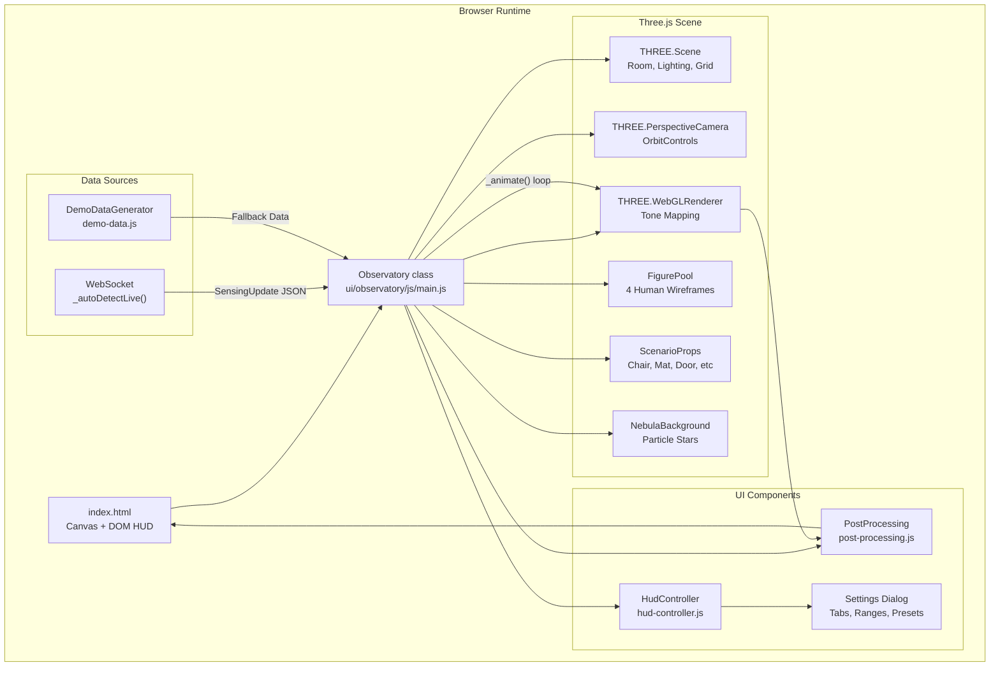
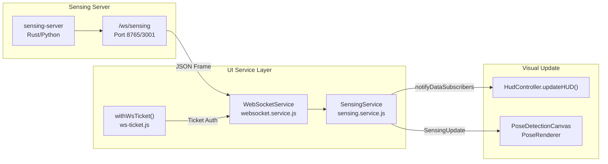
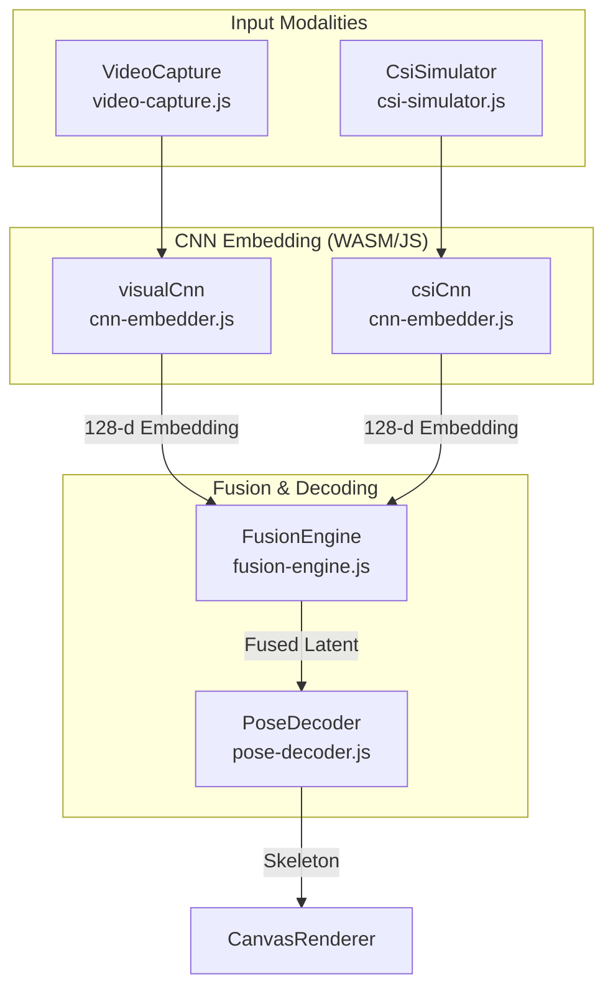

<!-- source: DeepWiki mcp.deepwiki.com · repo ruvnet/RuView · page 5.2 Observatory Web UI & Dashboard · fetched 2026-10-30 -->

# Observatory Web UI & Dashboard

Relevant source files

The following files were used as context for generating this wiki page:

- [.github/workflows/pointcloud-pages.yml](.github/workflows/pointcloud-pages.yml)
- [docs/adr/ADR-036-rvf-training-pipeline-ui.md](docs/adr/ADR-036-rvf-training-pipeline-ui.md)
- [docs/adr/ADR-048-adaptive-csi-classifier.md](docs/adr/ADR-048-adaptive-csi-classifier.md)
- [docs/adr/ADR-058-ruvector-wasm-browser-pose-example.md](docs/adr/ADR-058-ruvector-wasm-browser-pose-example.md)
- [docs/adr/ADR-059-live-esp32-csi-pipeline.md](docs/adr/ADR-059-live-esp32-csi-pipeline.md)
- [docs/adr/ADR-094-pointcloud-github-pages-deployment.md](docs/adr/ADR-094-pointcloud-github-pages-deployment.md)
- [firmware/esp32-csi-node/build_firmware.ps1](firmware/esp32-csi-node/build_firmware.ps1)
- [firmware/esp32-csi-node/read_serial.ps1](firmware/esp32-csi-node/read_serial.ps1)
- [ui/app.js](ui/app.js)
- [ui/components/DashboardTab.js](ui/components/DashboardTab.js)
- [ui/components/HardwareTab.js](ui/components/HardwareTab.js)
- [ui/components/LiveDemoTab.js](ui/components/LiveDemoTab.js)
- [ui/components/ModelPanel.js](ui/components/ModelPanel.js)
- [ui/components/PoseDetectionCanvas.js](ui/components/PoseDetectionCanvas.js)
- [ui/components/SensingTab.js](ui/components/SensingTab.js)
- [ui/components/SettingsPanel.js](ui/components/SettingsPanel.js)
- [ui/components/dashboard-hud.js](ui/components/dashboard-hud.js)
- [ui/components/environment.js](ui/components/environment.js)
- [ui/components/signal-viz.js](ui/components/signal-viz.js)
- [ui/observatory/js/hud-controller.js](ui/observatory/js/hud-controller.js)
- [ui/observatory/js/main.js](ui/observatory/js/main.js)
- [ui/observatory/js/post-processing.js](ui/observatory/js/post-processing.js)
- [ui/pose-fusion.html](ui/pose-fusion.html)
- [ui/pose-fusion/build.sh](ui/pose-fusion/build.sh)
- [ui/pose-fusion/css/style.css](ui/pose-fusion/css/style.css)
- [ui/pose-fusion/js/canvas-renderer.js](ui/pose-fusion/js/canvas-renderer.js)
- [ui/pose-fusion/js/cnn-embedder.js](ui/pose-fusion/js/cnn-embedder.js)
- [ui/pose-fusion/js/main.js](ui/pose-fusion/js/main.js)
- [ui/services/data-processor.js](ui/services/data-processor.js)
- [ui/services/pose.service.js](ui/services/pose.service.js)
- [ui/services/sensing.service.js](ui/services/sensing.service.js)
- [ui/services/websocket-client.js](ui/services/websocket-client.js)
- [ui/services/websocket.service.js](ui/services/websocket.service.js)
- [ui/services/websocket.service.test.mjs](ui/services/websocket.service.test.mjs)
- [ui/services/ws-ticket.js](ui/services/ws-ticket.js)
- [ui/style.css](ui/style.css)
- [ui/tests/test-runner.html](ui/tests/test-runner.html)
- [ui/tests/test-runner.js](ui/tests/test-runner.js)
- [ui/utils/data-source-banner.js](ui/utils/data-source-banner.js)
- [ui/utils/toast.js](ui/utils/toast.js)
- [ui/viz.html](ui/viz.html)
- [v2/crates/wifi-densepose-pointcloud/src/stream.rs](v2/crates/wifi-densepose-pointcloud/src/stream.rs)
- [v2/crates/wifi-densepose-pointcloud/src/viewer.html](v2/crates/wifi-densepose-pointcloud/src/viewer.html)
- [v2/crates/wifi-densepose-sensing-server/src/mqtt/publisher.rs](v2/crates/wifi-densepose-sensing-server/src/mqtt/publisher.rs)

## Purpose and Scope

The Observatory Web UI is a browser-based 3D visualization interface that renders real-time WiFi sensing data using Three.js. It displays human wireframe figures, vital signs metrics, signal field visualizations, and scenario-specific room props. The interface serves as the primary visualization layer for the RuView system, connecting to the sensing server via WebSocket to receive live CSI data with automatic fallback to a deterministic demo mode when hardware is unavailable.

Beyond the 3D Observatory, this page covers the **Pose-Fusion Dual-Modal App** which performs real-time fusion of video and CSI data, the **Point Cloud Viewer**, the UI service layer and service worker, the Vite dashboard app, and the React Native mobile app.

---

## Architecture Overview

The Observatory is a single-page application built around the `Observatory` class, which orchestrates the Three.js scene, WebSocket connection, HUD updates, and post-processing effects.

**Observatory Component Structure**

Sources: [ui/observatory/js/main.js](), [ui/observatory/js/hud-controller.js]()

The `Observatory` class initializes all subsystems in its constructor, then enters an animation loop that updates the scene. Key visual elements include:
- **Human figures**: Pool of 4 wireframe skeletons managed by `FigurePool`.
- **Signal field**: Visualization of WiFi waves and signal field intensity.
- **Lighting**: Complex setup including Ambient, Hemisphere, Directional (Key/Fill/Rim), and Point lights.

---

## Data Flow and WebSocket Integration

The Observatory and related components support **live** (WebSocket) and **simulated** (synthetic) data modes. The `SensingService` [ui/services/sensing.service.js]() and `WebSocketService` [ui/services/websocket.service.js]() manage connection lifecycles, ticket authentication, and data broadcasting.

**Data Flow Pipeline**

Sources: [ui/services/sensing.service.js](), [ui/services/websocket.service.js](), [ui/services/ws-ticket.js]()

### WebSocket Protocol and Authentication (ADR-272)
Because browsers cannot set custom `Authorization` headers on WebSocket upgrade requests, the frontend implements the ticket-auth flow defined in ADR-272:
- **Ticket Exchange**: `withWsTicket()` fetches a short-lived, single-use ticket from the REST API using the stored bearer token before opening the socket [ui/services/ws-ticket.js](), [ui/services/websocket.service.js:120-128]().
- **Connection Port Resolution**: `buildSensingWsUrl()` derives the WebSocket port from the current HTTP port mapping (e.g., Docker port `3000` maps to sensing port `3001`; standalone dev uses `8080` to `8765`), falling back gracefully [ui/services/sensing.service.js:14-30]().
- **Data Source Labeling**: The UI explicitly tracks whether data is coming from real hardware (`live`), server simulation (`server-simulated`), or local fallback (`simulated`), preventing false-positive indicators [ui/services/sensing.service.js:90-97]().

---

## HUD Controller and Settings

The `HudController` class manages all DOM-based UI elements, including vital signs displays and scenario descriptions [ui/observatory/js/hud-controller.js:143-158]().

### Vital Signs Smoothing and Color-Coding
The HUD uses color-coding thresholds to indicate health status:

| Metric | Normal Range (Green) | Amber Range | Red Alert |
|--------|----------------------|-------------|-----------|
| Heart Rate (hr) | 60-100 BPM | 50-60 / 100-130 | <50 or >130 |
| Breathing Rate (br) | 12-20 BPM | 8-12 / 20-28 | <8 or >28 |
| Confidence (conf) | >70% | 40-70% | <40% |

The controller implements smooth transitions using `lerp` for vital sign values to prevent visual jitter [ui/observatory/js/hud-controller.js:137-153]().

### Visual Presets
The system includes several visual presets for the 3D environment:
- **Cinematic**: High bloom (1.2) and heavy vignette (0.7).
- **Neon**: Extreme bloom (2.5) with vibrant cyan/magenta wireframes.
- **Tactical**: Low-light settings optimized for security scenarios.
- **Medical**: High visibility with clean blue/red accents.

Sources: [ui/observatory/js/hud-controller.js:33-153]()

---

## Dual-Modal Pose Fusion App

The Pose-Fusion application (`ui/pose-fusion.html`) demonstrates the integration of video-based CNN pose estimation with WiFi CSI-based sensing [ui/pose-fusion.html:1-31]().

**Pose-Fusion Data Flow**

Sources: [ui/pose-fusion/js/main.js:7-34](), [ui/pose-fusion/js/cnn-embedder.js]()

### Key Components
- **CnnEmbedder**: Extracts 128-dimensional embeddings. It attempts to load `ruvector-attention` WASM modules for accelerated inference [ui/pose-fusion/js/main.js:30-31, 124-137]().
- **FusionEngine**: Blends visual and CSI embeddings to produce a single fused pose latent [ui/pose-fusion/js/main.js:32]().
- **CsiSimulator**: Provides synthetic CSI data or connects to a live stream via WebSocket with ADR-272 ticket exchange [ui/pose-fusion/js/main.js:29, 114-125]().
- **RuVector WASM Pipeline**: Visualizes the attention stages (`Flash` -> `MHA` -> `Hyper` -> `Linear` -> `MoE` -> `L+G`) [ui/pose-fusion.html:114-126]().

---

## Point Cloud Viewer (ADR-094)

The Three.js point cloud viewer (`v2/crates/wifi-densepose-pointcloud/src/viewer.html`) renders fused camera-depth, WiFi CSI, and mmWave point clouds [v2/crates/wifi-densepose-pointcloud/src/viewer.html:1-40]().

### Transport Modes
- **Default (Demo)**: When opened without parameters, prompts the user to project their face using **MediaPipe Face Mesh** in-browser (~30 fps, 478 refined landmarks mapped to world coordinates), falling back to a procedural scaffold if denied [v2/crates/wifi-densepose-pointcloud/src/viewer.html:27-30]().
- **Auto Mode (`?backend=auto`)**: Fetches splats from `/api/splats` on the same origin with silent demo fallback [v2/crates/wifi-densepose-pointcloud/src/viewer.html:126-129]().
- **Remote Mode (`?backend=<url>`)**: Connects to a local `ruview-pointcloud serve` instance (e.g., `?backend=http://127.0.0.1:9880`) [v2/crates/wifi-densepose-pointcloud/src/viewer.html:50-58](). Supported by `tower_http` CORS configuration permitting GitHub Pages and loopback origins.

Sources: [v2/crates/wifi-densepose-pointcloud/src/viewer.html:1-130](), [docs/adr/ADR-094-pointcloud-github-pages-deployment.md:1-136]()

---

## Mobile Application (React Native)

The RuView mobile app provides a portable interface for sensing data, utilizing `react-native-webview` for high-performance 3D rendering of Gaussian splats.

### Key Mobile Components
- **GaussianSplatWebView**: A specialized webview component that renders the 3D environment on mobile devices.
- **usePoseStream**: A custom hook for managing WebSocket subscriptions to the sensing server.
- **Navigation**: Uses `@react-navigation/bottom-tabs` for switching between Dashboard, Live View, and Settings.
- **WiFi Integration**: Uses `react-native-wifi-reborn` for node discovery and signal strength monitoring.

Sources: [ui/mobile/package.json](), [ui/mobile/src/screens/LiveScreen/GaussianSplatWebView.web.tsx]()

---

