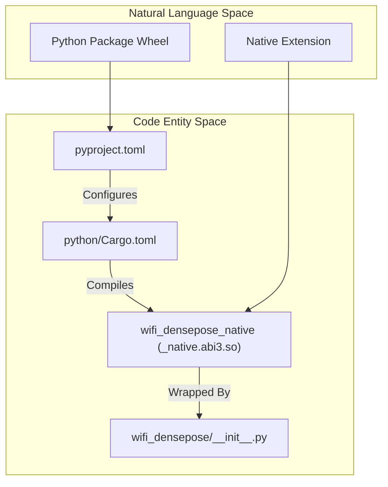
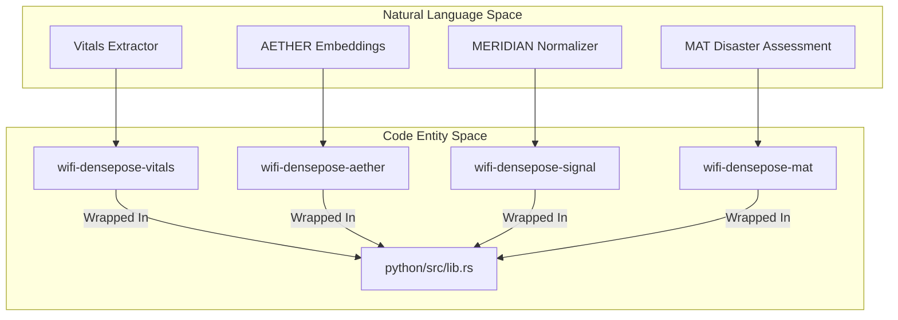
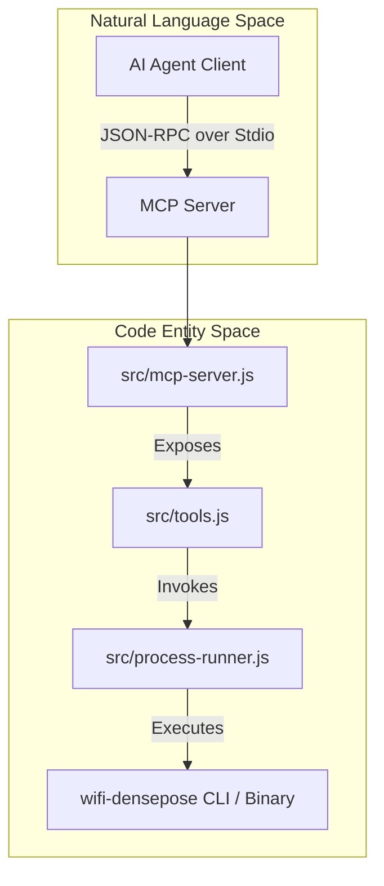

<!-- source: DeepWiki mcp.deepwiki.com · repo ruvnet/RuView · page 5.4 Python Package & MCP Integration · fetched 2026-10-30 -->

# Python Package & MCP Integration

Relevant source files

The following files were used as context for generating this wiki page:

- [.github/workflows/npm-packages.yml](.github/workflows/npm-packages.yml)
- [.github/workflows/pip-release.yml](.github/workflows/pip-release.yml)
- [.github/workflows/ruview-npm-release.yml](.github/workflows/ruview-npm-release.yml)
- [AGENTS.md](AGENTS.md)
- [docs/adr/ADR-185-python-p6-sota-bindings.md](docs/adr/ADR-185-python-p6-sota-bindings.md)
- [docs/adr/ADR-263-ruview-npm-harness-deep-review.md](docs/adr/ADR-263-ruview-npm-harness-deep-review.md)
- [docs/adr/ADR-325-cognitum-spaces-activation-and-governed-spatial-exchange.md](docs/adr/ADR-325-cognitum-spaces-activation-and-governed-spatial-exchange.md)
- [docs/research/rvagent-rvf-integration/README.md](docs/research/rvagent-rvf-integration/README.md)
- [harness/ruview/.harness/manifest.json](harness/ruview/.harness/manifest.json)
- [harness/ruview/.harness/manifest.sha256](harness/ruview/.harness/manifest.sha256)
- [harness/ruview/CLAUDE.md](harness/ruview/CLAUDE.md)
- [harness/ruview/README.md](harness/ruview/README.md)
- [harness/ruview/bin/cli.js](harness/ruview/bin/cli.js)
- [harness/ruview/package-lock.json](harness/ruview/package-lock.json)
- [harness/ruview/package.json](harness/ruview/package.json)
- [harness/ruview/src/guidance.js](harness/ruview/src/guidance.js)
- [harness/ruview/src/mcp-server.js](harness/ruview/src/mcp-server.js)
- [harness/ruview/src/tools.js](harness/ruview/src/tools.js)
- [harness/ruview/test/mcp.test.mjs](harness/ruview/test/mcp.test.mjs)
- [harness/ruview/test/tools.test.mjs](harness/ruview/test/tools.test.mjs)
- [plugins/ruview/.claude-plugin/plugin.json](plugins/ruview/.claude-plugin/plugin.json)
- [plugins/ruview/codex/AGENTS.md](plugins/ruview/codex/AGENTS.md)
- [plugins/ruview/codex/prompts/ruview-rvagent.md](plugins/ruview/codex/prompts/ruview-rvagent.md)
- [plugins/ruview/skills/ruview-rvagent/SKILL.md](plugins/ruview/skills/ruview-rvagent/SKILL.md)
- [python/Cargo.lock](python/Cargo.lock)
- [python/Cargo.toml](python/Cargo.toml)
- [python/pyproject.toml](python/pyproject.toml)
- [python/ruview-meta/pyproject.toml](python/ruview-meta/pyproject.toml)
- [python/src/bindings/mat.rs](python/src/bindings/mat.rs)
- [python/src/lib.rs](python/src/lib.rs)
- [python/tests/aether_parity.rs](python/tests/aether_parity.rs)
- [python/tests/aether_weights_parity.rs](python/tests/aether_weights_parity.rs)
- [python/tests/golden/aether_embedding.json](python/tests/golden/aether_embedding.json)
- [python/tests/golden/aether_loaded_embedding.json](python/tests/golden/aether_loaded_embedding.json)
- [python/tests/golden/mat_input.json](python/tests/golden/mat_input.json)
- [python/tests/golden/mat_result.sha256](python/tests/golden/mat_result.sha256)
- [python/tests/mat_parity.rs](python/tests/mat_parity.rs)
- [python/tests/test_mat.py](python/tests/test_mat.py)
- [python/tests/test_meridian.py](python/tests/test_meridian.py)
- [python/wifi_densepose/__init__.py](python/wifi_densepose/__init__.py)
- [python/wifi_densepose/aether.py](python/wifi_densepose/aether.py)
- [python/wifi_densepose/mat.py](python/wifi_densepose/mat.py)
- [python/wifi_densepose/mat.pyi](python/wifi_densepose/mat.pyi)
- [python/wifi_densepose/meridian.py](python/wifi_densepose/meridian.py)
- [v2/crates/wifi-densepose-mat/src/detection/pipeline.rs](v2/crates/wifi-densepose-mat/src/detection/pipeline.rs)
- [v2/crates/wifi-densepose-mat/src/lib.rs](v2/crates/wifi-densepose-mat/src/lib.rs)

This page documents the programmatic access layers of the RuView ecosystem: the `wifi-densepose` Python package (ADR-117/184/185) and the `ruview-mcp` Model Context Protocol server, alongside the `plugins/ruview` agent plugin and the npm harness CLI.

---

## 1. Python Package Architecture & Build

The `wifi-densepose` PyPI package provides Python bindings for the Rust sensing core [python/pyproject.toml:11-15](). Version 2.0.0 replaces the legacy Python implementation with a PyO3-compiled extension module named `wifi_densepose._native`, exposing a pure-Python facade in `wifi_densepose/__init__.py` [python/Cargo.toml:15-24](). 

To avoid building separate wheels for every Python minor version, the package uses `abi3-py310`, ensuring a single binary wheel per OS/architecture supports Python 3.10 through 3.13 and newer stable ABIs [python/Cargo.toml:48-52](), [.github/workflows/pip-release.yml:102-103](). 

Sources: [python/pyproject.toml:1-15](), [python/Cargo.toml:15-25](), [.github/workflows/pip-release.yml:102-123]()

---

## 2. PyO3 Subsystem Bindings

The Rust workspace exposes several subsystem crates through PyO3 modules, gated behind Cargo features to preserve a lean default wheel footprint:

*   **Vitals (`wifi-densepose-vitals`)**: Pure-sync 4-stage digital signal processing pipeline for breathing and heart rate extraction [python/Cargo.toml:59-61]().
*   **AETHER (`wifi-densepose-aether`)**: Contrastive CSI embedding and person re-identification (ADR-024, ADR-185 P1), exporting 128-dimensional L2-normalized vectors [python/Cargo.toml:78-84](), [python/wifi_densepose/aether.py:1-20]().
*   **MERIDIAN (`wifi-densepose-train`, `wifi-densepose-signal`)**: Cross-domain generalization and hardware-invariant normalization (ADR-027, ADR-185 P2), binding the tch-free inference and rapid adaptation paths [python/Cargo.toml:86-101](), [python/wifi_densepose/meridian.py:1-27]().
*   **MAT (`wifi-densepose-mat`)**: Mass Casualty Assessment Tool (ADR-185 P3) for disaster-survivor detection and START-protocol triage [python/Cargo.toml:103-116](), [python/wifi_densepose/mat.py:1-31]().

Sources: [python/Cargo.toml:59-116](), [python/wifi_densepose/aether.py:1-49](), [python/wifi_densepose/meridian.py:1-62](), [python/wifi_densepose/mat.py:1-61]()

---

## 3. Client Facade & Optional Dependencies

The package defines optional dependency groups and Cargo features to control wheel size budget and optional dependencies:

| Pip Extra | Cargo Feature | Bound Subsystems / Dependencies |
| :--- | :--- | :--- |
| `[client]` | N/A | Pure-Python WebSocket/MQTT client helpers (`websockets`, `paho-mqtt`) [python/pyproject.toml:47-50]() |
| `[aether]` | `aether` | `wifi-densepose-aether` (pure compute, zero external async/server dependencies) [python/pyproject.toml:56](), [python/Cargo.toml:33]() |
| `[meridian]` | `meridian` | `wifi-densepose-train` (without `tch-backend`) and `wifi-densepose-signal` [python/pyproject.toml:59](), [python/Cargo.toml:38]() |
| `[mat]` | `mat` | `wifi-densepose-mat` with `tokio` and `geo` dependencies [python/pyproject.toml:62](), [python/Cargo.toml:43]() |
| `[sota]` | `sota` | Convenience superset enabling `aether`, `meridian`, and `mat` [python/pyproject.toml:64](), [python/Cargo.toml:45]() |

Sources: [python/pyproject.toml:45-64](), [python/Cargo.toml:28-46]()

---

## 4. Model Context Protocol (MCP) Server & Agent Integration

The `ruview-mcp` server implements the Model Context Protocol (ADR-124), exposing RuView capabilities to AI assistants over `stdio` or HTTP transports [harness/ruview/.harness/manifest.json:50](), [harness/ruview/src/guidance.js:1-50]().

*   **Agent Plugin (`plugins/ruview`)**: Integrates tools into LLM runtimes like Claude Code and Codex [harness/ruview/.harness/manifest.json:7-10]().
*   **Spatial & Tool Invocations**: Exposes tools for room calibration, node provisioning, and Cognitum Spaces integration [harness/ruview/.harness/manifest.json:14-18]().

Sources: [harness/ruview/.harness/manifest.json:1-70](), [harness/ruview/src/mcp-server.js:1-1], [harness/ruview/src/tools.js:1-1]()

---

## 5. NPM Harness CLI & Metaharness

The `harness/ruview` package provides testing fixtures, flywheel evaluations, and CLI automation scripts [harness/ruview/.harness/manifest.json:26-34]().

*   **CLI Entry Point**: Executed via `bin/cli.js` to manage verification runs and local agent guardrails [harness/ruview/bin/cli.js:1](), [harness/ruview/src/guardrails.js:1-1]().
*   **Manifest & Claims**: Governed by `.harness/manifest.json` ensuring cryptographic file hashing and verified dependency pins [harness/ruview/.harness/manifest.json:1-70]().

Sources: [harness/ruview/.harness/manifest.json:1-70](), [harness/ruview/bin/cli.js:1-1]()

---

