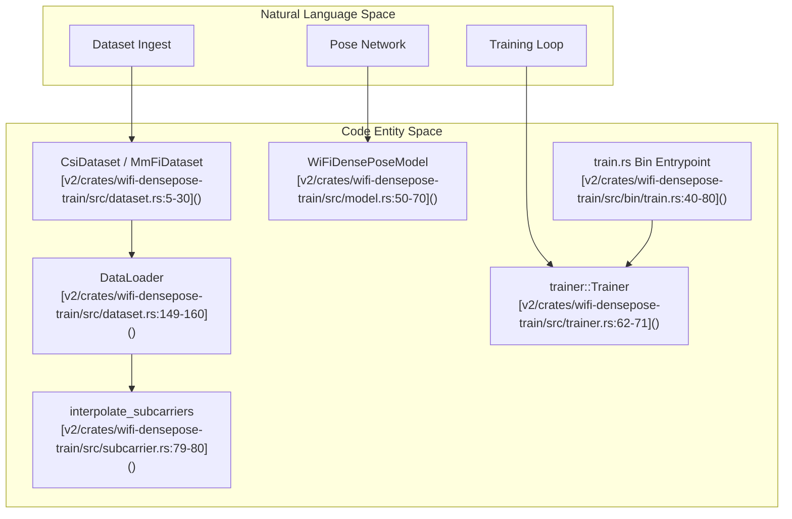
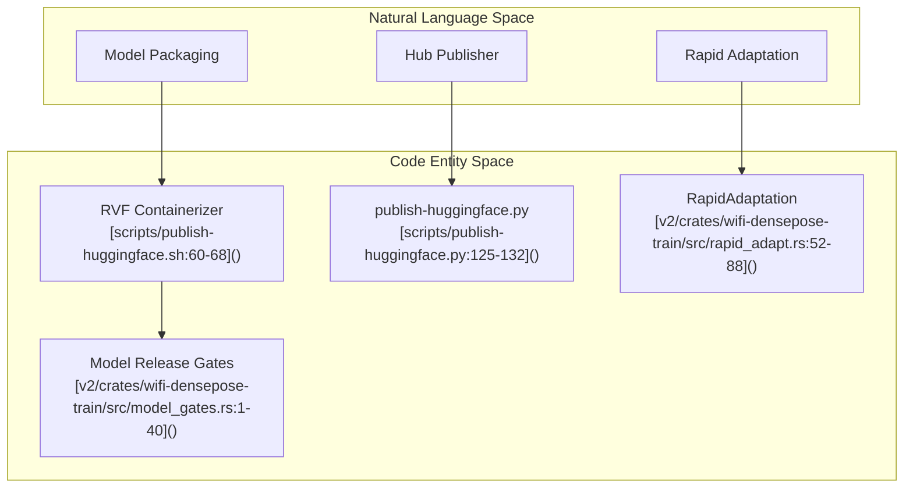

<!-- source: DeepWiki mcp.deepwiki.com · repo ruvnet/RuView · page 6 Training & Model Deployment · fetched 2026-10-30 -->

# Training & Model Deployment

Relevant source files

The following files were used as context for generating this wiki page:

- [docs/adr/ADR-173-metric-locked-pck-mpjpe-accuracy-harness.md](docs/adr/ADR-173-metric-locked-pck-mpjpe-accuracy-harness.md)
- [v2/crates/wifi-densepose-mat/benches/feitcsi_bench.rs](v2/crates/wifi-densepose-mat/benches/feitcsi_bench.rs)
- [v2/crates/wifi-densepose-mat/src/integration/csi_receiver.rs](v2/crates/wifi-densepose-mat/src/integration/csi_receiver.rs)
- [v2/crates/wifi-densepose-mat/src/integration/feitcsi.rs](v2/crates/wifi-densepose-mat/src/integration/feitcsi.rs)
- [v2/crates/wifi-densepose-mat/src/integration/hardware_adapter.rs](v2/crates/wifi-densepose-mat/src/integration/hardware_adapter.rs)
- [v2/crates/wifi-densepose-mat/src/integration/mod.rs](v2/crates/wifi-densepose-mat/src/integration/mod.rs)
- [v2/crates/wifi-densepose-train/benches/benchmark_harness.rs](v2/crates/wifi-densepose-train/benches/benchmark_harness.rs)
- [v2/crates/wifi-densepose-train/src/accuracy.rs](v2/crates/wifi-densepose-train/src/accuracy.rs)
- [v2/crates/wifi-densepose-train/src/bin/train.rs](v2/crates/wifi-densepose-train/src/bin/train.rs)
- [v2/crates/wifi-densepose-train/src/dataset.rs](v2/crates/wifi-densepose-train/src/dataset.rs)
- [v2/crates/wifi-densepose-train/src/dataset/widar.rs](v2/crates/wifi-densepose-train/src/dataset/widar.rs)
- [v2/crates/wifi-densepose-train/src/error.rs](v2/crates/wifi-densepose-train/src/error.rs)
- [v2/crates/wifi-densepose-train/src/lib.rs](v2/crates/wifi-densepose-train/src/lib.rs)
- [v2/crates/wifi-densepose-train/tests/test_metrics.rs](v2/crates/wifi-densepose-train/tests/test_metrics.rs)

This wiki page provides an architectural overview of the `wifi-densepose-train` pipeline and its supporting crates, detailing how raw channel state information (CSI) is processed into datasets, trained via self-supervised and supervised objectives, evaluated against metric-locked standards, and packaged into the RuVector Format (RVF) and edge cog applications.

**Scope**: This is a parent page. For deep implementation details, see the child pages:
- [Dataset Preparation](#6.1)
- [Model Training](#6.2)
- [Model Deployment & RVF Format](#6.3)
- [AetherArena Benchmark](#6.4)
- [Cog Packaging & Edge Model Apps](#6.5)

---

## Training Pipeline Overview

The training infrastructure transforms multi-view and single-view CSI streams into deployable model containers. The Rust workspace coordinates dataset loading, tensor preprocessing, self-supervised pretraining, and GPU execution via LibTorch bindings (`tch-backend`).

### Diagram: Natural Language to Code Entity Mapping (Training)

*Sources: [v2/crates/wifi-densepose-train/src/lib.rs:8-20](), [v2/crates/wifi-densepose-train/src/trainer.rs:62-71](), [v2/crates/wifi-densepose-train/src/bin/train.rs:40-80]()*

---

## Dataset Preparation

Data ingest supports multiple academic and field-collected formats, applying deterministic indexing, subcarrier resampling, and tensor compression.

- **Supported Formats**: `MmFiDataset` processes `.npy` tensor archives [v2/crates/wifi-densepose-train/src/dataset.rs:5-30]() while `SyntheticCsiDataset` provides deterministic physics-based simulation for testing [v2/crates/wifi-densepose-train/src/dataset.rs:32-41](). Ingest for Widar3.0 Intel 5300 `.dat` bfee logs is provided via `widar::WidarDataset` [v2/crates/wifi-densepose-train/src/dataset/widar.rs:1-20]().
- **Preprocessing**: Frequency-axis resampling via `interpolate_subcarriers` maps variable antenna configurations to unified input dimensions [v2/crates/wifi-densepose-train/src/subcarrier.rs:79-80](). Temporal compression relies on `ruvector-temporal-tensor` [v2/crates/wifi-densepose-train/src/dataset.rs:44-46]().

For complete ingestion logic, DataLoader structures, and synthetic generators, see [Dataset Preparation](#6.1).

*Sources: [v2/crates/wifi-densepose-train/src/dataset.rs:1-122](), [v2/crates/wifi-densepose-train/src/subcarrier.rs:1-90]()*

---

## Model Training

The training orchestrator executes multi-task learning objectives combining keypoint regression, DensePose UV mapping, and domain-adversarial adaptation.

- **Modality Translation & Backbone**: Translates raw amplitude and phase tensors into latent space representations feeding into multi-task heads [v2/crates/wifi-densepose-train/src/model.rs:60-90]().
- **Self-Supervised Pretraining**: Unlabeled Wi-Fi data is processed via Masked Autoencoders (MAE) following ADR-152 [v2/crates/wifi-densepose-train/src/mae.rs:1-40]().
- **Metrics & Validation**: Evaluates models using metric-locked PCK (Percentage of Correct Keypoints), OKS (Object Keypoint Similarity), and MPJPE (Mean Per-Joint Position Error) via the `accuracy` module [v2/crates/wifi-densepose-train/src/accuracy.rs:1-50]().

For detailed configuration parameters, loss balancing, and training progress APIs, see [Model Training](#6.2).

*Sources: [v2/crates/wifi-densepose-train/src/config.rs:44-174](), [v2/crates/wifi-densepose-train/src/accuracy.rs:1-60]()*

---

## Model Deployment & RVF Format

Trained weights and configurations are serialized into the RuVector Format (RVF) container specification for efficient distribution and low-latency runtime inference.

### Diagram: Natural Language to Code Entity Mapping (Deployment)

*Sources: [scripts/publish-huggingface.sh:60-68](), [scripts/publish-huggingface.py:125-132](), [v2/crates/wifi-densepose-train/src/rapid_adapt.rs:52-88]()*

- **Release Gates**: Automated checks in `model_gates` prevent degenerate or mislabeled models from advancing to release [v2/crates/wifi-densepose-train/src/model_gates.rs:1-40]().
- **Progressive Loading**: Container structure supports layer-by-layer streaming to initialize sensing servers instantly before refinement weights complete loading.

For container layout specifications, HuggingFace publishing scripts, and sensing server integration, see [Model Deployment & RVF Format](#6.3).

*Sources: [scripts/publish-huggingface.sh:1-68](), [v2/crates/wifi-densepose-train/src/model_gates.rs:1-50]()*

---

## AetherArena Benchmark

The AetherArena spatial-intelligence benchmark (ADR-149) provides a rigorous evaluation harness for ranking model generalizability and privacy-preserving inference guarantees.

- **Score Runner**: The `aa_score_runner` binary executes evaluation workloads on CPU or GPU without requiring external telemetry [v2/crates/wifi-densepose-train/Cargo.toml:23-28]().
- **Ablation & Privacy**: Measures trade-offs between sensing fidelity and membership inference attack (MIA) vulnerability across feature combinations [v2/crates/wifi-densepose-train/src/ablation.rs:1-53]().

For scoring pipeline specifications, submission manifests, and the RF Foundation Encoder (ADR-150), see [AetherArena Benchmark](#6.4).

*Sources: [v2/crates/wifi-densepose-train/Cargo.toml:23-28](), [v2/crates/wifi-densepose-train/src/ablation.rs:1-126]()*

---

## Cog Packaging & Edge Model Apps

Edge model deployment adheres to the cog packaging specification (ADR-100/101), packaging models with WebAssembly or native runtimes for execution on constrained nodes.

- **Crates**: `cog-pose-estimation` and `cog-person-count` encapsulate model inference artifacts, manifests, and publisher runtimes.
- **Constraints**: Enforces strict honest-labeling policies to prevent synthetic classification outputs from being misattributed to physical sensor captures.

For manifest specifications, ONNX/safetensors artifact structures, and edge runtime modules, see [Cog Packaging & Edge Model Apps](#6.5).

*Sources: [v2/crates/wifi-densepose-train/src/lib.rs:1-40]()*, [v2/crates/wifi-densepose-train/Cargo.toml:1-30]()

---

