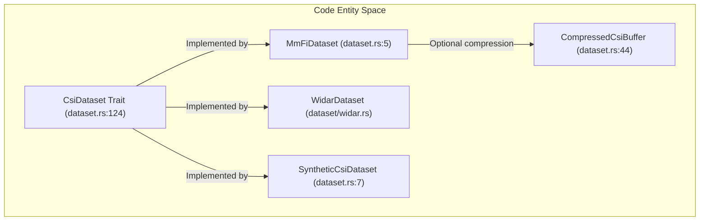
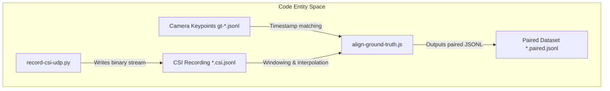

<!-- source: DeepWiki mcp.deepwiki.com · repo ruvnet/RuView · page 6.1 Dataset Preparation · fetched 2026-10-30 -->

# Dataset Preparation

<details>
<summary>Relevant source files</summary>

The following files were used as context for generating this wiki page:

- [docs/adr/ADR-173-metric-locked-pck-mpjpe-accuracy-harness.md](docs/adr/ADR-173-metric-locked-pck-mpjpe-accuracy-harness.md)
- [docs/benchmarks/mmfi-wifi-sensing-study.md](docs/benchmarks/mmfi-wifi-sensing-study.md)
- [docs/benchmarks/person-count-cog.md](docs/benchmarks/person-count-cog.md)
- [scripts/align-ground-truth.js](scripts/align-ground-truth.js)
- [scripts/record-csi-udp.py](scripts/record-csi-udp.py)
- [scripts/train-count.py](scripts/train-count.py)
- [v2/crates/cog-person-count/cog/artifacts/count_train_results.json](v2/crates/cog-person-count/cog/artifacts/count_train_results.json)
- [v2/crates/cog-person-count/cog/artifacts/count_v1.onnx](v2/crates/cog-person-count/cog/artifacts/count_v1.onnx)
- [v2/crates/cog-person-count/cog/artifacts/count_v1.safetensors](v2/crates/cog-person-count/cog/artifacts/count_v1.safetensors)
- [v2/crates/cog-person-count/cog/artifacts/count_v1.temperature](v2/crates/cog-person-count/cog/artifacts/count_v1.temperature)
- [v2/crates/cog-person-count/cog/artifacts/manifests/arm/manifest.json](v2/crates/cog-person-count/cog/artifacts/manifests/arm/manifest.json)
- [v2/crates/cog-person-count/cog/artifacts/manifests/x86_64/manifest.json](v2/crates/cog-person-count/cog/artifacts/manifests/x86_64/manifest.json)
- [v2/crates/wifi-densepose-mat/benches/feitcsi_bench.rs](v2/crates/wifi-densepose-mat/benches/feitcsi_bench.rs)
- [v2/crates/wifi-densepose-mat/src/integration/csi_receiver.rs](v2/crates/wifi-densepose-mat/src/integration/csi_receiver.rs)
- [v2/crates/wifi-densepose-mat/src/integration/feitcsi.rs](v2/crates/wifi-densepose-mat/src/integration/feitcsi.rs)
- [v2/crates/wifi-densepose-mat/src/integration/hardware_adapter.rs](v2/crates/wifi-densepose-mat/src/integration/hardware_adapter.rs)
- [v2/crates/wifi-densepose-mat/src/integration/mod.rs](v2/crates/wifi-densepose-mat/src/integration/mod.rs)
- [v2/crates/wifi-densepose-train/benches/benchmark_harness.rs](v2/crates/wifi-densepose-train/benches/benchmark_harness.rs)
- [v2/crates/wifi-densepose-train/src/accuracy.rs](v2/crates/wifi-densepose-train/src/accuracy.rs)
- [v2/crates/wifi-densepose-train/src/bin/train.rs](v2/crates/wifi-densepose-train/src/bin/train.rs)
- [v2/crates/wifi-densepose-train/src/dataset.rs](v2/crates/wifi-densepose-train/src/dataset.rs)
- [v2/crates/wifi-densepose-train/src/dataset/widar.rs](v2/crates/wifi-densepose-train/src/dataset/widar.rs)
- [v2/crates/wifi-densepose-train/src/error.rs](v2/crates/wifi-densepose-train/src/error.rs)
- [v2/crates/wifi-densepose-train/src/lib.rs](v2/crates/wifi-densepose-train/src/lib.rs)
- [v2/crates/wifi-densepose-train/tests/test_metrics.rs](v2/crates/wifi-densepose-train/tests/test_metrics.rs)

</details>


This page documents the dataset infrastructure used for training WiFi-DensePose models, including dataset formats, loading mechanisms, preprocessing operations, subcarrier interpolation, temporal compression, and ground-truth alignment scripts. For information about model training itself, see [Model Training](#6.2). For deployment of trained models, see [Model Deployment & RVF Format](#6.3).

The dataset preparation layer provides:
- **Multiple dataset sources**: MM-Fi (real CSI recordings), Wi-Pose (cross-environment), Widar3.0 (Intel 5300 bfee captures), and `SyntheticCsiDataset` (deterministic testing). [v2/crates/wifi-densepose-train/src/lib.rs:3-16]()
- **Efficient indexing**: Prefix-sum arrays with $O(\log n)$ binary search for random access across multi-file datasets via cumulative length tracking. [v2/crates/wifi-densepose-train/src/dataset.rs:120-143]()
- **Preprocessing**: Automatic subcarrier interpolation (e.g., converting 114 or 30 subcarriers to the target 56) to normalize varying hardware configurations. [v2/crates/wifi-densepose-train/src/subcarrier.rs:1-79]()
- **Memory optimization**: 50–75% memory reduction via tiered temporal compression using `CompressedCsiBuffer` and `ruvector-temporal-tensor`. [v2/crates/wifi-densepose-train/src/dataset.rs:44-50]()
- **Reproducibility**: Deterministic shuffling using a seeded PRNG (`Xorshift64`). [v2/crates/wifi-densepose-train/src/dataset.rs:149-188]()

---

## Dataset Formats

### MM-Fi (Multimodal-Fidelity)
The primary real-world benchmark used is MM-Fi, which contains data from 40 subjects across 27 activities. The `MmFiDataset` implementation expects a hierarchical layout on disk where CSI amplitude, phase, and keypoints are stored as `.npy` files. [docs/benchmarks/mmfi-wifi-sensing-study.md:4-6](), [v2/crates/wifi-densepose-train/src/dataset.rs:13-26]()

```text
<root>/
  S01/                    # Subject 01
    A01/                  # Action 01
      wifi_csi.npy        # Amplitude: [T, n_tx, n_rx, n_sc]
      wifi_csi_phase.npy  # Phase: [T, n_tx, n_rx, n_sc]
      gt_keypoints.npy    # Keypoints: [T, 17, 3] (x, y, visibility)
    A02/
      ...
  S02/
    ...
```
**Sources**: [docs/benchmarks/mmfi-wifi-sensing-study.md:4-6](), [v2/crates/wifi-densepose-train/src/dataset.rs:13-26]()

### Wi-Pose Dataset
Wi-Pose is used to provide antenna diversity matching target ESP32 hardware configurations. It requires interpolating from its native subcarrier count (e.g., Intel 5300 format) to the RuView target subcarrier count. [docs/benchmarks/mmfi-wifi-sensing-study.md:70-73]()

### Widar3.0 Dataset
Widar3.0 ingest is supported via `widar.rs`, which provides an Intel 5300 `.dat` "bfee" parser (`parse_bfee_bytes`) and a `CsiDataset` adapter complete with split-protocol metadata and leakage guards (ADR-291 §1). [v2/crates/wifi-densepose-train/src/lib.rs:116-117](), [v2/crates/wifi-densepose-train/src/dataset/widar.rs:1-45]()

### Synthetic Dataset
`SyntheticCsiDataset` generates fully deterministic CSI data using a physics-based model. It is the primary data source for verification pipelines and score runners, ensuring that test proofs are not affected by filesystem I/O or non-deterministic parsing. [v2/crates/wifi-densepose-train/src/dataset.rs:6-9]()

**Sources**: [docs/benchmarks/mmfi-wifi-sensing-study.md:4-73](), [v2/crates/wifi-densepose-train/src/lib.rs:116-117](), [v2/crates/wifi-densepose-train/src/dataset.rs:6-9](), [v2/crates/wifi-densepose-train/src/dataset/widar.rs:1-45]()

---

## CsiDataset Trait and CsiSample Structure

### CsiDataset Trait
All dataset implementations conform to the `CsiDataset` trait, which defines the interface for indexed access, length, and metadata naming.


**Sources**: [v2/crates/wifi-densepose-train/src/dataset.rs:3-143](), [v2/crates/wifi-densepose-train/src/dataset/widar.rs:1-45]()

### CsiSample Structure
A `CsiSample` represents a single windowed observation. Keypoint coordinates are normalized to `[0, 1]` with the origin at the top-left corner. [v2/crates/wifi-densepose-train/src/dataset.rs:60-97]()

| Field | Type | Shape | Description |
|-------|------|-------|-------------|
| `amplitude` | `Array4<f32>` | `[window_frames, n_tx, n_rx, n_sc]` | CSI amplitude tensor |
| `phase` | `Array4<f32>` | `[window_frames, n_tx, n_rx, n_sc]` | CSI phase tensor (radians) |
| `keypoints` | `Array2<f32>` | `[17, 2]` | COCO 17-keypoint positions (x, y) |
| `keypoint_visibility` | `Array1<f32>` | `[17]` | COCO visibility flags (0/1/2) |

**Sources**: [v2/crates/wifi-densepose-train/src/dataset.rs:60-97]()

---

## DataLoader Indexing and Shuffling

The `DataLoader` wraps any `CsiDataset` to provide batched iteration. If shuffling is enabled, it applies a deterministic permutation seeded at initialization, ensuring strict reproducibility across training runs. [v2/crates/wifi-densepose-train/src/dataset.rs:149-188]()

**Sources**: [v2/crates/wifi-densepose-train/src/dataset.rs:149-188]()

---

## Subcarrier Interpolation & Signal Normalization

Different hardware devices report varying subcarrier counts (e.g., MM-Fi provides 114 subcarriers, while ESP32 provides 56). The dataset loaders automatically resample the subcarrier frequency axis when the recorded dimensions differ from the target configuration. [v2/crates/wifi-densepose-train/src/subcarrier.rs:1-79]()

1. **Weight Precomputation**: `compute_interp_weights` calculates bracketing indices and fractional weights. [v2/crates/wifi-densepose-train/src/subcarrier.rs:1-35]()
2. **Resampling**: `interpolate_subcarriers` applies linear interpolation across the frequency domain. [v2/crates/wifi-densepose-train/src/subcarrier.rs:37-79]()

**Sources**: [v2/crates/wifi-densepose-train/src/subcarrier.rs:1-79]()

---

## Temporal Compression via CompressedCsiBuffer

To manage large CSI datasets in memory, `CompressedCsiBuffer` implements tiered temporal quantization using `ruvector-temporal-tensor`. [v2/crates/wifi-densepose-train/src/dataset.rs:44-50]()

- **Hot Tier**: High precision for active training windows.
- **Warm Tier**: Medium precision for nearby temporal contexts.
- **Cold Tier**: Low precision (50–75% reduction) for long-term storage and background buffer history.

**Sources**: [v2/crates/wifi-densepose-train/src/dataset.rs:44-50]()

---

## Ground-Truth Collection and Alignment Scripts

To create paired training samples for supervised training (such as WiFlow per ADR-079), camera keypoint observations must be time-aligned with raw CSI recordings captured from ESP32 nodes over UDP. [scripts/align-ground-truth.js:1-25](), [scripts/record-csi-udp.py:1-12]()


**Sources**: [scripts/align-ground-truth.js:1-50](), [scripts/record-csi-udp.py:1-54]()

---

## AetherArena (AA) Integration

Dataset preparation for the AetherArena spatial-intelligence benchmark follows the manifest-based submission model. Models are evaluated against held-out splits using score runner binaries and hash-chained verification ledners. [v2/crates/wifi-densepose-train/src/bin/aa_score_runner.rs:1-28]()

**Sources**: [v2/crates/wifi-densepose-train/src/bin/aa_score_runner.rs:1-28]()

---

