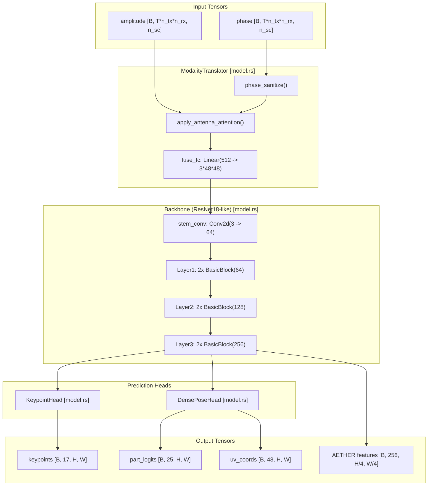
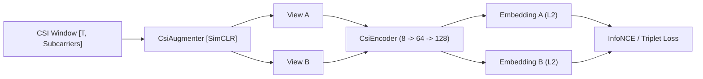
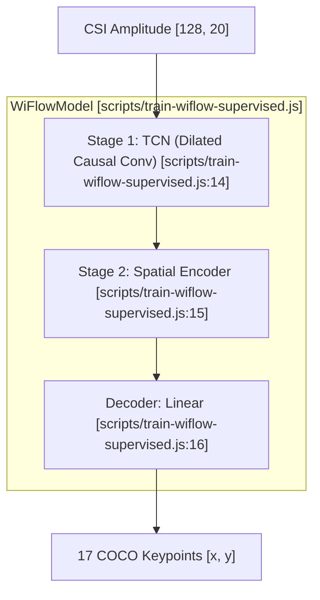
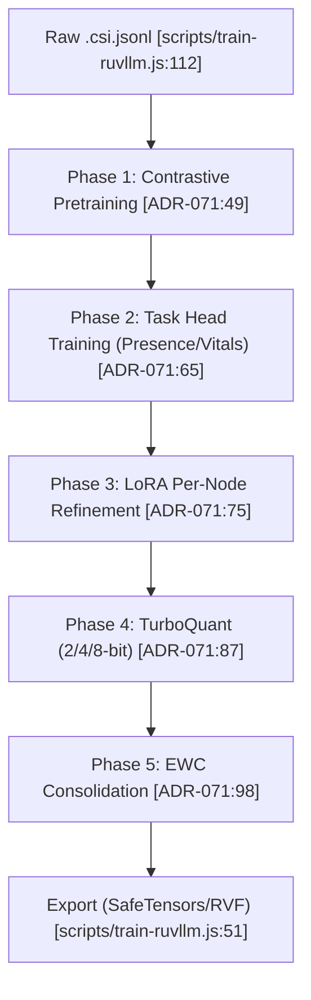
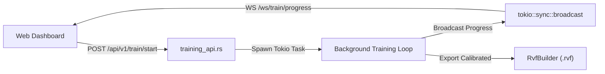
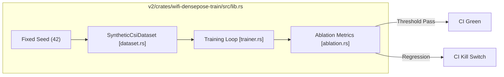

<!-- source: DeepWiki mcp.deepwiki.com · repo ruvnet/RuView · page 6.2 Model Training · fetched 2026-10-30 -->

# Model Training

Relevant source files

The following files were used as context for generating this wiki page:

- [docs/adr/ADR-071-ruvllm-training-pipeline.md](docs/adr/ADR-071-ruvllm-training-pipeline.md)
- [docs/adr/ADR-079-camera-ground-truth-training.md](docs/adr/ADR-079-camera-ground-truth-training.md)
- [docs/adr/ADR-155-nn-training-beyond-sota.md](docs/adr/ADR-155-nn-training-beyond-sota.md)
- [docs/adr/ADR-186-training-progress-api.md](docs/adr/ADR-186-training-progress-api.md)
- [docs/huggingface/MODEL_CARD.md](docs/huggingface/MODEL_CARD.md)
- [python/src/bindings/aether.rs](python/src/bindings/aether.rs)
- [python/tests/test_aether.py](python/tests/test_aether.py)
- [python/wifi_densepose/aether.pyi](python/wifi_densepose/aether.pyi)
- [scripts/benchmark-ruvllm.js](scripts/benchmark-ruvllm.js)
- [scripts/collect-ground-truth.py](scripts/collect-ground-truth.py)
- [scripts/eval-wiflow.js](scripts/eval-wiflow.js)
- [scripts/mac-mini-train.sh](scripts/mac-mini-train.sh)
- [scripts/publish-huggingface.py](scripts/publish-huggingface.py)
- [scripts/publish-huggingface.sh](scripts/publish-huggingface.sh)
- [scripts/train-camera-free.js](scripts/train-camera-free.js)
- [scripts/train-ruvllm.js](scripts/train-ruvllm.js)
- [scripts/train-wiflow-supervised.js](scripts/train-wiflow-supervised.js)
- [ui/components/TrainingPanel.js](ui/components/TrainingPanel.js)
- [v2/crates/wifi-densepose-aether/Cargo.toml](v2/crates/wifi-densepose-aether/Cargo.toml)
- [v2/crates/wifi-densepose-aether/src/embedding.rs](v2/crates/wifi-densepose-aether/src/embedding.rs)
- [v2/crates/wifi-densepose-aether/src/graph_transformer.rs](v2/crates/wifi-densepose-aether/src/graph_transformer.rs)
- [v2/crates/wifi-densepose-aether/src/lib.rs](v2/crates/wifi-densepose-aether/src/lib.rs)
- [v2/crates/wifi-densepose-aether/src/sona.rs](v2/crates/wifi-densepose-aether/src/sona.rs)
- [v2/crates/wifi-densepose-aether/tests/golden_parity.rs](v2/crates/wifi-densepose-aether/tests/golden_parity.rs)
- [v2/crates/wifi-densepose-nn/benches/native_conv_bench.rs](v2/crates/wifi-densepose-nn/benches/native_conv_bench.rs)
- [v2/crates/wifi-densepose-nn/src/densepose.rs](v2/crates/wifi-densepose-nn/src/densepose.rs)
- [v2/crates/wifi-densepose-nn/src/lib.rs](v2/crates/wifi-densepose-nn/src/lib.rs)
- [v2/crates/wifi-densepose-nn/src/rf_encoder.rs](v2/crates/wifi-densepose-nn/src/rf_encoder.rs)
- [v2/crates/wifi-densepose-nn/src/tensor.rs](v2/crates/wifi-densepose-nn/src/tensor.rs)
- [v2/crates/wifi-densepose-nn/src/translator.rs](v2/crates/wifi-densepose-nn/src/translator.rs)
- [v2/crates/wifi-densepose-sensing-server/src/model_format.rs](v2/crates/wifi-densepose-sensing-server/src/model_format.rs)
- [v2/crates/wifi-densepose-sensing-server/src/training_api.rs](v2/crates/wifi-densepose-sensing-server/src/training_api.rs)
- [v2/crates/wifi-densepose-train/benches/training_bench.rs](v2/crates/wifi-densepose-train/benches/training_bench.rs)
- [v2/crates/wifi-densepose-train/src/ablation.rs](v2/crates/wifi-densepose-train/src/ablation.rs)
- [v2/crates/wifi-densepose-train/src/config.rs](v2/crates/wifi-densepose-train/src/config.rs)
- [v2/crates/wifi-densepose-train/src/domain.rs](v2/crates/wifi-densepose-train/src/domain.rs)
- [v2/crates/wifi-densepose-train/src/eval.rs](v2/crates/wifi-densepose-train/src/eval.rs)
- [v2/crates/wifi-densepose-train/src/geometry.rs](v2/crates/wifi-densepose-train/src/geometry.rs)
- [v2/crates/wifi-densepose-train/src/metrics.rs](v2/crates/wifi-densepose-train/src/metrics.rs)
- [v2/crates/wifi-densepose-train/src/metrics_core.rs](v2/crates/wifi-densepose-train/src/metrics_core.rs)
- [v2/crates/wifi-densepose-train/src/rapid_adapt.rs](v2/crates/wifi-densepose-train/src/rapid_adapt.rs)
- [v2/crates/wifi-densepose-train/src/signal_features.rs](v2/crates/wifi-densepose-train/src/signal_features.rs)
- [v2/crates/wifi-densepose-train/tests/test_dataset.rs](v2/crates/wifi-densepose-train/tests/test_dataset.rs)
- [v2/crates/wifi-densepose-train/tests/test_real_loader.rs](v2/crates/wifi-densepose-train/tests/test_real_loader.rs)

This page documents the WiFi-DensePose model training process, including the neural network architecture, training loop orchestration, multi-task loss functions, evaluation metrics, self-supervised pretraining via AETHER, and live training progress streaming APIs. It covers both the high-performance Rust-based training infrastructure and the Node.js-based `ruvllm` pipeline used for rapid adaptation and edge deployment.

The training pipeline transforms raw CSI measurements into spatial intelligence and pose estimation capabilities through a multi-stage architecture that fuses amplitude and phase modalities, extracts hierarchical features, and predicts keypoint heatmaps and DensePose coordinates.

## Model Architecture

The `WiFiDensePoseModel` implements a three-stage architecture: modality translation, feature extraction, and dual-head prediction. The model is defined in the training crate and instantiated with persistent parameter storage.

### WiFiDensePoseModel Structure

Sources: `v2/crates/wifi-densepose-train/src/domain.rs:1-45` [v2/crates/wifi-densepose-train/src/domain.rs]()

### Modality Translator & Backbone
*   **Modality Translator**: Converts flattened CSI vectors into a pseudo-spatial image representation ($3 \times 48 \times 48$) using antenna-path gating and phase sanitization [v2/crates/wifi-densepose-nn/src/translator.rs:1-50]().
*   **Backbone**: A ResNet18-like stack using `BasicBlock` components for hierarchical feature extraction [v2/crates/wifi-densepose-nn/src/tensor.rs:1-60]().
*   **Prediction Heads**: Keypoint head for 17 COCO-compliant joints and DensePose head for body-part classification and UV mapping [v2/crates/wifi-densepose-nn/src/densepose.rs:1-40]().

Sources: `v2/crates/wifi-densepose-nn/src/translator.rs:1-50`, `v2/crates/wifi-densepose-nn/src/densepose.rs:1-40` [v2/crates/wifi-densepose-nn/src/translator.rs]()

---

## Self-Supervised Pretraining & AETHER

The `wifi-densepose-aether` crate implements contrastive self-supervised pretraining for CSI representations, allowing models to learn environmental structures without expensive manual labels [v2/crates/wifi-densepose-aether/src/lib.rs:1-28]().

### Contrastive Embedding Pipeline
*   **Encoder Architecture**: A 2-layer fully connected network (`8 -> 64 -> 128`) with BatchNorm, GELU activation, and L2 normalization yielding a 128-dim embedding [docs/huggingface/MODEL_CARD.md:80-82]().
*   **Loss Functions**: InfoNCE (temperature $0.07$) and Triplet Loss (margin $0.3$) trained on temporal positives (frames within 2s) and temporal/hard negatives (>30s apart or across nodes) [scripts/train-ruvllm.js:88-96](), [docs/huggingface/MODEL_CARD.md:80-82]().
*   **Python Bindings**: PyO3-based synchronous bindings surface `EmbeddingExtractor`, `CsiAugmenter`, and `info_nce_loss` to Python `wifi_densepose.aether` with bit-for-bit numerical parity guarantees [python/src/bindings/aether.rs:1-35](), [python/tests/test_aether.py:1-33]().

Sources: `v2/crates/wifi-densepose-aether/src/embedding.rs:1-80`, `python/src/bindings/aether.rs:1-35` [v2/crates/wifi-densepose-aether/src/embedding.rs]()

---

## Camera-Supervised WiFlow Pipeline (ADR-079)

To achieve high spatial accuracy beyond naive heuristic proxies, RuView implements a camera-supervised training pipeline where laptop camera feeds provide teacher labels via MediaPipe [docs/adr/ADR-079-camera-ground-truth-training.md:1-45]().

### WiFlow Pipeline & Curriculum

Sources: `scripts/train-wiflow-supervised.js:13-17`, `docs/adr/ADR-079-camera-ground-truth-training.md:36-42` [scripts/train-wiflow-supervised.js]()

*   **Data Synchronization**: `collect-ground-truth.py` aligns 30 fps laptop webcam frames with ~100 Hz ESP32 CSI windows, mapping 33 MediaPipe landmarks to 17 COCO keypoints [docs/adr/ADR-079-camera-ground-truth-training.md:85-178]().
*   **Three-Phase Curriculum (`train-wiflow-supervised.js`)**:
    1.  *Phase 1*: Contrastive pretraining on CSI windows [scripts/train-wiflow-supervised.js:20]().
    2.  *Phase 2*: Confidence-weighted SmoothL1 keypoint regression with progressive thresholds ($0.9 \to 0.7 \to 0.5 \to 0.0$) [scripts/train-wiflow-supervised.js:21-22]().
    3.  *Phase 3*: Fine-tuning with skeletal bone length constraints and temporal consistency penalties ($\lambda_{bone}=0.3$, $\lambda_{temporal}=0.1$) [scripts/train-wiflow-supervised.js:23-125]().

Sources: `scripts/train-wiflow-supervised.js:19-24`, `docs/adr/ADR-079-camera-ground-truth-training.md:69-73` [scripts/train-wiflow-supervised.js]()

---

## The ruvllm Pipeline & Edge Export (ADR-071)

For environments without heavy Python stacks, RuView provides the Node.js-based `ruvllm` training and quantization pipeline [docs/adr/ADR-071-ruvllm-training-pipeline.md:18-38]().

### ruvllm Training Phases

Sources: `docs/adr/ADR-071-ruvllm-training-pipeline.md:45-108`, `scripts/train-ruvllm.js:1-110` [docs/adr/ADR-071-ruvllm-training-pipeline.md]()

*   **TurboQuant Compression**: Supports 2-bit, 4-bit, and 8-bit uniform affine weight quantization for edge deployment on ESP32-S3 or Raspberry Pi Zero (`csi-embed-v2-int4.bin` fits within 8 KB SRAM budgets) [docs/huggingface/MODEL_CARD.md:124](), [docs/adr/ADR-071-ruvllm-training-pipeline.md:87-95]().
*   **Model Format Detection & Conversion**: `model_format.rs` auto-detects model file formats (Safetensors, HF quantized blobs, RVF containers) and provides built-in converters (`safetensors_to_rvf`) to resolve HuggingFace loading discrepancies (Issue #894) [v2/crates/wifi-densepose-sensing-server/src/model_format.rs:1-41]().

Sources: `v2/crates/wifi-densepose-sensing-server/src/model_format.rs:1-41`, `docs/adr/ADR-071-ruvllm-training-pipeline.md:87-108` [v2/crates/wifi-densepose-sensing-server/src/model_format.rs]()

---

## Training Progress API & Sensing Server Integration (ADR-186)

To resolve UI gaps where training requests silently no-oped or returned 404 errors, ADR-186 wires the in-server training engine and WebSocket progress streaming [docs/adr/ADR-186-training-progress-api.md:1-114]().

### Training API Architecture

Sources: `v2/crates/wifi-densepose-sensing-server/src/training_api.rs:1-26`, `docs/adr/ADR-186-training-progress-api.md:80-114` [v2/crates/wifi-densepose-sensing-server/src/training_api.rs]()

*   **REST & WebSocket Endpoints**:
    *   `POST /api/v1/train/start` / `stop` / `status` / `pretrain` / `lora` [v2/crates/wifi-densepose-sensing-server/src/training_api.rs:17-23]()
    *   `WS /ws/train/progress` — streams live training loss, epoch counters, and validation accuracy over tokio broadcast channels [v2/crates/wifi-densepose-sensing-server/src/training_api.rs:24-26]().
*   **Pure Rust Training Loop**: Parses recorded `.csi.jsonl` datasets, extracts subcarrier variance and Goertzel frequency-domain power features, optimizes linear/backbone weights via batch gradient descent, and exports `.rvf` containers without PyTorch dependencies [v2/crates/wifi-densepose-sensing-server/src/training_api.rs:7-16]().

Sources: `v2/crates/wifi-densepose-sensing-server/src/training_api.rs:1-26`, `docs/adr/ADR-186-training-progress-api.md:80-114` [v2/crates/wifi-densepose-sensing-server/src/training_api.rs]()

---

## Multi-Task Loss, Metrics, & Ablation Harness

RuView enforces strict metric canonicalization (ADR-155) to eliminate metric divergence and claim-inflating bugs [docs/adr/ADR-155-nn-training-beyond-sota.md:1-71]().

### Canonical Evaluation Metrics
*   **PCK@k (Percentage of Correct Keypoints)**: Uses torso-normalized distance ($\text{torso} = \|\text{left\_hip} - \text{right\_hip}\|_2$) with bounding-box diagonal fallbacks. *Critical bug fix*: Samples with zero visible joints score `0.0` (never `1.0`) [docs/adr/ADR-155-nn-training-beyond-sota.md:56-61]().
*   **OKS (Object Keypoint Similarity)**: Derived from the ground-truth pose extent scale proxy $s = \sqrt{\text{area}}$, eliminating constant `s = 1.0` inflation on normalized coordinates [docs/adr/ADR-155-nn-training-beyond-sota.md:61]().
*   **MPJPE (Mean Per-Joint Position Error)**: Evaluates millimeter-accurate keypoint deviation on held-out splits [docs/adr/ADR-155-nn-training-beyond-sota.md:63]().

### Ablation Harness
The ablation harness in `wifi-densepose-train` tests subcarrier combinations, feature extraction stages, and privacy leakage metrics (membership inference AUC) under controlled conditions [v2/crates/wifi-densepose-train/src/ablation.rs:1-105]().

Sources: `docs/adr/ADR-155-nn-training-beyond-sota.md:56-71`, `v2/crates/wifi-densepose-train/src/ablation.rs:1-105` [docs/adr/ADR-155-nn-training-beyond-sota.md]()

---

## Rapid Adaptation & Continual Learning (MERIDIAN)

For environment-specific tuning, the system supports **Few-shot Rapid Adaptation** and continual learning [v2/crates/wifi-densepose-train/src/rapid_adapt.rs:1-40]().

*   **LoRA (Low-Rank Adaptation)**: Per-node rank-4 adapters enable room-specific multipath calibration without modifying base backbone weights [scripts/train-ruvllm.js:66](), [docs/adr/ADR-071-ruvllm-training-pipeline.md:75-85]().
*   **EWC (Elastic Weight Consolidation)**: Computes Fisher information matrices ($\lambda = 2000$) to protect previously learned tasks against catastrophic forgetting during per-room fine-tuning [scripts/train-ruvllm.js:45-48](), [docs/adr/ADR-071-ruvllm-training-pipeline.md:98-106]().

Sources: `v2/crates/wifi-densepose-train/src/rapid_adapt.rs:1-40`, `docs/adr/ADR-071-ruvllm-training-pipeline.md:75-106` [v2/crates/wifi-densepose-train/src/rapid_adapt.rs]()

---

## Trust Kill Switch & Verification Pipeline

The `wifi-densepose-train` crate supports deterministic verification. It uses a fixed seed and `SyntheticCsiDataset` to ensure model convergence remains identical across code changes [v2/crates/wifi-densepose-train/src/dataset.rs:1-40]().

Sources: `v2/crates/wifi-densepose-train/src/lib.rs:71-74`, `v2/crates/wifi-densepose-train/src/ablation.rs:1-9` [v2/crates/wifi-densepose-train/src/lib.rs]()

---

