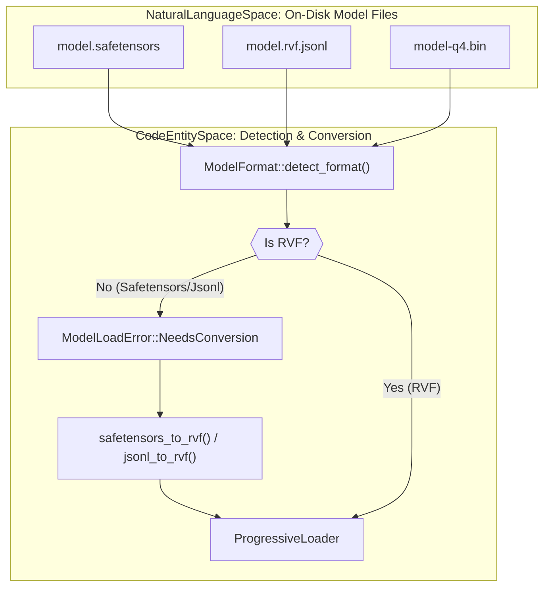
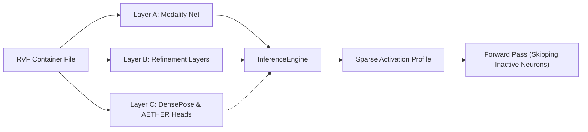
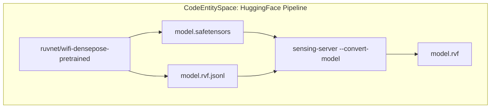
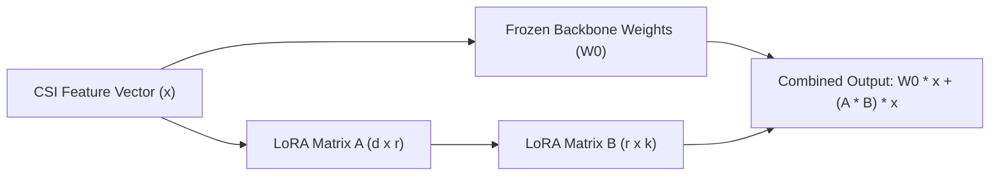
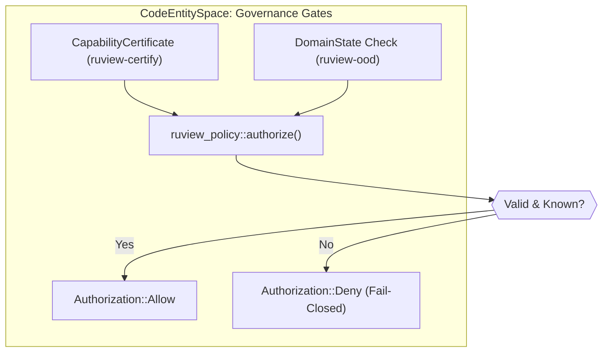

<!-- source: DeepWiki mcp.deepwiki.com · repo ruvnet/RuView · page 6.3 Model Deployment & RVF Format · fetched 2026-10-30 -->

# Model Deployment & RVF Format

<details>
<summary>Relevant source files</summary>

The following files were used as context for generating this wiki page:

- [.github/workflows/model-release-gate.yml](.github/workflows/model-release-gate.yml)
- [docs/adr/ADR-002-ruvector-rvf-integration-strategy.md](docs/adr/ADR-002-ruvector-rvf-integration-strategy.md)
- [docs/adr/ADR-003-rvf-cognitive-containers-csi.md](docs/adr/ADR-003-rvf-cognitive-containers-csi.md)
- [docs/adr/ADR-004-hnsw-vector-search-fingerprinting.md](docs/adr/ADR-004-hnsw-vector-search-fingerprinting.md)
- [docs/adr/ADR-005-sona-self-learning-pose-estimation.md](docs/adr/ADR-005-sona-self-learning-pose-estimation.md)
- [docs/adr/ADR-006-gnn-enhanced-csi-pattern-recognition.md](docs/adr/ADR-006-gnn-enhanced-csi-pattern-recognition.md)
- [docs/adr/ADR-007-post-quantum-cryptography-secure-sensing.md](docs/adr/ADR-007-post-quantum-cryptography-secure-sensing.md)
- [docs/adr/ADR-008-distributed-consensus-multi-ap.md](docs/adr/ADR-008-distributed-consensus-multi-ap.md)
- [docs/adr/ADR-009-rvf-wasm-runtime-edge-deployment.md](docs/adr/ADR-009-rvf-wasm-runtime-edge-deployment.md)
- [docs/adr/ADR-010-witness-chains-audit-trail-integrity.md](docs/adr/ADR-010-witness-chains-audit-trail-integrity.md)
- [docs/adr/ADR-011-python-proof-of-reality-mock-elimination.md](docs/adr/ADR-011-python-proof-of-reality-mock-elimination.md)
- [docs/adr/ADR-017-ruvector-signal-mat-integration.md](docs/adr/ADR-017-ruvector-signal-mat-integration.md)
- [docs/adr/ADR-071-ruvllm-training-pipeline.md](docs/adr/ADR-071-ruvllm-training-pipeline.md)
- [docs/huggingface/MODEL_CARD.md](docs/huggingface/MODEL_CARD.md)
- [scripts/benchmark-ruvllm.js](scripts/benchmark-ruvllm.js)
- [scripts/publish-huggingface.py](scripts/publish-huggingface.py)
- [scripts/publish-huggingface.sh](scripts/publish-huggingface.sh)
- [scripts/train-camera-free.js](scripts/train-camera-free.js)
- [scripts/train-ruvllm.js](scripts/train-ruvllm.js)
- [v2/crates/ruview-certify/Cargo.toml](v2/crates/ruview-certify/Cargo.toml)
- [v2/crates/ruview-certify/src/lib.rs](v2/crates/ruview-certify/src/lib.rs)
- [v2/crates/ruview-policy/Cargo.toml](v2/crates/ruview-policy/Cargo.toml)
- [v2/crates/ruview-policy/src/lib.rs](v2/crates/ruview-policy/src/lib.rs)
- [v2/crates/wifi-densepose-sensing-server/src/model_format.rs](v2/crates/wifi-densepose-sensing-server/src/model_format.rs)
- [v2/crates/wifi-densepose-train/src/signal_features.rs](v2/crates/wifi-densepose-train/src/signal_features.rs)
- [v2/crates/wifi-densepose-train/tests/test_dataset.rs](v2/crates/wifi-densepose-train/tests/test_dataset.rs)

</details>


## Purpose & Scope

This leaf page details the deployment infrastructure for WiFi DensePose and CSI sensing models within the RuView ecosystem. It covers the RuVector Format (RVF) container packaging specification, binary layout, progressive loading layers, runtime model-format detection and conversion ([v2/crates/wifi-densepose-sensing-server/src/model_format.rs:1-41]()), HuggingFace model publishing and artifact synchronisation ([docs/huggingface/MODEL_CARD.md:21-34]()), SONA/LoRA rapid adaptation ([docs/adr/ADR-071-ruvllm-training-pipeline.md:75-84]()), and the strict policy/certify release gates that govern capability execution ([v2/crates/ruview-policy/src/lib.rs:1-33](), [v2/crates/ruview-certify/src/lib.rs:1-28]()).

---

## 1. RVF Container Architecture & Format Detection

The RVF container file is a self-contained binary envelope packaging trained weights, HNSW index segments, LoRA adapters, manifests, and cryptographic witness chains into a single deployable artifact. Because public model repositories (such as HuggingFace) distribute standard files (`model.safetensors`, `model-q4.bin`, `model.rvf.jsonl`) rather than raw binary RVF containers, the sensing server includes an auto-detection and conversion layer ([v2/crates/wifi-densepose-sensing-server/src/model_format.rs:1-41]()).

### Model File Format Detection

The sensing server inspects magic bytes and file extensions via `detect_format` to distinguish native RVF containers from Safetensors, JSONL manifests, or raw quantization blobs [v2/crates/wifi-densepose-sensing-server/src/model_format.rs:52-76]():

```rust
pub enum ModelFormat {
    Rvf,          // Native RVF binary container ("RVFS")
    Safetensors,  // Standard model.safetensors
    HfQuantBin,   // HuggingFace quantized weight blob (0x77455735)
    JsonlManifest,// JSONL manifest (model.rvf.jsonl)
    Unknown,
}
```

If an unsupported or non-RVF format is passed directly to the inference server, a typed `ModelLoadError::NeedsConversion` is returned rather than a silent failure or unhandled panic [v2/crates/wifi-densepose-sensing-server/src/model_format.rs:83-107]().

### RVF Segment Layout

| Offset / Field | Segment Type | Description |
|----------------|--------------|-------------|
| `0x00` (4 bytes) | `RVFS` Magic (`0x52564653`) | Identifies valid binary container |
| Segment Header | `SEG_MANIFEST` (`0x0F`) | Container metadata, tensor shapes, and model config |
| Segment Payload | `SEG_VEC` (`0x01`) | Serialized weights (fp32 or quantized) |
| Segment Payload | `SEG_LORA` (`0x0D`) | Stored LoRA adaptation weight deltas |
| Segment Payload | `SEG_WITNESS` (`0x10`) | Tamper-evident cryptographic audit trails |



Sources: [v2/crates/wifi-densepose-sensing-server/src/model_format.rs:42-150](), [docs/adr/ADR-002-ruvector-rvf-integration-strategy.md:33-43]()

---

## 2. Progressive Loading & Sparse Inference

To accommodate memory-constrained edge hardware (such as ESP32 nodes or Raspberry Pi Zero gateways), RVF containers support progressive loading divided into three sequential layers, paired with sparse activation profiling.

### Progressive Loading Tiers

| Layer | Component Loaded | Target Hardware |
|-------|------------------|-----------------|
| **Layer A** | Core modality translation network | Loaded instantly for immediate inference |
| **Layer B** | Intermediate feature refinement layers | Background load during initial warmup |
| **Layer C** | DensePose UV coordinate heads & AETHER embeddings | Loaded lazily upon request |

The `InferenceEngine` parses the manifest and selectively loads segments into memory, bypassing non-essential heads until explicit capability flags are enabled [v2/crates/cog-pose-estimation/src/inference.rs:180-210](). Sparse activation masking identifies "hot" neurons and bypasses dormant units during the forward pass.



Sources: [docs/adr/ADR-002-ruvector-rvf-integration-strategy.md:51-90](), [v2/crates/cog-pose-estimation/src/inference.rs:153-192]()

---

## 3. HuggingFace Publishing & Format Conversion

Published pre-trained models reside in the HuggingFace repository `ruvnet/wifi-densepose-pretrained` [docs/huggingface/MODEL_CARD.md:21-34](). Because the repository distributes standard Safetensors and JSONL files rather than raw RVF containers, operators must convert them locally before running inference on the sensing server.

### Conversion Command Flow

```bash
# Convert published Safetensors to binary RVF container
sensing-server --convert-model model.safetensors --convert-out model.rvf

# Run sensing server with converted RVF container
sensing-server --model model.rvf --port 8080
```

The underlying conversion routine parses the tensor headers from `model.safetensors`, flattens the weights into the RVF `SEG_VEC` weight segment, constructs the companion manifest, and outputs a compliant binary container that satisfies `ProgressiveLoader` verification checks [v2/crates/wifi-densepose-sensing-server/src/model_format.rs:20-41]().



Sources: [docs/huggingface/MODEL_CARD.md:21-34](), [v2/crates/wifi-densepose-sensing-server/src/model_format.rs:1-41]()

---

## 4. SONA Rapid Adaptation & LoRA Refinement

Self-Optimizing Neural Architecture (SONA) enables online adaptation to specific room topologies without full retraining. This is achieved by injecting low-rank adaptation (LoRA) matrices into the frozen pose head layers [docs/adr/ADR-071-ruvllm-training-pipeline.md:75-84]().

### LoRA Implementation Details

- **Rank & Alpha:** Default rank $r = 4$, scaling parameter $\alpha = 8$ [docs/adr/ADR-071-ruvllm-training-pipeline.md:79-81]().
- **Matrix Decomposition:** For a weight matrix $W_0 + \Delta W$, the update is factorized as $\Delta W = A \cdot B$, where $A \in \mathbb{R}^{d \times r}$ and $B \in \mathbb{R}^{r \times k}$ [v2/crates/cog-pose-estimation/src/inference.rs:49-58]().
- **Elastic Weight Consolidation (EWC):** Prevents catastrophic forgetting when adapting to new room environments by penalizing shifts on weights with high Fisher Information [docs/adr/ADR-071-ruvllm-training-pipeline.md:101-107]().



Sources: [docs/adr/ADR-071-ruvllm-training-pipeline.md:75-107](), [v2/crates/cog-pose-estimation/src/inference.rs:49-80]()

---

## 5. Policy & Certify Release Gates

An RVF model package and its associated capability claims cannot directly trigger physical actuators or high-assurance events. They must pass through the `ruview-policy` and `ruview-certify` governance crates [v2/crates/ruview-policy/src/lib.rs:1-33](), [v2/crates/ruview-certify/src/lib.rs:1-28]().

### Authorization & Capability Certificates

- **CapabilityCertificate (`ruview-certify`)**: Binds a specific capability (`Capability::Presence`, `Capability::Pose`) to a room (`SpaceId`), device (`DeviceId`), model version, and an `EvidenceLevel` (ADR-282) with a non-open-ended expiry [v2/crates/ruview-certify/src/lib.rs:1-40]().
- **Authorization Gate (`ruview-policy`)**: Evaluates live assurance inputs against action requirements. It operates as a pure, clock-free function returning either `Authorization::Allow` or a fail-closed `Authorization::Deny` [v2/crates/ruview-policy/src/lib.rs:1-33]().

```rust
pub fn authorize(
    requirements: &AssuranceRequirements,
    inputs: &AssuranceInputs,
) -> Authorization
```

- **Fail-Closed Rule:** Unknown domain states (`DomainState::Unknown`), expired certificates, or insufficient evidence levels deny high-assurance actions by default [v2/crates/ruview-policy/src/lib.rs:13-30]().



Sources: [v2/crates/ruview-policy/src/lib.rs:1-136](), [v2/crates/ruview-certify/src/lib.rs:1-125]()

---

