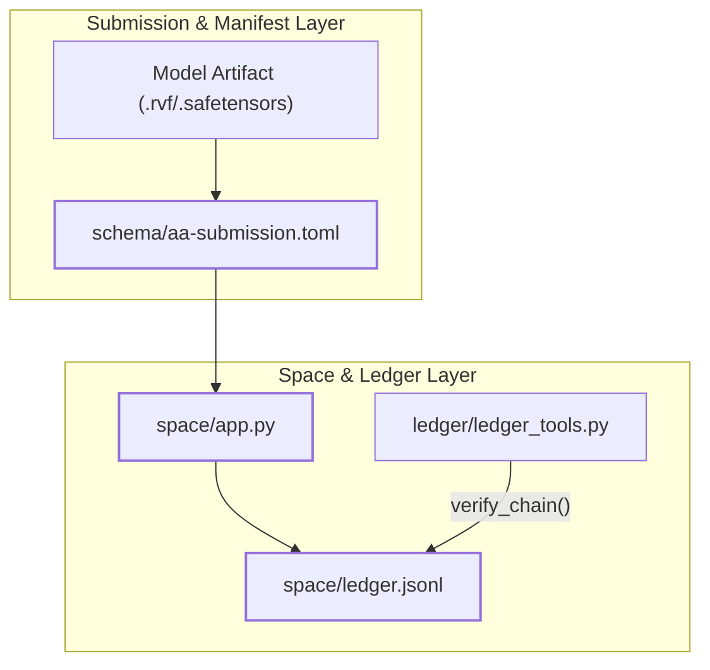
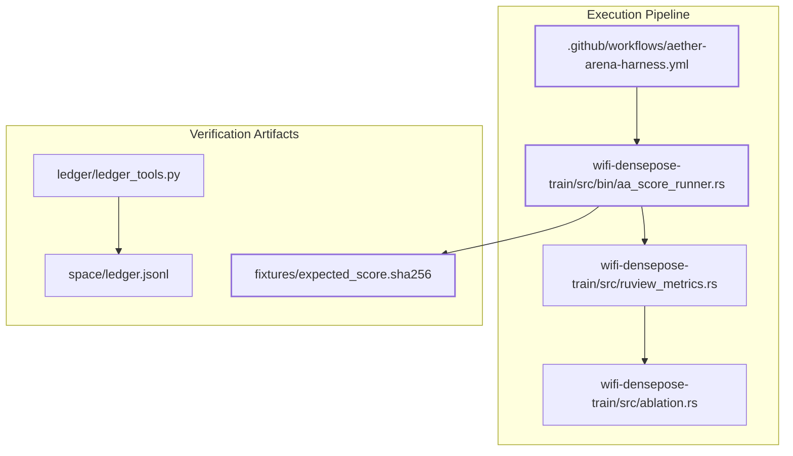

<!-- source: DeepWiki mcp.deepwiki.com · repo ruvnet/RuView · page 6.4 AetherArena Benchmark · fetched 2026-10-30 -->

# AetherArena Benchmark

<details>
<summary>Relevant source files</summary>

The following files were used as context for generating this wiki page:

- [.claude-flow/horizons/aether-arena-aa.json](.claude-flow/horizons/aether-arena-aa.json)
- [.github/workflows/aether-arena-harness.yml](.github/workflows/aether-arena-harness.yml)
- [aether-arena/README.md](aether-arena/README.md)
- [aether-arena/STATUS.md](aether-arena/STATUS.md)
- [aether-arena/VERIFY.md](aether-arena/VERIFY.md)
- [aether-arena/calibration/README.md](aether-arena/calibration/README.md)
- [aether-arena/calibration/calibrate.py](aether-arena/calibration/calibrate.py)
- [aether-arena/calibration/cog_calibrate.py](aether-arena/calibration/cog_calibrate.py)
- [aether-arena/calibration/infer.py](aether-arena/calibration/infer.py)
- [aether-arena/calibration/model.py](aether-arena/calibration/model.py)
- [aether-arena/calibration/test_cog_calibration.py](aether-arena/calibration/test_cog_calibration.py)
- [aether-arena/fixtures/expected_score.sha256](aether-arena/fixtures/expected_score.sha256)
- [aether-arena/fixtures/smoke_pred.json](aether-arena/fixtures/smoke_pred.json)
- [aether-arena/fixtures/smoke_split.json](aether-arena/fixtures/smoke_split.json)
- [aether-arena/ledger/ledger.jsonl](aether-arena/ledger/ledger.jsonl)
- [aether-arena/ledger/ledger_tools.py](aether-arena/ledger/ledger_tools.py)
- [aether-arena/schema/aa-submission.toml](aether-arena/schema/aa-submission.toml)
- [aether-arena/space/README.md](aether-arena/space/README.md)
- [aether-arena/space/app.py](aether-arena/space/app.py)
- [aether-arena/space/ledger.jsonl](aether-arena/space/ledger.jsonl)
- [aether-arena/space/requirements.txt](aether-arena/space/requirements.txt)
- [docs/adr/ADR-149-public-community-leaderboard-huggingface.md](docs/adr/ADR-149-public-community-leaderboard-huggingface.md)
- [docs/adr/ADR-150-rf-foundation-encoder.md](docs/adr/ADR-150-rf-foundation-encoder.md)
- [docs/benchmarks/wifi-pose-efficiency-frontier.md](docs/benchmarks/wifi-pose-efficiency-frontier.md)
- [docs/proof-of-capabilities.md](docs/proof-of-capabilities.md)
- [v2/.cargo/audit.toml](v2/.cargo/audit.toml)
- [v2/crates/homecore-recorder/Cargo.toml](v2/crates/homecore-recorder/Cargo.toml)
- [v2/crates/wifi-densepose-train/src/bin/aa_score_runner.rs](v2/crates/wifi-densepose-train/src/bin/aa_score_runner.rs)

</details>


AetherArena ("AA") is the official, project-agnostic spatial-intelligence benchmark platform designed to provide a standardized, auditable yardstick for camera-free sensing [docs/adr/ADR-149-public-community-leaderboard-huggingface.md:1-4](). It addresses the lack of consistent evaluation protocols in WiFi and RF sensing by providing a hosted leaderboard with matched metrics, private evaluation splits, and a tamper-evident witness ledger [docs/adr/ADR-149-public-community-leaderboard-huggingface.md:18-34]().

---

## 1. Benchmark Architecture & Governance (ADR-149)

The benchmark is structured around four pillars: a public leaderboard hosted as a Hugging Face Space (`aether-arena/space/app.py`), a private evaluation split, an open Rust scoring harness, and a signed witness ledger (`aether-arena/space/ledger.jsonl`) [docs/adr/ADR-149-public-community-leaderboard-hurgical-leaderboard-huggingface.md:53-56](), [aether-arena/space/app.py:3-6](). 

Submissions are governed by a strict schema (`aether-arena/schema/aa-submission.toml`) specifying feature sets, tensor I/O contracts, and model references. Entrants submit model artifacts rather than raw predictions, ensuring independent evaluation against held-out splits [aether-arena/space/app.py:86-97]().


*Diagram 1: Mapping benchmark architecture concepts to physical code entities.*

Sources: [aether-arena/space/app.py:1-38](), [aether-arena/schema/aa-submission.toml:1-10](), [docs/adr/ADR-149-public-community-leaderboard-huggingface.md:18-34]()

---

## 2. Scoring Pipeline and `aa_score_runner`

The core evaluation logic is encapsulated in a pure-Rust, GPU-free runner binary located at `v2/crates/wifi-densepose-train/src/bin/aa_score_runner.rs` [v2/crates/wifi-densepose-train/src/bin/aa_score_runner.rs:1-15](). It evaluates prediction outputs against ground truth using metrics defined in `ruview_metrics.rs` [v2/crates/wifi-densepose-train/src/bin/ruview_metrics.rs:1-20]().

To prevent cross-platform floating-point discrepancies (`libm` variance across GLIBC, MSVC, and macOS), the runner executes strict quantization on metric outputs prior to computing hash values for the determinism gate [v2/crates/wifi-densepose-train/src/bin/aa_score_runner.rs:33-45]().


*Diagram 2: Mapping scorer modules and verification files to execution pipelines.*

### Determinism and Repeatability Commands
*   **Run Scorer Self-Test**: `cargo run -q -p wifi-densepose-train --bin aa_score_runner --no-default-features` [aether-arena/VERIFY.md:19-20]()
*   **Repeatability Check (16 runs)**: `cargo run -q -p wifi-densepose-train --bin aa_score_train --bin aa_score_runner --no-default-features -- --repeat 16` [aether-arena/VERIFY.md:36-37]()
*   **Verify Ledger Integrity**: `python3 ledger_tools.py verify` [aether-arena/VERIFY.md:45-46]()

Sources: [.github/workflows/aether-arena-harness.yml:28-78](), [v2/crates/wifi-densepose-train/src/bin/aa_score_runner.rs:1-50](), [aether-arena/VERIFY.md:10-49]()

---

## 3. RF Foundation Encoder (ADR-150)

The RF Foundation Encoder addresses cross-subject and cross-room generalization bottlenecks by separating pose preservation from environmental noise [docs/adr/ADR-150-rf-foundation-encoder.md:1-20]().

### Loss Stack Formulation
The multi-task objective enforces structural invariance without discarding anatomical properties [docs/adr/ADR-150-rf-foundation-encoder.md:58-68]():
```
L_total = L_pose
        + 0.20 · L_masked_csi          # Learn channel structure from unlabeled CSI
        + 0.10 · L_temporal_contrast   # Enforce motion continuity across frames
        + 0.20 · L_pose_contrast       # Same pose across different subjects = positive
        + 0.05 · L_subject_decorrelation # Remove identity conflicting with pose
        + 0.10 · L_coherence           # Spectral coherence confidence gate
```

Sources: [docs/adr/ADR-150-rf-foundation-encoder.md:1-78]()

---

## 4. Calibration & LoRA Adaptation Tools

Zero-shot cross-environment models degrade significantly in unseen rooms. To solve this without retraining base weights, AetherArena supplies reference calibration scripts under `aether-arena/calibration/` [aether-arena/calibration/README.md:1-15]().

*   `calibrate.py`: Fits an 11 KB rank-8 LoRA adapter (`.npz`) for transformer-based architectures using paired CSI-keypoint tensors [aether-arena/calibration/README.md:35-48]().
*   `cog_calibrate.py`: Produces `.safetensors` adapters compatible with the Rust `cog-pose-estimation` inference engine [aether-arena/calibration/README.md:66-73]().

Sources: [aether-arena/calibration/README.md:1-80](), [aether-arena/calibration/calibrate.py:1-30]()

---

## 5. Implementation Status

| Milestone | Status | Description |
| :--- | :--- | :--- |
| **M2: Scorer** | ✅ Done | `aa_score_runner` functional with determinism gate [aether-arena/STATUS.md:11](). |
| **M6: HF Space** | ✅ Done | Deployed Gradio interface at `huggingface.co/spaces/ruvnet/aether-arena` [aether-arena/STATUS.md:15](). |
| **M7: Ledger** | ✅ Done | `ledger_tools.py` implements append-only hash-chaining [aether-arena/STATUS.md:16](). |
| **M5: Private Split**| 🟡 Pending | Assembly of private MM-Fi held-out split for public scoring [aether-arena/STATUS.md:14](). |

Sources: [aether-arena/STATUS.md:1-30]()

---

