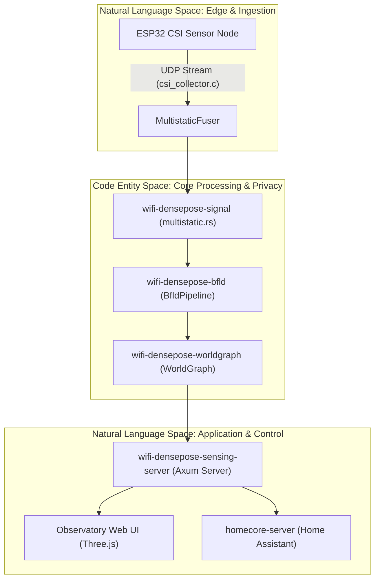

<!-- source: DeepWiki mcp.deepwiki.com · repo ruvnet/RuView · page 7 Architecture & Design · fetched 2026-10-30 -->

# Architecture & Design

Relevant source files

The following files were used as context for generating this wiki page:

- [docs/adr/ADR-012-esp32-csi-sensor-mesh.md](docs/adr/ADR-012-esp32-csi-sensor-mesh.md)
- [docs/adr/ADR-030-ruvsense-persistent-field-model.md](docs/adr/ADR-030-ruvsense-persistent-field-model.md)
- [docs/adr/ADR-052-tauri-desktop-frontend.md](docs/adr/ADR-052-tauri-desktop-frontend.md)
- [docs/adr/ADR-095-rvcsi-edge-rf-sensing-platform.md](docs/adr/ADR-095-rvcsi-edge-rf-sensing-platform.md)
- [docs/adr/ADR-148-drone-swarm-control-system.md](docs/adr/ADR-148-drone-swarm-control-system.md)
- [docs/adr/ADR-164-adr-corpus-gap-analysis.md](docs/adr/ADR-164-adr-corpus-gap-analysis.md)
- [docs/adr/ADR-166-quality-engineering-security-hardening.md](docs/adr/ADR-166-quality-engineering-security-hardening.md)
- [docs/adr/ADR-167-ddd-bounded-contexts.md](docs/adr/ADR-167-ddd-bounded-contexts.md)
- [docs/adr/ADR-168-benchmark-proof.md](docs/adr/ADR-168-benchmark-proof.md)
- [docs/adr/ADR-169-adam-mode-light-theme.md](docs/adr/ADR-169-adam-mode-light-theme.md)
- [docs/adr/gap-analysis/census.md](docs/adr/gap-analysis/census.md)
- [docs/adr/gap-analysis/lens-findings.md](docs/adr/gap-analysis/lens-findings.md)
- [docs/ddd/README.md](docs/ddd/README.md)
- [docs/ddd/hardware-platform-domain-model.md](docs/ddd/hardware-platform-domain-model.md)
- [docs/ddd/ruvsense-domain-model.md](docs/ddd/ruvsense-domain-model.md)
- [docs/ddd/rvcsi-domain-model.md](docs/ddd/rvcsi-domain-model.md)
- [docs/ddd/sensing-server-domain-model.md](docs/ddd/sensing-server-domain-model.md)
- [docs/ddd/signal-processing-domain-model.md](docs/ddd/signal-processing-domain-model.md)
- [docs/ddd/training-pipeline-domain-model.md](docs/ddd/training-pipeline-domain-model.md)
- [docs/prd/rvcsi-platform-prd.md](docs/prd/rvcsi-platform-prd.md)
- [scripts/esp32_jsonl_to_rvcsi.py](scripts/esp32_jsonl_to_rvcsi.py)

## Purpose and Scope

This page serves as the architectural overview and parent navigation hub for the RuView WiFi densepose sensing system. It outlines the core architectural foundations—including Domain-Driven Design (DDD) bounded contexts, multistatic sensing workflows, the Beamforming Feedback Layer for Detection (BFLD) privacy control plane, authentication/security mechanisms, and the Architectural Decision Record (ADR) corpus. 

As a parent page, it provides a high-level conceptual framework and cross-system relationships. For exhaustive technical implementations, domain models, and protocol specs, please refer to the child pages:
- [Domain Model (RuvSense)](#7.1) — DDD bounded contexts, aggregates, and entities [docs/ddd/ruvsense-domain-model.md:7-17]().
- [RuView Multistatic Sensing (ADR-031)](#7.2) — Cross-viewpoint fusion architecture and TDM coordination [docs/ddd/ruvsense-domain-model.md:11]().
- [BFLD Privacy Control Plane](#7.3) — Privacy classes, modes, and structural invariants [docs/ddd/ruvsense-domain-model.md:13]().
- [Authentication & Security Model](#7.4) — Static bearer tokens, Cognitum OAuth 2.1, and WebSocket auth tickets.
- [Architectural Decision Records](#7.5) — Comprehensive index and summary of the ADR corpus [docs/adr/ADR-164-adr-corpus-gap-analysis.md:10-17]().

Sources: [docs/ddd/ruvsense-domain-model.md:1-22](), [docs/adr/ADR-164-adr-corpus-gap-analysis.md:10-17]()

---

## System Overview & Component Relationships

RuView transforms raw wireless Channel State Information (CSI) from commodity ESP32 edge nodes into camera-free human poses, vital signs, and spatial intelligence. The overall architecture coordinates data ingestion, secure privacy gating, signal processing pipelines, and application interfaces.

Sources: [docs/ddd/ruvsense-domain-model.md:11-17](), [docs/adr/ADR-012-esp32-csi-sensor-mesh.md:113-127]()

---

## 7.1 Domain Model (RuvSense)

The system organizes its problem space using Domain-Driven Design (DDD) to isolate domain rules from technical plumbing [docs/ddd/README.md:1-6](). The RuvSense domain model spans seven bounded contexts: Multistatic Sensing, Coherence, Pose Tracking, Field Model, Longitudinal Monitoring, Spatial Identity, and Edge Intelligence [docs/ddd/ruvsense-domain-model.md:7-17](). 

Each context manages its own aggregate roots (such as `FusedSensingFrame` for multistatic sensing and `PoseTrack` for skeletal tracking) and communicates via explicit domain events rather than shared mutable state [docs/ddd/ruvsense-domain-model.md:85-86](). 

For full aggregates, value objects, and ubiquitous language definitions, see [Domain Model (RuvSense)](#7.1).

Sources: [docs/ddd/ruvsense-domain-model.md:7-22](), [docs/ddd/README.md:1-15]()

---

## 7.2 RuView Multistatic Sensing (ADR-031)

To achieve sub-inch accuracy and robust multi-person tracking without cameras, RuView employs a cross-viewpoint fusion architecture [docs/ddd/ruvsense-domain-model.md:11](). Nodes coordinate transmissions via a Time-Division Multiplexing (TDM) protocol, feeding per-viewpoint observations into attention mechanisms with geometric biases [docs/ddd/ruvsense-domain-model.md:29]().

The pipeline applies coherence-gated environment updates, filtering out multipath anomalies and locking onto stable body perturbations [docs/ddd/ruvsense-domain-model.md:32-34](). Tomography and field model subsystems translate these inputs into a unified spatial representation [docs/ddd/ruvsense-domain-model.md:14]().

For detailed cross-viewpoint attention formulas and acceptance tiers, see [RuView Multistatic Sensing (ADR-031)](#7.2).

Sources: [docs/ddd/ruvsense-domain-model.md:11-14](), [docs/adr/ADR-030-ruvsense-persistent-field-model.md:13-36]()

---

## 7.3 BFLD Privacy Control Plane

The Beamforming Feedback Layer for Detection (BFLD) functions as the system's privacy control plane, ensuring that raw wireless feedback never violates user privacy [docs/ddd/ruvsense-domain-model.md:13](). BFLD enforces strict isolation through configurable `PrivacyClass` levels and `PrivacyMode` postures, utilizing attestation proofs and `BfldPipeline` handlers [docs/ddd/ruvsense-domain-model.md:13]().

Key features include Soul Signature matching, coherence-gated emission checks, and three core structural invariants that prevent unauthorized identity reconstruction from beamforming data [docs/ddd/ruvsense-domain-model.md:13]().

For comprehensive wire formats and invariant proofs, see [BFLD Privacy Control Plane](#7.3).

Sources: [docs/ddd/ruvsense-domain-model.md:13](), [docs/adr/ADR-095-rvcsi-edge-rf-sensing-platform.md:31-34]()

---

## 7.4 Authentication & Security Model

The security subsystem secures server endpoints, desktop bindings, and device communications. It integrates static bearer tokens, a Cognitum OAuth 2.1 resource server implementation ([ADR-271]), JWKS token caching, browser session management with PKCE, and WebSocket auth tickets ([ADR-272]).

The `wifi-densepose-auth` crate and CLI login store manage user credentials, while strict CSI data policies and hardening procedures (as outlined in `SECURITY.md`) govern data access across the platform.

For full API endpoint security rules and auth sequence diagrams, see [Authentication & Security Model](#7.4).

Sources: [docs/adr/ADR-166-quality-engineering-security-hardening.md:1-10](), [docs/adr/gap-analysis/lens-findings.md:39-56]()

---

## 7.5 Architectural Decision Records

The project maintains an extensive corpus of Architectural Decision Records spanning signal processing, ESP32 mesh topologies, RuVector integration, AETHER embeddings, security hardening, and the BFLD privacy architecture [docs/adr/ADR-164-adr-corpus-gap-analysis.md:10-17]().

Recent corpus governance and gap analyses ensure that implementation states match documentation, resolving naming collisions and supersession chains across over 160 decision entries [docs/adr/ADR-164-adr-corpus-gap-analysis.md:10-18]().

For an indexed summary and status ledger of all ADRs, see [Architectural Decision Records](#7.5).

Sources: [docs/adr/ADR-164-adr-corpus-gap-analysis.md:1-25](), [docs/adr/gap-analysis/census.md:1-10]()

---

