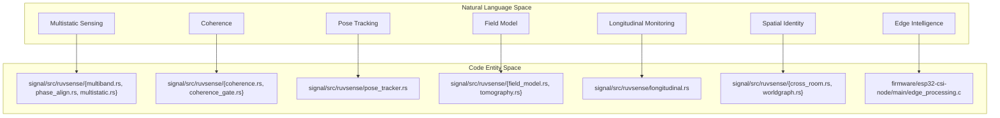

<!-- source: DeepWiki mcp.deepwiki.com · repo ruvnet/RuView · page 7.1 Domain Model (RuvSense) · fetched 2026-10-30 -->

# Domain Model (RuvSense)

Relevant source files

The following files were used as context for generating this wiki page:

- [docs/adr/ADR-030-ruvsense-persistent-field-model.md](docs/adr/ADR-030-ruvsense-persistent-field-model.md)
- [docs/adr/ADR-095-rvcsi-edge-rf-sensing-platform.md](docs/adr/ADR-095-rvcsi-edge-rf-sensing-platform.md)
- [docs/ddd/README.md](docs/ddd/README.md)
- [docs/ddd/hardware-platform-domain-model.md](docs/ddd/hardware-platform-domain-model.md)
- [docs/ddd/ruvsense-domain-model.md](docs/ddd/ruvsense-domain-model.md)
- [docs/ddd/rvcsi-domain-model.md](docs/ddd/rvcsi-domain-model.md)
- [docs/ddd/sensing-server-domain-model.md](docs/ddd/sensing-server-domain-model.md)
- [docs/ddd/signal-processing-domain-model.md](docs/ddd/signal-processing-domain-model.md)
- [docs/ddd/training-pipeline-domain-model.md](docs/ddd/training-pipeline-domain-model.md)
- [docs/prd/rvcsi-platform-prd.md](docs/prd/rvcsi-platform-prd.md)
- [scripts/esp32_jsonl_to_rvcsi.py](scripts/esp32_jsonl_to_rvcsi.py)

## Purpose and Scope

This page documents the **Domain-Driven Design (DDD) model** for RuvSense, the multistatic WiFi sensing subsystem of RuView. RuvSense transforms raw Channel State Information (CSI) from multiple ESP32 nodes into tracked human poses, vital signs, and spatial awareness without cameras.

The domain model defines:
- **Seven bounded contexts** that own their data and enforce business rules (`Multistatic Sensing`, `Coherence`, `Pose Tracking`, `Field Model`, `Longitudinal Monitoring`, `Spatial Identity`, `Edge Intelligence`).
- **Aggregate roots** that maintain invariants.
- **Value objects** carrying domain meaning.
- **Domain events** connecting contexts.
- **Ubiquitous language** shared between code and documentation.
- **Per-node state pipelines (ADR-068)** as the architectural evolution for multi-node reliability.
- **Environmental Digital Twins (ADR-139)** using the `WorldGraph` for spatial identity.

Sources: `docs/ddd/ruvsense-domain-model.md:1-21()`, `docs/ddd/README.md:9-11()`

---

## Ubiquitous Language

The following terms form the shared vocabulary between domain experts, developers, and the codebase:

| Term | Definition |
|------|------------|
| **Sensing Cycle** | One complete TDMA round where all nodes transmit once (~35ms at 28.5 Hz measured) |
| **Link** | A single TX-RX pair; with $N$ nodes there are $N \times (N-1)$ directed links |
| **Multi-Band Frame** | Fused CSI from one node hopping across multiple channels in one dwell cycle |
| **Fused Sensing Frame** | Aggregated observation from all nodes at one sensing cycle, ready for inference |
| **Coherence Score** | 0.0-1.0 metric quantifying consistency of current CSI with reference template |
| **Coherence Gate** | Decision rule: accept, inflate noise, reject, or trigger recalibration |
| **Pose Track** | Temporally persistent per-person 17-keypoint trajectory with Kalman state |
| **Track Lifecycle** | State machine: Tentative → Active → Lost → Terminated |
| **Re-ID Embedding** | 128-dim AETHER contrastive vector encoding body identity |
| **Edge Tier** | Processing level on ESP32: 0=raw, 1=signal cleanup, 2=vitals, 3=WASM |
| **Node** | ESP32-S3 device acting as both TX and RX in multistatic mesh |
| **WorldGraph** | The environmental digital twin mapping rooms, sensors, and person tracks |

Sources: `docs/ddd/ruvsense-domain-model.md:25-45()`, `docs/adr/ADR-139-worldgraph-environmental-digital-twin.md:34-47()`

---

## Bounded Contexts Overview

RuvSense is organized into seven bounded contexts, each owning its domain logic and data. 

### Diagram: Natural Language Space to Code Entity Space (Bounded Contexts)

Sources: `docs/ddd/ruvsense-domain-model.md:7-18()`, `docs/ddd/README.md:9-11()`

| # | Context | Responsibility | Key ADRs | Code Pointers |
|---|---------|----------------|----------|---------------|
| 1 | Multistatic Sensing | Collect and fuse CSI from multiple nodes and channels | [ADR-029](), [ADR-137](), [ADR-138]() | `signal/src/ruvsense/multistatic.rs` |
| 2 | Coherence | Monitor signal quality, gate bad data | [ADR-029](), [ADR-138]() | `signal/src/ruvsense/coherence.rs` |
| 3 | Pose Tracking | Track people as persistent skeletons with re-ID | [ADR-024](), [ADR-144]() | `signal/src/ruvsense/pose_tracker.rs` |
| 4 | Field Model | Learn room baselines, extract body perturbations | [ADR-030](), [ADR-142](), [ADR-143]() | `signal/src/ruvsense/field_model.rs` |
| 5 | Longitudinal Monitoring | Track health trends over days/weeks | [ADR-030](), [ADR-142]() | `signal/src/ruvsense/longitudinal.rs` |
| 6 | Spatial Identity | Cross-room tracking via environment fingerprints | [ADR-030](), [ADR-139]() | `signal/src/ruvsense/cross_room.rs` |
| 7 | Edge Intelligence | On-device sensing (no server needed) | [ADR-039](), [ADR-040]() | `firmware/esp32-csi-node/main/edge_processing.c` |

Sources: `docs/ddd/ruvsense-domain-model.md:7-18()`, `docs/adr/ADR-136-ruview-streaming-engine-frame-contracts.md:61-75()`

---

## 1. Multistatic Sensing Context

### Responsibility
Collect, normalize, and fuse CSI from multiple ESP32 nodes across multiple channels into a single coherent sensing frame per cycle.

### Multi-Node State Pipeline (ADR-068)
To prevent cross-contamination between nodes, RuvSense utilizes a `HashMap<u8, NodeState>` structure. Each ESP32 node (identified by its `node_id`) maintains an independent sensing pipeline including its own temporal history, smoothing buffers, and classification state in `signal/src/ruvsense/multistatic.rs`.

### LinkGroup & ArrayCoordinator (ADR-138)
The `LinkGroup` aggregate manages the lifetime of physical links, tracking band membership across 2.4, 5, and 6 GHz frequencies. The `ArrayCoordinator` service applies geometry gates (GDI) and clock-quality gates to emit `DirectionalEvidence` instead of a hard pose decision.

Sources: `docs/adr/ADR-138-linkgroup-array-coordinator-clock-quality.md:33-41()`, `docs/adr/ADR-068-per-node-state-pipeline.md:41-74()`

---

## 2. Coherence Context

### Responsibility
Monitor temporal consistency of CSI observations and gate downstream updates to reject drift, transient interference, and environmental changes.

### Fusion Quality Scoring (ADR-137)
The fuser in `signal/src/ruvsense/coherence.rs` returns a `QualityScore` alongside the `FusedSensingFrame`. This score encapsulates:
- **`EvidenceRef`**: Concrete checks that passed (e.g., dominant-tap ratio).
- **`ContradictionFlag`**: Validations that failed but were tolerated (e.g., minor timestamp jitter).

Sources: `docs/adr/ADR-137-fusion-engine-quality-scoring-evidence.md:32-41()`, `docs/ddd/ruvsense-domain-model.md:94-98()`

---

## 3. Pose Tracking Context

### Responsibility
Track multiple people as persistent 17-keypoint skeletons.

### UWB Range-Constraint Fusion (ADR-144)
The `PoseTracker` in `signal/src/ruvsense/pose_tracker.rs` integrates ultra-wideband (UWB) metric ranges to resolve scale drift and front/back ambiguity. UWB measurements are applied as nonlinear spherical constraints within the Kalman filter update loop.

Sources: `docs/adr/ADR-144-uwb-range-constraint-fusion.md:34-43()`, `docs/ddd/ruvsense-domain-model.md:35-37()`

---

## 4. Field Model Context

### Responsibility
Learn room baselines and extract body perturbations using SVD and online statistics.

### RF SLAM v2 (ADR-143)
The `ReflectorTracker` in `signal/src/ruvsense/tomography.rs` discovers static reflectors by triangulating delay-domain CIR taps. This allows the system to learn anchor positions dynamically and detect physical layout changes.

### Evolution Tracker (ADR-142)
The `EvolutionTracker` orchestrates cross-link change-point detection within `signal/src/ruvsense/field_model.rs`. It determines if a drift is a local link artifact or a coherent environmental shift.

Sources: `docs/adr/ADR-143-rf-slam-reflector-discovery-anchor-learning.md:33-41()`, `docs/adr/ADR-142-evolution-tracker-temporal-voxel-aggregation.md:34-41()`

---

## 5. Longitudinal Monitoring Context

### Responsibility
Track biophysical baselines (gait symmetry, stability, breathing regularity) over days and weeks using Welford online statistics.

### Aggregate Root: `PersonalBaseline`
Maintains running mean and variance for each biophysical metric inside `signal/src/ruvsense/longitudinal.rs`. It produces a `DriftReport` when significant novelty is detected.

Sources: `docs/adr/ADR-142-evolution-tracker-temporal-voxel-aggregation.md:21-22()`, `docs/ddd/ruvsense-domain-model.md:15-15()`

---

## 6. Spatial Identity Context

### Responsibility
Cross-room identity continuity and environmental digital twin management.

### WorldGraph (ADR-139)
The `WorldGraph` implemented in graph modules acts as the single authority for spatial identity. It connects `area_id` from HomeCore, `ScanZone` from MAT, and `SensorPosition` into a unified graph of rooms, sensors, and tracks via `signal/src/ruvsense/cross_room.rs`.

Sources: `docs/adr/ADR-139-worldgraph-environmental-digital-twin.md:34-47()`, `docs/ddd/ruvsense-domain-model.md:16-16()`

---

## 7. Edge Intelligence Context

### Responsibility
On-device DSP pipeline on the ESP32-S3 that performs signal processing locally without requiring a central server.

### Tier Architecture
- **Tier 0**: Raw CSI streaming (`firmware/esp32-csi-node/main/csi_collector.c`).
- **Tier 1**: Signal cleanup and phase sanitization (`firmware/esp32-csi-node/main/edge_processing.c`).
- **Tier 2**: Vital signs and breathing rate extraction.
- **Tier 3**: WASM Runtime sandbox for programmable edge modules (`firmware/esp32-csi-node/main/wasm_runtime.c`).

Sources: `docs/adr/ADR-039-esp32-edge-intelligence.md:20-55()`, `docs/ddd/hardware-platform-domain-model.md:10-15()`

---

## Invariants and Business Rules

### Diagram: Data Flow and Code Implementation Space

```mermaid
graph TD
    subgraph "Natural Language Pipeline"
        NL_INGEST["Raw UDP Ingestion"] --> NL_CLEAN["Phase & Signal Sanitization"]
        NL_CLEAN --> NL_FUSE["Multistatic Fusion"]
        NL_FUSE --> NL_GRAPH["WorldGraph Twin Update"]
    end

    subgraph "Code Entity Execution"
        CE_INGEST["sensing-server/src/main.rs"] --> CE_CLEAN["signal/src/ruvsense/phase_align.rs"]
        CE_CLEAN --> CE_FUSE["signal/src/ruvsense/multistatic.rs"]
        CE_FUSE --> CE_GRAPH["signal/src/ruvsense/cross_room.rs"]
    end
```

Sources: `docs/adr/ADR-136-ruview-streaming-engine-frame-contracts.md:45-55()`, `docs/ddd/ruvsense-domain-model.md:50-83()`

### Provenance Rule (ADR-140)
Every semantic state (e.g., "Someone Sleeping") must trace to:
1. Signal evidence (`EvidenceRef`).
2. Model version.
3. Calibration version.
4. Privacy decision (`PrivacyAction`).

### BFLD Privacy Control Plane (ADR-141)
The `PrivacyModeRegistry` maps named modes (e.g., `CareWithConsent`) to specific `PrivacyClass` levels. It enforces the fundamental invariant that raw beamforming feedback (BFI) never exits the local node boundary.

Sources: `docs/adr/ADR-140-semantic-state-record-and-agent-bridge.md:53-56()`, `docs/adr/ADR-141-bfld-privacy-control-plane-modes-attestation.md:62-74()`

---

