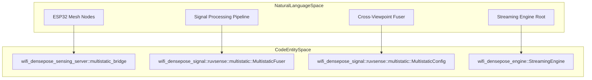

<!-- source: DeepWiki mcp.deepwiki.com · repo ruvnet/RuView · page 7.2 RuView Multistatic Sensing (ADR-031) · fetched 2026-10-30 -->

# RuView Multistatic Sensing (ADR-031)

<details>
<summary>Relevant source files</summary>

The following files were used as context for generating this wiki page:

- [docs/adr/ADR-018-esp32-dev-implementation.md](docs/adr/ADR-018-esp32-dev-implementation.md)
- [docs/adr/ADR-029-ruvsense-multistatic-sensing-mode.md](docs/adr/ADR-029-ruvsense-multistatic-sensing-mode.md)
- [docs/adr/ADR-039-esp32-edge-intelligence.md](docs/adr/ADR-039-esp32-edge-intelligence.md)
- [docs/adr/ADR-066-esp32-swarm-seed-coordinator.md](docs/adr/ADR-066-esp32-swarm-seed-coordinator.md)
- [docs/adr/ADR-068-per-node-state-pipeline.md](docs/adr/ADR-068-per-node-state-pipeline.md)
- [docs/adr/ADR-069-cognitum-seed-csi-pipeline.md](docs/adr/ADR-069-cognitum-seed-csi-pipeline.md)
- [docs/research/architecture/implementation-plan.md](docs/research/architecture/implementation-plan.md)
- [docs/research/architecture/ruvsense-multistatic-fidelity-architecture.md](docs/research/architecture/ruvsense-multistatic-fidelity-architecture.md)
- [docs/research/arena-physica/arena-physica-analysis.md](docs/research/arena-physica/arena-physica-analysis.md)
- [docs/research/arena-physica/arena-physica-studio-analysis.md](docs/research/arena-physica/arena-physica-studio-analysis.md)
- [docs/research/ruview-beyond-sota/01-sota-landscape-2026.md](docs/research/ruview-beyond-sota/01-sota-landscape-2026.md)
- [docs/research/ruview-beyond-sota/02-beyond-sota-architecture.md](docs/research/ruview-beyond-sota/02-beyond-sota-architecture.md)
- [docs/research/ruview-beyond-sota/04-optimization-roadmap.md](docs/research/ruview-beyond-sota/04-optimization-roadmap.md)
- [docs/research/sota-2026-05-22/PROGRESS.md](docs/research/sota-2026-05-22/PROGRESS.md)
- [docs/research/sota-2026-05-22/R5-subcarrier-saliency.md](docs/research/sota-2026-05-22/R5-subcarrier-saliency.md)
- [docs/research/sota-2026-05-22/R7-multilink-consistency.md](docs/research/sota-2026-05-22/R7-multilink-consistency.md)
- [docs/research/sota-2026-05-22/R8-rssi-only-count.md](docs/research/sota-2026-05-22/R8-rssi-only-count.md)
- [examples/happiness-vector/provision_swarm.sh](examples/happiness-vector/provision_swarm.sh)
- [firmware/esp32-csi-node/main/rv_mesh.c](firmware/esp32-csi-node/main/rv_mesh.c)
- [firmware/esp32-csi-node/main/stream_sender.c](firmware/esp32-csi-node/main/stream_sender.c)
- [firmware/esp32-csi-node/main/stream_sender.h](firmware/esp32-csi-node/main/stream_sender.h)
- [v2/crates/cog-person-count/cog/artifacts/saliency.json](v2/crates/cog-person-count/cog/artifacts/saliency.json)
- [v2/crates/wifi-densepose-engine/Cargo.toml](v2/crates/wifi-densepose-engine/Cargo.toml)
- [v2/crates/wifi-densepose-engine/benches/engine_cycle.rs](v2/crates/wifi-densepose-engine/benches/engine_cycle.rs)
- [v2/crates/wifi-densepose-engine/src/lib.rs](v2/crates/wifi-densepose-engine/src/lib.rs)
- [v2/crates/wifi-densepose-sensing-server/src/engine_bridge.rs](v2/crates/wifi-densepose-sensing-server/src/engine_bridge.rs)
- [v2/crates/wifi-densepose-sensing-server/src/multistatic_bridge.rs](v2/crates/wifi-densepose-sensing-server/src/multistatic_bridge.rs)
- [v2/crates/wifi-densepose-signal/src/hardware_norm.rs](v2/crates/wifi-densepose-signal/src/hardware_norm.rs)
- [v2/crates/wifi-densepose-signal/src/ruvsense/evolution.rs](v2/crates/wifi-densepose-signal/src/ruvsense/evolution.rs)
- [v2/crates/wifi-densepose-signal/src/ruvsense/multistatic.rs](v2/crates/wifi-densepose-signal/src/ruvsense/multistatic.rs)

</details>


## Purpose and Scope

This page documents the RuView multistatic WiFi sensing architecture (ADR-031 / ADR-029), which advances WiFi-based human pose estimation by fusing channel state information (CSI) from multiple ESP32 nodes using a cross-viewpoint fusion model [docs/adr/ADR-029-ruvsense-multistatic-sensing-mode.md:1-15](). RuView addresses the fidelity limits of single-viewpoint sensing by integrating learned attention mechanisms over per-viewpoint embeddings.

The page details the following key components:
- **Per-viewpoint AETHER embeddings & CSI frames**: Structured `MultiBandCsiFrame` captures [v2/crates/wifi-densepose-signal/src/ruvsense/multistatic.rs:3-6]().
- **Scaled dot-product attention fusion** with geometric bias and `ruvector-attn-mincut` [v2/crates/wifi-densepose-signal/src/ruvsense/multistatic.rs:10-15]().
- **TDM sensing protocol**: Time-division multiplexing scheduling coordinating transmissions and receptions across an $N$-node ESP32 mesh yielding $N \times (N-1)$ bistatic links [docs/adr/ADR-029-ruvsense-multistatic-sensing-mode.md:107-123]().
- **Coherence-gated environment updates**: CIR-gated updates (ADR-134) and timestamp spread guard intervals (`MultistaticConfig`) [v2/crates/wifi-densepose-signal/src/ruvsense/multistatic.rs:16-22]().
- **Acceptance tiers**: Multi-tier quality evaluation for production quality assurance.
- **Tomography, evolution, and field model subsystems**: `EvolutionTracker`, `TemporalVoxelMap`, and `FieldModel` [v2/crates/wifi-densepose-signal/src/ruvsense/evolution.rs:1-16]().

Sources: [docs/adr/ADR-029-ruvsense-multistatic-sensing-mode.md:1-45](), [v2/crates/wifi-densepose-signal/src/ruvsense/multistatic.rs:1-28]()

---

## System Architecture & Code Entity Mapping

RuView extends multi-node WiFi sensing beyond feature aggregation by fusing learned per-node embeddings through a scaled dot-product attention mechanism managed in the engine and signal crates [v2/crates/wifi-densepose-engine/src/lib.rs:1-30]().

### Diagram: Natural Language to Code Entity Mapping (Pipeline Core)



Sources: [v2/crates/wifi-densepose-signal/src/ruvsense/multistatic.rs:1-92](), [v2/crates/wifi-densepose-sensing-server/src/multistatic_bridge.rs:1-50]()

---

## TDM Sensing Protocol & Synchronization

Multistatic sensing requires coordinated node transmissions to avoid interfering uplinks. RuView uses a Time-Division Multiplexing (TDM) schedule where one node transmits Null Data Packets (NDP) while all others listen [docs/adr/ADR-029-ruvsense-multistatic-sensing-mode.md:79-80]().

### Slot Schedule Example (4 Nodes)

| Slot | Transmitter | Receiver 1 | Receiver 2 | Receiver 3 | Duration (ms) |
|---|---|---|---|---|---|
| 0 | Node A | B | C | D | 4 |
| 1 | Node B | A | C | D | 4 |
| 2 | Node C | A | B | D | 4 |
| 3 | Node D | A | B | C | 4 |
| 4 | - | Processing + Fusion | | | 34 |
| **Total** | | | | | **50 ms (20 Hz)** |

- Yields $N \times (N-1)$ bistatic links per cycle [docs/adr/ADR-029-ruvsense-multistatic-sensing-mode.md:109-110]().
- Firmware uses channel hopping across non-overlapping channels [docs/adr/ADR-029-ruvsense-multistatic-sensing-mode.md:66-73]().
- Timestamp spread validation is governed by `MultistaticConfig::guard_interval_us` (default 60,000 µs hard guard, 20,000 µs soft guard) [v2/crates/wifi-densepose-signal/src/ruvsense/multistatic.rs:91-148]().

Sources: [docs/adr/ADR-029-ruvsense-multistatic-sensing-mode.md:107-123](), [v2/crates/wifi-densepose-signal/src/ruvsense/multistatic.rs:91-148]()

---

## Cross-Viewpoint Attention Fusion & Geometric Bias

RuView fuses per-viewpoint embeddings via a scaled dot-product attention mechanism augmented with geometric coordinates [v2/crates/wifi-densepose-signal/src/ruvsense/multistatic.rs:63-88]().

### Diagram: Cross-Viewpoint Attention Flow

```mermaid
graph TB
    subgraph "ViewpointInputs"
        MB1[""MultiBandCsiFrame Node 1""]
        MB2[""MultiBandCsiFrame Node 2""]
        MBN[""MultiBandCsiFrame Node N""]
    end

    subgraph "AttentionFusion"
        FUSER[""MultistaticFuser::fuse()""]
        ATT[""ruvector-attn-mincut""]
        CIR[""CirEstimator / CIR Gate (ADR-134)""]
    end

    subgraph "FusedOutput"
        FSF[""FusedSensingFrame""]
    end

    MB1 --> FUSER
    MB2 --> FUSER
    MBN --> FUSER
    FUSER --> ATT
    ATT --> CIR
    CIR --> FSF
```

### Implementation Details
- `MultistaticFuser` processes `MultiBandCsiFrame` inputs, verifying timestamp spreads against `guard_interval_us` [v2/crates/wifi-densepose-signal/src/ruvsense/multistatic.rs:35-57]().
- `FusedSensingFrame` contains `fused_amplitude`, `fused_phase`, `node_positions`, and `cross_node_coherence` [v2/crates/wifi-densepose-signal/src/ruvsense/multistatic.rs:63-88]().
- Multi-person separation is handled via `ruvector-mincut::DynamicMinCut` [v2/crates/wifi-densepose-signal/src/ruvsense/multistatic.rs:13-15]().

Sources: [v2/crates/wifi-densepose-signal/src/ruvsense/multistatic.rs:1-1708](), [v2/crates/wifi-densepose-signal/src/ruvsense/mod.rs:1-35]()

---

## Coherence-Gated Environment Updates & CIR Gate

To maintain model stability, RuView applies coherence gating (ADR-134) over signal frames [v2/crates/wifi-densepose-signal/src/ruvsense/multistatic.rs:16-22]().

- **CIR Gate**: When `use_cir_gate` is enabled, the dominant-tap ratio from the Channel Impulse Response (CIR) isolates body-motion signatures [v2/crates/wifi-densepose-signal/src/ruvsense/multistatic.rs:16-22]().
- **Soft Guards**: Spreads exceeding `soft_guard_us` trigger privacy demotion or contradiction flags without outright rejection [v2/crates/wifi-densepose-signal/src/ruvsense/multistatic.rs:112-119]().

Sources: [v2/crates/wifi-densepose-signal/src/ruvsense/multistatic.rs:16-22](), [v2/crates/wifi-densepose-signal/src/ruvsense/multistatic.rs:112-148]()

---

## Acceptance Tiers & Streaming Engine Integration

The `StreamingEngine` composition root validates pipeline cycles, ensuring trust propagation (ADR-135..146) [v2/crates/wifi-densepose-engine/src/lib.rs:1-30]().

| Tier | Criteria |
|---|---|
| **Bronze** | Base requirement: stable 20 Hz output, <15cm torso jitter, functional separation [docs/adr/ADR-029-ruvsense-multistatic-sensing-mode.md:19-21]() |
| **Silver** | Improved jitter (<3cm RMS), breathing SNR > 10dB at 3m, zero ID swaps over 10 min [docs/adr/ADR-029-ruvsense-multistatic-sensing-mode.md:21-24]() |
| **Gold** | Production-grade: Heartbeat detection at 1.5m, stable over days, zero identity swaps [docs/adr/ADR-029-ruvsense-multistatic-sensing-mode.md:24-26]() |

Sources: [v2/crates/wifi-densepose-engine/src/lib.rs:1-120](), [docs/adr/ADR-029-ruvsense-multistatic-sensing-mode.md:17-45]()

---

## Tomography, Evolution & Field Model Subsystems

Advanced subsystems maintain spatial awareness across cycles:
- `TemporalVoxelMap` & `EvolutionTracker` (ADR-142): accumulate Bayesian log-odds occupancy evidence with Welford variance tracking [v2/crates/wifi-densepose-signal/src/ruvsense/evolution.rs:1-48]().
- `VoxelGate`: applies monotonic privacy demotion over voxel outputs (`Full`, `Anonymous`, `Restricted`) [v2/crates/wifi-densepose-signal/src/ruvsense/evolution.rs:19-28]() & [v2/crates/wifi-densepose-signal/src/ruvsense/evolution.rs:154-183]().
- `RfSlam` (ADR-143): discovers static reflectors and classifies them as walls, furniture, or mobile entities [v2/crates/wifi-densepose-signal/src/ruvsense/evolution.rs:1-10]().

Sources: [v2/crates/wifi-densepose-signal/src/ruvsense/evolution.rs:1-406]()

---

