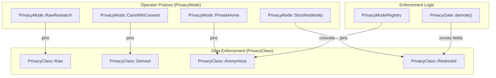
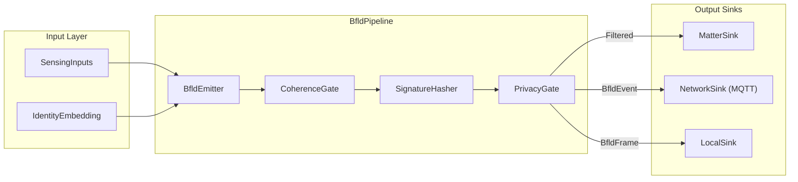

<!-- source: DeepWiki mcp.deepwiki.com · repo ruvnet/RuView · page 7.3 BFLD Privacy Control Plane · fetched 2026-10-30 -->

# BFLD Privacy Control Plane

Relevant source files

The following files were used as context for generating this wiki page:

- [docs/adr/ADR-118-bfld-beamforming-feedback-layer-for-detection.md](docs/adr/ADR-118-bfld-beamforming-feedback-layer-for-detection.md)
- [docs/adr/ADR-119-bfld-frame-format-and-wire-protocol.md](docs/adr/ADR-119-bfld-frame-format-and-wire-protocol.md)
- [docs/adr/ADR-120-bfld-privacy-class-and-hash-rotation.md](docs/adr/ADR-120-bfld-privacy-class-and-hash-rotation.md)
- [docs/adr/ADR-121-bfld-identity-risk-scoring.md](docs/adr/ADR-121-bfld-identity-risk-scoring.md)
- [docs/adr/ADR-122-bfld-ruview-ha-matter-exposure.md](docs/adr/ADR-122-bfld-ruview-ha-matter-exposure.md)
- [docs/adr/ADR-123-bfld-capture-path-nexmon-and-esp32.md](docs/adr/ADR-123-bfld-capture-path-nexmon-and-esp32.md)
- [docs/research/BFLD/01-sota-survey.md](docs/research/BFLD/01-sota-survey.md)
- [docs/research/BFLD/02-soul.md](docs/research/BFLD/02-soul.md)
- [docs/research/BFLD/03-security-threat-model.md](docs/research/BFLD/03-security-threat-model.md)
- [docs/research/BFLD/04-privacy-gating.md](docs/research/BFLD/04-privacy-gating.md)
- [docs/research/BFLD/05-automation-integration.md](docs/research/BFLD/05-automation-integration.md)
- [v2/crates/wifi-densepose-bfld/Cargo.toml](v2/crates/wifi-densepose-bfld/Cargo.toml)
- [v2/crates/wifi-densepose-bfld/README.md](v2/crates/wifi-densepose-bfld/README.md)
- [v2/crates/wifi-densepose-bfld/examples/bfld_handle.rs](v2/crates/wifi-densepose-bfld/examples/bfld_handle.rs)
- [v2/crates/wifi-densepose-bfld/examples/bfld_minimal.rs](v2/crates/wifi-densepose-bfld/examples/bfld_minimal.rs)
- [v2/crates/wifi-densepose-bfld/src/availability.rs](v2/crates/wifi-densepose-bfld/src/availability.rs)
- [v2/crates/wifi-densepose-bfld/src/coherence_gate.rs](v2/crates/wifi-densepose-bfld/src/coherence_gate.rs)
- [v2/crates/wifi-densepose-bfld/src/emitter.rs](v2/crates/wifi-densepose-bfld/src/emitter.rs)
- [v2/crates/wifi-densepose-bfld/src/frame.rs](v2/crates/wifi-densepose-bfld/src/frame.rs)
- [v2/crates/wifi-densepose-bfld/src/ha_discovery.rs](v2/crates/wifi-densepose-bfld/src/ha_discovery.rs)
- [v2/crates/wifi-densepose-bfld/src/identity_features.rs](v2/crates/wifi-densepose-bfld/src/identity_features.rs)
- [v2/crates/wifi-densepose-bfld/src/lib.rs](v2/crates/wifi-densepose-bfld/src/lib.rs)
- [v2/crates/wifi-densepose-bfld/src/mqtt_topics.rs](v2/crates/wifi-densepose-bfld/src/mqtt_topics.rs)
- [v2/crates/wifi-densepose-bfld/src/pipeline.rs](v2/crates/wifi-densepose-bfld/src/pipeline.rs)
- [v2/crates/wifi-densepose-bfld/src/pipeline_handle.rs](v2/crates/wifi-densepose-bfld/src/pipeline_handle.rs)
- [v2/crates/wifi-densepose-bfld/src/rumqttc_publisher.rs](v2/crates/wifi-densepose-bfld/src/rumqttc_publisher.rs)
- [v2/crates/wifi-densepose-bfld/tests/availability_topic.rs](v2/crates/wifi-densepose-bfld/tests/availability_topic.rs)
- [v2/crates/wifi-densepose-bfld/tests/coherence_gate.rs](v2/crates/wifi-densepose-bfld/tests/coherence_gate.rs)
- [v2/crates/wifi-densepose-bfld/tests/crate_readme.rs](v2/crates/wifi-densepose-bfld/tests/crate_readme.rs)
- [v2/crates/wifi-densepose-bfld/tests/emitter_hasher.rs](v2/crates/wifi-densepose-bfld/tests/emitter_hasher.rs)
- [v2/crates/wifi-densepose-bfld/tests/emitter_pipeline.rs](v2/crates/wifi-densepose-bfld/tests/emitter_pipeline.rs)
- [v2/crates/wifi-densepose-bfld/tests/example_handle.rs](v2/crates/wifi-densepose-bfld/tests/example_handle.rs)
- [v2/crates/wifi-densepose-bfld/tests/example_minimal.rs](v2/crates/wifi-densepose-bfld/tests/example_minimal.rs)
- [v2/crates/wifi-densepose-bfld/tests/frame_header_size.rs](v2/crates/wifi-densepose-bfld/tests/frame_header_size.rs)
- [v2/crates/wifi-densepose-bfld/tests/frame_payload_integration.rs](v2/crates/wifi-densepose-bfld/tests/frame_payload_integration.rs)
- [v2/crates/wifi-densepose-bfld/tests/frame_roundtrip.rs](v2/crates/wifi-densepose-bfld/tests/frame_roundtrip.rs)
- [v2/crates/wifi-densepose-bfld/tests/ha_discovery.rs](v2/crates/wifi-densepose-bfld/tests/ha_discovery.rs)
- [v2/crates/wifi-densepose-bfld/tests/ha_discovery_publish.rs](v2/crates/wifi-densepose-bfld/tests/ha_discovery_publish.rs)
- [v2/crates/wifi-densepose-bfld/tests/handle_soul_oracle.rs](v2/crates/wifi-densepose-bfld/tests/handle_soul_oracle.rs)
- [v2/crates/wifi-densepose-bfld/tests/header_roundtrip.rs](v2/crates/wifi-densepose-bfld/tests/header_roundtrip.rs)
- [v2/crates/wifi-densepose-bfld/tests/identity_features_encoder.rs](v2/crates/wifi-densepose-bfld/tests/identity_features_encoder.rs)
- [v2/crates/wifi-densepose-bfld/tests/mosquitto_integration.rs](v2/crates/wifi-densepose-bfld/tests/mosquitto_integration.rs)
- [v2/crates/wifi-densepose-bfld/tests/mqtt_publish_loop.rs](v2/crates/wifi-densepose-bfld/tests/mqtt_publish_loop.rs)
- [v2/crates/wifi-densepose-bfld/tests/mqtt_topic_routing.rs](v2/crates/wifi-densepose-bfld/tests/mqtt_topic_routing.rs)
- [v2/crates/wifi-densepose-bfld/tests/pipeline_facade.rs](v2/crates/wifi-densepose-bfld/tests/pipeline_facade.rs)
- [v2/crates/wifi-densepose-bfld/tests/pipeline_handle_worker.rs](v2/crates/wifi-densepose-bfld/tests/pipeline_handle_worker.rs)
- [v2/crates/wifi-densepose-bfld/tests/pipeline_to_frame.rs](v2/crates/wifi-densepose-bfld/tests/pipeline_to_frame.rs)
- [v2/crates/wifi-densepose-bfld/tests/reserved_flags.rs](v2/crates/wifi-densepose-bfld/tests/reserved_flags.rs)
- [v2/crates/wifi-densepose-bfld/tests/rumqttc_lwt.rs](v2/crates/wifi-densepose-bfld/tests/rumqttc_lwt.rs)
- [v2/crates/wifi-densepose-bfld/tests/rumqttc_publisher_smoke.rs](v2/crates/wifi-densepose-bfld/tests/rumqttc_publisher_smoke.rs)
- [v2/crates/wifi-densepose-bfld/tests/soul_match_oracle.rs](v2/crates/wifi-densepose-bfld/tests/soul_match_oracle.rs)

The **Beamforming Feedback Layer for Detection (BFLD)** (`wifi-densepose-bfld`) is a specialized privacy-gating crate within the RuView ecosystem. It processes 802.11ac/ax Beamforming Feedback Information (BFI) and Channel State Information (CSI) to provide occupancy and motion sensing while measuring and mitigating biometric identity leakage [v2/crates/wifi-densepose-bfld/src/lib.rs:1-12](). BFLD serves as the enforcement layer for RuView's privacy guarantees, ensuring that high-fidelity sensing data does not inadvertently become a persistent biometric identifier without explicit operator consent [docs/adr/ADR-118-bfld-beamforming-feedback-layer-for-detection.md:30-34]().

## Three Structural Invariants

BFLD is designed around three core invariants that are enforced structurally by the codebase, rather than by software policy alone:
*   **I1**: Raw BFI never exits the sensing node [v2/crates/wifi-densepose-bfld/src/lib.rs:8-8]().
*   **I2**: Identity embeddings are stored in-RAM-only (no disk or network persistence) [v2/crates/wifi-densepose-bfld/src/lib.rs:9-9]().
*   **I3**: Cross-site identity correlation is cryptographically impossible via per-site keyed BLAKE3 hash rotation [v2/crates/wifi-densepose-bfld/src/lib.rs:10-10]().

Sources: [v2/crates/wifi-densepose-bfld/src/lib.rs:1-12](), [docs/adr/ADR-118-bfld-beamforming-feedback-layer-for-detection.md:70-74](), [docs/adr/ADR-120-bfld-privacy-class-and-hash-rotation.md:17-23]().

---

## Privacy Classification & Modes

BFLD operates using a dual-layer privacy architecture: **Privacy Classes** (describing data content rigor) and **Privacy Modes** (describing operator posture and compliance envelopes).

### Privacy Classes
The `PrivacyClass` enum governs what fields are permitted within a `BfldFrame` or `BfldEvent` [v2/crates/wifi-densepose-bfld/src/lib.rs:106-119]().

| Class | Name | Description | Network Allowed (`allows_network`) | Matter Eligible (`allows_matter`) |
| :--- | :--- | :--- | :--- | :--- |
| `0` | `Raw` | Local-only research data; includes raw BFI matrices. | **No** [v2/crates/wifi-densepose-bfld/src/lib.rs:125-127]() | **No** |
| `1` | `Derived` | LAN-only research; includes identity embeddings and risk scores. | Yes [v2/crates/wifi-densepose-bfld/src/lib.rs:125-127]() | **No** |
| `2` | `Anonymous` | Production default; aggregate sensing (presence, motion) only. | Yes | Yes [v2/crates/wifi-densepose-bfld/src/lib.rs:129-134]() |
| `3` | `Restricted` | Care-home deployments; Class 2 minus risk scores and signature hashes. | Yes | Yes [v2/crates/wifi-densepose-bfld/src/lib.rs:129-134]() |

Sources: [v2/crates/wifi-densepose-bfld/src/lib.rs:106-141](), [docs/adr/ADR-120-bfld-privacy-class-and-hash-rotation.md:33-45]().

### Privacy Modes & Attestation Proofs
The `PrivacyMode` represents the operator-facing posture. Selecting a mode pins a target `PrivacyClass` and enforces specific `PrivacyAction` bits (e.g., `SuppressIdentity`, `DropRaw`) [v2/crates/wifi-densepose-bfld/src/lib.rs:92-94](). 

The `PrivacyModeRegistry` maintains the active mode and an audit log of `PrivacyAttestationProof` objects [v2/crates/wifi-densepose-bfld/src/lib.rs:94-94](). Every mode transition creates a new attestation proof that is BLAKE3 hash-chained to its predecessor, establishing a tamper-evident witness ledger of the system's privacy posture.

### System Posture Mapping

The following diagram maps high-level operator postures to their corresponding code entities and class constraints.

**Privacy Mode to Entity Mapping**

Sources: [v2/crates/wifi-densepose-bfld/src/lib.rs:88-121](), [docs/adr/ADR-120-bfld-privacy-class-and-hash-rotation.md:92-102]().

---

## Identity Protection & Soul Signature Matching

### Identity Embedding & Ring Buffer
The `IdentityEmbedding` struct (a 128-dimensional vector derived from the AETHER encoder) is handled with strict sensitivity [v2/crates/wifi-densepose-bfld/src/lib.rs:76-76](). It is stored in a `subtle::Zeroizing` ring buffer (`EmbeddingRing`) with a fixed capacity of 64 entries [v2/crates/wifi-densepose-bfld/src/lib.rs:77-77](). To enforce invariant **I2**, the embedding type explicitly lacks a `serde::Serialize` implementation, ensuring it can never be serialized into network packets or written to non-volatile storage.

### Keyed Hash Rotation (Invariant I3)
The `SignatureHasher` computes an `rf_signature_hash` using BLAKE3 in keyed mode [v2/crates/wifi-densepose-bfld/src/lib.rs:95-95]().
*   **Site Salt**: A 256-bit secret generated on first node boot and kept strictly local [docs/adr/ADR-120-bfld-privacy-class-and-hash-rotation.md:76-85]().
*   **Day Epoch**: The hashing key incorporates the current UTC day epoch, forcing biometric rotation every 24 hours [docs/adr/ADR-120-bfld-privacy-class-and-hash-rotation.md:89-91]().

### Coherence Gate, Risk Scoring, and Soul Signatures
The `coherence_gate` module evaluates incoming signals against the `identity_risk_score` [v2/crates/wifi-densepose-bfld/src/lib.rs:60-60]().
*   **Identity Risk Score**: A composite metric combining separability, stability, and consistency factors [v2/crates/wifi-densepose-bfld/src/identity_risk.rs:80-80]().
*   **GateAction**: Depending on the risk score and hysteresis thresholds, the gate yields `Accept`, `PredictOnly`, `Reject`, or `Recalibrate` [v2/crates/wifi-densepose-bfld/src/coherence_gate.rs:179-186]().
*   **SoulMatchOracle**: An optional trait interface (`SoulMatchOracle`) that allows the gate to bypass recalibration if a signal matches a known, enrolled "Soul Signature" [v2/crates/wifi-densepose-bfld/src/coherence_gate.rs:133-138](). The matching engine (`soul_match`) runs a per-channel weighted-cosine similarity across physiological frequency bands (cardiac and respiratory channels) [v2/crates/wifi-densepose-bfld/src/lib.rs:13-20]().

Sources: [v2/crates/wifi-densepose-bfld/src/lib.rs:13-20](), [v2/crates/wifi-densepose-bfld/src/lib.rs:60-80](), [v2/crates/wifi-densepose-bfld/src/coherence_gate.rs:27-105](), [docs/adr/ADR-121-bfld-identity-risk-scoring.md:1-40]().

---

## Pipeline Architecture & Wire Format

The `BfldPipeline` acts as the primary synchronization and processing entry point for sensing data [v2/crates/wifi-densepose-bfld/src/pipeline.rs:74-79]().

### Data Flow and Components
The pipeline consumes `SensingInputs` and optional `IdentityEmbedding` via `BfldPipeline::process` or `BfldPipeline::process_to_frame`, outputting privacy-gated `BfldEvent` records or serialized `BfldFrame` byte vectors [v2/crates/wifi-densepose-bfld/src/pipeline.rs:105-161]().

**BFLD Pipeline Component Diagram**

Sources: [v2/crates/wifi-densepose-bfld/src/pipeline.rs:74-184](), [v2/crates/wifi-densepose-bfld/src/pipeline_handle.rs:22-65]().

### Wire Format (`BfldFrame`)
Frames transmitted locally or across permitted network boundaries use the `BfldFrameHeader` structure (`#[repr(C, packed)]`, 86 bytes, little-endian) [v2/crates/wifi-densepose-bfld/src/frame.rs:66-108](). 
*   **Magic**: `BFLD_MAGIC` (`0xBF1D_0001`) [v2/crates/wifi-densepose-bfld/src/frame.rs:31-31]()
*   **Integrity**: Protected by CRC-32/ISO-HDLC covering the payload section bytes [v2/crates/wifi-densepose-bfld/src/frame.rs:26-28]().
*   **Flags**: Encodes flags such as `HAS_CSI_DELTA`, `PRIVACY_MODE`, and `SELF_ONLY` [v2/crates/wifi-densepose-bfld/src/frame.rs:43-54]().

Sources: [v2/crates/wifi-densepose-bfld/src/frame.rs:1-108](), [docs/adr/ADR-119-bfld-frame-format-and-wire-protocol.md:1-60]().

---

## Home Assistant & MQTT Integration

BFLD integrates with Home Assistant via MQTT auto-discovery (HA-DISCO) and deterministic topic routing [docs/adr/ADR-122-bfld-ruview-ha-matter-exposure.md:1-30]().

### MQTT Topic Structure
Topics are strictly gated by `PrivacyClass`. Class 0 (`Raw`) and Class 1 (`Derived`) events are entirely excluded from publishing on the public MQTT broker topic tree [v2/crates/wifi-densepose-bfld/src/mqtt_topics.rs:109-114]().

| Entity | MQTT Topic Suffix | Class Requirement | Payload Type |
| :--- | :--- | :--- | :--- |
| Presence | `bfld/presence/state` | $\ge 2$ (`Anonymous`) | JSON boolean (`true`/`false`) [v2/crates/wifi-densepose-bfld/src/mqtt_topics.rs:120-122]() |
| Motion | `bfld/motion/state` | $\ge 2$ | Fixed-precision decimal (`0.720000`) [v2/crates/wifi-densepose-bfld/src/mqtt_topics.rs:124-126]() |
| Person Count | `bfld/person_count/state` | $\ge 2$ | Bare integer (`2`) [v2/crates/wifi-densepose-bfld/src/mqtt_topics.rs:128-130]() |
| Confidence | `bfld/confidence/state` | $\ge 2$ | Fixed-precision decimal [v2/crates/wifi-densepose-bfld/src/mqtt_topics.rs:132-134]() |
| Zone Activity | `bfld/zone_activity/state` | $\ge 2$ (when configured) | Escaped JSON string [v2/crates/wifi-densepose-bfld/src/mqtt_topics.rs:136-146]() |
| Identity Risk | `bfld/identity_risk/state` | $== 2$ (`Anonymous` only) | Fixed-precision decimal [v2/crates/wifi-densepose-bfld/src/mqtt_topics.rs:150-157]() |

Sources: [v2/crates/wifi-densepose-bfld/src/mqtt_topics.rs:1-160](), [v2/crates/wifi-densepose-bfld/src/ha_discovery.rs:1-129]().

### Publisher Architecture & LWT
*   **`publish_discovery`**: Renders and publishes Home Assistant JSON configuration payloads for automatic entity creation [v2/crates/wifi-densepose-bfld/src/ha_discovery.rs:45-56]().
*   **`RumqttPublisher`**: A synchronous MQTT client implementation wrapping `rumqttc`. It supports Last Will and Testament (LWT) configuration via `connect_with_lwt`, ensuring that offline availability markers are published automatically if the TCP session drops unexpectedly [v2/crates/wifi-densepose-bfld/src/rumqttc_publisher.rs:30-83]().

Sources: [v2/crates/wifi-densepose-bfld/src/ha_discovery.rs:45-56](), [v2/crates/wifi-densepose-bfld/src/rumqttc_publisher.rs:30-83](), [docs/adr/ADR-122-bfld-ruview-ha-matter-exposure.md:49-58]().

---

