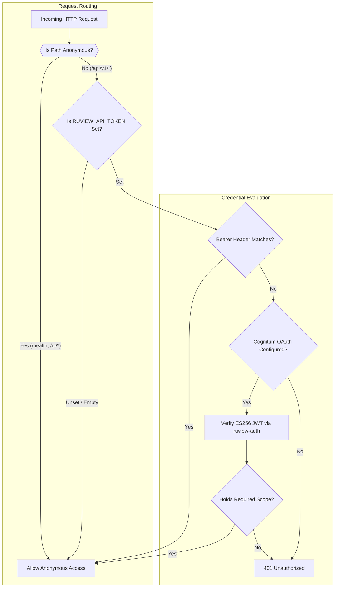
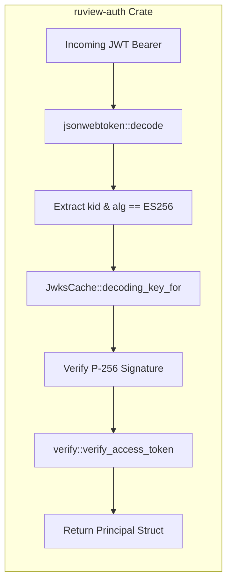
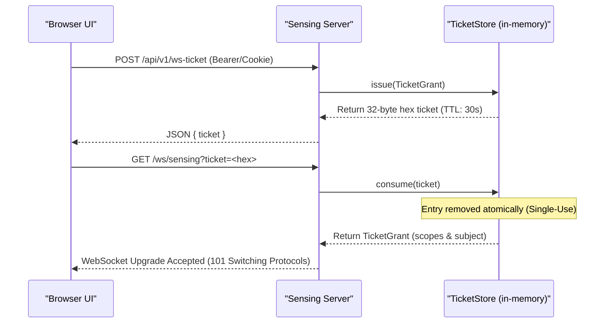

<!-- source: DeepWiki mcp.deepwiki.com · repo ruvnet/RuView · page 7.4 Authentication & Security Model · fetched 2026-10-30 -->

# Authentication & Service Security Model

Relevant source files

The following files were used as context for generating this wiki page:

- [.github/workflows/csi-data-policy.yml](.github/workflows/csi-data-policy.yml)
- [docs/adr/ADR-271-cognitum-oauth-resource-server.md](docs/adr/ADR-271-cognitum-oauth-resource-server.md)
- [docs/adr/ADR-272-websocket-authentication-tickets.md](docs/adr/ADR-272-websocket-authentication-tickets.md)
- [scripts/csi-data-policy-check.sh](scripts/csi-data-policy-check.sh)
- [scripts/csi-data-policy.allow](scripts/csi-data-policy.allow)
- [ui/pose-fusion/js/csi-simulator.js](ui/pose-fusion/js/csi-simulator.js)
- [ui/services/api.service.js](ui/services/api.service.js)
- [ui/services/ws-ticket.test.mjs](ui/services/ws-ticket.test.mjs)
- [ui/sw.js](ui/sw.js)
- [ui/sw.test.mjs](ui/sw.test.mjs)
- [ui/utils/quick-settings.js](ui/utils/quick-settings.js)
- [v2/crates/ruview-auth/Cargo.toml](v2/crates/ruview-auth/Cargo.toml)
- [v2/crates/ruview-auth/src/jwks.rs](v2/crates/ruview-auth/src/jwks.rs)
- [v2/crates/ruview-auth/src/lib.rs](v2/crates/ruview-auth/src/lib.rs)
- [v2/crates/ruview-auth/src/login/flow.rs](v2/crates/ruview-auth/src/login/flow.rs)
- [v2/crates/ruview-auth/src/login/mod.rs](v2/crates/ruview-auth/src/login/mod.rs)
- [v2/crates/ruview-auth/src/pkce.rs](v2/crates/ruview-auth/src/pkce.rs)
- [v2/crates/ruview-auth/src/verify.rs](v2/crates/ruview-auth/src/verify.rs)
- [v2/crates/ruview-auth/tests/verifier_matrix.rs](v2/crates/ruview-auth/tests/verifier_matrix.rs)
- [v2/crates/wifi-densepose-sensing-server/SECURITY.md](v2/crates/wifi-densepose-sensing-server/SECURITY.md)
- [v2/crates/wifi-densepose-sensing-server/benches/mqtt_throughput.rs](v2/crates/wifi-densepose-sensing-server/benches/mqtt_throughput.rs)
- [v2/crates/wifi-densepose-sensing-server/src/bearer_auth.rs](v2/crates/wifi-densepose-sensing-server/src/bearer_auth.rs)
- [v2/crates/wifi-densepose-sensing-server/src/browser_session.rs](v2/crates/wifi-densepose-sensing-server/src/browser_session.rs)
- [v2/crates/wifi-densepose-sensing-server/src/inference.rs](v2/crates/wifi-densepose-sensing-server/src/inference.rs)
- [v2/crates/wifi-densepose-sensing-server/src/mqtt/state.rs](v2/crates/wifi-densepose-sensing-server/src/mqtt/state.rs)
- [v2/crates/wifi-densepose-sensing-server/src/ws_ticket.rs](v2/crates/wifi-densepose-sensing-server/src/ws_ticket.rs)
- [v2/crates/wifi-densepose-sensing-server/tests/auth_wiring.rs](v2/crates/wifi-densepose-sensing-server/tests/auth_wiring.rs)

## Purpose and Scope

This page details the authentication, authorization, and security architecture of the RuView codebase. It covers the dual-credential HTTP API gateway (`bearer_auth.rs`), offline Cognitum OAuth 2.1 verification (ADR-271) via the `ruview-auth` crate, browser session cookie management, single-use WebSocket authentication tickets (ADR-272), CLI credential storage, and the overarching CSI data governance policy and `SECURITY.md` posture.

Sources: `v2/crates/wifi-densepose-sensing-server/src/bearer_auth.rs:1-48`, `v2/crates/ruview-auth/src/lib.rs:1-70`, `docs/adr/ADR-271-cognitum-oauth-resource-server.md:1-57`

---

## 1. Static Bearer Tokens & API Gating

RuView supports an optional, deployment-time static bearer token via the `RUVIEW_API_TOKEN` environment variable. When enabled, incoming HTTP requests targeting protected endpoints must include a matching `Authorization: Bearer <token>` header. If the environment variable is unset or empty, the middleware acts as a no-op, preserving the default LAN-only open posture.

The middleware implements a strict deny-by-default allowlist approach via `ANONYMOUS_PREFIXES`. Liveness and readiness probes (`/health*`), static UI assets (`/ui/*`), and the root endpoint remain unauthenticated to allow orchestrators and browsers to interact without injecting headers. Protected mutating and reading operations reside under `/api/v1/*`. To prevent timing side-channel leaks, token comparison uses a length-then-byte constant-time check.

*Figure 1: Request authorization and verification pipeline in `bearer_auth.rs`.*

Sources: `v2/crates/wifi-densepose-sensing-server/src/bearer_auth.rs:1-146`

---

## 2. Cognitum OAuth 2.1 Resource Server & JWKS Cache

Under ADR-271, RuView acts as an OAuth 2.1 **resource server** rather than an OAuth client. It performs **offline verification** of ES256 JSON Web Tokens (JWTs) issued by `auth.cognitum.one`, utilizing the published JWKS endpoint.

The `ruview-auth` crate handles signature verification and claims validation without making outbound calls during request validation. The key components include:
* [`JwksCache`]: Caches signing keys indexed by `kid` with a default TTL (`DEFAULT_CACHE_TTL` of 300s) and a fetch interval floor (`FETCH_MIN_INTERVAL` of 30s) to prevent request amplification.
* [`verify_access_token`]: Validates claims (including `typ == "access"`, expiration windows with a 30s clock leeway, and refusal of long-lived setup/workload credentials).
* **Scope-based capability gating**: Routes require either `sensing:read` or `sensing:admin` scopes to segregate viewing streams from destructive operations like model deletion or training execution.

*Figure 2: Offline token verification data flow across `ruview-auth` modules.*

Sources: `v2/crates/wifi-densepose-sensing-server/src/bearer_auth.rs:22-48`, `v2/crates/ruview-auth/src/lib.rs:1-90`, `v2/crates/ruview-auth/src/verify.rs:1-104`, `v2/crates/ruview-auth/src/jwks.rs:1-82`

---

## 3. Browser Sessions, Cookies, and PKCE

Because web browsers cannot directly read CLI-managed credential files or inject custom headers into standard WebSocket handshakes easily, RuView implements a browser sign-in flow (`GET /oauth/start` to `GET /oauth/callback`) resulting in a signed session cookie (`ruview_session`).

The server manages PKCE transaction state using a short-lived transaction cookie (`ruview_oauth_txn`) with a 10-minute TTL. Upon a successful OAuth code exchange, the sensing server issues an HMAC-SHA256 signed session cookie containing the principal's claims and issuance timestamp. 

To mitigate the impact of compromised sessions, `SESSION_TTL_SECS` bounds browser sessions to 1 hour. Furthermore, mutating operations are restricted: browser session sign-ins request `sensing:read` exclusively (`B0RWS_SIGNIN_SCOPE`), ensuring web UI users cannot execute administrative actions without explicit CLI credentials or bearer tokens.

Sources: `v2/crates/wifi-densepose-sensing-server/src/browser_session.rs:1-146`, `docs/adr/ADR-271-cognitum-oauth-resource-server.md:1-132`

---

## 4. WebSocket Authentication Tickets (ADR-272)

Standard browser `WebSocket` constructors cannot attach HTTP `Authorization` headers during the initial handshake upgrade request. Under ADR-272, RuView solves this vulnerability using single-use, short-lived WebSocket authentication tickets.

The workflow operates as follows:
1. An authenticated web client executes a standard `POST /api/v1/ws-ticket` request carrying its existing bearer token or session cookie.
2. The server mints a 32-byte cryptographic random ticket via [`TicketStore::issue`], storing it in an in-memory map (`TicketStore`) with a strict 30-second TTL (`TICKET_TTL`).
3. The client connects to the WebSocket endpoint appending the ticket as a query parameter: `/ws/sensing?ticket=<opaque_string>`.
4. The server redeems the ticket via [`TicketStore::consume`], which immediately removes it from the store to prevent replay attacks, even within the 30-second window.

To protect against resource exhaustion or denial-of-service attempts, the `TicketStore` enforces both a global outstanding ticket limit (`MAX_OUTSTANDING` = 512) and a per-principal cap (`MAX_PER_PRINCIPAL` = 16).

*Figure 3: WebSocket ticket issuance and single-use redemption lifecycle.*

Sources: `v2/crates/wifi-densepose-sensing-server/src/ws_ticket.rs:1-173`, `docs/adr/ADR-272-websocket-authentication-tickets.md:1-45`

---

## 5. CLI Credentials & Client Storage

Interactive CLI commands (such as `wifi-densepose login`) execute OAuth authorization code flows with PKCE. Upon successful authentication, access and refresh tokens are persisted to the local file store at `~/.ruview/credentials.json`. 

The `ruview-auth` crate's `login` feature module manages single-flight token refreshing, advisory cross-process file locking (using `libc` on Unix platforms), and credential rotation to prevent race conditions when multiple CLI processes or daemon workers attempt refreshes simultaneously.

Sources: `v2/crates/ruview-auth/src/lib.rs:70-90`, `v2/crates/ruview-auth/Cargo.toml:26-50`

---

## 6. CSI Data Policy & Security Posture

Because Channel State Information (CSI) captures fine-grained physical layer wireless reflections that can be analyzed for presence detection, vital sign tracking, and pose estimation, RuView treats raw RF recordings and derived biometric features as sensitive personal data.

The repository enforces strict data handling guidelines defined in `SECURITY.md` and automated via CI policies:
* **`scripts/csi-data-policy.allow`**: Gated allowlist checking for compliant dataset distribution and preventing inadvertent publishing of raw telemetry or identifiable spatial captures.
* **Fail-Closed Occupancy Evidence**: Edge nodes and processing pipelines default to conservative occupancy estimation states on authentication or verification failures.

Sources: `v2/crates/wifi-densepose-sensing-server/SECURITY.md:1-50`, `scripts/csi-data-policy.allow:1-30`

---

