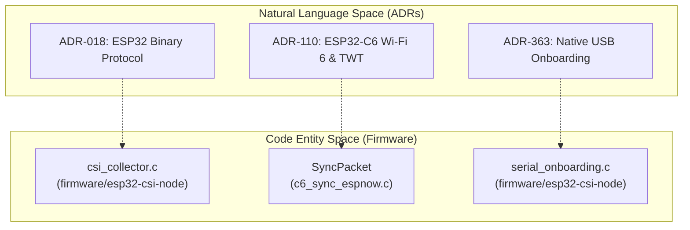
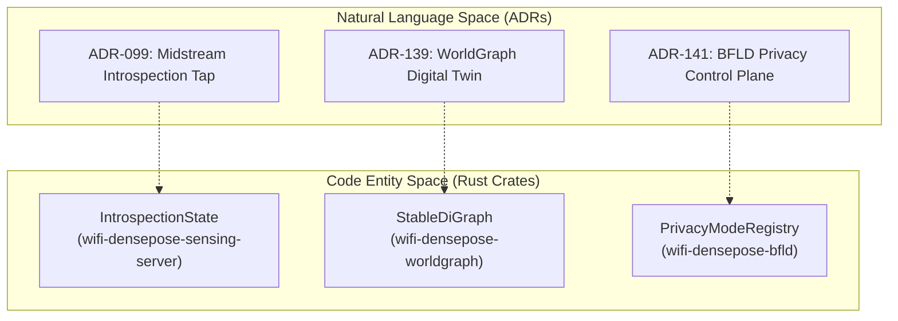
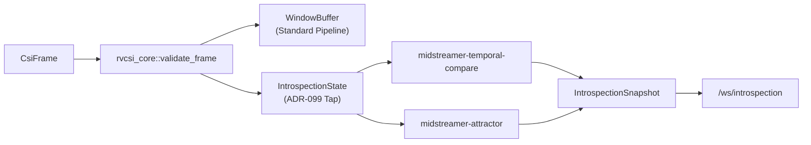

<!-- source: DeepWiki mcp.deepwiki.com · repo ruvnet/RuView · page 7.5 Architectural Decision Records · fetched 2026-10-30 -->

# Architectural Decision Records

Relevant source files

The following files were used as context for generating this wiki page:

- [.github/workflows/firmware-ci.yml](.github/workflows/firmware-ci.yml)
- [docs/adr/ADR-002-ruvector-rvf-integration-strategy.md](docs/adr/ADR-002-ruvector-rvf-integration-strategy.md)
- [docs/adr/ADR-003-rvf-cognitive-containers-csi.md](docs/adr/ADR-003-rvf-cognitive-containers-csi.md)
- [docs/adr/ADR-004-hnsw-vector-search-fingerprinting.md](docs/adr/ADR-004-hnsw-vector-search-fingerprinting.md)
- [docs/adr/ADR-005-sona-self-learning-pose-estimation.md](docs/adr/ADR-005-sona-self-learning-pose-estimation.md)
- [docs/adr/ADR-006-gnn-enhanced-csi-pattern-recognition.md](docs/adr/ADR-006-gnn-enhanced-csi-pattern-recognition.md)
- [docs/adr/ADR-007-post-quantum-cryptography-secure-sensing.md](docs/adr/ADR-007-post-quantum-cryptography-secure-sensing.md)
- [docs/adr/ADR-008-distributed-consensus-multi-ap.md](docs/adr/ADR-008-distributed-consensus-multi-ap.md)
- [docs/adr/ADR-009-rvf-wasm-runtime-edge-deployment.md](docs/adr/ADR-009-rvf-wasm-runtime-edge-deployment.md)
- [docs/adr/ADR-010-witness-chains-audit-trail-integrity.md](docs/adr/ADR-010-witness-chains-audit-trail-integrity.md)
- [docs/adr/ADR-011-python-proof-of-reality-mock-elimination.md](docs/adr/ADR-011-python-proof-of-reality-mock-elimination.md)
- [docs/adr/ADR-012-esp32-csi-sensor-mesh.md](docs/adr/ADR-012-esp32-csi-sensor-mesh.md)
- [docs/adr/ADR-017-ruvector-signal-mat-integration.md](docs/adr/ADR-017-ruvector-signal-mat-integration.md)
- [docs/adr/ADR-052-tauri-desktop-frontend.md](docs/adr/ADR-052-tauri-desktop-frontend.md)
- [docs/adr/ADR-136-ruview-streaming-engine-frame-contracts.md](docs/adr/ADR-136-ruview-streaming-engine-frame-contracts.md)
- [docs/adr/ADR-137-fusion-engine-quality-scoring-evidence.md](docs/adr/ADR-137-fusion-engine-quality-scoring-evidence.md)
- [docs/adr/ADR-138-linkgroup-array-coordinator-clock-quality.md](docs/adr/ADR-138-linkgroup-array-coordinator-clock-quality.md)
- [docs/adr/ADR-139-worldgraph-environmental-digital-twin.md](docs/adr/ADR-139-worldgraph-environmental-digital-twin.md)
- [docs/adr/ADR-140-semantic-state-record-and-agent-bridge.md](docs/adr/ADR-140-semantic-state-record-and-agent-bridge.md)
- [docs/adr/ADR-141-bfld-privacy-control-plane-modes-attestation.md](docs/adr/ADR-141-bfld-privacy-control-plane-modes-attestation.md)
- [docs/adr/ADR-142-evolution-tracker-temporal-voxel-aggregation.md](docs/adr/ADR-142-evolution-tracker-temporal-voxel-aggregation.md)
- [docs/adr/ADR-143-rf-slam-reflector-discovery-anchor-learning.md](docs/adr/ADR-143-rf-slam-reflector-discovery-anchor-learning.md)
- [docs/adr/ADR-144-uwb-range-constraint-fusion.md](docs/adr/ADR-144-uwb-range-constraint-fusion.md)
- [docs/adr/ADR-145-ablation-eval-harness-privacy-leakage.md](docs/adr/ADR-145-ablation-eval-harness-privacy-leakage.md)
- [docs/adr/ADR-146-rf-encoder-multitask-heads-uncertainty.md](docs/adr/ADR-146-rf-encoder-multitask-heads-uncertainty.md)
- [docs/adr/ADR-148-drone-swarm-control-system.md](docs/adr/ADR-148-drone-swarm-control-system.md)
- [docs/adr/ADR-164-adr-corpus-gap-analysis.md](docs/adr/ADR-164-adr-corpus-gap-analysis.md)
- [docs/adr/ADR-166-quality-engineering-security-hardening.md](docs/adr/ADR-166-quality-engineering-security-hardening.md)
- [docs/adr/ADR-167-ddd-bounded-contexts.md](docs/adr/ADR-167-ddd-bounded-contexts.md)
- [docs/adr/ADR-168-benchmark-proof.md](docs/adr/ADR-168-benchmark-proof.md)
- [docs/adr/ADR-169-adam-mode-light-theme.md](docs/adr/ADR-169-adam-mode-light-theme.md)
- [docs/adr/ADR-363-native-macos-usb-node-onboarding.md](docs/adr/ADR-363-native-macos-usb-node-onboarding.md)
- [docs/adr/README.md](docs/adr/README.md)
- [docs/adr/gap-analysis/census.md](docs/adr/gap-analysis/census.md)
- [docs/adr/gap-analysis/lens-findings.md](docs/adr/gap-analysis/lens-findings.md)
- [docs/validation/2026-08-31-macos-usb-node-onboarding.md](docs/validation/2026-08-31-macos-usb-node-onboarding.md)
- [firmware/esp32-csi-node/README.md](firmware/esp32-csi-node/README.md)
- [firmware/esp32-csi-node/main/CMakeLists.txt](firmware/esp32-csi-node/main/CMakeLists.txt)
- [firmware/esp32-csi-node/main/Kconfig.projbuild](firmware/esp32-csi-node/main/Kconfig.projbuild)
- [firmware/esp32-csi-node/main/adaptive_controller.c](firmware/esp32-csi-node/main/adaptive_controller.c)
- [firmware/esp32-csi-node/main/main.c](firmware/esp32-csi-node/main/main.c)
- [firmware/esp32-csi-node/main/nvs_config.c](firmware/esp32-csi-node/main/nvs_config.c)
- [firmware/esp32-csi-node/main/serial_onboarding.c](firmware/esp32-csi-node/main/serial_onboarding.c)
- [firmware/esp32-csi-node/main/serial_onboarding.h](firmware/esp32-csi-node/main/serial_onboarding.h)
- [firmware/esp32-csi-node/main/serial_onboarding_protocol.c](firmware/esp32-csi-node/main/serial_onboarding_protocol.c)
- [firmware/esp32-csi-node/main/thermal.c](firmware/esp32-csi-node/main/thermal.c)
- [firmware/esp32-csi-node/main/thermal.h](firmware/esp32-csi-node/main/thermal.h)
- [firmware/esp32-csi-node/test/Makefile](firmware/esp32-csi-node/test/Makefile)
- [firmware/esp32-csi-node/test/test_thermal_hysteresis.c](firmware/esp32-csi-node/test/test_thermal_hysteresis.c)
- [firmware/esp32-csi-node/version.txt](firmware/esp32-csi-node/version.txt)

This page indexes and summarizes the extensive Architectural Decision Records (ADR) corpus spanning over 270 files in the RuView codebase. These records capture the context, options considered, decisions made, and consequences for each technical choice across ESP32 mesh topologies, SOTA signal processing, RuVector integration, AETHER embeddings, multistatic sensing, persistent field models, security hardening, per-node state pipelines, rvCSI, NVsim, HOMECORE, BFLD, the RF Foundation Encoder, and the gap-analysis census `[docs/adr/README.md:1-18]()`.

---

## ADR Index & Corpus Overview

The project maintains a rigorous decision corpus structured around Domain-Driven Design (DDD) bounded contexts, ensuring that architectural intent remains tightly bound to implementation aggregates `[docs/adr/README.md:26-33]`. Below is a curated index of key ADR domains:

| Domain | Representative ADRs | Status | Key Code Entities / Modules |
|---|---|---|---|
| **ESP32 Mesh & Firmware** | ADR-012, ADR-018, ADR-110, ADR-363 | Accepted / Implemented | `csi_collector.c`, `SyncPacket`, `serial_onboarding.c` `[docs/adr/README.md:51-63]()`, `[firmware/esp32-csi-node/main/main.c:1-40]()` |
| **Signal Processing & rvCSI** | ADR-013, ADR-014, ADR-068, ADR-099 | Accepted / Proposed | `WindowBuffer`, `IntrospectionState`, `wifi-densepose-signal` `[docs/adr/README.md:66-77]()`, `[v2/crates/wifi-densepose-sensing-server/src/introspection.rs:1-21]()` |
| **RuVector & AI** | ADR-016, ADR-024, ADR-150 | Accepted / Proposed | `wifi-densepose-ruvector`, `embedding.rs`, `aa_score_runner` `[docs/adr/README.md:80-90]()` |
| **World Model & Fusion** | ADR-137, ADR-138, ADR-139 | Proposed | `QualityScore`, `LinkGroup`, `WorldNode` (`wifi-densepose-worldgraph`) `[docs/adr/ADR-139-worldgraph-environmental-digital-twin.md:1-9]()` |
| **Privacy & Security** | ADR-118, ADR-141, ADR-271 | Accepted | `PrivacyClass`, `PrivacyModeRegistry`, `Cognitum` OAuth 2.1 `[docs/adr/ADR-141-bfld-privacy-control-plane-modes-attestation.md:8-9]()` |

Sources: `[docs/adr/README.md:42-120]()`, `[v2/crates/wifi-densepose-sensing-server/src/introspection.rs:1-21]()`

---

## Architectural Mapping: Natural Language to Code Entities

The following diagrams bridge the architectural design space to concrete code structures within the workspace.

**Diagram 1: Firmware & Edge Intelligence Bridge**

Sources: `[firmware/esp32-csi-node/main/main.c:30-48]()`, `[firmware/esp32-csi-node/main/serial_onboarding.c:1-25]()`, `[docs/adr/ADR-363-native-macos-usb-node-onboarding.md:21-35]()`

**Diagram 2: Core Sensing & Privacy Bridge**

Sources: `[v2/crates/wifi-densepose-sensing-server/src/introspection.rs:14-21]`, `[docs/adr/ADR-139-worldgraph-environmental-digital-twin.md:38-41]`, `[docs/adr/ADR-141-bfld-privacy-control-plane-modes-attestation.md:64-75]`

---

## Real-Time Introspection (ADR-099)

**Status**: Proposed  
**Decision**: Adopt `midstreamer-temporal-compare` and `midstreamer-attractor` as a parallel real-time tap `[docs/adr/ADR-099-midstream-introspection-tap.md:48-50]()`.

Unlike the standard `WindowBuffer` which emits summary aggregates every 500-1000ms `[docs/adr/ADR-099-midstream-introspection-tap.md:22-22]()`, `IntrospectionState` provides a per-frame inspection path operating at sub-frame latency `[v2/crates/wifi-densepose-sensing-server/src/introspection.rs:16-18]()`.

**Introspection Data Flow**

Sources: `[v2/crates/wifi-densepose-sensing-server/src/introspection.rs:1-21]()`, `[docs/adr/ADR-099-midstream-introspection-tap.md:62-68]()`

---

## Environmental Digital Twin & WorldGraph (ADR-139)

**Status**: Proposed  
**Decision**: Establish `WorldGraph` via a typed `petgraph` structure to unify multi-node spatial topologies, sensor placements, and home automation states `[docs/adr/ADR-139-worldgraph-environmental-digital-twin.md:1-9]()`.

- **Geospatial Nodes**: Maps local ENU coordinate planes directly to WGS84 coordinates `[docs/adr/ADR-139-worldgraph-environmental-digital-twin.md:19-19]()`.
- **HomeCore Integration**: Links Home Assistant `area_id` strings to topological graph vertices `[docs/adr/ADR-139-worldgraph-environmental-digital-twin.md:20-20]()`.

Sources: `[docs/adr/ADR-139-worldgraph-environmental-digital-twin.md:13-33]()`

---

## BFLD Privacy Control Plane (ADR-141)

**Status**: Accepted  
**Decision**: Implement `PrivacyMode` as a governed operator posture (e.g., `CareWithConsent`, `StrictNoIdentity`) backed by cryptographic attestation proofs `[docs/adr/ADR-141-bfld-privacy-control-plane-modes-attestation.md:62-65]()`.

### Structural Invariants
1. **I1**: Raw Beamforming Feedback Information (BFI) never departs the local node boundary `[docs/adr/ADR-141-bfld-privacy-control-plane-modes-attestation.md:21-21]()`.
2. **I2**: Identity and person-re-ID embeddings reside exclusively in volatile RAM.
3. **I3**: Cross-site correlation is prevented via secure hash rotation mechanisms `[docs/adr/ADR-141-bfld-privacy-control-plane-modes-attestation.md:35-35]()`.

Sources: `[docs/adr/ADR-141-bfld-privacy-control-plane-modes-attestation.md:17-37]()`

---

## Implementation Matrix

| ADR | Target Subsystem | Code Entity | Implementation Path Reference |
|-----|---|---|---|
| ADR-016 | RuVector | `ruvector-mincut` | `[v2/crates/wifi-densepose-sensing-server/Cargo.toml:28-28]()` |
| ADR-099 | Real-Time Tap | `IntrospectionState` | `[v2/crates/wifi-densepose-sensing-server/src/introspection.rs:95-95]()` |
| ADR-110 | Mesh Timing | `SyncPacket` | `[v2/crates/wifi-densepose-sensing-server/Cargo.toml:53-54]()` |
| ADR-141 | Privacy | `PrivacyClass` | `[docs/adr/ADR-141-bfld-privacy-control-plane-modes-attestation.md:19-19]()` |
| ADR-137 | Fusion Scoring | `QualityScore` | `[docs/adr/ADR-137-fusion-engine-quality-scoring-evidence.md:71-80]()` |
| ADR-138 | MLO Lifecycle | `LinkGroup` | `[docs/adr/ADR-138-linkgroup-array-coordinator-clock-quality.md:35-35]()` |

Sources: `[v2/crates/wifi-densepose-sensing-server/Cargo.toml:22-54]()`, `[docs/adr/ADR-137-fusion-engine-quality-scoring-evidence.md:67-80]()`

---

