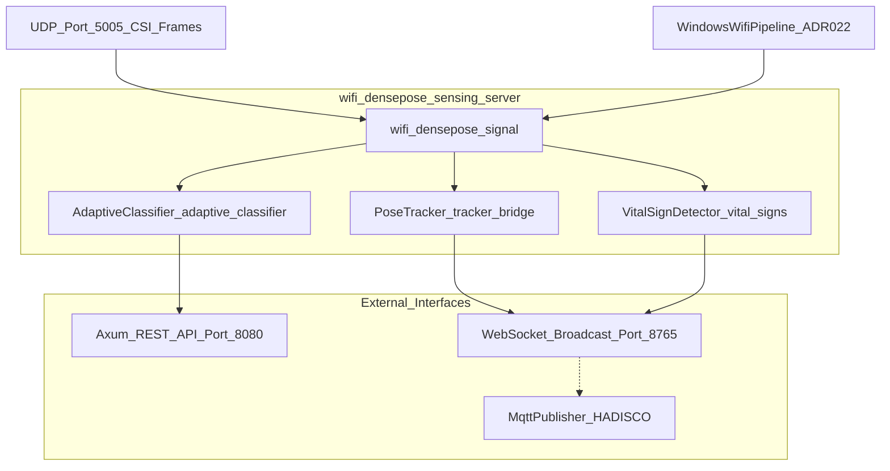
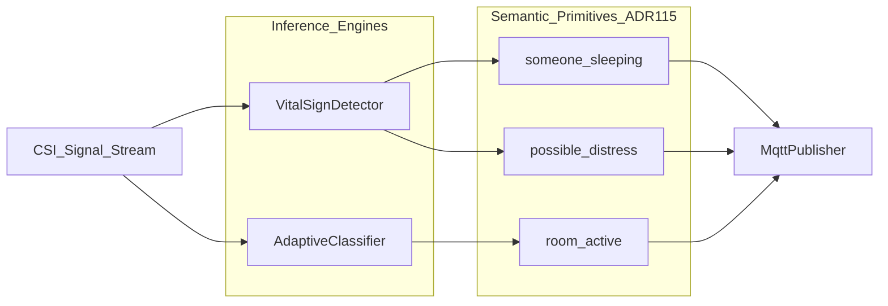

<!-- source: DeepWiki mcp.deepwiki.com · repo ruvnet/RuView · page 8 API Reference · fetched 2026-10-30 -->

# API Reference

Relevant source files

The following files were used as context for generating this wiki page:

- [CHANGELOG.md](CHANGELOG.md)
- [CLAUDE.md](CLAUDE.md)
- [README.md](README.md)
- [assets/ruview-hero-h3-v3.gif](assets/ruview-hero-h3-v3.gif)
- [assets/screen.png](assets/screen.png)
- [docs/adr/ADR-355-local-empty-room-bootstrap-prior.md](docs/adr/ADR-355-local-empty-room-bootstrap-prior.md)
- [docs/adr/ADR-357-raw-csi-calibration-sample-integrity.md](docs/adr/ADR-357-raw-csi-calibration-sample-integrity.md)
- [docs/readme-details.md](docs/readme-details.md)
- [docs/user-guide.md](docs/user-guide.md)
- [v2/Cargo.lock](v2/Cargo.lock)
- [v2/Cargo.toml](v2/Cargo.toml)
- [v2/crates/wifi-densepose-sensing-server/Cargo.toml](v2/crates/wifi-densepose-sensing-server/Cargo.toml)
- [v2/crates/wifi-densepose-sensing-server/README.md](v2/crates/wifi-densepose-sensing-server/README.md)
- [v2/crates/wifi-densepose-sensing-server/examples/mqtt_publisher.rs](v2/crates/wifi-densepose-sensing-server/examples/mqtt_publisher.rs)
- [v2/crates/wifi-densepose-sensing-server/src/bootstrap_baseline.rs](v2/crates/wifi-densepose-sensing-server/src/bootstrap_baseline.rs)
- [v2/crates/wifi-densepose-sensing-server/src/cli.rs](v2/crates/wifi-densepose-sensing-server/src/cli.rs)
- [v2/crates/wifi-densepose-sensing-server/src/field_bridge.rs](v2/crates/wifi-densepose-sensing-server/src/field_bridge.rs)
- [v2/crates/wifi-densepose-sensing-server/src/lib.rs](v2/crates/wifi-densepose-sensing-server/src/lib.rs)
- [v2/crates/wifi-densepose-sensing-server/src/main.rs](v2/crates/wifi-densepose-sensing-server/src/main.rs)
- [v2/crates/wifi-densepose-sensing-server/src/mqtt/config.rs](v2/crates/wifi-densepose-sensing-server/src/mqtt/config.rs)
- [v2/crates/wifi-densepose-signal/src/ruvsense/field_model.rs](v2/crates/wifi-densepose-signal/src/ruvsense/field_model.rs)
- [v2/rust-toolchain.toml](v2/rust-toolchain.toml)

The RuView sensing server exposes a REST API and WebSocket interface for programmatic access to WiFi sensing data, pose estimation, vital signs monitoring, model management, and ESP32 node control. This document provides a high-level reference for the communication protocols used by the `wifi-densepose-sensing-server`.

For application-level integration examples, see [Applications](#5). For CLI usage, see [CLI Tools & Examples](#5.3).

---

## Base Configuration

The sensing server (`wifi-densepose-sensing-server`) is a lightweight **Axum** web server that orchestrates data flow between ESP32 hardware, signal processing crates, and client interfaces [v2/crates/wifi-densepose-sensing-server/src/main.rs:1-9]().

| Component | Default Port | CLI Flag | Access |
|-----------|-------------|----------|---------|
| HTTP REST API | `8080` | `--http-port` | `http://host:8080` |
| WebSocket | `8765` | `--ws-port` | `ws://host:8765` |
| ESP32 UDP Sink | `5005` | `--udp-port` | `udp://host:5005` |

The server binds to `127.0.0.1` by default but can be configured for network access via `--bind-addr 0.0.0.0` [v2/crates/wifi-densepose-sensing-server/src/main.rs:100-143]().

Sources: [v2/crates/wifi-densepose-sensing-server/src/main.rs:97-143]()

---

## REST API Endpoints

The REST API provides control over the sensing lifecycle, model configuration, and access to the latest processed frames.

### Core Endpoints
*   **Health & Info**: Standard probes and system metadata endpoints [v2/crates/wifi-densepose-sensing-server/src/main.rs:41-42]()
*   **Sensing Data**: Access to latest pose keypoints and vital signs extracted by `VitalSignDetector` [v2/crates/wifi-densepose-sensing-server/src/lib.rs:46]()
*   **Model Management**: Endpoints to list, load, and unload **RVF (RuVector Format)** containers [v2/crates/wifi-densepose-sensing-server/src/rvf_container.rs:1-85]()
*   **Edge Registry**: Surfaces the canonical Cognitum cog catalog for edge module management (ADR-102) [v2/crates/wifi-densepose-sensing-server/src/main.rs:191-197]()

### Security
The API supports an opt-in **Bearer Token** authentication layer [v2/crates/wifi-densepose-sensing-server/src/bearer_auth.rs:1-12]() and **Host-header validation** to defend against DNS rebinding attacks in loopback-bound deployments [v2/crates/wifi-densepose-sensing-server/src/host_validation.rs:1-15]().

For details, see [REST API Endpoints](#8.1).

Sources: [v2/crates/wifi-densepose-sensing-server/src/lib.rs:11-20](), [v2/crates/wifi-densepose-sensing-server/Cargo.toml:22-107]()

---

## WebSocket Protocol

The WebSocket endpoint (`ws://host:8765/ws/sensing`) provides a real-time stream of `SensingUpdate` JSON messages.

### Stream Lifecycle
The server broadcasts updates at a frequency determined by the `--tick-ms` flag (default 100ms / 10Hz) [v2/crates/wifi-densepose-sensing-server/src/main.rs:136-138](). The stream aggregates data from multiple sources:
1.  **ESP32 Nodes**: Real-time CSI frames via UDP [v2/crates/wifi-densepose-sensing-server/src/main.rs:1-9]()
2.  **Windows WiFi**: Multi-BSSID scanning data from `WindowsWifiPipeline` (ADR-022) [v2/crates/wifi-densepose-sensing-server/src/main.rs:85-89]()
3.  **Simulated Data**: Synthetic frames when no hardware is present [v2/crates/wifi-densepose-sensing-server/src/main.rs:1-9]()

For details, see [WebSocket Protocol](#8.2).

Sources: [v2/crates/wifi-densepose-sensing-server/src/main.rs:60-70]()

---

## Architectural Data Flow

The `sensing-server` binary acts as a bridge between the physical RF space and programmatic API consumers.

Title: RuView Sensing Server Internal Data Flow

Sources: [v2/crates/wifi-densepose-sensing-server/src/main.rs:1-9](), [v2/crates/wifi-densepose-sensing-server/src/main.rs:60-70](), [v2/crates/wifi-densepose-sensing-server/src/lib.rs:11-46]()

---

## Home Assistant & MQTT Integration

When started with the `--mqtt` flag, the server activates a background `MqttPublisher` [v2/crates/wifi-densepose-sensing-server/src/main.rs:111-116](). This service maps internal sensing state to Home Assistant semantic primitives (e.g., `someone-sleeping`, `room-active`) and publishes them via MQTT auto-discovery [v2/crates/wifi-densepose-sensing-server/src/semantic.rs:1-30]().

Title: Semantic API Mapping

Sources: [v2/crates/wifi-densepose-sensing-server/src/semantic.rs:1-35](), [v2/crates/wifi-densepose-sensing-server/src/mqtt/config.rs:1-20]()

---

For detailed endpoint lists, payload schemas, and client connection guidelines, see the child pages:
- [REST API Endpoints](#8.1) — All REST endpoints: health, sensing data, vital signs, pose, model management, recording, training/adaptive endpoints, OTA/WASM node endpoints, BFLD scan, mesh sync snapshot, node log proxy, and legacy v1 FastAPI routes.
- [WebSocket Protocol](#8.2) — The `/ws/sensing` WebSocket: `SensingUpdate` JSON message format, ticket-based auth handshake, connection lifecycle, reconnection/backoff, heartbeats, and client-side websocket services.

---

