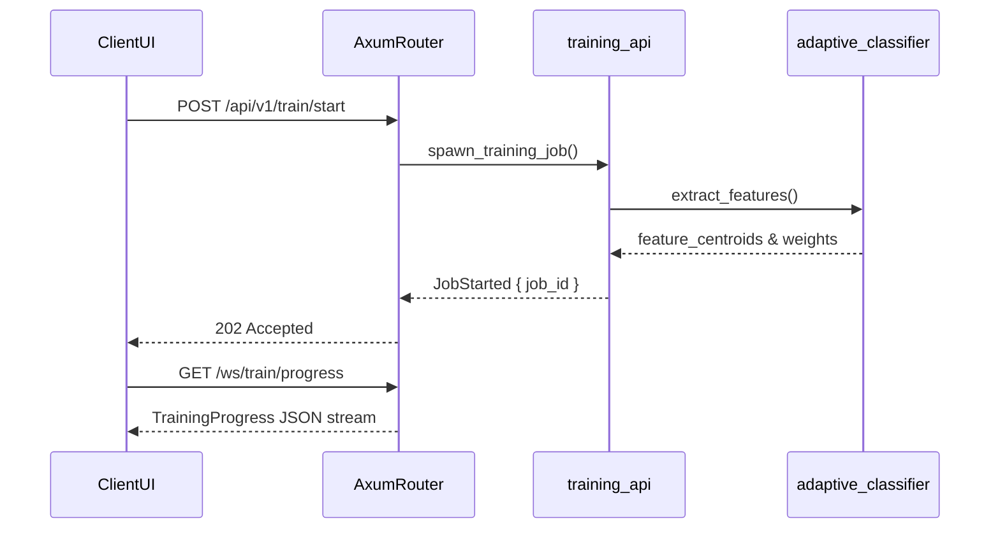

<!-- source: DeepWiki mcp.deepwiki.com · repo ruvnet/RuView · page 8.1 REST API Endpoints · fetched 2026-10-30 -->

# REST API Endpoints

<details>
<summary>Relevant source files</summary>

The following files were used as context for generating this wiki page:

- [CHANGELOG.md](CHANGELOG.md)
- [CLAUDE.md](CLAUDE.md)
- [README.md](README.md)
- [archive/v1/src/api/routers/health.py](archive/v1/src/api/routers/health.py)
- [archive/v1/src/services/metrics.py](archive/v1/src/services/metrics.py)
- [archive/v1/tests/unit/test_health_concurrency.py](archive/v1/tests/unit/test_health_concurrency.py)
- [assets/ruview-hero-h3-v3.gif](assets/ruview-hero-h3-v3.gif)
- [assets/screen.png](assets/screen.png)
- [docs/adr/ADR-186-training-progress-api.md](docs/adr/ADR-186-training-progress-api.md)
- [docs/adr/ADR-355-local-empty-room-bootstrap-prior.md](docs/adr/ADR-355-local-empty-room-bootstrap-prior.md)
- [docs/adr/ADR-357-raw-csi-calibration-sample-integrity.md](docs/adr/ADR-357-raw-csi-calibration-sample-integrity.md)
- [docs/readme-details.md](docs/readme-details.md)
- [docs/user-guide.md](docs/user-guide.md)
- [python/src/bindings/aether.rs](python/src/bindings/aether.rs)
- [python/tests/test_aether.py](python/tests/test_aether.py)
- [python/wifi_densepose/aether.pyi](python/wifi_densepose/aether.pyi)
- [ui/components/TrainingPanel.js](ui/components/TrainingPanel.js)
- [v2/Cargo.lock](v2/Cargo.lock)
- [v2/Cargo.toml](v2/Cargo.toml)
- [v2/crates/wifi-densepose-aether/Cargo.toml](v2/crates/wifi-densepose-aether/Cargo.toml)
- [v2/crates/wifi-densepose-aether/src/embedding.rs](v2/crates/wifi-densepose-aether/src/embedding.rs)
- [v2/crates/wifi-densepose-aether/src/graph_transformer.rs](v2/crates/wifi-densepose-aether/src/graph_transformer.rs)
- [v2/crates/wifi-densepose-aether/src/lib.rs](v2/crates/wifi-densepose-aether/src/lib.rs)
- [v2/crates/wifi-densepose-aether/src/sona.rs](v2/crates/wifi-densepose-aether/src/sona.rs)
- [v2/crates/wifi-densepose-aether/tests/golden_parity.rs](v2/crates/wifi-densepose-aether/tests/golden_parity.rs)
- [v2/crates/wifi-densepose-sensing-server/Cargo.toml](v2/crates/wifi-densepose-sensing-server/Cargo.toml)
- [v2/crates/wifi-densepose-sensing-server/README.md](v2/crates/wifi-densepose-sensing-server/README.md)
- [v2/crates/wifi-densepose-sensing-server/src/bootstrap_baseline.rs](v2/crates/wifi-densepose-sensing-server/src/bootstrap_baseline.rs)
- [v2/crates/wifi-densepose-sensing-server/src/field_bridge.rs](v2/crates/wifi-densepose-sensing-server/src/field_bridge.rs)
- [v2/crates/wifi-densepose-sensing-server/src/lib.rs](v2/crates/wifi-densepose-sensing-server/src/lib.rs)
- [v2/crates/wifi-densepose-sensing-server/src/main.rs](v2/crates/wifi-densepose-sensing-server/src/main.rs)
- [v2/crates/wifi-densepose-sensing-server/src/training_api.rs](v2/crates/wifi-densepose-sensing-server/src/training_api.rs)
- [v2/crates/wifi-densepose-signal/src/ruvsense/field_model.rs](v2/crates/wifi-densepose-signal/src/ruvsense/field_model.rs)
- [v2/crates/wifi-densepose-train/benches/training_bench.rs](v2/crates/wifi-densepose-train/benches/training_bench.rs)
- [v2/crates/wifi-densepose-train/src/metrics.rs](v2/crates/wifi-densepose-train/src/metrics.rs)

</details>


## Purpose and Scope

This document provides a full technical reference for all REST API endpoints exposed by the RuView sensing server (`wifi-densepose-sensing-server`). The API provides programmatic access to real-time WiFi Channel State Information (CSI) sensing data, vital sign measurements, pose estimation, RVF model management, recording workflows, training/adaptive classifier pipelines, OTA/WASM node endpoints, BFLD privacy scans, mesh synchronization snapshots, node log proxies, and legacy v1 compatibility routes.

The backend is implemented in Rust using the **Axum** framework [v2/crates/wifi-densepose-sensing-server/src/main.rs:60-70](), ensuring low-latency concurrency and high-throughput UDP packet ingestion [v2/crates/wifi-densepose-sensing-server/src/main.rs:108-112]().

Sources: [v2/crates/wifi-densepose-sensing-server/src/main.rs:60-112](), [v2/crates/wifi-densepose-sensing-server/Cargo.toml:22-26]()

---

## API Architecture & Security

The sensing server binds to an HTTP port (default `8080`) [v2/crates/wifi-densepose-sensing-server/src/main.rs:101-103]() and processes requests through an `Axum` router [v2/crates/wifi-densepose-sensing-server/src/main.rs:68-70](). 

### Security & Authentication
- **Bearer Token Auth**: Opt-in via `RUVIEW_API_TOKEN`. When configured, requests under `/api/v1/` require an `Authorization: Bearer <token>` header verified via constant-time comparison [v2/crates/wifi-densepose-sensing-server/src/bearer_auth.rs:31-81]().
- **Host Header Validation**: Defends against DNS rebinding by validating incoming `Host` headers against loopback defaults and operator-supplied allowed hosts [v2/crates/wifi-densepose-sensing-server/src/main.rs:166-173]().

### System-to-Code Architecture Diagram

```mermaid
graph TB
    subgraph "NaturalLanguageSpace"
        [ClientUI] -->|"HTTP REST"| [AxumRouter]
        [EdgeNode] -->|"UDP CSI Frames"| [UdpSocket]
    end

    subgraph "CodeEntitySpace"
        [AxumRouter] --> [bearer_auth::require_bearer]
        [AxumRouter] --> [training_api::routes]
        [AxumRouter] --> [AppStateInner]
        [AppStateInner] --> [VitalSignDetector]
        [AppStateInner] --> [PoseTracker]
        [AppStateInner] --> [FieldModel]
    end
```
Sources: [v2/crates/wifi-densepose-sensing-server/src/main.rs:60-112](), [v2/crates/wifi-densepose-sensing-server/src/bearer_auth.rs:31-81]()

---

## Health, Status & Node Log Proxy Endpoints

### GET /health/health
Returns system liveness and operational metadata without requiring authentication [v2/crates/wifi-densepose-sensing-server/src/bearer_auth.rs:11-14]().

**Response:**
```json
{
  "status": "ok",
  "source": "esp32",
  "uptime_secs": 4200
}
```

### GET /api/v1/nodes/logs
Proxies or retrieves aggregated structured logs and telemetry from connected edge nodes.

Sources: [v2/crates/wifi-densepose-sensing-server/src/main.rs:68-70]()

---

## Sensing, Vital Signs & Pose Endpoints

### GET /api/v1/sensing/latest
Retrieves the most recent processed sensing frame, containing feature vectors, signal field matrices, and raw subcarrier statistics [v2/crates/wifi-densepose-sensing-server/src/main.rs:172-218]().

### GET /api/v1/vitals/current
Returns real-time extracted breathing rate, heart rate, and presence confidence derived via the `VitalSignDetector` [v2/crates/wifi-densepose-sensing-server/src/vital_signs.rs:1-15]().

### GET /api/v1/pose/current
Returns the current 17-keypoint COCO skeleton fused by the `MultistaticFuser` and smoothed via the `PoseTracker` (Kalman filter) [v2/crates/wifi-densepose-sensing-server/src/main.rs:90-94]().

### GET /api/v1/introspection/snapshot
Provides a real-time introspection tap (ADR-099) returning attractor regime classification (`midstreamer-attractor`) and Lyapunov stability exponents [v2/crates/wifi-densepose-sensing-server/src/introspection.rs:142-166]().

Sources: [v2/crates/wifi-densepose-sensing-server/src/main.rs:172-218](), [v2/crates/wifi-densepose-sensing-server/src/introspection.rs:142-166]()

---

## Model Management & RVF Containers

### GET /api/v1/models
Lists all available `.rvf` (RuVector Format) model containers present in the configured models storage directory [v2/crates/wifi-densepose-sensing-server/src/model_format.rs:1-20]().

### POST /api/v1/models/load
Loads a specified model into memory, supporting progressive loading sequences if enabled [v2/crates/wifi-densepose-sensing-server/src/rvf_pipeline.rs:1-25]().

Sources: [v2/crates/wifi-densepose-sensing-server/src/model_format.rs:1-20](), [v2/crates/wifi-densepose-sensing-server/src/rvf_pipeline.rs:1-25]()

---

## Training & Adaptive Classifier Endpoints

Implemented primarily in `training_api.rs` and `adaptive_classifier.rs` under ADR-186 (Training Reconnect & Progress API):

### POST /api/v1/train/start
Initiates model fine-tuning or adaptive classifier calibration over recorded session datasets.

### GET /ws/train/progress
A WebSocket/streaming endpoint tracking live training progress, loss curves, epoch count, and validation metrics [v2/crates/wifi-densepose-sensing-server/src/main.rs:28-32]().

### POST /api/v1/classifier/adapt
Feeds recent labeled samples into the adaptive logistic classifier to update environment-specific decision thresholds.

### Training Data Flow Diagram


Sources: [v2/crates/wifi-densepose-sensing-server/src/main.rs:28-32](), [v2/crates/wifi-densepose-sensing-server/src/training_api.rs:1-40](), [v2/crates/wifi-densepose-sensing-server/src/adaptive_classifier.rs:1-35]()

---

## OTA / WASM Node Endpoints & Edge Registry

### GET /api/v1/edge/registry
Fetches and caches the canonical Cognitum cog application registry (ADR-102), returning signed metadata for edge modules [v2/crates/wifi-densepose-sensing-server/src/edge_registry.rs:1-20]().

### POST /api/v1/nodes/ota
Initiates firmware or WASM binary updates across targeted ESP32 nodes in the mesh.

Sources: [v2/crates/wifi-densepose-sensing-server/src/edge_registry.rs:1-20](), [v2/crates/wifi-densepose-sensing-server/Cargo.toml:88-93]()

---

## BFLD Scan & Mesh Sync Snapshot Endpoints

### GET /api/v1/bfld/scan
Triggers or returns the latest privacy and beamforming feedback scan (`wifi-densepose-bfld`), measuring identity leakage risk and active protection posture [v2/crates/wifi-densepose-sensing-server/Cargo.toml:64-67]().

### GET /api/v1/mesh/snapshot
Returns a multistatic mesh synchronization snapshot containing node timestamps, link calibration status, and epoch alignment metrics (`SyncPacket` decoding).

Sources: [v2/crates/wifi-densepose-sensing-server/Cargo.toml:62-67](), [v2/crates/wifi-densepose-sensing-server/src/main.rs:90-95]()

---

## Legacy v1 FastAPI Routes & Compatibility

The sensing server maintains compatibility wrappers mirroring the legacy Python FastAPI structure under `archive/v1/` for historical analysis and client parity [v2/crates/wifi-densepose-sensing-server/src/main.rs:9-10]().

### Legacy Endpoints
- `GET /api/v1/legacy/pose/current`: Historical pose endpoint alias.
- `POST /api/v1/legacy/pose/analyze`: Custom segmentation analysis wrapper.
- `GET /api/v1/legacy/zones/{zone_id}/occupancy`: Zone occupancy metric endpoint.

Sources: [v2/crates/wifi-densepose-sensing-server/src/main.rs:9-10](), [archive/v1/src/api/routers/health.py:1-20]()

---

