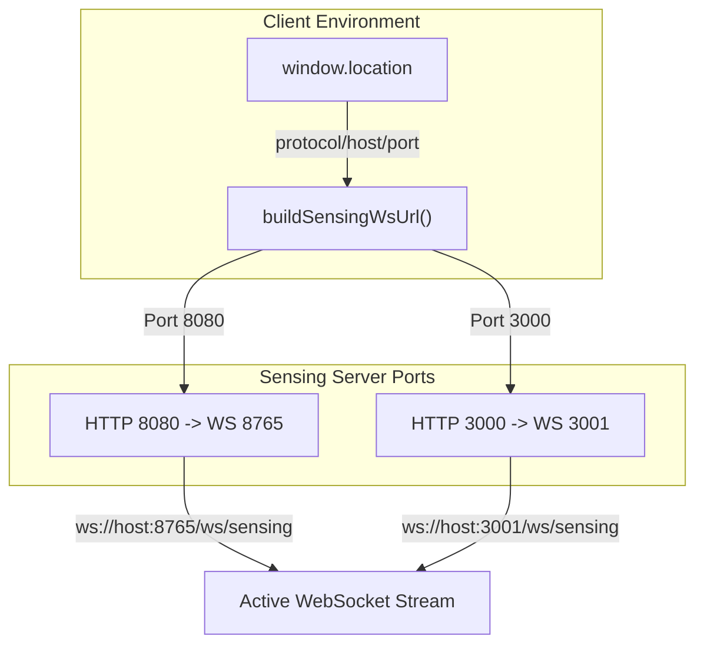
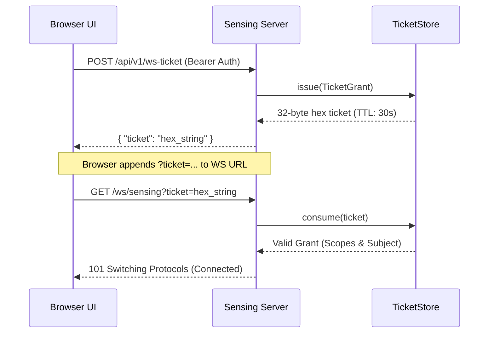
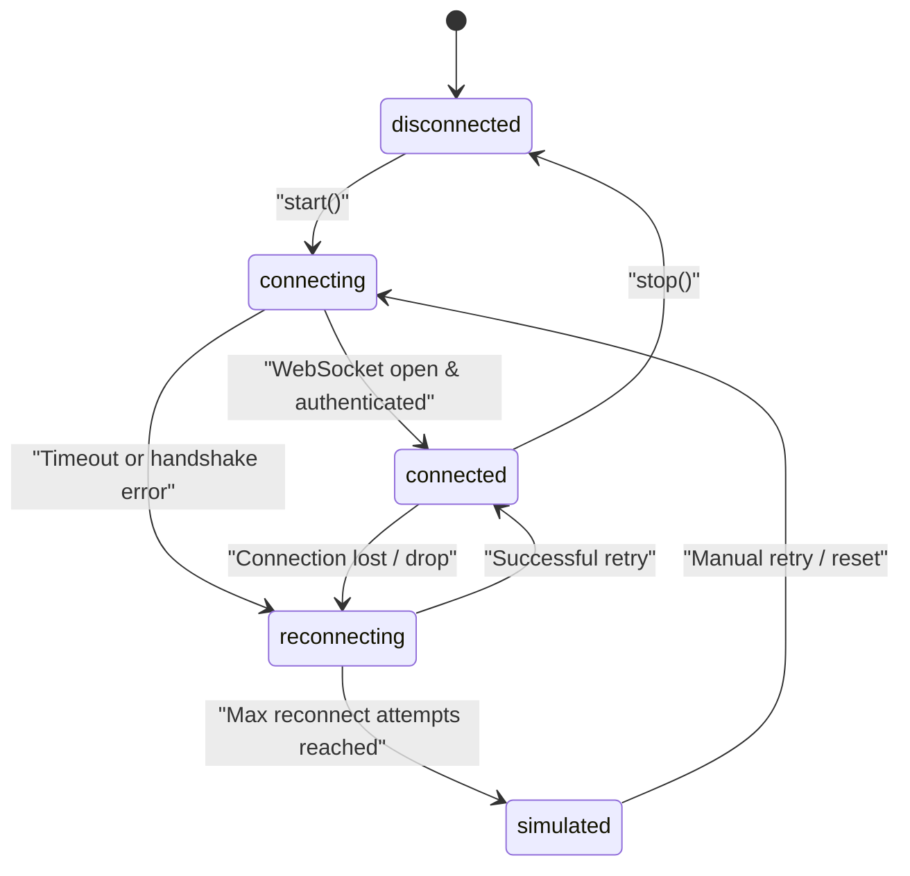

<!-- source: DeepWiki mcp.deepwiki.com · repo ruvnet/RuView · page 8.2 WebSocket Protocol · fetched 2026-10-30 -->

# WebSocket Protocol

<details>
<summary>Relevant source files</summary>

The following files were used as context for generating this wiki page:

- [docs/adr/ADR-036-rvf-training-pipeline-ui.md](docs/adr/ADR-036-rvf-training-pipeline-ui.md)
- [docs/adr/ADR-271-cognitum-oauth-resource-server.md](docs/adr/ADR-271-cognitum-oauth-resource-server.md)
- [docs/adr/ADR-272-websocket-authentication-tickets.md](docs/adr/ADR-272-websocket-authentication-tickets.md)
- [ui/app.js](ui/app.js)
- [ui/components/DashboardTab.js](ui/components/DashboardTab.js)
- [ui/components/HardwareTab.js](ui/components/HardwareTab.js)
- [ui/components/LiveDemoTab.js](ui/components/LiveDemoTab.js)
- [ui/components/ModelPanel.js](ui/components/ModelPanel.js)
- [ui/components/PoseDetectionCanvas.js](ui/components/PoseDetectionCanvas.js)
- [ui/components/SensingTab.js](ui/components/SensingTab.js)
- [ui/components/SettingsPanel.js](ui/components/SettingsPanel.js)
- [ui/services/api.service.js](ui/services/api.service.js)
- [ui/services/pose.service.js](ui/services/pose.service.js)
- [ui/services/sensing.service.js](ui/services/sensing.service.js)
- [ui/services/websocket.service.js](ui/services/websocket.service.js)
- [ui/services/ws-ticket.test.mjs](ui/services/ws-ticket.test.mjs)
- [ui/style.css](ui/style.css)
- [ui/sw.js](ui/sw.js)
- [ui/sw.test.mjs](ui/sw.test.mjs)
- [ui/tests/test-runner.html](ui/tests/test-runner.html)
- [ui/tests/test-runner.js](ui/tests/test-runner.js)
- [ui/utils/data-source-banner.js](ui/utils/data-source-banner.js)
- [ui/utils/quick-settings.js](ui/utils/quick-settings.js)
- [v2/crates/ruview-auth/src/jwks.rs](v2/crates/ruview-auth/src/jwks.rs)
- [v2/crates/wifi-densepose-sensing-server/src/bearer_auth.rs](v2/crates/wifi-densepose-sensing-server/src/bearer_auth.rs)
- [v2/crates/wifi-densepose-sensing-server/src/browser_session.rs](v2/crates/wifi-densepose-sensing-server/src/browser_session.rs)
- [v2/crates/wifi-densepose-sensing-server/src/ws_ticket.rs](v2/crates/wifi-densepose-sensing-server/src/ws_ticket.rs)
- [v2/crates/wifi-densepose-sensing-server/tests/auth_wiring.rs](v2/crates/wifi-densepose-sensing-server/tests/auth_wiring.rs)

</details>


## Purpose and Scope

This document details the WebSocket protocol implemented in the RuView sensing server and consumed by client applications (such as the Observatory UI and desktop components) [ui/services/sensing.service.js:1-12](). The primary WebSocket endpoint (`/ws/sensing`) delivers real-time Channel State Information (CSI) features, node telemetry, vital signs estimates, and spatial occupancy updates [ui/services/sensing.service.js:1-30](). 

This page covers the end-to-end connection lifecycle, ticket-based authentication handshakes (ADR-272) designed for browser environments that cannot set custom `Authorization` headers on upgrade requests [v2/crates/wifi-densepose-sensing-server/src/ws_ticket.rs:1-36](), the `SensingUpdate` JSON message format, exponential backoff reconnection logic, heartbeats, and client-side websocket services.

Sources: [ui/services/sensing.service.js:1-30](), [v2/crates/wifi-densepose-sensing-server/src/ws_ticket.rs:1-36]()

---

## Endpoint and URL Structure

### Primary Endpoint

The real-time sensing stream is exposed at the WebSocket path:

```
ws://<host>:<port>/ws/sensing
```

**Port Mapping & Configuration:**
- **Standard Stack:** HTTP web UI on port `8080`, sensing stream on port `8765` [ui/services/sensing.service.js:14-19]().
- **Docker Deployment:** HTTP UI/API on port `3000`, sensing stream mapped to port `3001` [ui/services/sensing.service.js:14-19]().
- **Protocol Security:** Automatically uses `wss://` if the web page is loaded over HTTPS, and `ws://` for plain HTTP [ui/services/sensing.service.js:21-22]().

### URL Construction Diagram



Sources: [ui/services/sensing.service.js:14-30]()

---

## Ticket-Based Authentication Handshake (ADR-272)

When authentication is enabled on the sensing server (via `RUVIEW_API_TOKEN` or Cognitum OAuth), endpoints like `/ws/sensing` require credentials [v2/crates/wifi-densepose-sensing-server/src/bearer_auth.rs:1-18](). However, native browser `WebSocket` constructors cannot inject custom headers such as `Authorization: Bearer <token>` during the HTTP upgrade handshake [v2/crates/wifi-densepose-sensing-server/src/ws_ticket.rs:1-11]().

To resolve this safely without passing long-lived tokens in query parameters, RuView implements a **ticket-based auth handshake** (ADR-272) [v2/crates/wifi-densepose-sensing-server/src/ws_ticket.rs:1-36]().

### Handshake Sequence



### Ticket Invariants

1. **Single-Use:** The ticket is immediately removed from the `TicketStore` upon redemption (`consume`). Replaying a ticket fails even within its 30-second window [v2/crates/wifi-densepose-sensing-server/src/ws_ticket.rs:149-161]().
2. **Short TTL:** Tickets expire after 30 seconds (`TICKET_TTL`), making harvested URLs useless [v2/crates/wifi-densepose-sensing-server/src/ws_ticket.rs:43-46]().
3. **Restricted Scope:** The ticket authorizes *only* the WebSocket connection upgrade, inheriting the exact scopes and subject of the authenticated `POST` request that minted it [v2/crates/wifi-densepose-sensing-server/src/ws_ticket.rs:68-76]().
4. **Native Client Exception:** Non-browser clients (Rust CLI, Python SDK, MCP clients) are not constrained by browser APIs and pass standard `Authorization: Bearer <token>` headers directly on the upgrade request [v2/crates/wifi-densepose-sensing-server/src/ws_ticket.rs:31-35]().

Sources: [v2/crates/wifi-densepose-sensing-server/src/ws_ticket.rs:1-173](), [ui/services/websocket.service.js:118-147]()

---

## Connection Lifecycle & State Machine

The client-side `SensingService` and `WebSocketService` manage connections through distinct operational states [ui/services/sensing.service.js:73-102]().

### Connection States

| State | Description |
|-------|-------------|
| `disconnected` | Initial state or intentional teardown via `stop()` [ui/services/sensing.service.js:88](). |
| `connecting` | Fetching ticket and performing WebSocket handshake [ui/services/websocket.service.js:69](). |
| `connected` | Socket is open; incoming `SensingUpdate` frames are processed [ui/services/sensing.service.js:90](). |
| `reconnecting` | Connection dropped; active backoff retries underway [ui/services/sensing.service.js:92](). |
| `simulated` | Reconnect attempts exhausted; fallback client-side synthetic data generation active (if enabled) [ui/services/sensing.service.js:93](). |

### State Machine Diagram



Sources: [ui/services/sensing.service.js:73-124](), [ui/services/websocket.service.js:63-116]()

---

## Message Format: SensingUpdate JSON

The sensing server broadcasts structured JSON payloads representing the aggregate state of the wireless sensor network.

### JSON Schema Structure

```json
{
  "type": "sensing_update",
  "timestamp": 1721644800.123,
  "source": "esp32",
  "nodes": [
    {
      "node_id": "esp32_node_01",
      "rssi": -52,
      "motion_level": 0.18,
      "n_persons": 1
    }
  ],
  "vital_signs": {
    "breathing_rate": 0.22,
    "heart_rate": 1.15,
    "confidence": 0.91
  },
  "signal_field": [0.05, 0.12, 0.88, 0.45],
  "occupancy": 1
}
```

### Field Definitions

| Field | Type | Description |
|-------|------|-------------|
| `type` | string | Message discriminator, always `"sensing_update"`. |
| `timestamp` | float | Unix epoch timestamp of frame generation. |
| `source` | string | Active hardware capture backend (`"esp32"`, `"wifi"`, `"simulate"`). |
| `nodes` | array | Telemetry array containing individual edge node metrics (`node_id`, `rssi`, `motion_level`). |
| `vital_signs` | object | Extracted respiratory and cardiac rates with confidence scoring. |
| `signal_field` | array | Spatial perturbation tensor for 3D/Observatory visualization. |
| `occupancy` | integer | Estimated total person count in the monitored zone. |

Sources: [ui/services/sensing.service.js:140-170](), [v2/crates/wifi-densepose-sensing-server/src/main.rs:1-70]()

---

## Reconnection Strategy & Backoff

When a connection fails, the client adheres to an exponential backoff schedule combined with a simulation fallback safeguard.

### Backoff Delays

- **Attempt 1:** 1,000 ms [ui/services/sensing.service.js:33]()
- **Attempt 2:** 2,000 ms [ui/services/sensing.service.js:33]()
- **Attempt 3:** 4,000 ms [ui/services/sensing.service.js:33]()
- **Attempt 4:** 8,000 ms [ui/services/sensing.service.js:33]()
- **Attempt 5–20:** 16,000 ms (capped) [ui/services/sensing.service.js:33-34]()

### Simulation Fallback Policy

To prevent the UI from flashing synthetic data during transient network hiccups, simulation fallback only activates after **5 consecutive failed attempts** (`SIM_FALLBACK_AFTER_ATTEMPTS`) [ui/services/sensing.service.js:35-37](). Client-side simulation is disabled by default to maintain measurement integrity unless explicitly requested via `?simulate=1` or `localStorage` [ui/services/sensing.service.js:40-71]().

Sources: [ui/services/sensing.service.js:31-71]()

---

## Heartbeats & Connection Persistence

To detect silent TCP connection drops, the WebSocket layer maintains an active keep-alive regime:

- **Heartbeat Interval:** Ping/activity check every `30,000` ms (30 seconds) [ui/services/websocket.service.js:17]().
- **Connection Timeout:** Handshake timeout of `10,000` ms [ui/services/websocket.service.js:18]().
- **Activity Tracking:** Every incoming message updates `connection.lastActivity` [ui/services/websocket.service.js:185-190](). If no activity or ping response occurs within the threshold, the client forcibly terminates the socket and initiates the reconnection backoff sequence [ui/services/websocket.service.js:104-115]().

Sources: [ui/services/websocket.service.js:15-22](), [ui/services/websocket.service.js:100-116]()

---

## Client-Side WebSocket Services

Two primary JavaScript service classes orchestrate WebSocket communication in the web application:

1. **`SensingService` (`ui/services/sensing.service.js`)**: Manages the `/ws/sensing` stream lifecycle, exposes event subscriptions (`onData`, `onStateChange`), tracks RSSI history buffers, and coordinates simulation fallbacks [ui/services/sensing.service.js:38-150]().
2. **`WebSocketService` (`ui/services/websocket.service.js`)**: Generic multi-connection manager supporting general-purpose streams, automatic ticket exchange via `withWsTicket()`, heartbeat monitoring, and exponential backoff retry handlers [ui/services/websocket.service.js:7-147]().

Sources: [ui/services/sensing.service.js:38-160](), [ui/services/websocket.service.js:7-147]()

---

