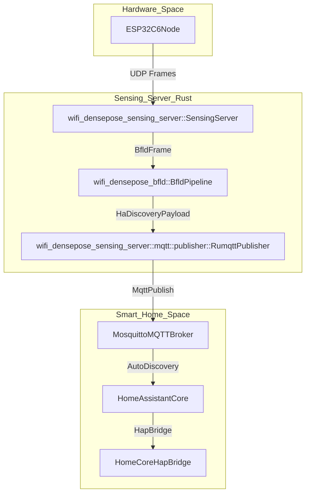
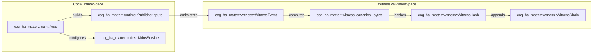

<!-- source: DeepWiki mcp.deepwiki.com · repo ruvnet/RuView · page 9 Home Assistant & Smart Home Integration · fetched 2026-10-30 -->

# Home Assistant & Smart Home Integration

Relevant source files

The following files were used as context for generating this wiki page:

- [docs/adr/ADR-116-cog-ha-matter-seed.md](docs/adr/ADR-116-cog-ha-matter-seed.md)
- [docs/research/ADR-116-ha-matter-cog-research.md](docs/research/ADR-116-ha-matter-cog-research.md)
- [v2/crates/cog-ha-matter/Cargo.toml](v2/crates/cog-ha-matter/Cargo.toml)
- [v2/crates/cog-ha-matter/src/lib.rs](v2/crates/cog-ha-matter/src/lib.rs)
- [v2/crates/cog-ha-matter/src/main.rs](v2/crates/cog-ha-matter/src/main.rs)
- [v2/crates/cog-ha-matter/src/manifest.rs](v2/crates/cog-ha-matter/src/manifest.rs)
- [v2/crates/cog-ha-matter/src/mdns.rs](v2/crates/cog-ha-matter/src/mdns.rs)
- [v2/crates/cog-ha-matter/src/runtime.rs](v2/crates/cog-ha-matter/src/runtime.rs)
- [v2/crates/cog-ha-matter/src/witness.rs](v2/crates/cog-ha-matter/src/witness.rs)
- [v2/crates/cog-ha-matter/src/witness_signing.rs](v2/crates/cog-ha-matter/src/witness_signing.rs)
- [v2/crates/homecore-api/Cargo.toml](v2/crates/homecore-api/Cargo.toml)
- [v2/crates/homecore-api/src/app.rs](v2/crates/homecore-api/src/app.rs)
- [v2/crates/homecore-api/src/bin/server.rs](v2/crates/homecore-api/src/bin/server.rs)
- [v2/crates/homecore-api/src/error.rs](v2/crates/homecore-api/src/error.rs)
- [v2/crates/homecore-api/src/rest.rs](v2/crates/homecore-api/src/rest.rs)
- [v2/crates/homecore-api/src/state.rs](v2/crates/homecore-api/src/state.rs)
- [v2/crates/homecore-api/src/tokens.rs](v2/crates/homecore-api/src/tokens.rs)
- [v2/crates/homecore-api/src/ws.rs](v2/crates/homecore-api/src/ws.rs)
- [v2/crates/homecore-api/tests/compatibility_surface.rs](v2/crates/homecore-api/tests/compatibility_surface.rs)
- [v2/crates/homecore-api/tests/server_bin_auth.rs](v2/crates/homecore-api/tests/server_bin_auth.rs)
- [v2/crates/homecore-api/tests/ws_handshake.rs](v2/crates/homecore-api/tests/ws_handshake.rs)
- [v2/crates/homecore-automation/src/condition.rs](v2/crates/homecore-automation/src/condition.rs)
- [v2/crates/homecore-server/Cargo.toml](v2/crates/homecore-server/Cargo.toml)
- [v2/crates/homecore-server/src/hap.rs](v2/crates/homecore-server/src/hap.rs)
- [v2/crates/homecore-server/src/main.rs](v2/crates/homecore-server/src/main.rs)
- [v2/docs/homecore-capabilities.md](v2/docs/homecore-capabilities.md)

RuView provides a comprehensive ecosystem for integrating WiFi-based pose and vital sign sensing into smart home environments. This integration is built on a tiered architecture ranging from standard MQTT publishing to a native Rust-based Home Assistant port (`HOMECORE`) and packaged Seed applications (`cog-ha-matter`).

The system emphasizes privacy through the **BFLD (Beamforming Feedback Layer for Detection)** crate, ensuring that sensitive RF data is transformed into semantic primitives before leaving the local network.

### High-Level Architecture

The following diagram bridges natural language concepts to the exact Rust code entities responsible for the sensing-to-smart-home pipeline:

**Sensing to Smart Home Code Entity Flow**

Sources: [v2/crates/cog-ha-matter/src/runtime.rs:127-133](), [v2/crates/cog-ha-matter/src/lib.rs:35-46]()

---

## 9.1 MQTT, Discovery & Semantic Primitives

The primary integration path uses MQTT auto-discovery (`HA-DISCO`) to project WiFi sensing results as standard Home Assistant entities. This layer is managed by the `wifi-densepose-bfld` crate, which implements the **HA-MIND** (Home Assistant Machine Intelligence for Networked Detection) semantic primitives.

### Key Capabilities
- **`MqttPublisher`**: Handles connection management, rate limiting, and Last Will and Testament (LWT) signaling for availability topics.
- **HA Auto-Discovery Payloads**: Automatically structures JSON configuration payloads for sensor and binary sensor registries.
- **BFLD Topic Routing**: Routes transformed telemetry through privacy-gated channels.
- **Blueprints & Lovelace Cards**: Ready-to-import Home Assistant Blueprints and dashboard cards for quick deployment.

For details, see [MQTT, Discovery & Semantic Primitives](#9.1).

Sources: [v2/crates/cog-ha-matter/src/lib.rs:35-46](), [v2/crates/cog-ha-matter/src/runtime.rs:78-108]()

---

## 9.2 HOMECORE: Rust Home Assistant Port

**HOMECORE** (ADR-126/127) is a high-performance Rust reimplementation of core Home Assistant functionalities, designed to run natively on the Cognitum Seed appliance or edge gateways [v2/crates/homecore-server/src/main.rs:1-18]().

### System Capabilities
- **State Machine & Event Bus**: Lock-free concurrency wrappers managing state registries and system events [v2/docs/homecore-capabilities.md:10-13]().
- **HOMECORE API**: Exposes HA-compatible REST and WebSocket endpoints (`/api/`, `/api/config`, `/api/websocket`) with secure bearer token auth [v2/crates/homecore-api/src/rest.rs:29-37](), [v2/crates/homecore-api/src/ws.rs:41-47]().
- **Recorder & Automation Engine**: SQLite state history persistence [v2/docs/homecore-capabilities.md:14](), template evaluation, and run-mode automations [v2/docs/homecore-capabilities.md:18]().
- **Apple HomeKit Bridge**: Implements the HomeKit Accessory Protocol (`homecore-hap`) for direct integration with Apple Home controllers [v2/crates/homecore-server/Cargo.toml:70-71]().

For details, see [HOMECORE: Rust Home Assistant Port](#9.2).

Sources: [v2/crates/homecore-server/src/main.rs:1-35](), [v2/crates/homecore-api/src/app.rs:25-60](), [v2/docs/homecore-capabilities.md:1-23]()

---

## 9.3 cog-ha-matter Seed App

The `cog-ha-matter` application is a packaged, installable artifact for the Cognitum Seed appliance (ADR-116) [docs/adr/ADR-116-cog-ha-matter-seed.md:1-10](). It wraps the sensing server's MQTT publisher into a managed service with robust Seed-native capabilities [v2/crates/cog-ha-matter/src/lib.rs:1-24]().

### Seed-Native Features
- **mDNS Responder**: Automatically advertises `_ruview-ha._tcp` so discovery integrations find the node without manual host configuration [v2/crates/cog-ha-matter/src/main.rs:136-163]().
- **Witness Chain Audit Log**: Implements an Ed25519-signed, SHA-256 hash-chained append-only log (`WitnessChain`, `WitnessHash`, `canonical_bytes`) for verifiable state transitions [v2/crates/cog-ha-matter/src/witness.rs:40-103]().
- **Packaging & Release**: Coordinated via the workspace Makefile and build script tasks [v2/crates/cog-ha-matter/Cargo.toml:1-17]().

### Cog and Witness Entity Mapping
The following diagram illustrates the relationship between the cog runtime components and the cryptographic witness validation boundary:

**Cog Runtime and Witness Code Entities**

Sources: [v2/crates/cog-ha-matter/src/main.rs:26-69](), [v2/crates/cog-ha-matter/src/witness.rs:40-103]()

For details, see [cog-ha-matter Seed App](#9.3).

Sources: [docs/adr/ADR-116-cog-ha-matter-seed.md:1-35](), [v2/crates/cog-ha-matter/src/lib.rs:1-35](), [v2/crates/cog-ha-matter/src/witness.rs:1-40]()

---

