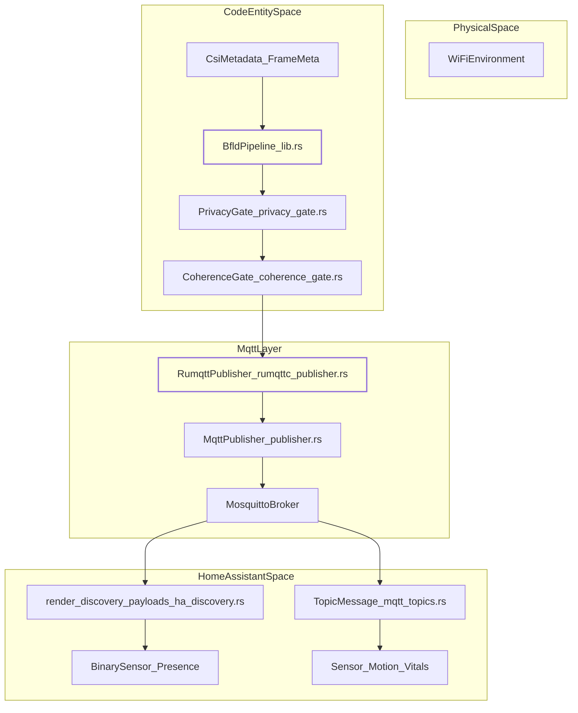
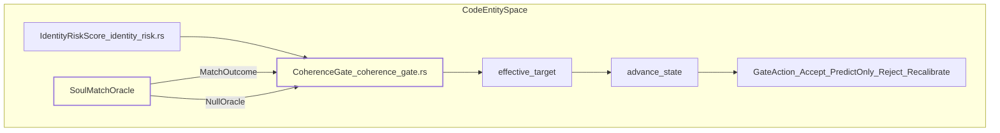

<!-- source: DeepWiki mcp.deepwiki.com · repo ruvnet/RuView · page 9.1 MQTT, Discovery & Semantic Primitives · fetched 2026-10-30 -->

# MQTT, Discovery & Semantic Primitives

Relevant source files

The following files were used as context for generating this wiki page:

- [docs/adr/ADR-058-ruvector-wasm-browser-pose-example.md](docs/adr/ADR-058-ruvector-wasm-browser-pose-example.md)
- [docs/adr/ADR-059-live-esp32-csi-pipeline.md](docs/adr/ADR-059-live-esp32-csi-pipeline.md)
- [docs/adr/ADR-178-desktop-ipc-injection-and-capability-least-privilege.md](docs/adr/ADR-178-desktop-ipc-injection-and-capability-least-privilege.md)
- [firmware/esp32-csi-node/build_firmware.ps1](firmware/esp32-csi-node/build_firmware.ps1)
- [firmware/esp32-csi-node/read_serial.ps1](firmware/esp32-csi-node/read_serial.ps1)
- [ui/pose-fusion.html](ui/pose-fusion.html)
- [ui/pose-fusion/build.sh](ui/pose-fusion/build.sh)
- [ui/pose-fusion/css/style.css](ui/pose-fusion/css/style.css)
- [ui/pose-fusion/js/canvas-renderer.js](ui/pose-fusion/js/canvas-renderer.js)
- [ui/pose-fusion/js/cnn-embedder.js](ui/pose-fusion/js/cnn-embedder.js)
- [ui/pose-fusion/js/main.js](ui/pose-fusion/js/main.js)
- [ui/services/websocket.service.test.mjs](ui/services/websocket.service.test.mjs)
- [v2/crates/wifi-densepose-bfld/src/availability.rs](v2/crates/wifi-densepose-bfld/src/availability.rs)
- [v2/crates/wifi-densepose-bfld/src/coherence_gate.rs](v2/crates/wifi-densepose-bfld/src/coherence_gate.rs)
- [v2/crates/wifi-densepose-bfld/src/ha_discovery.rs](v2/crates/wifi-densepose-bfld/src/ha_discovery.rs)
- [v2/crates/wifi-densepose-bfld/src/lib.rs](v2/crates/wifi-densepose-bfld/src/lib.rs)
- [v2/crates/wifi-densepose-bfld/src/rumqttc_publisher.rs](v2/crates/wifi-densepose-bfld/src/rumqttc_publisher.rs)
- [v2/crates/wifi-densepose-bfld/tests/availability_topic.rs](v2/crates/wifi-densepose-bfld/tests/availability_topic.rs)
- [v2/crates/wifi-densepose-bfld/tests/coherence_gate.rs](v2/crates/wifi-densepose-bfld/tests/coherence_gate.rs)
- [v2/crates/wifi-densepose-bfld/tests/ha_discovery.rs](v2/crates/wifi-densepose-bfld/tests/ha_discovery.rs)
- [v2/crates/wifi-densepose-bfld/tests/ha_discovery_publish.rs](v2/crates/wifi-densepose-bfld/tests/ha_discovery_publish.rs)
- [v2/crates/wifi-densepose-bfld/tests/mosquitto_integration.rs](v2/crates/wifi-densepose-bfld/tests/mosquitto_integration.rs)
- [v2/crates/wifi-densepose-bfld/tests/rumqttc_lwt.rs](v2/crates/wifi-densepose-bfld/tests/rumqttc_lwt.rs)
- [v2/crates/wifi-densepose-bfld/tests/rumqttc_publisher_smoke.rs](v2/crates/wifi-densepose-bfld/tests/rumqttc_publisher_smoke.rs)
- [v2/crates/wifi-densepose-bfld/tests/soul_match_oracle.rs](v2/crates/wifi-densepose-bfld/tests/soul_match_oracle.rs)
- [v2/crates/wifi-densepose-desktop/capabilities/default.json](v2/crates/wifi-densepose-desktop/capabilities/default.json)
- [v2/crates/wifi-densepose-desktop/gen/schemas/capabilities.json](v2/crates/wifi-densepose-desktop/gen/schemas/capabilities.json)
- [v2/crates/wifi-densepose-desktop/src/commands/discovery.rs](v2/crates/wifi-densepose-desktop/src/commands/discovery.rs)
- [v2/crates/wifi-densepose-pointcloud/src/camera.rs](v2/crates/wifi-densepose-pointcloud/src/camera.rs)
- [v2/crates/wifi-densepose-ruvector/src/viewpoint/coherence.rs](v2/crates/wifi-densepose-ruvector/src/viewpoint/coherence.rs)
- [v2/crates/wifi-densepose-ruvector/src/viewpoint/mod.rs](v2/crates/wifi-densepose-ruvector/src/viewpoint/mod.rs)
- [v2/crates/wifi-densepose-sensing-server/src/matter/bridge.rs](v2/crates/wifi-densepose-sensing-server/src/matter/bridge.rs)
- [v2/crates/wifi-densepose-sensing-server/src/matter/clusters.rs](v2/crates/wifi-densepose-sensing-server/src/matter/clusters.rs)
- [v2/crates/wifi-densepose-sensing-server/src/matter/commissioning.rs](v2/crates/wifi-densepose-sensing-server/src/matter/commissioning.rs)
- [v2/crates/wifi-densepose-sensing-server/src/mqtt/publisher.rs](v2/crates/wifi-densepose-sensing-server/src/mqtt/publisher.rs)
- [v2/crates/wifi-densepose-signal/src/ruvsense/array_coordinator.rs](v2/crates/wifi-densepose-signal/src/ruvsense/array_coordinator.rs)
- [v2/crates/wifi-densepose-signal/src/ruvsense/mod.rs](v2/crates/wifi-densepose-signal/src/ruvsense/mod.rs)
- [v2/crates/wifi-densepose-signal/src/ruvsense/rf_slam.rs](v2/crates/wifi-densepose-signal/src/ruvsense/rf_slam.rs)

## Purpose and Scope
This leaf page documents the Home Assistant integration layer for RuView, focusing on MQTT publishing via `RumqttPublisher` [v2/crates/wifi-densepose-bfld/src/rumqttc_publisher.rs:31-35](), Home Assistant Auto-Discovery (HA-DISCO) payloads [v2/crates/wifi-densepose-bfld/src/ha_discovery.rs:1-13](), BFLD MQTT topic routing, semantic primitives governed by the `CoherenceGate` [v2/crates/wifi-densepose-bfld/src/coherence_gate.rs:27-31](), Matter bridge composition [v2/crates/wifi-densepose-sensing-server/src/matter/bridge.rs:54-57](), and commissioning code generation [v2/crates/wifi-densepose-sensing-server/src/matter/commissioning.rs:48-62]().

---

## Overview of HA-MIND & MQTT Architecture
The RuView system integrates with Home Assistant (HA) through a specialized MQTT publishing layer and high-level semantic primitives known as **HA-MIND**. This architecture relies on the Beamforming Feedback Layer for Detection (**BFLD**) to process privacy-gated sensing primitives [v2/crates/wifi-densepose-bfld/src/lib.rs:1-12]().

### Core Components
- **`RumqttPublisher`**: A sync MQTT client wrapper around `rumqttc::Client` that handles state and event delivery [v2/crates/wifi-densepose-bfld/src/rumqttc_publisher.rs:31-35]().
- **`MqttPublisher`**: Background asynchronous task managing connection lifecycle, TLS transports (`TlsConfig`), LWT configuration, and availability heartbeats [v2/crates/wifi-densepose-sensing-server/src/mqtt/publisher.rs:1-29]().
- **HA-MIND Primitives**: Abstracted behavioral and presence states derived from CSI features.
- **`PrivacyClass`**: Enforces strict filtering rules (`Raw`, `Derived`, `Anonymous`, `Restricted`) to control what data leaves the node [v2/crates/wifi-densepose-bfld/src/lib.rs:105-119]().

### System Data Flow (Natural Language to Code Space)
The following diagram maps the logical flow from physical WiFi sensing to Home Assistant entities, linking physical observations to specific code entities.

**Diagram: Sensing to HA Entity Mapping Bridge**

**Sources:** [v2/crates/wifi-densepose-bfld/src/lib.rs:74-83](), [v2/crates/wifi-densepose-bfld/src/ha_discovery.rs:61-129](), [v2/crates/wifi-densepose-sensing-server/src/mqtt/publisher.rs:1-29]()

---

## MQTT Publishing & Auto-Discovery

RuView uses `RumqttPublisher` to implement the `Publish` trait, managing QoS levels and retention flags [v2/crates/wifi-densepose-bfld/src/rumqttc_publisher.rs:31-35](). State updates use non-retained messages to prevent stale-state flapping upon reconnect, while discovery and availability configurations are published with retention enabled [v2/crates/wifi-densepose-bfld/src/ha_discovery.rs:9-13]().

### HA-DISCO Payload Generation
The `render_discovery_payloads` function builds JSON configurations for Home Assistant on `homeassistant/<type>/<unique_id>/config` [v2/crates/wifi-densepose-bfld/src/ha_discovery.rs:61-64](). 

- **Device Identifiers**: Maps each node to a structured "RuView Seed" device [v2/crates/wifi-densepose-bfld/src/ha_discovery.rs:174-183]().
- **Availability Topics**: Links every entity to a shared availability topic governed by Last Will and Testament (LWT) payloads (`PAYLOAD_AVAILABLE` / `PAYLOAD_NOT_AVAILABLE`) [v2/crates/wifi-densepose-bfld/src/ha_discovery.rs:143-163]().
- **Entity Categories**: Flags diagnostic metrics using `entity_category: "diagnostic"` [v2/crates/wifi-densepose-bfld/src/ha_discovery.rs:131-172]().

### Entity List
Per node, the following BFLD entities are generated under `PrivacyClass::Anonymous` or higher [v2/crates/wifi-densepose-bfld/src/ha_discovery.rs:68-126]():
| Entity | HA Type | Purpose |
| :--- | :--- | :--- |
| `presence` | `binary_sensor` | Occupancy detection with `occupancy` device class [v2/crates/wifi-densepose-bfld/src/ha_discovery.rs:68-76]() |
| `motion` | `sensor` | Quantitative motion metric with diagnostic category [v2/crates/wifi-densepose-bfld/src/ha_discovery.rs:77-85]() |
| `person_count` | `sensor` | Estimated occupant count with `people` unit [v2/crates/wifi-densepose-bfld/src/ha_discovery.rs:86-94]() |
| `zone_activity` | `sensor` | Spatial zone activity score [v2/crates/wifi-densepose-bfld/src/ha_discovery.rs:95-103]() |
| `confidence` | `sensor` | Inference confidence score [v2/crates/wifi-densepose-bfld/src/ha_discovery.rs:104-112]() |
| `identity_risk` | `sensor` | Risk score of identity exposure (published exclusively at `PrivacyClass::Anonymous`) [v2/crates/wifi-densepose-bfld/src/ha_discovery.rs:114-126]() |

**Sources:** [v2/crates/wifi-densepose-bfld/src/ha_discovery.rs:61-129](), [v2/crates/wifi-densepose-bfld/src/rumqttc_publisher.rs:31-35]()

---

## HA-MIND Semantic Primitives & Coherence Gate

The `CoherenceGate` struct wraps stateless band classifiers with hysteresis ($\pm0.05$) and debounce timing (`DEBOUNCE_NS = 5_000_000_000` ns) to stabilize state transitions [v2/crates/wifi-densepose-bfld/src/coherence_gate.rs:19-30]().

### Gate Evaluation & Oracles
When evaluating score updates, `CoherenceGate::evaluate_with_oracle` allows integration with a `SoulMatchOracle`. If the oracle returns a `MatchOutcome::Match`, potential recalibration triggers are safely downgraded to `GateAction::PredictOnly` [v2/crates/wifi-densepose-bfld/src/coherence_gate.rs:71-84]().

### Semantic Primitive States
1. **someone-sleeping**: Low-frequency rhythmic patterns without translational movement.
2. **possible-distress**: High-intensity irregularities followed by prolonged stillness.
3. **room-active**: General occupancy with moderate-to-high activity.
4. **bathroom-occupied**: Static presence mapped to restricted zones.
5. **fall-risk-elevated**: Detected gait instability.

### Code Entity Architecture for Gating
**Diagram: Coherence Gate & Oracle Architecture**

**Sources:** [v2/crates/wifi-densepose-bfld/src/coherence_gate.rs:27-105](), [v2/crates/wifi-densepose-bfld/src/coherence_gate.rs:133-149]()

---

## Privacy-Mode-Safe Publishing & BFLD Topic Routing
The BFLD architecture enforces data isolation through three structural invariants (I1: Raw BFI never leaves the node; I2: Identity embeddings stay in RAM; I3: Cross-site correlation is cryptographically blocked) [v2/crates/wifi-densepose-bfld/src/lib.rs:8-11]().

### Privacy Classes
- **`PrivacyClass::Raw` (0)**: Local-only research data containing raw BFI matrices. `allows_network()` returns `false` [v2/crates/wifi-densepose-bfld/src/lib.rs:108-127]().
- **`PrivacyClass::Derived` (1)**: Downsampled angles and identity embeddings for LAN-only research sinks [v2/crates/wifi-densepose-bfld/src/lib.rs:110-114]().
- **`PrivacyClass::Anonymous` (2)**: Production default enabling aggregate sensing and safety primitives without biometric retention [v2/crates/wifi-densepose-bfld/src/lib.rs:115-116]().
- **`PrivacyClass::Restricted` (3)**: Regulated deployment class stripping risk scores and hashes [v2/crates/wifi-densepose-bfld/src/lib.rs:117-118]().

**Sources:** [v2/crates/wifi-densepose-bfld/src/lib.rs:1-141]()

---

## Matter Commissioning & Bridge Integration
RuView exposes sensing primitives via Matter controllers using the `cog-ha-matter` and sensing-server Matter bridge components [v2/crates/wifi-densepose-sensing-server/src/matter/bridge.rs:1-22]().

### Bridge Tree Assembly
`build_bridge_tree` constructs a hierarchical `BridgeTree` containing a root aggregator (`DEVICE_TYPE_AGGREGATOR`), per-node `BridgedNode` endpoints, and child entity endpoints [v2/crates/wifi-densepose-sensing-server/src/matter/bridge.rs:54-70](). Entities sharing occupancy contexts are collapsed onto common parent endpoints to comply with Matter device type constraints [v2/crates/wifi-densepose-sensing-server/src/matter/bridge.rs:85-106]().

### Setup Code Generation
The `commissioning` module generates 11-digit manual pairing codes based on Matter Core Specification §5.1 using `SetupCodeInput` [v2/crates/wifi-densepose-sensing-server/src/matter/commissioning.rs:48-62](). The input parameters validate against disallowed security PIN lists (`00000000`, `12345678`, etc.) before computing Verhoeff check digits [v2/crates/wifi-densepose-sensing-server/src/matter/commissioning.rs:72-96]().

**Sources:** [v2/crates/wifi-densepose-sensing-server/src/matter/bridge.rs:54-144](), [v2/crates/wifi-densepose-sensing-server/src/matter/commissioning.rs:48-147]()

---

## HA Blueprints & Lovelace Cards
Ready-to-import integration assets streamline automation setup:
- **Smart Lighting Blueprint**: Triggers lighting based on `room-active` and `presence` states.
- **Fall Alert Blueprint**: Dispatches high-priority notifications when `possible-distress` or `fall-risk-elevated` triggers.
- **Privacy Shield Lovelace Card**: Renders real-time privacy status and active enforcement classes.

**Sources:** [v2/crates/wifi-densepose-bfld/src/ha_discovery.rs:61-129](), [v2/crates/wifi-densepose-sensing-server/src/matter/bridge.rs:31-41]()

---

