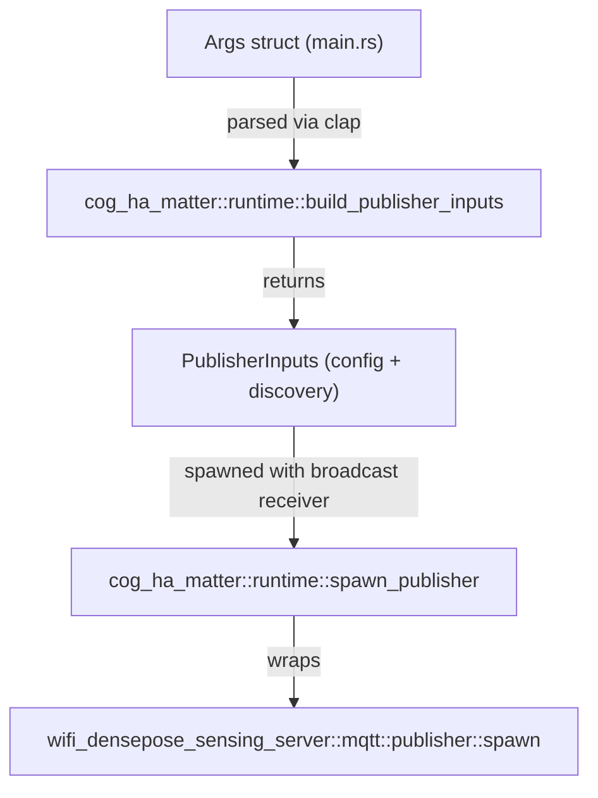
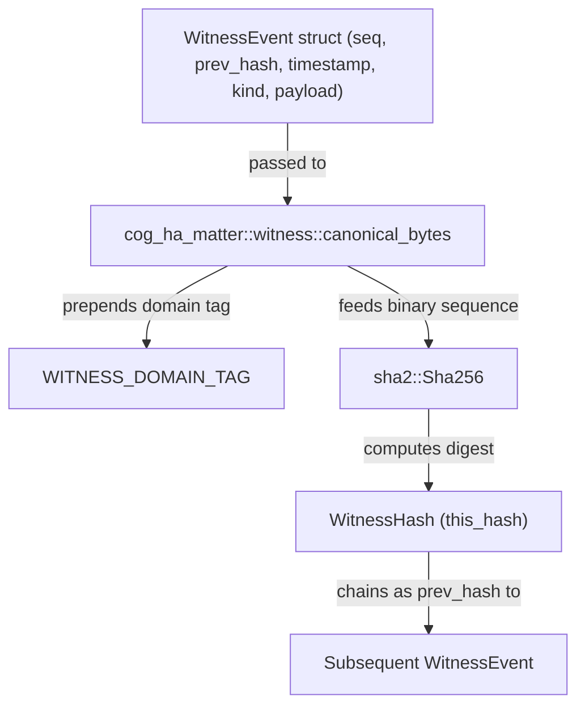

<!-- source: DeepWiki mcp.deepwiki.com · repo ruvnet/RuView · page 9.3 cog-ha-matter Seed App · fetched 2026-10-30 -->

# cog-ha-matter Seed App

<details>
<summary>Relevant source files</summary>

The following files were used as context for generating this wiki page:

- [.github/workflows/bfld-mqtt-integration.yml](.github/workflows/bfld-mqtt-integration.yml)
- [.github/workflows/clone-tracking.yml](.github/workflows/clone-tracking.yml)
- [.github/workflows/cog-ha-matter-release.yml](.github/workflows/cog-ha-matter-release.yml)
- [.github/workflows/dashboard-a11y.yml](.github/workflows/dashboard-a11y.yml)
- [.github/workflows/dashboard-pages.yml](.github/workflows/dashboard-pages.yml)
- [.github/workflows/desktop-release.yml](.github/workflows/desktop-release.yml)
- [data/clone-data.rvf](data/clone-data.rvf)
- [docs/adr/ADR-116-cog-ha-matter-seed.md](docs/adr/ADR-116-cog-ha-matter-seed.md)
- [docs/research/ADR-116-ha-matter-cog-research.md](docs/research/ADR-116-ha-matter-cog-research.md)
- [v2/crates/cog-ha-matter/Cargo.toml](v2/crates/cog-ha-matter/Cargo.toml)
- [v2/crates/cog-ha-matter/cog/Makefile](v2/crates/cog-ha-matter/cog/Makefile)
- [v2/crates/cog-ha-matter/cog/README.md](v2/crates/cog-ha-matter/cog/README.md)
- [v2/crates/cog-ha-matter/cog/manifest.template.json](v2/crates/cog-ha-matter/cog/manifest.template.json)
- [v2/crates/cog-ha-matter/src/lib.rs](v2/crates/cog-ha-matter/src/lib.rs)
- [v2/crates/cog-ha-matter/src/main.rs](v2/crates/cog-ha-matter/src/main.rs)
- [v2/crates/cog-ha-matter/src/manifest.rs](v2/crates/cog-ha-matter/src/manifest.rs)
- [v2/crates/cog-ha-matter/src/mdns.rs](v2/crates/cog-ha-matter/src/mdns.rs)
- [v2/crates/cog-ha-matter/src/runtime.rs](v2/crates/cog-ha-matter/src/runtime.rs)
- [v2/crates/cog-ha-matter/src/witness.rs](v2/crates/cog-ha-matter/src/witness.rs)
- [v2/crates/cog-ha-matter/src/witness_signing.rs](v2/crates/cog-ha-matter/src/witness_signing.rs)
- [v2/crates/nvsim-server/Dockerfile](v2/crates/nvsim-server/Dockerfile)
- [v2/crates/wifi-densepose-bfld/tests/ci_workflow.rs](v2/crates/wifi-densepose-bfld/tests/ci_workflow.rs)

</details>


## Purpose and Scope

The `cog-ha-matter` crate is a Cognitum Seed-installable application package implementing ADR-116. It packages the Home Assistant MQTT auto-discovery and state republication engine originally defined in ADR-115 (`wifi-densepose-sensing-server::mqtt`) into a self-contained, Seed-native artifact [v2/crates/cog-ha-matter/Cargo.toml:1-8](). 

Unlike a bare aggregator configuration flag (`--mqtt`), `cog-ha-matter` runs as a supervised daemon on the Cognitum Seed appliance, integrating zero-configuration mDNS discovery [v2/crates/cog-ha-matter/src/mdns.rs:1-10](), local control surfaces [v2/crates/cog-ha-matter/src/lib.rs:41-46](), and a tamper-evident Ed25519-signed witness chain audit log [v2/crates/cog-ha-matter/src/witness.rs:1-32]().

Sources: `docs/adr/ADR-116-cog-ha-matter-seed.md:1-75](), `v2/crates/cog-ha-matter/Cargo.toml:1-8](), `v2/crates/cog-ha-matter/src/lib.rs:1-47]()

---

## 1. Package Manifest & Registry Integration

The cog conforms to the Cognitum Cog Packaging Specification (ADR-100). The binary supports a `--print-manifest` flag that outputs its self-describing JSON metadata to stdout, which the Seed control plane and build pipelines consume during installation [v2/crates/cog-ha-matter/src/main.rs:47-109]().

```json
{
  "id": "ha-matter",
  "version": "0.3.1",
  "binary_url": "https://storage.googleapis.com/cognitum-apps/cogs/{arch}/cog-ha-matter-{arch}",
  "binary_bytes": 0,
  "binary_sha256": "",
  "binary_signature": ""
}
```

When built via the local packaging pipeline, the manifest templates [v2/crates/cog-ha-matter/cog/manifest.template.json]() are stamped with actual target architectures (`arm`, `x86_64`), release checksums, and cryptographic signatures before being indexed in `app-registry.json` [v2/crates/cog-ha-matter/cog/README.md:54-71]().

Sources: `v2/crates/cog-ha-matter/src/main.rs:47-109](), `v2/crates/cog-ha-matter/cog/README.md:1-71]()

---

## 2. Runtime Architecture & Publisher Wiring

The entrypoint [v2/crates/cog-ha-matter/src/main.rs:71-179]() parses command-line arguments using `clap` [v2/crates/cog-ha-matter/src/main.rs:16-69]() and delegates configuration assembly to `cog_ha_matter::runtime` [v2/crates/cog-ha-matter/src/runtime.rs:1-32](). 

To prevent broker session collision issues documented in ADR-115, the MQTT `client_id` is derived dynamically from the cog ID and the instance `node_id` [v2/crates/cog-ha-matter/src/runtime.rs:9-16]().


*Figure 1: Natural language to code entity flow for runtime publisher initialization.*

Sources: `v2/crates/cog-ha-matter/src/main.rs:16-127](), `v2/crates/cog-ha-matter/src/runtime.rs:78-133]()

---

## 3. mDNS Zero-Configuration Responder

The `cog_ha_matter::mdns` module provides a pure record builder (`MdnsService`) that formats RFC 6763 zeroconf service advertisements for `_ruview-ha._tcp` [v2/crates/cog-ha-matter/src/mdns.rs:1-40](). 

### TXT Record Mapping
Home Assistant's discovery subsystem harvests specific keys from the service TXT record to automatically configure entities without manual broker endpoint entry [v2/crates/cog-ha-matter/src/mdns.rs:23-40]().

| TXT Key | Source Value | Purpose |
|---|---|---|
| `cog_id` | `COG_ID` (`"ha-matter"`) | Disambiguates RuView cogs from other zeroconf publishers [v2/crates/cog-ha-matter/src/mdns.rs:30]() |
| `cog_version` | `identity.sw_version` | Surfaces upgrade notices in Home Assistant Repairs [v2/crates/cog-ha-matter/src/mdns.rs:31]() |
| `node_id` | `identity.node_id` | Maps to the Home Assistant device registry key [v2/crates/cog-ha-matter/src/mdns.rs:32]() |
| `mqtt_port` | `mqtt_port` | Instructs Home Assistant where to reach the MQTT broker [v2/crates/cog-ha-matter/src/mdns.rs:33]() |
| `privacy` | `privacy_mode` (`"1"` / `"0"`) | Gates biometric entity registration by default [v2/crates/cog-ha-matter/src/mdns.rs:34]() |
| `proto` | `"ruview-ha/1"` | Protocol version specifier for breaking auto-discovery updates [v2/crates/cog-ha-matter/src/mdns.rs:35]() |

The `build_mdns_service` function constructs deterministic, sorted TXT arrays and converts them into `mdns_sd::ServiceInfo` instances [v2/crates/cog-ha-matter/src/mdns.rs:90-138]().

Sources: `v2/crates/cog-ha-matter/src/mdns.rs:1-138]()

---

## 4. Witness Chain & Ed25519 Audit Logging

Regulated deployments (such as healthcare, assisted living, and multi-tenant housing) require tamper-evident proof of state transitions. The `cog_ha_matter::witness` module implements an append-only hash-chained event log [v2/crates/cog-ha-matter/src/witness.rs:1-32]().


*Figure 2: Witness event serialization and cryptographic hash chaining pipeline.*

### Canonical Bytes & Domain Separation
To prevent cross-protocol collision attacks (e.g., replaying a witness event hash as an Ed25519 manifest signature), every hashed event incorporates a strict domain-separation tag and length-prefixing rules [v2/crates/cog-ha-matter/src/witness.rs:105-162]().

The constant `WITNESS_DOMAIN_TAG` is defined as:
```rust
pub const WITNESS_DOMAIN_TAG: &[u8] = b"cog-ha-matter/witness-event/v1\x00";
```
[v2/crates/cog-ha-matter/src/witness.rs:122]()

The `canonical_bytes` function binds the previous hash, sequence counter, timestamp, kind string, and opaque payload into a deterministic byte array before computing the SHA-256 `this_hash` [v2/crates/cog-ha-matter/src/witness.rs:142-162](). Ed25519 signatures layer on top of this hash output using `ed25519-dalek` [v2/crates/cog-ha-matter/Cargo.toml:41]().

Sources: `v2/crates/cog-ha-matter/src/witness.rs:1-162](), `v2/crates/cog-ha-matter/Cargo.toml:37-42]()

---

## 5. Packaging Makefile & Release Workflow

The local build and publishing lifecycle is governed by the cog Makefile [v2/crates/cog-ha-matter/cog/Makefile:1-83](). It mirrors the packaging standard established by `cog-pose-estimation` [v2/crates/cog-ha-matter/cog/README.md:3-5]().

### Build & Release Targets
* `make build` — Compiles release binaries for both `aarch64-unknown-linux-gnu` (`dist/cog-ha-matter-arm`) and `x86_64-unknown-linux-gnu` (`dist/cog-ha-matter-x86_64`) [v2/crates/cog-ha-matter/cog/Makefile:17-27]().
* `make sign` — Computes SHA-256 checksum sidecars (`.sha256`) and prepares placeholder hooks for Ed25519 signing secrets (`COGNITUM_OWNER_SIGNING_KEY`) [v2/crates/cog-ha-matter/cog/Makefile:31-45]().
* `make upload` — Copies built artifacts to the Google Cloud Storage bucket (`gs://cognitum-apps/cogs/`) [v2/crates/cog-ha-matter/cog/Makefile:48-57]().
* `make manifest` — Invokes the binary with `--print-manifest` to generate the exact JSON registry descriptor [v2/crates/cog-ha-matter/cog/Makefile:60-64]().

Sources: `v2/crates/cog-ha-matter/cog/Makefile:1-84](), `v2/crates/cog-ha-matter/cog/README.md:1-71]()

---

