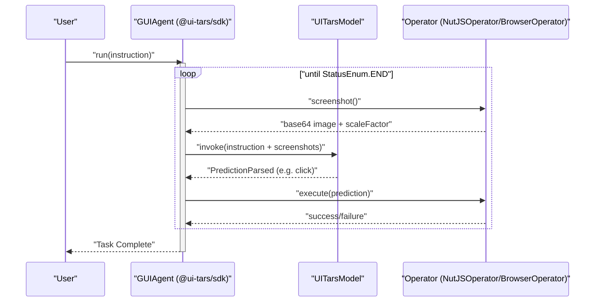
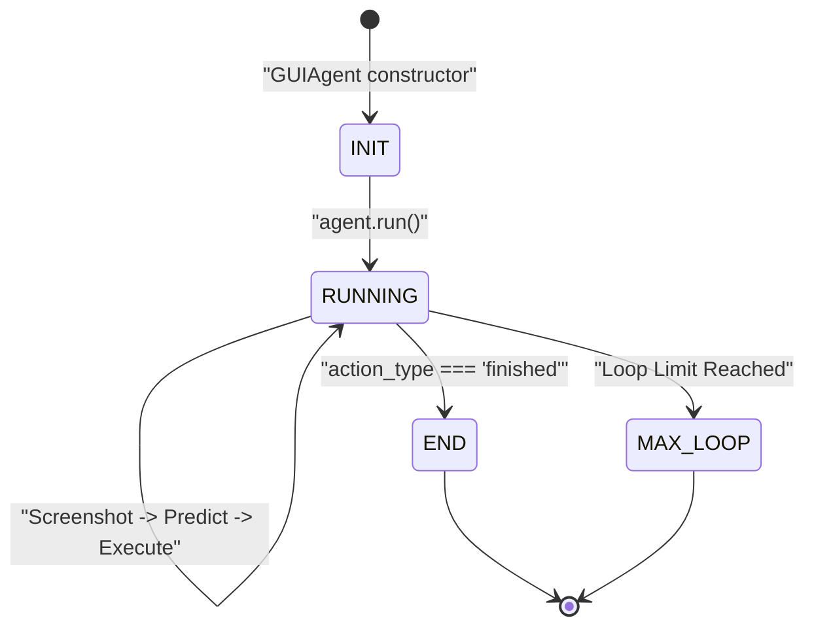

<!-- source: DeepWiki mcp.deepwiki.com · repo bytedance/UI-TARS-desktop · page 1 Overview · fetched 2026-10-30 -->

# Overview

<details>
<summary>Relevant source files</summary>

The following files were used as context for generating this wiki page:

- [.gitignore](.gitignore)
- [.lintstagedrc.mjs](.lintstagedrc.mjs)
- [.secretlintignore](.secretlintignore)
- [README.md](README.md)
- [README.zh-CN.md](README.zh-CN.md)
- [apps/ui-tars/images/mac_app.png](apps/ui-tars/images/mac_app.png)
- [apps/ui-tars/images/quick_start/base_url.png](apps/ui-tars/images/quick_start/base_url.png)
- [apps/ui-tars/images/quick_start/start_button.png](apps/ui-tars/images/quick_start/start_button.png)
- [apps/ui-tars/src/main/remote/shared.ts](apps/ui-tars/src/main/remote/shared.ts)
- [apps/ui-tars/src/renderer/src/components/CountDown/index.tsx](apps/ui-tars/src/renderer/src/components/CountDown/index.tsx)
- [apps/ui-tars/src/renderer/src/const/index.ts](apps/ui-tars/src/renderer/src/const/index.ts)
- [apps/ui-tars/src/renderer/src/pages/home/index.tsx](apps/ui-tars/src/renderer/src/pages/home/index.tsx)
- [apps/ui-tars/src/renderer/src/pages/remote/cast/vnc.tsx](apps/ui-tars/src/renderer/src/pages/remote/cast/vnc.tsx)
- [apps/ui-tars/src/renderer/src/pages/remote/free.tsx](apps/ui-tars/src/renderer/src/pages/remote/free.tsx)
- [docs/quick-start.md](docs/quick-start.md)
- [multimodal/CHANGELOG.md](multimodal/CHANGELOG.md)
- [multimodal/benchmark/content-extraction/package.json](multimodal/benchmark/content-extraction/package.json)
- [multimodal/package.json](multimodal/package.json)
- [multimodal/websites/docs/package.json](multimodal/websites/docs/package.json)
- [multimodal/websites/main/package.json](multimodal/websites/main/package.json)
- [package.json](package.json)
- [packages/agent-infra/browser-use/src/dom/views.test.ts](packages/agent-infra/browser-use/src/dom/views.test.ts)
- [packages/agent-infra/browser-use/src/dom/views.ts](packages/agent-infra/browser-use/src/dom/views.ts)
- [packages/agent-infra/browser-use/vitest.config.ts](packages/agent-infra/browser-use/vitest.config.ts)
- [packages/agent-infra/mcp-servers/browser/tests/utils/utils.test.ts](packages/agent-infra/mcp-servers/browser/tests/utils/utils.test.ts)
- [packages/common/configs/package.json](packages/common/configs/package.json)
- [packages/ui-tars/sdk/README.md](packages/ui-tars/sdk/README.md)
- [packages/ui-tars/sdk/src/index.ts](packages/ui-tars/sdk/src/index.ts)
- [pnpm-lock.yaml](pnpm-lock.yaml)

</details>


## Purpose and Scope

The UI-TARS Desktop repository is a **monorepo** containing two primary products and shared infrastructure for building multimodal AI agents that can interact with graphical user interfaces. This documentation covers the architecture, components, and development practices for the entire repository.

This page provides a high-level introduction to the repository structure, main products, and core architectural concepts. For detailed information about specific subsystems, see:
- Repository organization and package management: [Repository Structure and Monorepo Organization]()
- Agent TARS multimodal agent system: [Multimodal Agent Stack (Agent TARS / OmniTARS)]()
- Tarko framework for agent execution: [Tarko Framework]()
- Desktop application specifics: [UI-TARS Desktop Application]()
- Infrastructure components: [Agent Infrastructure Layer]()

**Sources:** [README.md:1-299](), [multimodal/package.json:1-49](), [package.json:1-58]()

## Repository Products

The repository ships two distinct but related products:

### Agent TARS

**Agent TARS** is a general-purpose multimodal AI agent stack that brings GUI Agent and Vision capabilities to terminals, browsers, and web applications. It provides:

- **CLI Interface**: Command-line tool (`@agent-tars/cli`) for running agents in terminal environments [README.md:33-36]().
- **Web UI**: React-based web interface for interactive agent sessions [README.md:36-37]().
- **Server**: Backend managing agent sessions and API endpoints [multimodal/CHANGELOG.md:7-7]().
- **MCP Integration**: Built on Model Context Protocol for extensible tool access [README.md:37-38]().
- **Sandbox Execution**: Support for [AIO agent Sandbox](https://github.com/agent-infra/sandbox) as an isolated environment for tool execution [README.md:74-74](), [multimodal/CHANGELOG.md:10-10]().

**Sources:** [README.md:83-163](), [multimodal/CHANGELOG.md:1-40](), [packages/ui-tars/sdk/README.md:55-57]()

### UI-TARS Desktop

**UI-TARS Desktop** is an Electron-based native application for local and remote computer/browser automation [README.md:39-46](). Key features:

- **Local Operator Mode**: Direct control of the local computer using `NutJSOperator` for native desktop actions [docs/quick-start.md:63-65]().
- **Remote Operator Mode**: Control of remote sandbox environments via VNC/browser connections [apps/ui-tars/src/renderer/src/pages/remote/free.tsx:51-80]().
- **VLM Provider Configuration**: Supports multiple Vision-Language Model providers like Hugging Face (UI-TARS-1.5) and Volcano Engine (Doubao-1.5-UI-TARS) [docs/quick-start.md:65-133]().
- **Cross-Platform**: Runs on Windows and macOS [docs/quick-start.md:28-49]().

The desktop application uses the `@ui-tars/sdk` for core GUI automation logic [README.md:78-78]().

**Sources:** [README.md:237-278](), [docs/quick-start.md:1-161](), [packages/ui-tars/sdk/README.md:1-416](), [apps/ui-tars/src/renderer/src/pages/remote/free.tsx:76-80]()

### Shared Infrastructure

Both products share common infrastructure packages located in the monorepo:

| Package Category | Key Packages | Purpose |
|-----------------|--------------|---------|
| Agent Infrastructure | `@agent-infra/browser`, `@agent-infra/shared` | Browser automation and shared utilities [multimodal/benchmark/content-extraction/package.json:12-13]() |
| Tarko Framework | `@tarko/ui`, `@tarko/agent-ui` | Base agent execution, server infrastructure, web UI [multimodal/package.json:14-14]() |
| OmniTARS | `@omni-tars/agent`, `@omni-tars/gui-agent` | Composable multimodal agent system [multimodal/package.json:7-17]() |
| UI-TARS SDK | `@ui-tars/sdk`, `@ui-tars/operator-nut-js`, `@ui-tars/operator-browser` | GUI automation SDK and operators [pnpm-lock.yaml:195-203]() |

**Sources:** [README.md:1-50](), [multimodal/package.json:1-49](), [pnpm-lock.yaml:195-203]()

## High-Level Architecture

### System Architecture Diagram

The following diagram shows how the main products, frameworks, and infrastructure components relate:

```mermaid
graph TB
    subgraph "UI-TARS Desktop Monorepo"
        subgraph "Products"
            ["@agent-tars/cli"]
            ["@tarko/agent-ui"]
            ["apps/ui-tars (Electron)"]
        end
        
        subgraph "Frameworks"
            ["@tarko/agent"]
            ["@tarko/agent-server"]
            ["@omni-tars/agent"]
            ["@omni-tars/gui-agent"]
        end
        
        subgraph "Infrastructure Layer"
            ["@ui-tars/sdk"]
            ["@agent-infra/browser"]
            ["NutJSOperator"]
            ["BrowserOperator"]
        end
        
        subgraph "External"
            ["LLM APIs"]
            ["AIO Sandbox"]
        end
    end
    
    ["@agent-tars/cli"] --> ["@tarko/agent-server"]
    ["@tarko/agent-ui"] --> ["@tarko/agent-server"]
    ["apps/ui-tars (Electron)"] --> ["@ui-tars/sdk"]
    
    ["@tarko/agent-server"] --> ["@omni-tars/agent"]
    ["@omni-tars/agent"] --> ["@tarko/agent"]
    ["@omni-tars/agent"] --> ["@omni-tars/gui-agent"]
    
    ["@omni-tars/gui-agent"] --> ["@agent-infra/browser"]
    
    ["@ui-tars/sdk"] --> ["NutJSOperator"]
    ["@ui-tars/sdk"] --> ["BrowserOperator"]
    ["NutJSOperator"] --> ["@agent-infra/browser"]
    ["BrowserOperator"] --> ["@agent-infra/browser"]
    
    ["@tarko/agent"] --> ["LLM APIs"]
    ["@omni-tars/agent"] --> ["AIO Sandbox"]
```

**Sources:** [README.md:1-50](), [packages/ui-tars/sdk/README.md:11-51](), [multimodal/CHANGELOG.md:10-10]()

### GUI Agent SDK Flow

The `@ui-tars/sdk` provides a standard loop for GUI automation, bridging the model's visual reasoning with platform-specific execution.



**Sources:** [packages/ui-tars/sdk/README.md:73-103](), [packages/ui-tars/sdk/README.md:11-51](), [apps/ui-tars/src/renderer/src/pages/remote/free.tsx:36-36]()

## Technology Stack

### Core Technologies

| Layer | Technologies |
|-------|-------------|
| **Runtime** | Node.js ≥22, TypeScript 5.8 [multimodal/package.json:35-44]() |
| **Package Management** | pnpm 9 (workspaces), turbo (task orchestration) [package.json:5-27]() |
| **Desktop Application** | Electron, Vite, Electron Forge [pnpm-lock.yaml:120-145]() |
| **Web Framework** | React 18, React Router [multimodal/websites/main/package.json:15-19]() |
| **UI Libraries** | NextUI, Tailwind CSS, Framer Motion [multimodal/websites/docs/package.json:13-21]() |
| **Build Tools** | Rsbuild, Rslib, Rspress [multimodal/websites/main/package.json:26-26](), [multimodal/websites/docs/package.json:6-6]() |

**Sources:** [multimodal/package.json:34-48](), [package.json:1-58](), [multimodal/websites/main/package.json:1-56]()

## Agent Execution Model

### Status Lifecycle

The system uses a state machine to track agent execution progress:



**Sources:** [packages/ui-tars/sdk/README.md:185-194](), [packages/ui-tars/sdk/README.md:181-181](), [apps/ui-tars/src/renderer/src/pages/remote/free.tsx:43-49]()

### Agent Modes

The OmniTARS agent supports specialized operational modes:

| Mode | Purpose |
|------|---------|
| **omni** | General multimodal tasks with full capabilities [multimodal/CHANGELOG.md:22-22](). |
| **gui** | Specialized for GUI automation and browser control [multimodal/CHANGELOG.md:16-16](). |
| **game** | Optimized for game interaction with enhanced error handling [multimodal/CHANGELOG.md:16-20](). |

**Sources:** [multimodal/CHANGELOG.md:16-24]()

## Development Workflow

### Monorepo Structure

The repository uses **pnpm workspaces** with packages organized into categories:

```
multimodal/
├── tarko/              # Framework (agent core, server, UI)
├── omni-tars/          # Composable agent implementation
├── gui-agent/          # GUI automation plugin
├── agent-tars/         # CLI and high-level product
└── websites/           # Documentation and main site
packages/ui-tars/       # SDK and platform operators
apps/ui-tars/           # Electron Desktop application
```

**Sources:** [multimodal/package.json:7-17](), [pnpm-lock.yaml:96-209](), [package.json:1-8]()

### Build and Release

#### Build Scripts

```bash
# Bootstrap: Build all multimodal packages in order
pnpm run bootstrap

# Build specific components
pnpm run build:tarko
pnpm run build:gui-agent
pnpm run build:agent-tars
```

#### Release Process

The repository uses **pnpm-dev-kit (pdk)** for automated releases and versioning in the `multimodal` workspace [multimodal/package.json:22-32](). The core monorepo uses `changesets` for package management [package.json:28-28]().

**Sources:** [multimodal/package.json:7-32](), [package.json:1-21]()

## Key Architectural Patterns

### Operator Abstraction

Both UI-TARS SDK and GUI Agent Plugin use the **Operator pattern** to abstract platform differences:

```typescript
// Core interface defined in @ui-tars/sdk
interface Operator {
  screenshot(): Promise<ScreenshotOutput>
  execute(params: ExecuteParams): Promise<ExecuteOutput>
}
```

**Implementations:**
- `NutJSOperator`: Local desktop control via `@computer-use/nut-js` [pnpm-lock.yaml:117-119]().
- `BrowserOperator`: Web automation via Puppeteer/Playwright [pnpm-lock.yaml:195-197]().
- `RemoteOperator`: Cloud computer/browser control via VNC [apps/ui-tars/src/renderer/src/pages/remote/free.tsx:51-80]().

**Sources:** [packages/ui-tars/sdk/README.md:198-256](), [pnpm-lock.yaml:117-200]()

### Remote Resource Management

For remote operations, the system manages a lifecycle including resource allocation and time-balancing:

- `useRemoteResource`: Hook for managing cloud instances [apps/ui-tars/src/renderer/src/pages/remote/free.tsx:69-75]().
- `VNCPreview`: Component for viewing remote desktop streams [apps/ui-tars/src/renderer/src/pages/remote/free.tsx:40-40]().
- `getTimeBalance`: Checks remaining session time (e.g., 30-minute limits) [apps/ui-tars/src/renderer/src/pages/remote/free.tsx:87-113]().

**Sources:** [apps/ui-tars/src/renderer/src/pages/remote/free.tsx:1-241]()

---

