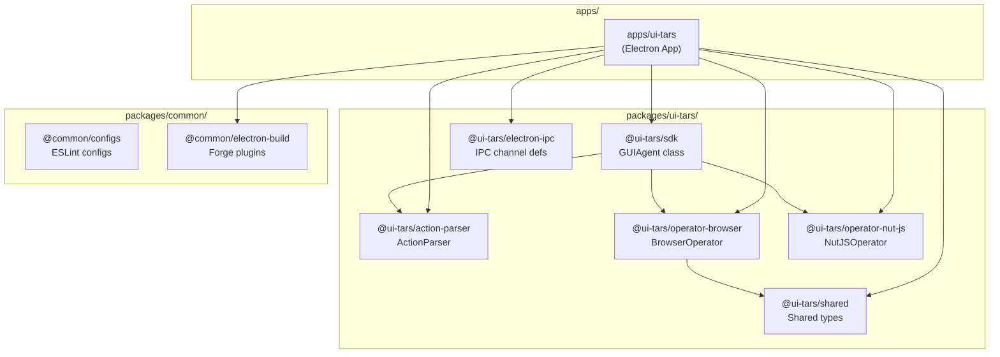
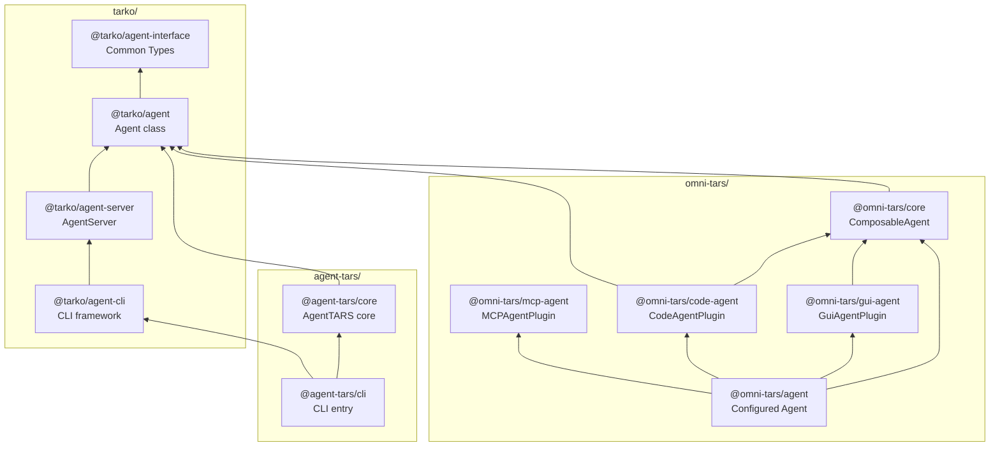

<!-- source: DeepWiki mcp.deepwiki.com · repo bytedance/UI-TARS-desktop · page 2 Repository Structure and Monorepo Organization · fetched 2026-10-30 -->

# Repository Structure and Monorepo Organization

<details>
<summary>Relevant source files</summary>

The following files were used as context for generating this wiki page:

- [.gitignore](.gitignore)
- [.lintstagedrc.mjs](.lintstagedrc.mjs)
- [.secretlintignore](.secretlintignore)
- [apps/ui-tars/e2e/app.test.ts](apps/ui-tars/e2e/app.test.ts)
- [multimodal/CHANGELOG.md](multimodal/CHANGELOG.md)
- [multimodal/agent-tars/cli/package.json](multimodal/agent-tars/cli/package.json)
- [multimodal/agent-tars/interface/package.json](multimodal/agent-tars/interface/package.json)
- [multimodal/benchmark/content-extraction/package.json](multimodal/benchmark/content-extraction/package.json)
- [multimodal/gui-agent/action-parser/package.json](multimodal/gui-agent/action-parser/package.json)
- [multimodal/omni-tars/code-agent/package.json](multimodal/omni-tars/code-agent/package.json)
- [multimodal/omni-tars/core/package.json](multimodal/omni-tars/core/package.json)
- [multimodal/omni-tars/mcp-agent/package.json](multimodal/omni-tars/mcp-agent/package.json)
- [multimodal/omni-tars/omni-agent/package.json](multimodal/omni-tars/omni-agent/package.json)
- [multimodal/package.json](multimodal/package.json)
- [multimodal/tarko/agent-cli/package.json](multimodal/tarko/agent-cli/package.json)
- [multimodal/tarko/agent-server/package.json](multimodal/tarko/agent-server/package.json)
- [multimodal/tarko/context-engineer/package.json](multimodal/tarko/context-engineer/package.json)
- [multimodal/tarko/interface/package.json](multimodal/tarko/interface/package.json)
- [multimodal/websites/docs/package.json](multimodal/websites/docs/package.json)
- [multimodal/websites/main/package.json](multimodal/websites/main/package.json)
- [package.json](package.json)
- [packages/agent-infra/browser-use/src/dom/views.test.ts](packages/agent-infra/browser-use/src/dom/views.test.ts)
- [packages/agent-infra/browser-use/src/dom/views.ts](packages/agent-infra/browser-use/src/dom/views.ts)
- [packages/agent-infra/browser-use/vitest.config.ts](packages/agent-infra/browser-use/vitest.config.ts)
- [packages/agent-infra/mcp-servers/browser/tests/utils/utils.test.ts](packages/agent-infra/mcp-servers/browser/tests/utils/utils.test.ts)
- [packages/common/configs/package.json](packages/common/configs/package.json)
- [pnpm-lock.yaml](pnpm-lock.yaml)
- [turbo.json](turbo.json)

</details>


This page describes the physical layout of the `UI-TARS-desktop` repository, how its packages are grouped, and how the build tools tie them together. It covers the root-level workspace, the `apps/`, `packages/`, and `multimodal/` directories, and the pnpm + Turbo orchestration layer.

---

## Top-Level Layout

The repository is a **pnpm monorepo** with two distinct workspaces that coexist in the same git repository but operate independently:

1.  **Root workspace** — manages the UI-TARS Desktop Electron app and all shared infrastructure packages. [package.json:1-58]()
2.  **`multimodal/` sub-monorepo** — a self-contained nested monorepo for the Agent TARS / OmniTARS multimodal stack, with its own `package.json`, pnpm lockfile, and release tooling. [multimodal/package.json:1-49]()

The root `package.json` declares `"packageManager": "pnpm@9.10.0"` and uses `turbo` as the task runner. [package.json:5-27]() The `multimodal/` workspace uses `pnpm-dev-kit` (`pdk`) for development and release management. [multimodal/package.json:10-32]()

### Workspace Configuration

The root workspace is configured via `pnpm-workspace.yaml`. Each workspace in `multimodal/` is identified by directory patterns in its own lockfile: [multimodal/pnpm-lock.yaml:7-152]()

| Workspace Pattern | Contains |
| :--- | :--- |
| `agent-tars/*` | Agent TARS core and CLI |
| `gui-agent/*` | GUI agent operators and SDK |
| `omni-tars/*` | OmniTARS multimodal agent packages |
| `tarko/*` | Tarko framework packages (agent, server, UI, LLM) |
| `benchmark/*` | Performance benchmarking tools (crawl, content-extraction) |
| `websites/*` | Documentation (Rspress) and marketing websites |

**Sources:** [package.json:1-58](), [multimodal/package.json:1-49](), [multimodal/pnpm-lock.yaml:7-152]()

---

## Root Workspace

**Directory tree (root workspace):**

```
UI-TARS-desktop/
├── apps/
│   └── ui-tars/               # Electron desktop application
├── packages/
│   ├── ui-tars/               # UI-TARS specific packages
│   │   ├── action-parser/     # @ui-tars/action-parser
│   │   ├── electron-ipc/      # @ui-tars/electron-ipc
│   │   ├── sdk/               # @ui-tars/sdk
│   │   ├── shared/            # @ui-tars/shared
│   │   ├── utio/              # @ui-tars/utio
│   │   └── operators/
│   │       ├── browser-operator/  # @ui-tars/operator-browser
│   │       └── nut-js/            # @ui-tars/operator-nut-js
│   └── common/
│       ├── configs/           # @common/configs
│       └── electron-build/    # @common/electron-build
├── multimodal/                # Sub-monorepo (Agent TARS stack)
├── infra/                     # Infrastructure tooling (e.g. agent-infra)
└── turbo.json
```

**Sources:** [pnpm-lock.yaml:96-209](), [package.json:1-58]()

---

## Package Naming Conventions

| Scope | Location | Purpose | Key Exports |
| :--- | :--- | :--- | :--- |
| `@ui-tars/*` | `packages/ui-tars/` | UI-TARS model interaction, SDK, operators | `GUIAgent`, `Operator` |
| `@agent-infra/*` | `packages/agent-infra/` | Shared infrastructure: browser, search, MCP | `BrowserContext`, `MCPClient` |
| `@common/*` | `packages/common/` | Shared ESLint/TS configs, Electron build helpers | Shared configs |
| `apps/ui-tars` | `apps/ui-tars/` | The Electron application itself | Main and renderer processes |

**Sources:** [pnpm-lock.yaml:96-209](), [multimodal/pnpm-lock.yaml:79-108]()

---

## Root Workspace Dependency Graph

**Diagram: Root workspace internal dependencies**



**Sources:** [pnpm-lock.yaml:96-209](), [package.json:1-58]()

---

## `multimodal/` Sub-Monorepo

The `multimodal/` directory is a **separate pnpm workspace** with its own `package.json` and lockfile. [multimodal/package.json:1-49]()

**Directory tree (`multimodal/`):**

```
multimodal/
├── tarko/                     # @tarko/* packages (base framework)
│   ├── agent/                 # @tarko/agent - Agent class, Runner
│   ├── agent-server/          # @tarko/agent-server - Express server
│   ├── agent-cli/             # @tarko/agent-cli - CLI entry point
│   ├── ui/                    # @tarko/ui - Shared UI primitives
│   ├── interface/             # @tarko/interface - High-level interfaces
│   ├── mcp-agent/             # @tarko/mcp-agent - MCP integration
│   ├── llm-client/            # @tarko/llm-client - Multi-provider SDK
│   └── shared-utils/          # @tarko/shared-utils - Utilities
├── gui-agent/                 # GUI agent packages
│   ├── action-parser/         # @gui-agent/action-parser
│   ├── agent-sdk/             # @gui-agent/agent-sdk
│   └── operator-browser/      # @gui-agent/operator-browser
├── agent-tars/                # @agent-tars/* packages
│   ├── core/                  # @agent-tars/core - AgentTARS class
│   ├── cli/                   # @agent-tars/cli - agent-tars CLI
│   └── interface/             # @agent-tars/interface - Types
├── omni-tars/                 # OmniTARS multimodal agent
│   ├── core/                  # @omni-tars/core - ComposableAgent
│   ├── code-agent/            # @omni-tars/code-agent - Sandbox execution
│   ├── gui-agent/             # @omni-tars/gui-agent - GUI control
│   ├── mcp-agent/             # @omni-tars/mcp-agent - MCP Plugin
│   └── omni-agent/            # @omni-tars/omni-agent - Configured agent
└── websites/
    ├── docs/                  # @agent-tars/docs (rspress documentation)
    └── main/                  # @agent-tars/website (rsbuild website)
```

**Sources:** [multimodal/package.json:1-49](), [multimodal/pnpm-lock.yaml:1-152](), [multimodal/websites/docs/package.json:1-30](), [multimodal/websites/main/package.json:1-56](), [multimodal/omni-tars/omni-agent/package.json:28-34](), [multimodal/omni-tars/code-agent/package.json:28-33]()

---

## `multimodal/` Build Order

The `bootstrap` script in `multimodal/package.json` reveals the build dependency order. It ensures that the base frameworks are built before the specialized agents that depend on them. [multimodal/package.json:7-17]()

```bash
pnpm --filter "./tarko/**" build && 
pnpm --filter "./gui-agent/**" build && 
pnpm --filter "./agent-tars/**" build && 
pnpm --filter "./omni-tars/**" build
```

**Sources:** [multimodal/package.json:7-17]()

---

## `multimodal/` Package Dependency Graph

**Diagram: multimodal sub-monorepo layers**



**Sources:** [multimodal/package.json:7-17](), [multimodal/omni-tars/omni-agent/package.json:28-34](), [multimodal/omni-tars/code-agent/package.json:28-33](), [multimodal/tarko/agent-server/package.json:21-26](), [multimodal/tarko/agent-cli/package.json:28-37]()

---

## Build Tooling

### Root Workspace: Turbo

The root workspace uses **Turbo** (`turbo ^2.4.4`) to orchestrate parallel builds across packages. [package.json:27-27]() The primary Turbo task is `dev:ui-tars`. [package.json:12-12]()

### Multimodal Workspace: PDK (pnpm-dev-kit)

The `multimodal/` sub-monorepo uses `pdk` (`pnpm-dev-kit`) for development and release orchestration: [multimodal/package.json:10-32]()

*   `pdk d`: Development mode. [multimodal/package.json:10-10]()
*   `pdk release`: Handles version bumping and publishing. [multimodal/package.json:22-22]()
*   `pdk changelog`: Generates changelogs from git history. [multimodal/package.json:31-31]()
*   `pdk patch`: Applies small version patches. [multimodal/package.json:32-32]()

### Package Build Tool: Rslib & Rsbuild

Many packages in the `multimodal/` workspace use **rslib** for libraries and **rsbuild** for applications. The websites use **rsbuild** or **rspress**. [multimodal/websites/main/package.json:26-26](), [multimodal/websites/docs/package.json:6-8](), [multimodal/omni-tars/code-agent/package.json:23-24](), [multimodal/tarko/agent-server/package.json:29-29]()

---

## Node.js Engine Requirements

| Workspace | Node.js Requirement | pnpm Version |
| :--- | :--- | :--- |
| Root workspace | `>=20.x` | `9.10.0` |
| `multimodal/` | `>=22` | `9` |

**Sources:** [package.json:5-56](), [multimodal/package.json:34-37]()

---

