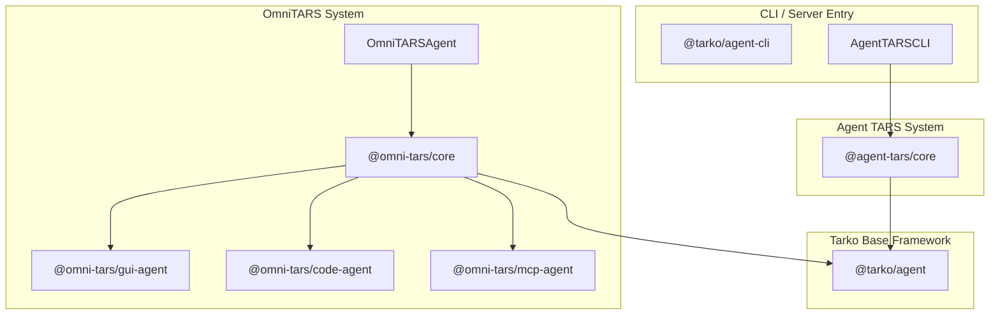
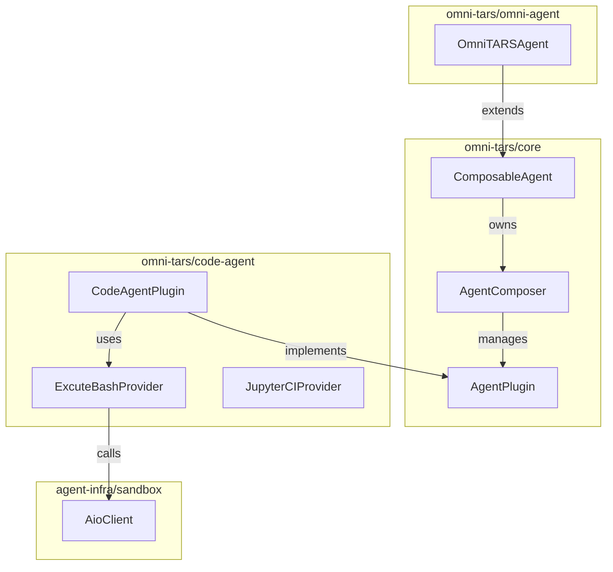

<!-- source: DeepWiki mcp.deepwiki.com · repo bytedance/UI-TARS-desktop · page 3 Multimodal Agent Stack (Agent TARS / OmniTARS) · fetched 2026-10-30 -->

# Multimodal Agent Stack (Agent TARS / OmniTARS)

<details>
<summary>Relevant source files</summary>

The following files were used as context for generating this wiki page:

- [multimodal/.gitignore](multimodal/.gitignore)
- [multimodal/agent-tars/cli/src/index.ts](multimodal/agent-tars/cli/src/index.ts)
- [multimodal/agent-tars/interface/src/constants.ts](multimodal/agent-tars/interface/src/constants.ts)
- [multimodal/omni-tars/code-agent/src/CodeAgentPlugin.ts](multimodal/omni-tars/code-agent/src/CodeAgentPlugin.ts)
- [multimodal/omni-tars/code-agent/src/index.ts](multimodal/omni-tars/code-agent/src/index.ts)
- [multimodal/omni-tars/code-agent/src/tools/ExcuteBash.ts](multimodal/omni-tars/code-agent/src/tools/ExcuteBash.ts)
- [multimodal/omni-tars/code-agent/src/tools/JupyterCI.ts](multimodal/omni-tars/code-agent/src/tools/JupyterCI.ts)
- [multimodal/omni-tars/code-agent/src/tools/StrReplaceEditor.ts](multimodal/omni-tars/code-agent/src/tools/StrReplaceEditor.ts)
- [multimodal/omni-tars/code-agent/tarko.config.ts](multimodal/omni-tars/code-agent/tarko.config.ts)
- [multimodal/omni-tars/core/src/AgentComposer.ts](multimodal/omni-tars/core/src/AgentComposer.ts)
- [multimodal/omni-tars/core/src/AgentPlugin.ts](multimodal/omni-tars/core/src/AgentPlugin.ts)
- [multimodal/omni-tars/core/src/ComposableAgent.ts](multimodal/omni-tars/core/src/ComposableAgent.ts)
- [multimodal/omni-tars/core/src/environments/code.ts](multimodal/omni-tars/core/src/environments/code.ts)
- [multimodal/omni-tars/core/src/utils/hepler.ts](multimodal/omni-tars/core/src/utils/hepler.ts)
- [multimodal/omni-tars/core/src/utils/parser.ts](multimodal/omni-tars/core/src/utils/parser.ts)
- [multimodal/omni-tars/gui-agent/tarko.config.ts](multimodal/omni-tars/gui-agent/tarko.config.ts)
- [multimodal/omni-tars/mcp-agent/src/McpAgentPlugin.ts](multimodal/omni-tars/mcp-agent/src/McpAgentPlugin.ts)
- [multimodal/omni-tars/mcp-agent/src/index.ts](multimodal/omni-tars/mcp-agent/src/index.ts)
- [multimodal/omni-tars/mcp-agent/src/tools/linkReader.ts](multimodal/omni-tars/mcp-agent/src/tools/linkReader.ts)
- [multimodal/omni-tars/mcp-agent/src/tools/mcp.ts](multimodal/omni-tars/mcp-agent/src/tools/mcp.ts)
- [multimodal/omni-tars/mcp-agent/tarko.config.ts](multimodal/omni-tars/mcp-agent/tarko.config.ts)
- [multimodal/omni-tars/omni-agent/.env.example](multimodal/omni-tars/omni-agent/.env.example)
- [multimodal/omni-tars/omni-agent/src/index.ts](multimodal/omni-tars/omni-agent/src/index.ts)
- [multimodal/tarko/agent-server-next/src/middlewares/access-log.ts](multimodal/tarko/agent-server-next/src/middlewares/access-log.ts)
- [multimodal/tarko/agent-server-next/src/middlewares/session-restore.ts](multimodal/tarko/agent-server-next/src/middlewares/session-restore.ts)
- [multimodal/tarko/agent-ui/src/standalone/components/ThemeToggle.tsx](multimodal/tarko/agent-ui/src/standalone/components/ThemeToggle.tsx)
- [multimodal/tarko/agent-ui/src/standalone/components/index.ts](multimodal/tarko/agent-ui/src/standalone/components/index.ts)
- [multimodal/tarko/agent-ui/src/standalone/home/CreatingPage.tsx](multimodal/tarko/agent-ui/src/standalone/home/CreatingPage.tsx)
- [multimodal/tarko/agent-ui/src/standalone/home/WelcomeCards.tsx](multimodal/tarko/agent-ui/src/standalone/home/WelcomeCards.tsx)
- [multimodal/tarko/agent-ui/src/standalone/home/WelcomePage.tsx](multimodal/tarko/agent-ui/src/standalone/home/WelcomePage.tsx)
- [multimodal/tarko/interface/src/web-ui-implementation.ts](multimodal/tarko/interface/src/web-ui-implementation.ts)

</details>


## Purpose and Scope

The multimodal agent stack lives entirely within the `multimodal/` sub-monorepo and contains two distinct but related agent systems:

- **Agent TARS** (`agent-tars/` packages) — A feature-rich agentic system with built-in browser management, search tools, planner, and environment abstraction for local vs. AIO sandbox execution. It is primarily executed via the `AgentTARSCLI` [multimodal/agent-tars/cli/src/index.ts:56-60]().
- **OmniTARS** (`omni-tars/` packages) — A composable plugin-based framework that orchestrates GUI, code, and MCP capabilities through the `ComposableAgent` + `AgentPlugin` architecture [multimodal/omni-tars/core/src/ComposableAgent.ts:24-47]().

Both systems are built on the Tarko framework (Section 4) and are served by the `@tarko/agent-cli` CLI. For specific plugin implementations, see child pages 3.1–3.5. For the UI-TARS Desktop application, see Section 5.

---

## Sub-monorepo Organization

The `multimodal/` directory is a self-contained pnpm workspace. Packages are organized to support the composition of specialized agents from shared infrastructure.

### Package Groups

| Group | npm scope | Contents |
|-------|-----------|----------|
| Tarko framework | `@tarko/` | `agent`, `agent-cli`, `agent-server`, `agent-ui`, `interface` |
| GUI agent | `@gui-agent/` | `action-parser`, `operator-browser`, `agent-sdk` |
| Agent TARS | `@agent-tars/` | `core`, `interface`, `cli` |
| OmniTARS | `@omni-tars/` | `core`, `gui-agent`, `code-agent`, `mcp-agent`, `omni-agent` |

**Diagram: Multimodal Sub-monorepo Package Groups**

```mermaid
graph TB
    subgraph "multimodal/"
        subgraph "tarko/"
            ["@tarko/agent"]
            ["@tarko/agent-cli"]
            ["@tarko/interface"]
            ["@tarko/agent-ui"]
        end
        subgraph "agent-tars/"
            ["@agent-tars/core"]
            ["@agent-tars/cli"]
        end
        subgraph "omni-tars/"
            ["@omni-tars/core"]
            ["@omni-tars/gui-agent"]
            ["@omni-tars/code-agent"]
            ["@omni-tars/mcp-agent"]
            ["@omni-tars/omni-agent"]
        end
    end

    ["@tarko/agent"] --> ["@agent-tars/core"]
    ["@tarko/agent"] --> ["@omni-tars/core"]
    ["@omni-tars/core"] --> ["@omni-tars/gui-agent"]
    ["@omni-tars/core"] --> ["@omni-tars/code-agent"]
    ["@omni-tars/core"] --> ["@omni-tars/mcp-agent"]
    ["@omni-tars/omni-agent"] --> ["@omni-tars/core"]
```

Sources: [multimodal/omni-tars/omni-agent/src/index.ts:6-8](), [multimodal/agent-tars/cli/src/index.ts:6-15](), [multimodal/omni-tars/core/src/ComposableAgent.ts:6-12]()

---

## Architecture Overview

**Diagram: High-Level Agent Stack — Both Systems**



**Diagram: OmniTARS Composition Stack (Code-level Entities)**



Sources: [multimodal/omni-tars/core/src/ComposableAgent.ts:24-96](), [multimodal/omni-tars/omni-agent/src/index.ts:11-12](), [multimodal/omni-tars/core/src/AgentComposer.ts:12-18](), [multimodal/omni-tars/code-agent/src/CodeAgentPlugin.ts:18-39](), [multimodal/omni-tars/code-agent/src/tools/ExcuteBash.ts:8-32]()

---

## OmniTARS Agent System

The OmniTARS system is built on a three-layer architecture within the `omni-tars/` workspace, utilizing a composable plugin system to extend the capabilities of the base LLM. For deep technical details on the architecture, see [OmniTARS Agent Architecture and Plugin System](#3.1).

### OmniTARSAgent Class

The `OmniTARSAgent` class serves as the entry point. It extends `ComposableAgent` and provides static configuration for the web UI [multimodal/omni-tars/omni-agent/src/index.ts:11-14]().

| Property | Type | Description |
|----------|------|-------------|
| `label` | `string` | Static label "Omni Agent" [multimodal/omni-tars/omni-agent/src/index.ts:12-12]() |
| `webuiConfig` | `AgentWebUIImplementation` | UI configuration including welcome cards and branding [multimodal/omni-tars/omni-agent/src/index.ts:14-20]() |

---

## ComposableAgent and Plugins

The `ComposableAgent` class provides the core plugin composition mechanism. It delegates lifecycle events (like `onLLMRequest`, `onEachAgentLoopStart`) to registered plugins through the `AgentComposer` [multimodal/omni-tars/core/src/ComposableAgent.ts:61-86]().

- **Plugin System:** Plugins like `CodeAgentPlugin` implement specific toolsets and handle environment-specific logic [multimodal/omni-tars/code-agent/src/CodeAgentPlugin.ts:18-42]().
- **Sandbox Execution:** The `CodeAgentPlugin` utilizes an `AioClient` to interact with a remote sandbox for bash execution and Jupyter notebook integration [multimodal/omni-tars/code-agent/src/CodeAgentPlugin.ts:28-39](). Details in [Code Agent and Sandbox Execution](#3.4).
- **MCP Integration:** External tools are integrated via the Model Context Protocol. See [MCP Agent Integration](#3.5).

---

## Agent Mode System

OmniTARS supports specialized operational modes (e.g., `omni`, `gui`, `game`) which are often triggered by user selection in the UI.

### Game Mode
Specialized for automated game playing, `game` mode is configured in `welcomeCards` with specific `agentOptions` and `browserMode: 'hybrid'` [multimodal/omni-tars/omni-agent/src/index.ts:27-33](). When a game card is clicked, the `WelcomeCards` component sets `runtimeSettings.agentMode = 'game'` [multimodal/tarko/agent-ui/src/standalone/home/WelcomeCards.tsx:51-53]().

### Prompt Engineering
The `AgentComposer` dynamically generates system prompts by combining `CODE_ENVIRONMENT`, `MCP_ENVIRONMENT`, and `COMPUTER_ENVIRONMENT` sections from all registered plugins [multimodal/omni-tars/core/src/AgentComposer.ts:44-64](). For details on the T5 prompt format, see [T5 Prompt Format and Streaming Parser](#3.7).

---

## Web UI Configuration

The `AgentWebUIImplementation` interface defines how the agent appears to the user, including welcome cards, navigation items, and layout settings [multimodal/tarko/interface/src/web-ui-implementation.ts:196-234]().

- **Welcome Cards:** Pre-configured tasks grouped by category (Game, Research, Code) with specific `agentOptions` [multimodal/omni-tars/omni-agent/src/index.ts:20-180](). The `WelcomeCards` component handles grouping and navigation to the `CreatingPage` [multimodal/tarko/agent-ui/src/standalone/home/WelcomeCards.tsx:24-69]().
- **CreatingPage:** Orchestrates session initialization by gathering `runtimeSettings` and `agentOptions` from the router state, global atoms, or URL parameters before calling `createSession` [multimodal/tarko/agent-ui/src/standalone/home/CreatingPage.tsx:39-92]().
- **Workspace Navigation:** Defines how tools like Code Server or VNC are embedded in the UI via `navItems` [multimodal/tarko/interface/src/web-ui-implementation.ts:34-65]().

For a full breakdown of UI settings, see [OmniTARS Web UI Configuration](#3.2).

---

## Child Pages

- [OmniTARS Agent Architecture and Plugin System](#3.1)
- [OmniTARS Web UI Configuration](#3.2)
- [GUI Agent Plugin and Screenshot Processing](#3.3)
- [Code Agent and Sandbox Execution](#3.4)
- [MCP Agent Integration](#3.5)
- [Agent Mode Configuration and Tool Call Engines](#3.6)
- [T5 Prompt Format and Streaming Parser](#3.7)

---

