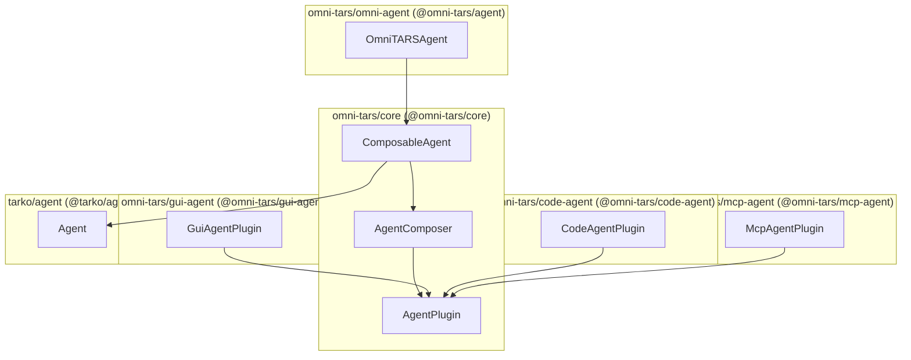
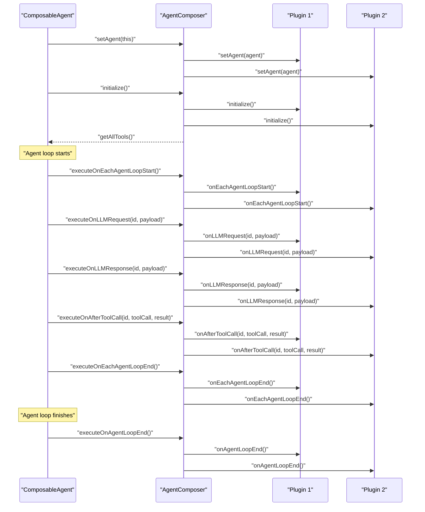
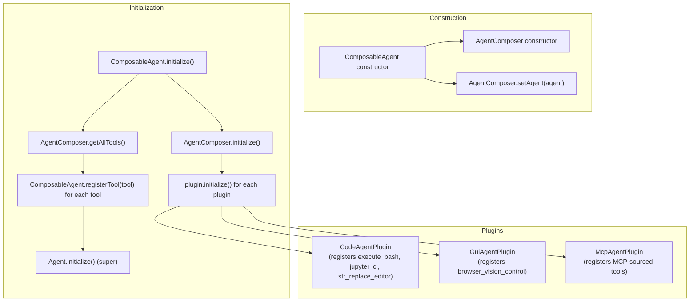

<!-- source: DeepWiki mcp.deepwiki.com · repo bytedance/UI-TARS-desktop · page 3.1 OmniTARS Agent Architecture and Plugin System · fetched 2026-10-30 -->

# OmniTARS Agent Architecture and Plugin System

<details>
<summary>Relevant source files</summary>

The following files were used as context for generating this wiki page:

- [multimodal/.gitignore](multimodal/.gitignore)
- [multimodal/omni-tars/code-agent/src/CodeAgentPlugin.ts](multimodal/omni-tars/code-agent/src/CodeAgentPlugin.ts)
- [multimodal/omni-tars/code-agent/src/index.ts](multimodal/omni-tars/code-agent/src/index.ts)
- [multimodal/omni-tars/code-agent/src/tools/ExcuteBash.ts](multimodal/omni-tars/code-agent/src/tools/ExcuteBash.ts)
- [multimodal/omni-tars/code-agent/src/tools/JupyterCI.ts](multimodal/omni-tars/code-agent/src/tools/JupyterCI.ts)
- [multimodal/omni-tars/code-agent/src/tools/StrReplaceEditor.ts](multimodal/omni-tars/code-agent/src/tools/StrReplaceEditor.ts)
- [multimodal/omni-tars/code-agent/tarko.config.ts](multimodal/omni-tars/code-agent/tarko.config.ts)
- [multimodal/omni-tars/core/src/AgentComposer.ts](multimodal/omni-tars/core/src/AgentComposer.ts)
- [multimodal/omni-tars/core/src/AgentPlugin.ts](multimodal/omni-tars/core/src/AgentPlugin.ts)
- [multimodal/omni-tars/core/src/ComposableAgent.ts](multimodal/omni-tars/core/src/ComposableAgent.ts)
- [multimodal/omni-tars/core/src/environments/code.ts](multimodal/omni-tars/core/src/environments/code.ts)
- [multimodal/omni-tars/core/src/utils/hepler.ts](multimodal/omni-tars/core/src/utils/hepler.ts)
- [multimodal/omni-tars/core/src/utils/parser.ts](multimodal/omni-tars/core/src/utils/parser.ts)
- [multimodal/omni-tars/gui-agent/tarko.config.ts](multimodal/omni-tars/gui-agent/tarko.config.ts)
- [multimodal/omni-tars/mcp-agent/src/McpAgentPlugin.ts](multimodal/omni-tars/mcp-agent/src/McpAgentPlugin.ts)
- [multimodal/omni-tars/mcp-agent/src/index.ts](multimodal/omni-tars/mcp-agent/src/index.ts)
- [multimodal/omni-tars/mcp-agent/src/tools/linkReader.ts](multimodal/omni-tars/mcp-agent/src/tools/linkReader.ts)
- [multimodal/omni-tars/mcp-agent/src/tools/mcp.ts](multimodal/omni-tars/mcp-agent/src/tools/mcp.ts)
- [multimodal/omni-tars/mcp-agent/tarko.config.ts](multimodal/omni-tars/mcp-agent/tarko.config.ts)
- [multimodal/omni-tars/omni-agent/.env.example](multimodal/omni-tars/omni-agent/.env.example)
- [multimodal/tarko/agent-server-next/src/middlewares/access-log.ts](multimodal/tarko/agent-server-next/src/middlewares/access-log.ts)
- [multimodal/tarko/agent-server-next/src/middlewares/session-restore.ts](multimodal/tarko/agent-server-next/src/middlewares/session-restore.ts)

</details>


This page documents the OmniTARS agent architecture built on the `ComposableAgent` base class, the `AgentPlugin` interface, and the `AgentComposer` orchestration system. This architecture lives in the `@omni-tars/core` package and enables composition of specialized agent capabilities (GUI automation, code execution, MCP integration) through a plugin-based design.

For documentation of the `Agent` base class that `ComposableAgent` extends, see [4.1](). For details on the specific plugin implementations — GUI, Code, and MCP — see [3.3](), [3.4](), and [3.5](). For agent mode configuration and tool call engine selection, see [3.6]().

---

## Overview

The OmniTARS agent system provides a composable architecture where specialized capabilities are added through **plugins**. Each plugin contributes:
- A set of `Tool` instances available to the LLM
- An `environmentSection` string that becomes part of the system prompt
- Lifecycle hooks executed at defined points during agent execution

The core abstractions are:

| Class | Package | File | Role |
|---|---|---|---|
| `AgentPlugin` | `@omni-tars/core` | [multimodal/omni-tars/core/src/AgentPlugin.ts:11-11]() | Base class for all plugins |
| `AgentComposer` | `@omni-tars/core` | [multimodal/omni-tars/core/src/AgentComposer.ts:12-12]() | Orchestrates a list of plugins |
| `ComposableAgent` | `@omni-tars/core` | [multimodal/omni-tars/core/src/ComposableAgent.ts:24-24]() | `Agent` subclass that delegates to `AgentComposer` |

**Package relationship diagram:**



Sources: [multimodal/omni-tars/core/src/ComposableAgent.ts:24-25](), [multimodal/omni-tars/core/src/AgentComposer.ts:12-13](), [multimodal/omni-tars/core/src/AgentPlugin.ts:11-12]()

---

## `AgentPlugin` — Base Class

All plugins extend `AgentPlugin` from [multimodal/omni-tars/core/src/AgentPlugin.ts]().

### Properties

| Property | Type | Description |
|---|---|---|
| `name` | `string \| undefined` | Unique identifier for the plugin [multimodal/omni-tars/core/src/AgentPlugin.ts:13-13]() |
| `environmentSection` | `string \| undefined` | Text block injected into the system prompt [multimodal/omni-tars/core/src/AgentPlugin.ts:15-15]() |
| `tools` | `Tool[]` | Tools registered by this plugin [multimodal/omni-tars/core/src/AgentPlugin.ts:18-18]() |
| `_agent` | `Agent \| undefined` | Private reference to the parent agent, set by `AgentComposer` [multimodal/omni-tars/core/src/AgentPlugin.ts:17-17]() |

### Methods

| Method | Purpose |
|---|---|
| `setAgent(agent)` | Called by `AgentComposer` to inject the agent instance [multimodal/omni-tars/core/src/AgentPlugin.ts:27-29]() |
| `getTools()` | Returns the plugin's `tools` array [multimodal/omni-tars/core/src/AgentPlugin.ts:32-34]() |
| `initialize()` | Optional async setup, called once before agent starts [multimodal/omni-tars/core/src/AgentPlugin.ts:37-37]() |
| `onLLMRequest(id, payload)` | Hook fired before each LLM call [multimodal/omni-tars/core/src/AgentPlugin.ts:40-42]() |
| `onLLMResponse(id, payload)` | Hook fired after each LLM response [multimodal/omni-tars/core/src/AgentPlugin.ts:45-47]() |
| `onEachAgentLoopStart()` | Hook fired at start of reasoning iteration [multimodal/omni-tars/core/src/AgentPlugin.ts:50-52]() |
| `onEachAgentLoopEnd()` | Hook fired at end of reasoning iteration [multimodal/omni-tars/core/src/AgentPlugin.ts:55-57]() |
| `onAgentLoopEnd()` | Hook fired when the entire agent run finishes [multimodal/omni-tars/core/src/AgentPlugin.ts:60-62]() |
| `onAfterToolCall(...)` | Hook fired after a tool has returned a result [multimodal/omni-tars/core/src/AgentPlugin.ts:65-71]() |

Sources: [multimodal/omni-tars/core/src/AgentPlugin.ts:11-72]()

### Plugin Lifecycle

**Plugin initialization and hook execution flow:**



Sources: [multimodal/omni-tars/core/src/AgentPlugin.ts:11-72](), [multimodal/omni-tars/core/src/AgentComposer.ts:33-143](), [multimodal/omni-tars/core/src/ComposableAgent.ts:49-95]()

---

## `AgentComposer` — Plugin Orchestrator

`AgentComposer` in [multimodal/omni-tars/core/src/AgentComposer.ts]() holds a list of `AgentPlugin` instances and provides:

1. **Agent injection** — `setAgent(agent)` propagates the `Agent` reference [multimodal/omni-tars/core/src/AgentComposer.ts:24-28]()
2. **Sequential initialization** — `initialize()` calls each plugin's setup in order [multimodal/omni-tars/core/src/AgentComposer.ts:33-39]()
3. **Tool aggregation** — `getAllTools()` flat-maps all `plugin.getTools()` arrays [multimodal/omni-tars/core/src/AgentComposer.ts:69-71]()
4. **System prompt generation** — `generateSystemPrompt()` combines environment sections [multimodal/omni-tars/core/src/AgentComposer.ts:44-64]()
5. **Hook fan-out** — Each `execute*` method iterates all plugins and calls corresponding hooks [multimodal/omni-tars/core/src/AgentComposer.ts:76-143]()

### System Prompt Composition

`generateSystemPrompt()` builds the system prompt in three parts:

| Part | Source |
|---|---|
| Base preamble | Hard-coded instructions including `<think>` tag requirements [multimodal/omni-tars/core/src/AgentComposer.ts:49-52]() |
| Environment sections | Each plugin's `environmentSection` property joined with `\n\n` [multimodal/omni-tars/core/src/AgentComposer.ts:55-58]() |
| Usage instructions | `generateUsageInstructions()`, dynamically built from present plugins [multimodal/omni-tars/core/src/AgentComposer.ts:61-63]() |

The `generateUsageInstructions()` method uses `hasPlugin(type)` to check for 'code', 'mcp', or 'gui' plugins. The resulting `<IMPORTANT_NOTE>` block tells the LLM which environment XML tags (e.g., `<code_env>`, `<mcp_env>`, `<computer_env>`) to use [multimodal/omni-tars/core/src/AgentComposer.ts:182-214]().

---

## `ComposableAgent` — The Main Agent Class

`ComposableAgent` in [multimodal/omni-tars/core/src/ComposableAgent.ts]() extends `Agent` from `@tarko/agent` and wires the plugin layer into the execution lifecycle.

### Constructor

```typescript
export interface ComposableAgentOptions extends AgentOptions {
  plugins: AgentPlugin[];
}
```

The constructor strips `plugins` out of the options before passing them to `super()` to prevent circular reference errors [multimodal/omni-tars/core/src/ComposableAgent.ts:28-37](). It then constructs the `AgentComposer` and calls `composer.setAgent(this)` [multimodal/omni-tars/core/src/ComposableAgent.ts:30-40]().

### `initialize()`

[multimodal/omni-tars/core/src/ComposableAgent.ts:49-59]()

```typescript
async initialize(): Promise<void> {
  await this.composer.initialize();

  // Register all tools from all plugins
  const tools = this.composer.getAllTools();
  for (const tool of tools) {
    this.registerTool(tool);
  }

  await super.initialize();
}
```

This is the point where all plugin-contributed tools are registered with the underlying `Agent`.

---

## Specialized Plugin Implementations

### `CodeAgentPlugin` (`@omni-tars/code-agent`)

The `CodeAgentPlugin` handles the `CODE_ENVIRONMENT` for bash execution and file editing.

| Feature | Implementation |
|---|---|
| Environment Section | `CODE_ENVIRONMENT` defined in [multimodal/omni-tars/core/src/environments/code.ts:18-78]() |
| Sandbox Client | `AioClient` for remote execution with `sandboxUrl` [multimodal/omni-tars/code-agent/src/CodeAgentPlugin.ts:28-32]() |
| Provided Tools | `ExcuteBashProvider`, `JupyterCIProvider`, `StrReplaceEditorProvider` [multimodal/omni-tars/code-agent/src/CodeAgentPlugin.ts:35-39]() |

The `execute_bash` tool specifically uses `AioClient.shellExec` to run commands in the sandbox [multimodal/omni-tars/code-agent/src/tools/ExcuteBash.ts:22-30]().

### `McpAgentPlugin` (`@omni-tars/mcp-agent`)

The `McpAgentPlugin` integrates Model Context Protocol servers.

| Feature | Implementation |
|---|---|
| Manager | `McpManager` handles multiple server connections [multimodal/omni-tars/mcp-agent/src/McpAgentPlugin.ts:27-29]() |
| Built-in Servers | Tavily, Google Search, and LinkReader via `streamable-http` [multimodal/omni-tars/mcp-agent/src/index.ts:26-58]() |
| Tool Providers | `SearchToolProvider` and `LinkReaderToolProvider` [multimodal/omni-tars/mcp-agent/src/McpAgentPlugin.ts:38-39]() |

Sources: [multimodal/omni-tars/mcp-agent/src/McpAgentPlugin.ts:19-42](), [multimodal/omni-tars/mcp-agent/src/index.ts:24-60]()

---

## Data Flow: Tool Registration

**How plugins contribute tools to the agent:**



Sources: [multimodal/omni-tars/core/src/ComposableAgent.ts:27-59](), [multimodal/omni-tars/core/src/AgentComposer.ts:33-71](), [multimodal/omni-tars/code-agent/src/CodeAgentPlugin.ts:35-39]()

---

