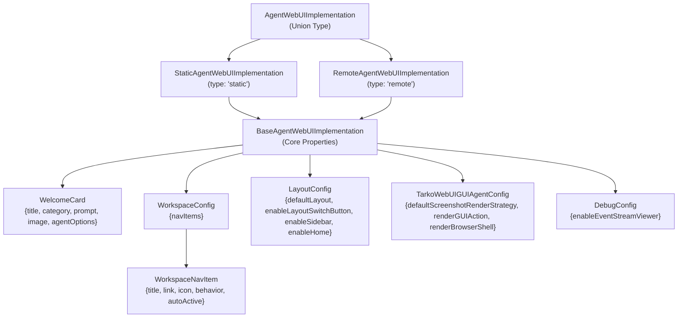
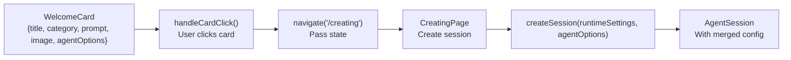
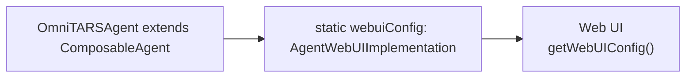
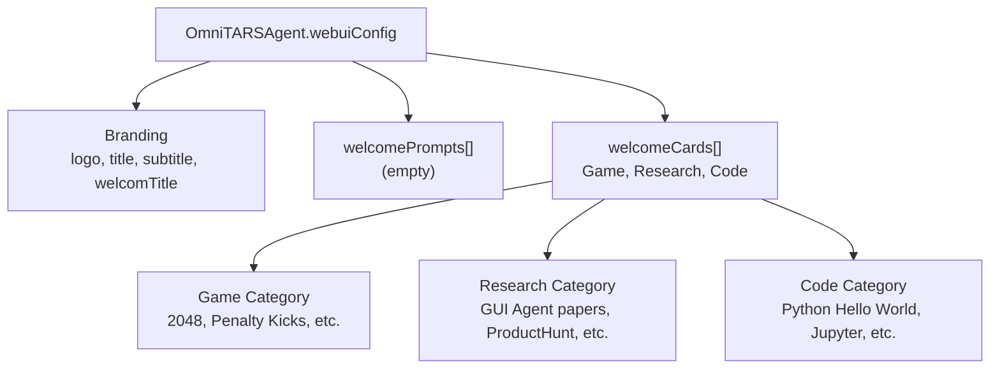
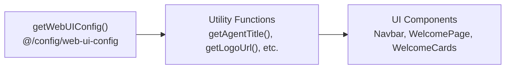
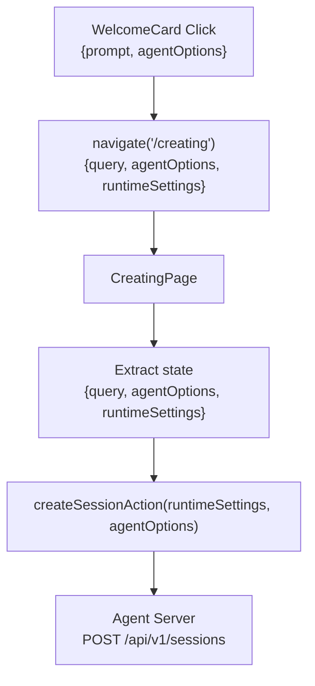

<!-- source: DeepWiki mcp.deepwiki.com · repo bytedance/UI-TARS-desktop · page 3.2 OmniTARS Web UI Configuration · fetched 2026-10-30 -->

# OmniTARS Web UI Configuration

<details>
<summary>Relevant source files</summary>

The following files were used as context for generating this wiki page:

- [multimodal/agent-tars/cli/src/index.ts](multimodal/agent-tars/cli/src/index.ts)
- [multimodal/agent-tars/core/src/webui-config.ts](multimodal/agent-tars/core/src/webui-config.ts)
- [multimodal/agent-tars/interface/src/constants.ts](multimodal/agent-tars/interface/src/constants.ts)
- [multimodal/omni-tars/omni-agent/src/index.ts](multimodal/omni-tars/omni-agent/src/index.ts)
- [multimodal/tarko/agent-ui/src/common/components/JsonRenderer.tsx](multimodal/tarko/agent-ui/src/common/components/JsonRenderer.tsx)
- [multimodal/tarko/agent-ui/src/common/state/actions/eventProcessors/EventHandlerRegistry.ts](multimodal/tarko/agent-ui/src/common/state/actions/eventProcessors/EventHandlerRegistry.ts)
- [multimodal/tarko/agent-ui/src/common/state/actions/eventProcessors/handlers/RawEventsHandler.ts](multimodal/tarko/agent-ui/src/common/state/actions/eventProcessors/handlers/RawEventsHandler.ts)
- [multimodal/tarko/agent-ui/src/common/state/actions/eventProcessors/index.ts](multimodal/tarko/agent-ui/src/common/state/actions/eventProcessors/index.ts)
- [multimodal/tarko/agent-ui/src/common/state/atoms/eventStreamModal.ts](multimodal/tarko/agent-ui/src/common/state/atoms/eventStreamModal.ts)
- [multimodal/tarko/agent-ui/src/standalone/app/Layout/index.tsx](multimodal/tarko/agent-ui/src/standalone/app/Layout/index.tsx)
- [multimodal/tarko/agent-ui/src/standalone/components/ThemeToggle.tsx](multimodal/tarko/agent-ui/src/standalone/components/ThemeToggle.tsx)
- [multimodal/tarko/agent-ui/src/standalone/components/index.ts](multimodal/tarko/agent-ui/src/standalone/components/index.ts)
- [multimodal/tarko/agent-ui/src/standalone/home/CreatingPage.tsx](multimodal/tarko/agent-ui/src/standalone/home/CreatingPage.tsx)
- [multimodal/tarko/agent-ui/src/standalone/home/WelcomeCards.tsx](multimodal/tarko/agent-ui/src/standalone/home/WelcomeCards.tsx)
- [multimodal/tarko/agent-ui/src/standalone/home/WelcomePage.tsx](multimodal/tarko/agent-ui/src/standalone/home/WelcomePage.tsx)
- [multimodal/tarko/agent-ui/src/standalone/modals/EventStreamModal.tsx](multimodal/tarko/agent-ui/src/standalone/modals/EventStreamModal.tsx)
- [multimodal/tarko/agent-ui/src/standalone/sidebar/ToolBar.tsx](multimodal/tarko/agent-ui/src/standalone/sidebar/ToolBar.tsx)
- [multimodal/tarko/interface/src/web-ui-implementation.ts](multimodal/tarko/interface/src/web-ui-implementation.ts)

</details>


## Overview

This document details the Web UI configuration system for OmniTARS agents, which allows agents to customize their web interface presentation, welcome experience, workspace navigation, and UI behavior. The configuration is defined through the `AgentWebUIImplementation` interface and implemented as a static property on agent classes.

For information about the broader OmniTARS agent architecture and plugin composition, see [OmniTARS Agent Architecture and Plugin System](3.1). For details on runtime settings and mode selection that affect agent behavior, see [Agent Mode Configuration and Tool Call Engines](3.6).

---

## AgentWebUIImplementation Interface Structure

### Type Definitions and Core Interfaces

The web UI configuration system is defined in the `@tarko/interface` package through a set of TypeScript interfaces that control all aspects of the UI presentation.

**Interface Hierarchy Diagram**



**Sources:** [multimodal/tarko/interface/src/web-ui-implementation.ts:7-314]()

### Base Configuration Properties

The `BaseAgentWebUIImplementation` interface defines the fundamental UI presentation properties:

| Property | Type | Default | Description |
|----------|------|---------|-------------|
| `type` | `'static' \| 'remote'` | `'static'` | Implementation type for UI serving |
| `logo` | `string` | Tarko logo URL | Logo image URL displayed in navbar |
| `title` | `string` | Agent name | Site title shown in navbar and meta tags |
| `subtitle` | `string` | Agent subtitle | Subtitle for home page and SEO |
| `welcomTitle` | `string` | Same as `title` | Hero title on welcome page |
| `welcomePrompts` | `string[]` | `[]` | Quick prompt suggestions on home page |
| `welcomeCards` | `WelcomeCard[]` | `[]` | Interactive cards for common tasks |
| `enableContextualSelector` | `boolean` | `false` | Enable @ syntax for file selection |

**Sources:** [multimodal/tarko/interface/src/web-ui-implementation.ts:196-268]()

### Welcome Card Configuration

Welcome cards provide pre-configured tasks that users can launch with a single click. Each card can specify custom agent options and runtime settings.

**WelcomeCard Interface**

```typescript
export interface WelcomeCard {
  title: string;              // Card display title
  category: string;           // Category for grouping cards
  prompt?: string;            // Initial query to send when clicked
  image?: string;             // Background image URL
  agentOptions?: Record<string, any>;  // One-time configuration for session
}
```

**Welcome Card Flow Diagram**



**Sources:** [multimodal/tarko/interface/src/web-ui-implementation.ts:156-178](), [multimodal/tarko/agent-ui/src/standalone/home/WelcomeCards.tsx:41-69]()

### Workspace Navigation Configuration

Workspace navigation items provide access to integrated tools like VNC, Code Server, and other workspace services. Items can open in new tabs or embed within the UI.

**WorkspaceNavItem Interface**

```typescript
export interface WorkspaceNavItem {
  title: string;                              // Button label
  link: string;                               // Target URL
  icon?: WorkspaceNavItemIcon;                // Icon type
  behavior?: 'new-page' | 'embed-frame';      // Click behavior
  autoActive?: boolean | string;              // Auto-activation config
}

export type WorkspaceNavItemIcon = 
  | 'code' 
  | 'monitor' 
  | 'terminal' 
  | 'browser' 
  | 'desktop' 
  | 'default';
```

**Auto-Activation Logic**

The `autoActive` property supports two formats:
- **Boolean**: Static true/false value. [multimodal/tarko/interface/src/web-ui-implementation.ts:60-60]()
- **String Expression**: JavaScript expression evaluated at runtime using `runtimeSettings` properties. [multimodal/tarko/interface/src/web-ui-implementation.ts:61-64]()

**Sources:** [multimodal/tarko/interface/src/web-ui-implementation.ts:16-65]()

### Layout Configuration

The `LayoutConfig` interface controls UI structure and page routing:

```typescript
export interface LayoutConfig {
  defaultLayout?: 'default' | 'narrow-chat';  // Initial layout mode
  enableLayoutSwitchButton?: boolean;         // Show layout toggle
  enableSidebar?: boolean;                    // Show session sidebar
  enableHome?: boolean;                       // Register home route
}
```

**Layout Implementation**

The `Layout` component in `agent-ui` uses `layoutModeAtom` to toggle between `default` (split screen) and `narrow-chat` (expanded workspace) modes. [multimodal/tarko/agent-ui/src/standalone/app/Layout/index.tsx:50-75]()

**Sources:** [multimodal/tarko/interface/src/web-ui-implementation.ts:69-96](), [multimodal/tarko/agent-ui/src/standalone/app/Layout/index.tsx:1-100]()

### GUI Agent Configuration

The `TarkoWebUIGUIAgentConfig` interface controls how GUI agent screenshots and actions are displayed:

```typescript
export interface TarkoWebUIGUIAgentConfig {
  defaultScreenshotRenderStrategy?: 'both' | 'beforeAction' | 'afterAction';
  enableScreenshotRenderStrategySwitch?: boolean;
  renderGUIAction?: boolean;
  renderBrowserShell?: boolean;
}
```

**Screenshot Rendering Strategy**

| Strategy | Use Case | Description |
|----------|----------|-------------|
| `both` | Action comparison | Display before and after screenshots side-by-side |
| `beforeAction` | Agent-TARS style | Show screenshot taken at loop start, with mouse cursor overlay |
| `afterAction` | Omni-TARS style | Show screenshot taken after action execution |

**Sources:** [multimodal/tarko/interface/src/web-ui-implementation.ts:108-152]()

### Debug Configuration

The `DebugConfig` interface enables development features, specifically the **Event Stream Viewer**. When `enableEventStreamViewer` is true, the UI registers a `RawEventsHandler` in the `EventHandlerRegistry` to capture and display real-time events in a modal accessible from the `ToolBar`.

**Sources:** [multimodal/tarko/interface/src/web-ui-implementation.ts:183-191](), [multimodal/tarko/agent-ui/src/common/state/actions/eventProcessors/EventHandlerRegistry.ts:57-60](), [multimodal/tarko/agent-ui/src/standalone/sidebar/ToolBar.tsx:128-145]()

---

## Agent Implementation Pattern

### Static webuiConfig Property

Agents implement web UI configuration by defining a static `webuiConfig` property on their class. This property is accessed by the system to customize the React frontend.

**Implementation Pattern**



**Sources:** [multimodal/omni-tars/omni-agent/src/index.ts:11-14](), [multimodal/tarko/agent-ui/src/config/web-ui-config.ts:6-6]()

### OmniTARSAgent Configuration Example

The `OmniTARSAgent` class demonstrates a comprehensive web UI configuration:

**Configuration Structure**



**Game Cards with Agent Options**

Game category cards specify `agentOptions` to force a specific `agentMode` when clicked:

```typescript
{
  title: '2048',
  category: 'Game',
  image: '...',
  agentOptions: {
    agentMode: {
      id: 'game',
      link: 'https://poki.com/zh/g/2048',
      browserMode: 'hybrid',
    },
  },
}
```

**Sources:** [multimodal/omni-tars/omni-agent/src/index.ts:14-178]()

---

## Configuration Consumption in Web UI

### Configuration Loading System

The web UI uses a centralized configuration loading system that provides utility functions for accessing configuration properties defined by the agent.

**Configuration Access Flow**



**Sources:** [multimodal/tarko/agent-ui/src/config/web-ui-config.ts:6-6](), [multimodal/tarko/agent-ui/src/standalone/home/WelcomePage.tsx:24-30]()

### Welcome Page Integration

The `WelcomePage` component consumes the configuration to render the hero section, search input, and interactive cards.

**Welcome Page Configuration Usage**

| UI Element | Source Property | Behavior |
|------------|-----------------|----------|
| Logo | `logo` | Fetched via `getLogoUrl()` |
| Hero Title | `welcomTitle` | Defaults to `title` if missing |
| Subtitle | `subtitle` | Displayed below the hero title |
| Quick Prompts | `welcomePrompts` | Shuffled and displayed as clickable suggestions |
| Task Grid | `welcomeCards` | Grouped by category in `WelcomeCards` component |

**Sources:** [multimodal/tarko/agent-ui/src/standalone/home/WelcomePage.tsx:24-64](), [multimodal/tarko/agent-ui/src/standalone/home/WelcomeCards.tsx:24-36]()

---

## Session Creation Flow

### CreatingPage Orchestration

The `CreatingPage` handles session creation by merging parameters from three sources in priority order:
1. **Router state**: Passed during internal navigation (e.g., from `WelcomeCards` click). [multimodal/tarko/agent-ui/src/standalone/home/CreatingPage.tsx:52-56]()
2. **Global runtime settings**: Selected by the user on the home page using `globalRuntimeSettingsAtom`. [multimodal/tarko/agent-ui/src/standalone/home/CreatingPage.tsx:58-61]()
3. **URL search params**: Used for deep-linking (parameters: `q`, `runtimeSettings`, `agentOptions`). [multimodal/tarko/agent-ui/src/standalone/home/CreatingPage.tsx:63-84]()

**Session Creation Logic**



**Sources:** [multimodal/tarko/agent-ui/src/standalone/home/CreatingPage.tsx:39-113](), [multimodal/tarko/agent-ui/src/standalone/home/WelcomeCards.tsx:41-69]()

---

