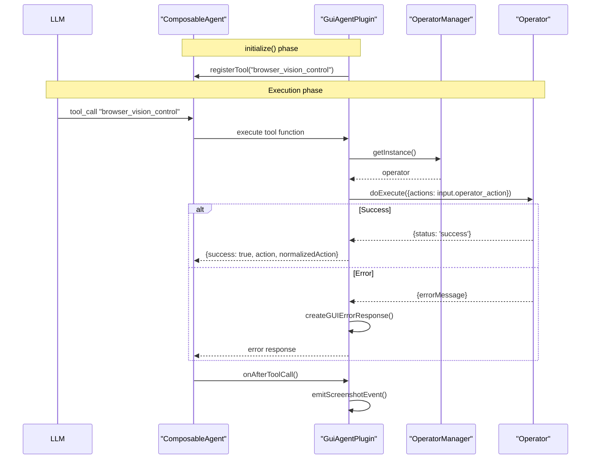

<!-- source: DeepWiki mcp.deepwiki.com · repo bytedance/UI-TARS-desktop · page 3.3 GUI Agent Plugin and Screenshot Processing · fetched 2026-10-30 -->

# GUI Agent Plugin and Screenshot Processing

<details>
<summary>Relevant source files</summary>

The following files were used as context for generating this wiki page:

- [multimodal/gui-agent/operator-aio/package.json](multimodal/gui-agent/operator-aio/package.json)
- [multimodal/gui-agent/operator-aio/src/AIOBrowser.ts](multimodal/gui-agent/operator-aio/src/AIOBrowser.ts)
- [multimodal/gui-agent/operator-aio/src/AIOComputer.ts](multimodal/gui-agent/operator-aio/src/AIOComputer.ts)
- [multimodal/gui-agent/operator-aio/src/AIOGameOperator.ts](multimodal/gui-agent/operator-aio/src/AIOGameOperator.ts)
- [multimodal/gui-agent/operator-aio/src/AIOHybridOperator.ts](multimodal/gui-agent/operator-aio/src/AIOHybridOperator.ts)
- [multimodal/gui-agent/operator-aio/src/index.ts](multimodal/gui-agent/operator-aio/src/index.ts)
- [multimodal/gui-agent/operator-aio/src/types.ts](multimodal/gui-agent/operator-aio/src/types.ts)
- [multimodal/gui-agent/operator-aio/test/aioComputer.test.ts](multimodal/gui-agent/operator-aio/test/aioComputer.test.ts)
- [multimodal/gui-agent/operator-nutjs/src/NutJSOperator.ts](multimodal/gui-agent/operator-nutjs/src/NutJSOperator.ts)
- [multimodal/omni-tars/gui-agent/package.json](multimodal/omni-tars/gui-agent/package.json)
- [multimodal/omni-tars/gui-agent/src/GUIAgentT5Adapter.ts](multimodal/omni-tars/gui-agent/src/GUIAgentT5Adapter.ts)
- [multimodal/omni-tars/gui-agent/src/GuiAgentPlugin.ts](multimodal/omni-tars/gui-agent/src/GuiAgentPlugin.ts)
- [multimodal/omni-tars/gui-agent/src/OperatorManager.ts](multimodal/omni-tars/gui-agent/src/OperatorManager.ts)
- [multimodal/omni-tars/gui-agent/src/index.ts](multimodal/omni-tars/gui-agent/src/index.ts)
- [multimodal/omni-tars/gui-agent/src/shared.ts](multimodal/omni-tars/gui-agent/src/shared.ts)
- [multimodal/omni-tars/omni-agent/tarko.config.ts](multimodal/omni-tars/omni-agent/tarko.config.ts)
- [multimodal/pnpm-lock.yaml](multimodal/pnpm-lock.yaml)

</details>


## Purpose and Scope

This page documents the `GuiAgentPlugin` implementation and its screenshot processing pipeline. The plugin provides visual GUI interaction capabilities by capturing, compressing, and streaming screenshots to the language model, enabling vision-based GUI automation.

This page covers:
- The `GuiAgentPlugin` class architecture and lifecycle hooks.
- `OperatorManager` for coordinating operator implementations (Browser, AIO, NutJS).
- Screenshot capture, WebP compression, and base64 encoding.
- Image detail level calculation for OpenAI API optimization.
- `browser_vision_control` tool registration and execution.
- Event stream integration for environment input.

## GuiAgentPlugin Architecture

The `GuiAgentPlugin` class extends `AgentPlugin` to provide GUI automation capabilities through visual grounding and action execution. It handles the `COMPUTER_USE_ENVIRONMENT` section of the agent's capabilities [multimodal/omni-tars/gui-agent/src/GuiAgentPlugin.ts:27-31]().

### Core Responsibilities

| Responsibility | Implementation Details |
|----------------|------------------------|
| **Screenshot Capture** | Captures screen state via `OperatorManager`, compresses to WebP format, emits `environment_input` events [multimodal/omni-tars/gui-agent/src/GuiAgentPlugin.ts:119-202](). |
| **Action Execution** | Routes GUI actions (click, type, scroll) through operator implementations [multimodal/omni-tars/gui-agent/src/GuiAgentPlugin.ts:62-90](). |
| **Tool Registration** | Registers `browser_vision_control` tool during initialization [multimodal/omni-tars/gui-agent/src/GuiAgentPlugin.ts:57-61](). |
| **Lifecycle Management** | Implements `initialize()` and `onAfterToolCall()` hooks [multimodal/omni-tars/gui-agent/src/GuiAgentPlugin.ts:45-117](). |
| **Image Optimization** | Compresses screenshots using 80% quality WebP with automatic detail level selection [multimodal/omni-tars/gui-agent/src/GuiAgentPlugin.ts:135-166](). |
| **Context Enrichment** | Adds current URL and visual context to conversation history [multimodal/omni-tars/gui-agent/src/GuiAgentPlugin.ts:182-187](). |

Sources: [multimodal/omni-tars/gui-agent/src/GuiAgentPlugin.ts:29-202]()

### Class Hierarchy

```mermaid
classDiagram
    class "AgentPlugin" {
        <<abstract>>
        +name string
        +environmentSection string
        +agent Agent
        +initialize() Promise~void~
        +onAfterToolCall() Promise~void~
        +getTools() Tool[]
    }
    
    class "GuiAgentPlugin" {
        +name "gui-agent"
        +environmentSection "COMPUTER_USE_ENVIRONMENT"
        -operatorManager "OperatorManager"
        -agentMode "AgentMode"
        -initializedWithMode boolean
        +initialize() Promise~void~
        +onAfterToolCall() Promise~void~
        -emitScreenshotEvent() Promise~void~
        -emitPresetUserQuey() Promise~void~
        -emitPresetAssistantNavMsg() Promise~void~
    }
    
    class "OperatorManager" {
        -operator "Operator"
        +getInstance() Promise~Operator~
        +static create(agentMode, sandboxUrl) "OperatorManager"
    }
    
    class "ImageCompressor" {
        -quality number
        -format string
        +compressToBuffer() Promise~Buffer~
    }
    
    class "Tool" {
        +id string
        +description string
        +function Function
    }
    
    "AgentPlugin" <|-- "GuiAgentPlugin"
    "GuiAgentPlugin" --> "OperatorManager"
    "GuiAgentPlugin" --> "ImageCompressor"
    "GuiAgentPlugin" ..> "Tool" : "registers"
```

**Diagram: GuiAgentPlugin Class Structure**

Sources: [multimodal/omni-tars/gui-agent/src/GuiAgentPlugin.ts:29-43](), [multimodal/omni-tars/gui-agent/src/GuiAgentPlugin.ts:135-138](), [multimodal/omni-tars/gui-agent/src/OperatorManager.ts:9-120]()

## OperatorManager and Operator Implementations

The `OperatorManager` provides a unified interface for managing different operator implementations. It selects between `AIOHybridOperator` (standard GUI) and `AIOGameOperator` (game-specific GUI) based on the `AgentMode` [multimodal/omni-tars/gui-agent/src/OperatorManager.ts:23-39]().

### Operator Abstraction Layer

```mermaid
graph TB
    "OperatorManager"["OperatorManager<br/>getInstance()"]
    
    subgraph "OperatorImpls" ["Operator Implementations"]
        "AIOHybridOperator"["AIOHybridOperator<br/>@gui-agent/operator-aio"]
        "AIOGameOperator"["AIOGameOperator<br/>@gui-agent/operator-aio"]
        "BrowserOperator"["BrowserOperator<br/>@gui-agent/operator-browser"]
    end
    
    subgraph "Infrastructure" ["Infrastructure Components"]
        "AIOBrowser"["AIOBrowser<br/>Remote Puppeteer Wrapper"]
        "AIOComputer"["AIOComputer<br/>Remote OS Action Wrapper"]
        "AioClient"["AioClient<br/>@agent-infra/sandbox"]
    end
    
    "OperatorManager" --> "AIOHybridOperator"
    "OperatorManager" --> "AIOGameOperator"
    
    "AIOHybridOperator" --> "AIOBrowser"
    "AIOHybridOperator" --> "AIOComputer"
    "AIOGameOperator" --> "AIOComputer"
    
    "AIOBrowser" --> "AioClient"
    "AIOComputer" --> "AioClient"
```

**Diagram: Operator Manager Architecture**

Sources: [multimodal/omni-tars/gui-agent/src/OperatorManager.ts:23-39](), [multimodal/gui-agent/operator-aio/src/AIOHybridOperator.ts:23-38](), [multimodal/gui-agent/operator-aio/src/AIOBrowser.ts:31-57]()

### Operator Interface and Execution

The `AIOHybridOperator` handles complex GUI actions by delegating to `AIOBrowser` for web-specific navigation and `AIOComputer` for operating system level mouse/keyboard inputs [multimodal/gui-agent/operator-aio/src/AIOHybridOperator.ts:142-216]().

| Method | Parameters | Return Type | Purpose |
|--------|-----------|-------------|---------|
| `screenshot()` | none | `Promise<ScreenshotOutput>` | Captures current screen state via `AIOComputer.screenshot()` [multimodal/gui-agent/operator-aio/src/AIOHybridOperator.ts:83-114](). |
| `execute(params)` | `{actions}` | `Promise<ExecuteOutput>` | Iterates through `BaseAction` array and calls `singleActionExecutor` [multimodal/gui-agent/operator-aio/src/AIOHybridOperator.ts:116-125](). |
| `singleActionExecutor` | `action` | `Promise<ExecuteOutput>` | Switches on `actionType` (click, type, navigate, etc.) [multimodal/gui-agent/operator-aio/src/AIOHybridOperator.ts:127-140](). |

Sources: [multimodal/gui-agent/operator-aio/src/AIOHybridOperator.ts:83-216]()

## Tool Registration and Execution Flow

### browser_vision_control Tool

The plugin registers a tool named `browser_vision_control` that serves as the entry point for all GUI operations within the `ComposableAgent` loop [multimodal/omni-tars/gui-agent/src/GuiAgentPlugin.ts:59-62]().



**Diagram: Tool Registration and Execution Sequence**

Sources: [multimodal/omni-tars/gui-agent/src/GuiAgentPlugin.ts:57-91](), [multimodal/omni-tars/gui-agent/src/GuiAgentPlugin.ts:104-117](), [multimodal/gui-agent/operator-aio/src/AIOHybridOperator.ts:116-125]()

## Screenshot Processing Pipeline

### Capture and Compression Workflow

The plugin performs optimization on screenshots before sending them to the VLM to manage token usage and latency [multimodal/omni-tars/gui-agent/src/GuiAgentPlugin.ts:135-155]().

```mermaid
flowchart TD
    "Start"["onAfterToolCall triggered"]
    "CheckTool"{"tool.name ==<br/>'browser_vision_control'?"}
    "Capture"["operator.doScreenshot()"]
    
    subgraph "Compression" ["Optimization Pipeline"]
        "Parse"["Base64ImageParser<br/>Get Dimensions"]
        "Sharp"["ImageCompressor<br/>WebP @ 80% Quality"]
        "CalcPixels"["Calculate Pixel Count<br/>(W * H)"]
    end
    
    "DetermineDetail"{"Pixel Count?"}
    "SetLow"["detail: 'low'<br/>≤ 1,048,576px"]
    "SetHigh"["detail: 'high'<br/>> 1,048,576px"]
    
    "BuildContent"["Build ChatCompletionContentPart[]"]
    "CreateEvent"["createEvent('environment_input')"]
    "SendEvent"["eventStream.sendEvent()"]
    
    "Start" --> "CheckTool"
    "CheckTool" -->|Yes| "Capture"
    "Capture" --> "Parse"
    "Parse" --> "Sharp"
    "Sharp" --> "CalcPixels"
    "CalcPixels" --> "DetermineDetail"
    "DetermineDetail" -->|Small| "SetLow"
    "DetermineDetail" -->|Large| "SetHigh"
    "SetLow" --> "BuildContent"
    "SetHigh" --> "BuildContent"
    "BuildContent" --> "CreateEvent"
    "CreateEvent" --> "SendEvent"
```

**Diagram: Screenshot Capture and Compression Pipeline**

Sources: [multimodal/omni-tars/gui-agent/src/GuiAgentPlugin.ts:119-202]()

### Image Compression Configuration

The plugin uses the `ImageCompressor` utility (built on `sharp`) to optimize payloads [multimodal/omni-tars/gui-agent/src/GuiAgentPlugin.ts:135-138]().

| Parameter | Value | Rationale |
|-----------|-------|-----------|
| **Format** | `webp` | Superior compression for screenshots [multimodal/omni-tars/gui-agent/src/GuiAgentPlugin.ts:137](). |
| **Quality** | `80` | High fidelity with reduced size [multimodal/omni-tars/gui-agent/src/GuiAgentPlugin.ts:136](). |
| **Low Detail Threshold** | 1,048,576 px | Maps to 1024x1024 (OpenAI "low" limit) [multimodal/omni-tars/gui-agent/src/GuiAgentPlugin.ts:23](). |
| **High Detail Threshold** | 4,014,080 px | Maps to 2048x1960 [multimodal/omni-tars/gui-agent/src/GuiAgentPlugin.ts:24](). |

Sources: [multimodal/omni-tars/gui-agent/src/GuiAgentPlugin.ts:23-24](), [multimodal/omni-tars/gui-agent/src/GuiAgentPlugin.ts:135-140]()

### Detail Level Selection Implementation

The detail parameter for the VLM is determined by comparing the compressed image's pixel count against defined thresholds [multimodal/omni-tars/gui-agent/src/GuiAgentPlugin.ts:157-166]().

```typescript
// From GuiAgentPlugin.ts:157-166
const pixelCount = compressedWidth * compressedHeight;
let detailLevel: 'low' | 'high';
if (pixelCount <= LOW_DETAIL_THRESHOLD) {
  detailLevel = 'low';
} else if (pixelCount <= HIGH_DETAIL_THRESHOLD) {
  detailLevel = 'high';
} else {
  // For images larger than high detail threshold, use high detail
  detailLevel = 'high';
}
```

Sources: [multimodal/omni-tars/gui-agent/src/GuiAgentPlugin.ts:157-166]()

## Browser Control via AIO Sandbox

The system uses `AIOBrowser` to interface with remote browser instances via the Chrome DevTools Protocol (CDP) [multimodal/gui-agent/operator-aio/src/AIOBrowser.ts:52-57]().

### AIOBrowser Core Functions

| Function | Implementation |
|----------|----------------|
| **Navigation** | `handleNavigate(inputs)` uses `page.goto(url)` [multimodal/gui-agent/operator-aio/src/AIOBrowser.ts:107-124](). |
| **History** | `handleNavigateBack()` uses `page.goBack()` [multimodal/gui-agent/operator-aio/src/AIOBrowser.ts:126-131](). |
| **Active Page Detection** | `getActivePage()` finds the tab where `document.visibilityState === 'visible'` [multimodal/gui-agent/operator-aio/src/AIOBrowser.ts:155-202](). |
| **Launch** | `launch(options)` connects the underlying `RemoteBrowser` [multimodal/gui-agent/operator-aio/src/AIOBrowser.ts:64-74](). |

Sources: [multimodal/gui-agent/operator-aio/src/AIOBrowser.ts:64-202]()

### Remote OS Interaction (AIOComputer)

`AIOComputer` provides an abstraction for operating system actions executed within the sandbox [multimodal/gui-agent/operator-aio/src/AIOComputer.ts:48-81]().

```typescript
// From AIOComputer.ts:139-146
async moveTo(x: number, y: number): Promise<ActionResponse> {
  const action: MoveToAction = {
    action_type: 'MOVE_TO',
    x,
    y,
  };
  return this.request(action);
}
```

Sources: [multimodal/gui-agent/operator-aio/src/AIOComputer.ts:139-146](), [multimodal/gui-agent/operator-aio/src/AIOComputer.ts:48-81]()

## Plugin Lifecycle and Mode Support

### Game Mode Specialization

When initialized in `game` mode, the plugin triggers a specialized bootstrap sequence to orient the agent [multimodal/omni-tars/gui-agent/src/GuiAgentPlugin.ts:46-55]().

1.  **Emit Preset User Query**: Sends the target URL as a navigation request.
2.  **Screenshot Event**: Captures the initial visual state after a 4000ms delay.
3.  **Emit Preset Assistant Message**: Provides context that navigation is underway or waiting.

Sources: [multimodal/omni-tars/gui-agent/src/GuiAgentPlugin.ts:46-55](), [multimodal/omni-tars/gui-agent/src/GuiAgentPlugin.ts:204-241]()

### Event Stream Integration

The plugin communicates with the `AgentEventStream` to push visual updates into the conversation flow. These events are categorized as `environment_input` [multimodal/omni-tars/gui-agent/src/GuiAgentPlugin.ts:193-201]().

```typescript
// From GuiAgentPlugin.ts:193-201
const event = eventStream.createEvent('environment_input', {
  description: 'Browser Screenshot',
  content,
  metadata: {
    type: 'screenshot',
    url: output?.url,
  },
});
eventStream.sendEvent(event);
```

Sources: [multimodal/omni-tars/gui-agent/src/GuiAgentPlugin.ts:193-201]()

---

