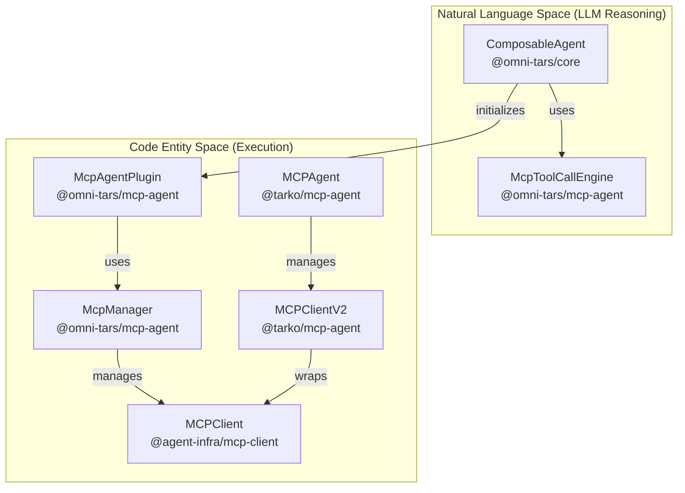
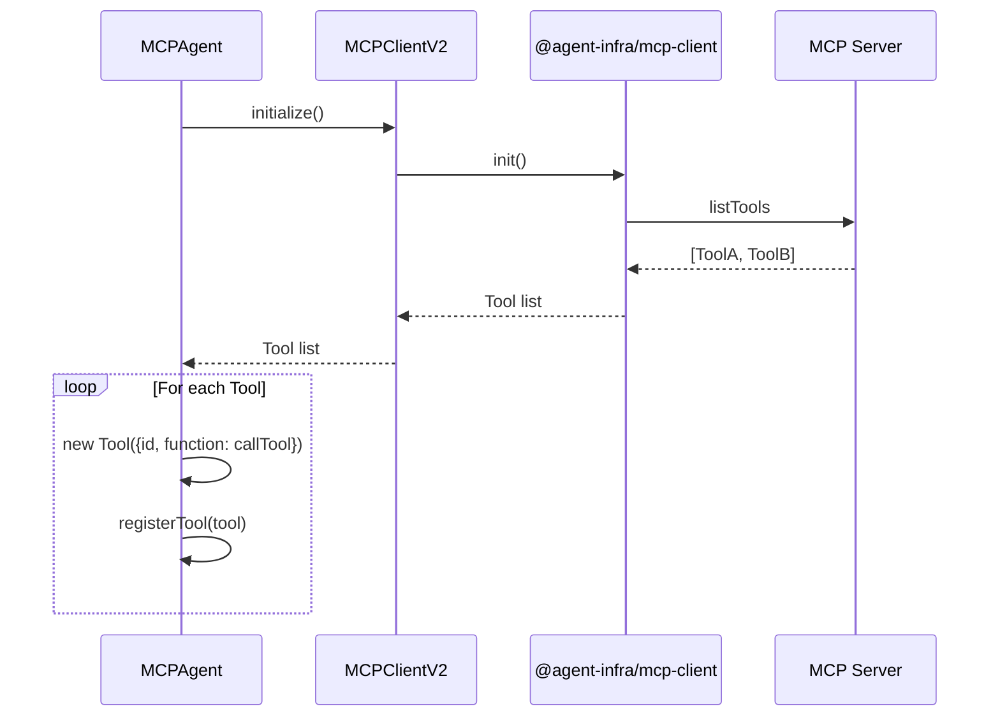

<!-- source: DeepWiki mcp.deepwiki.com · repo bytedance/UI-TARS-desktop · page 3.5 MCP Agent Integration · fetched 2026-10-30 -->

# MCP Agent Integration

Relevant source files

The following files were used as context for generating this wiki page:

- [multimodal/.gitignore](multimodal/.gitignore)
- [multimodal/omni-tars/code-agent/src/index.ts](multimodal/omni-tars/code-agent/src/index.ts)
- [multimodal/omni-tars/code-agent/tarko.config.ts](multimodal/omni-tars/code-agent/tarko.config.ts)
- [multimodal/omni-tars/core/src/environments/code.ts](multimodal/omni-tars/core/src/environments/code.ts)
- [multimodal/omni-tars/core/src/utils/hepler.ts](multimodal/omni-tars/core/src/utils/hepler.ts)
- [multimodal/omni-tars/gui-agent/tarko.config.ts](multimodal/omni-tars/gui-agent/tarko.config.ts)
- [multimodal/omni-tars/mcp-agent/src/index.ts](multimodal/omni-tars/mcp-agent/src/index.ts)
- [multimodal/omni-tars/mcp-agent/src/tools/linkReader.ts](multimodal/omni-tars/mcp-agent/src/tools/linkReader.ts)
- [multimodal/omni-tars/mcp-agent/tarko.config.ts](multimodal/omni-tars/mcp-agent/tarko.config.ts)
- [multimodal/omni-tars/omni-agent/.env.example](multimodal/omni-tars/omni-agent/.env.example)
- [multimodal/tarko/mcp-agent-interface/src/index.ts](multimodal/tarko/mcp-agent-interface/src/index.ts)
- [multimodal/tarko/mcp-agent/README.md](multimodal/tarko/mcp-agent/README.md)
- [multimodal/tarko/mcp-agent/examples/mcp-agent.ts](multimodal/tarko/mcp-agent/examples/mcp-agent.ts)
- [multimodal/tarko/mcp-agent/src/index.ts](multimodal/tarko/mcp-agent/src/index.ts)
- [multimodal/tarko/mcp-agent/src/mcp-agent.ts](multimodal/tarko/mcp-agent/src/mcp-agent.ts)
- [multimodal/tarko/mcp-agent/src/mcp-client-v2.ts](multimodal/tarko/mcp-agent/src/mcp-client-v2.ts)
- [multimodal/tarko/mcp-agent/src/mcp-types.ts](multimodal/tarko/mcp-agent/src/mcp-types.ts)
- [multimodal/websites/docs/docs/en/sdk/mcp-agent/core.md](multimodal/websites/docs/docs/en/sdk/mcp-agent/core.md)
- [multimodal/websites/docs/docs/zh/sdk/mcp-agent/core.md](multimodal/websites/docs/docs/zh/sdk/mcp-agent/core.md)

## Purpose and Scope

This document describes how the MCP (Model Context Protocol) Agent integrates external tools and services into the Omni-TARS multimodal agent system. The MCP Agent is a specialized component that extends agent capabilities by connecting to MCP servers, which provide standardized access to tools, prompts, and resources. This integration enables the agent to perform operations like web searching, file system access, shell commands, and browser automation through a unified protocol.

The system utilizes a dual-layer approach: a low-level `MCPAgent` class in the Tarko framework for protocol handling [multimodal/tarko/mcp-agent/src/mcp-agent.ts:11-11](), and a high-level `McpAgentPlugin` in the Omni-TARS stack for environment composition [multimodal/omni-tars/mcp-agent/src/index.ts:7-7]().

## Architecture and Data Flow

The MCP integration spans from the Tarko agent framework to the specialized Omni-TARS environment composition. The system maps natural language reasoning to executable code entities through a plugin-based architecture.

### System Entity Mapping

**Sources:** [multimodal/omni-tars/mcp-agent/src/index.ts:6-9](), [multimodal/omni-tars/mcp-agent/src/index.ts:62-72](), [multimodal/tarko/mcp-agent/src/mcp-agent.ts:11-13](), [multimodal/tarko/mcp-agent/src/mcp-client-v2.ts:14-15]()

## Tarko MCPAgent Implementation

The `MCPAgent` class in the Tarko framework implements the core logic for connecting to multiple MCP servers and registering their capabilities as native agent tools [multimodal/tarko/mcp-agent/src/mcp-agent.ts:11-11]().

### Server Initialization and Filtering
During the `initialize` phase, the agent performs the following steps:
1. **Filtering**: It filters the `MCPServerRegistry` based on the `mcpServer` options (include/exclude) using `filterItems` from shared utilities [multimodal/tarko/mcp-agent/src/mcp-agent.ts:49-54]().
2. **Client Creation**: For each server, it instantiates an `MCPClientV2` with a configurable connection timeout [multimodal/tarko/mcp-agent/src/mcp-agent.ts:63-63]().
3. **Tool Wrapping**: It retrieves tools from the MCP server and wraps them in the Tarko `Tool` class, mapping the MCP `inputSchema` to `JSONSchema7` [multimodal/tarko/mcp-agent/src/mcp-agent.ts:72-86]().

### Tool Registration Sequence

**Sources:** [multimodal/tarko/mcp-agent/src/mcp-agent.ts:49-102](), [multimodal/tarko/mcp-agent/src/mcp-client-v2.ts:41-59]()

## Omni-TARS MCP Integration

In the Omni-TARS stack, MCP capabilities are exposed through the `McpAgentPlugin`. This plugin integrates with the `ComposableAgent` to provide tool access and environment descriptions [multimodal/omni-tars/mcp-agent/src/index.ts:7-7]().

### Plugin Construction
The `mcpPluginBuilder` utility configures a set of standard MCP servers for the agent, including search and page parsing capabilities [multimodal/omni-tars/mcp-agent/src/index.ts:24-60]().

| Tool Type | Provider | Configuration |
|-----------|----------|---------------|
| `Tavily` | `streamable-http` | `https://mcp.tavily.com/mcp/` [multimodal/omni-tars/mcp-agent/src/index.ts:29-31]() |
| `Google` | `streamable-http` | Custom `googleMcpUrl` with `x-serper-api-key` [multimodal/omni-tars/mcp-agent/src/index.ts:37-42]() |
| `LinkReader` | `streamable-http` | Custom `linkReaderMcpUrl` for web crawling [multimodal/omni-tars/mcp-agent/src/index.ts:47-51]() |

### Tool Implementation Example: LinkReader
The `LinkReaderToolProvider` demonstrates how specific MCP tools are encapsulated within the Tarko `Tool` interface. It calls the `text_browser_view` tool from the `LinkReader` MCP client [multimodal/omni-tars/mcp-agent/src/tools/linkReader.ts:15-53]().

**Sources:** [multimodal/omni-tars/mcp-agent/src/index.ts:24-60](), [multimodal/omni-tars/mcp-agent/src/tools/linkReader.ts:27-37]()

## Transport and Configuration

The `MCPServerConfig` interface defines the connection parameters for different transport protocols supported by the MCP specification [multimodal/tarko/mcp-agent-interface/src/index.ts:38-62]().

| Field | Transport Type | Description |
|-------|----------------|-------------|
| `command` | `stdio` | The executable to run (e.g., `npx`, `node`) [multimodal/tarko/mcp-agent-interface/src/index.ts:43-43]() |
| `args` | `stdio` | Command line arguments for the server process [multimodal/tarko/mcp-agent-interface/src/index.ts:44-44]() |
| `env` | `stdio` | Environment variables for the child process [multimodal/tarko/mcp-agent-interface/src/index.ts:45-45]() |
| `url` | `sse` / `streaming-http` | The endpoint for remote MCP servers [multimodal/tarko/mcp-agent-interface/src/index.ts:52-52]() |
| `headers` | `sse` / `streaming-http` | Custom HTTP headers (e.g., `x-serper-api-key`) [multimodal/tarko/mcp-agent-interface/src/index.ts:56-56]() |

**Sources:** [multimodal/tarko/mcp-agent-interface/src/index.ts:38-66](), [multimodal/omni-tars/mcp-agent/src/index.ts:24-60]()

## Key Classes and Methods

### MCPClientV2
Implementation of `IMCPClient` that wraps the `@agent-infra/mcp-client` library [multimodal/tarko/mcp-agent/src/mcp-client-v2.ts:14-14]().
- `initialize()`: Connects to the server via the configured transport and fetches the tool list [multimodal/tarko/mcp-agent/src/mcp-client-v2.ts:41-59]().
- `callTool(toolName, args)`: Invokes a tool on the remote server and extracts the content from the response [multimodal/tarko/mcp-agent/src/mcp-client-v2.ts:61-80]().
- `close()`: Cleans up the connection and resets the client state [multimodal/tarko/mcp-agent/src/mcp-client-v2.ts:82-90]().

### McpAgent (Omni-TARS)
A `ComposableAgent` subclass that automatically integrates the `McpAgentPlugin` and `McpToolCallEngine` [multimodal/omni-tars/mcp-agent/src/index.ts:62-72]().
- `constructor(options)`: Extracts MCP-specific API keys and URLs to build the plugin stack [multimodal/omni-tars/mcp-agent/src/index.ts:64-72]().

**Sources:** [multimodal/tarko/mcp-agent/src/mcp-client-v2.ts:14-95](), [multimodal/omni-tars/mcp-agent/src/index.ts:62-73]()

---

