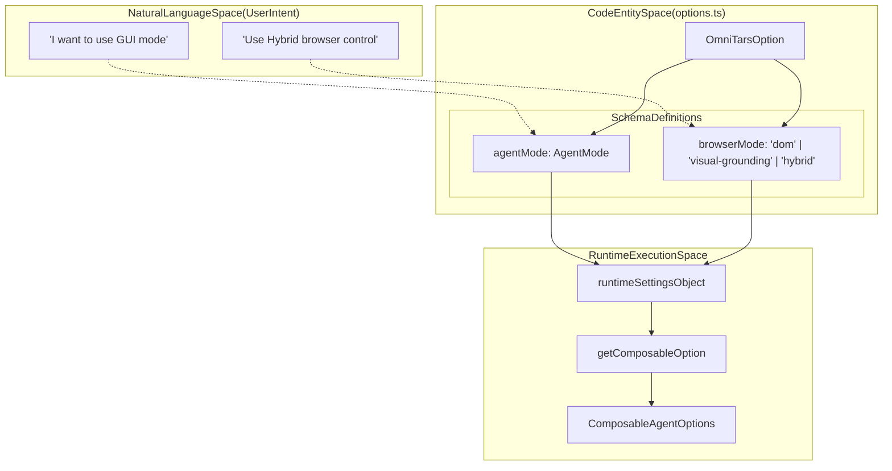
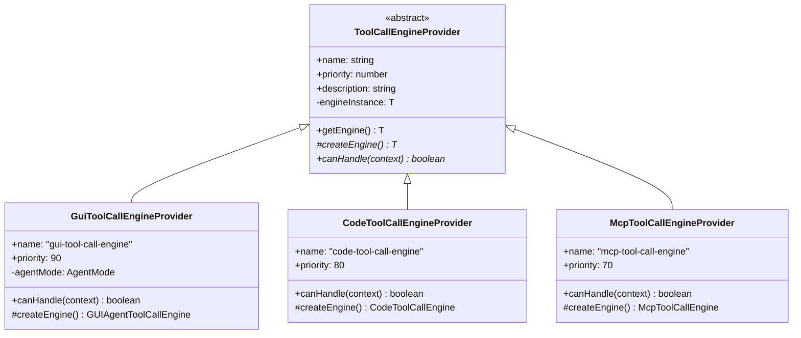
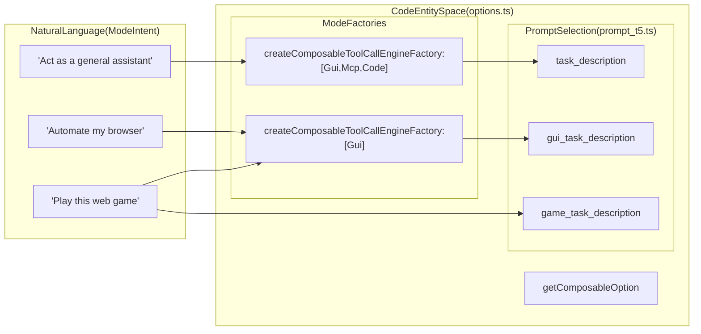

<!-- source: DeepWiki mcp.deepwiki.com · repo bytedance/UI-TARS-desktop · page 3.6 Agent Mode Configuration and Tool Call Engines · fetched 2026-10-30 -->

# Agent Mode Configuration and Tool Call Engines

<details>
<summary>Relevant source files</summary>

The following files were used as context for generating this wiki page:

- [multimodal/omni-tars/code-agent/src/CodeToolCallEngine.ts](multimodal/omni-tars/code-agent/src/CodeToolCallEngine.ts)
- [multimodal/omni-tars/core/src/environments/prompt_t5.ts](multimodal/omni-tars/core/src/environments/prompt_t5.ts)
- [multimodal/omni-tars/core/src/index.ts](multimodal/omni-tars/core/src/index.ts)
- [multimodal/omni-tars/core/src/types.ts](multimodal/omni-tars/core/src/types.ts)
- [multimodal/omni-tars/core/src/utils/streamingParserT5/index.ts](multimodal/omni-tars/core/src/utils/streamingParserT5/index.ts)
- [multimodal/omni-tars/gui-agent/src/GUIAgentToolCallEngine.ts](multimodal/omni-tars/gui-agent/src/GUIAgentToolCallEngine.ts)
- [multimodal/omni-tars/gui-agent/src/GuiToolCallEngineProvider.ts](multimodal/omni-tars/gui-agent/src/GuiToolCallEngineProvider.ts)
- [multimodal/omni-tars/mcp-agent/src/McpToolCallEngine.ts](multimodal/omni-tars/mcp-agent/src/McpToolCallEngine.ts)
- [multimodal/omni-tars/omni-agent/src/options.ts](multimodal/omni-tars/omni-agent/src/options.ts)
- [multimodal/tarko/agent/src/tool-call-engine/NativeToolCallEngine.ts](multimodal/tarko/agent/src/tool-call-engine/NativeToolCallEngine.ts)
- [multimodal/tarko/agent/src/tool-call-engine/PromptEngineeringToolCallEngine.ts](multimodal/tarko/agent/src/tool-call-engine/PromptEngineeringToolCallEngine.ts)

</details>


This document describes the agent mode configuration system and the composable tool call engine architecture. Agent modes (`omni`, `gui`, `game`) determine which capabilities are active and which tool call engines process LLM responses. The runtime settings system allows dynamic reconfiguration of agent behavior without restarting the server.

For information about the base agent execution framework and tool call processing pipeline, see [Core Agent Execution Framework](). For details on the T5 prompt format and streaming parsing, see [T5 Prompt Format and Streaming Parser](). For the composable agent architecture, see [OmniTARS Agent Architecture and Plugin System]().

## Agent Mode Overview

The system supports three distinct agent modes, each optimizing for different use cases:

| Mode | ID | Description | Engines Active | Available Functions |
|------|-----|-------------|----------------|---------------------|
| **Omni** | `omni` | Full-featured multimodal agent with all capabilities | GUI, Code, MCP | All functions (GUI actions, code execution, web search, link reading) |
| **GUI** | `gui` | GUI automation and browser control only | GUI only | GUI actions (click, type, scroll, navigate, etc.) |
| **Game** | `game` | Game automation with preset navigation | GUI only (restricted) | GUI actions (excluding navigate/navigate_back) |

**Sources:** [multimodal/omni-tars/core/src/types.ts:65-69](), [multimodal/omni-tars/omni-agent/src/options.ts:54-82]()

### AgentMode Type Definition

The `AgentMode` type defines the structure for mode configuration, including specific browser control strategies.

```typescript
export type AgentMode = {
  id: 'omni' | 'gui' | 'game';
  link?: string;           // For game mode: preset navigation URL
  browserMode?: 'dom' | 'visual-grounding' | 'hybrid';
};
```

**Sources:** [multimodal/omni-tars/core/src/types.ts:65-69]()

## Runtime Settings System

The runtime settings system provides a declarative schema-based configuration mechanism that allows users to select agent modes and other settings through the UI.

### Runtime Settings Schema and Transformation

The following diagram illustrates how natural language configuration requirements are transformed into code entities within the `AgentOptions`.

**Natural Language to Code Entity Mapping: Runtime Settings**



**Sources:** [multimodal/omni-tars/omni-agent/src/options.ts:24-28](), [multimodal/omni-tars/omni-agent/src/options.ts:30-41]()

## Tool Call Engine Provider System

The tool call engine provider system uses the Strategy pattern with priority-based selection to determine which engine handles tool call parsing and execution.

### ToolCallEngineProvider Hierarchy



**Sources:** [multimodal/omni-tars/core/src/types.ts:11-37](), [multimodal/omni-tars/gui-agent/src/GuiToolCallEngineProvider.ts:9-19](), [multimodal/omni-tars/code-agent/src/CodeToolCallEngine.ts:30-30](), [multimodal/omni-tars/mcp-agent/src/McpToolCallEngine.ts:25-25]()

### Priority-Based Engine Selection

Engine providers are sorted by priority (highest first) and the first provider whose `canHandle()` method returns `true` is selected.

| Provider | Priority | Criteria |
|----------|----------|----------|
| `GuiToolCallEngineProvider` | 90 | Tool names include GUI actions (click, type, scroll, etc.) or `<computer_env>` tags in LLM output. |
| `CodeToolCallEngineProvider` | 80 | Logic typically based on code-related tools. |
| `McpToolCallEngineProvider` | 70 | Logic typically based on MCP-related tools. |

**Sources:** [multimodal/omni-tars/gui-agent/src/GuiToolCallEngineProvider.ts:11-69]()

## Mode-to-Engine Mapping

Agent modes determine which tool call engine providers are instantiated and which system prompts are used.

**Natural Language to Code Entity Mapping: Agent Modes**



**Sources:** [multimodal/omni-tars/omni-agent/src/options.ts:54-82](), [multimodal/omni-tars/core/src/environments/prompt_t5.ts:18-34]()

### Implementation in getComposableOption

The `getComposableOption` function implements the mode-to-engine mapping by switching on `agentMode.id`.

```typescript
switch (agentMode.id) {
  case 'game':
  case 'gui':
    baseOptions.toolCallEngine = createComposableToolCallEngineFactory({
      engines: [new GuiToolCallEngineProvider(agentMode)],
    });
    baseOptions.plugins = [guiPlugin];
    break;
  case 'omni':
  default:
    baseOptions.toolCallEngine = createComposableToolCallEngineFactory({
      engines: [
        new GuiToolCallEngineProvider(agentMode),
        new McpToolCallEngineProvider(),
        new CodeToolCallEngineProvider(),
      ],
    });
    baseOptions.plugins = [
      mcpPluginBuilder({...}),
      codePluginBuilder({...}),
      guiPlugin,
    ];
    break;
}
```

**Sources:** [multimodal/omni-tars/omni-agent/src/options.ts:54-82]()

## Tool Call Engine Implementations

### GUIAgentToolCallEngine

The `GUIAgentToolCallEngine` is a specialized engine for visual and GUI tasks. It integrates the T5 prompt format and a specific adapter for browser vision control.

**Key Responsibilities:**
- **Prompt Preparation**: Uses `createSystemPromptGroup(this.agentMode)` to generate mode-specific instructions [multimodal/omni-tars/gui-agent/src/GUIAgentToolCallEngine.ts:48-50]().
- **Streaming Processing**: Uses `omniProcessStreamingChunk` to handle real-time LLM output [multimodal/omni-tars/gui-agent/src/GUIAgentToolCallEngine.ts:79-84]().
- **Tool Call Finalization**: Uses `GUIAgentT5Adapter` to convert raw T5 tool calls into browser control calls while preserving reasoning content [multimodal/omni-tars/gui-agent/src/GUIAgentToolCallEngine.ts:89-108]().

**Sources:** [multimodal/omni-tars/gui-agent/src/GUIAgentToolCallEngine.ts:34-108]()

### McpToolCallEngine

The `McpToolCallEngine` handles Model Context Protocol tool calls using the T5 format.

**Key Responsibilities:**
- **Content Parsing**: Specifically looks for `mcp_env` tags and parses the inner JSON array of tool calls [multimodal/omni-tars/mcp-agent/src/McpToolCallEngine.ts:62-68]().
- **Format Support**: Supports multiple LLM output formats including `<|FunctionCallBegin|>` and `<|FunctionCallEnd|>` markers [multimodal/omni-tars/mcp-agent/src/McpToolCallEngine.ts:118-188]().

**Sources:** [multimodal/omni-tars/mcp-agent/src/McpToolCallEngine.ts:25-77](), [multimodal/omni-tars/mcp-agent/src/McpToolCallEngine.ts:90-188]()

### Prompt and Environment Configuration

The T5 environment defines the prompt strings and function schemas injected into the LLM context.

| Variable | Description | Source |
|----------|-------------|--------|
| `task_description` | Base professional assistant prompt | [multimodal/omni-tars/core/src/environments/prompt_t5.ts:18-20]() |
| `gui_task_description` | GUI-specific agent prompt | [multimodal/omni-tars/core/src/environments/prompt_t5.ts:21-23]() |
| `game_task_description` | Game-specific prompt with thinking modes | [multimodal/omni-tars/core/src/environments/prompt_t5.ts:24-34]() |
| `mcp_functions` | Definitions for `LinkReader` and `Search` | [multimodal/omni-tars/core/src/environments/prompt_t5.ts:44-47]() |
| `code_functions` | Definitions for `execute_bash` | [multimodal/omni-tars/core/src/environments/prompt_t5.ts:48-50]() |

**Sources:** [multimodal/omni-tars/core/src/environments/prompt_t5.ts:18-50]()

---

