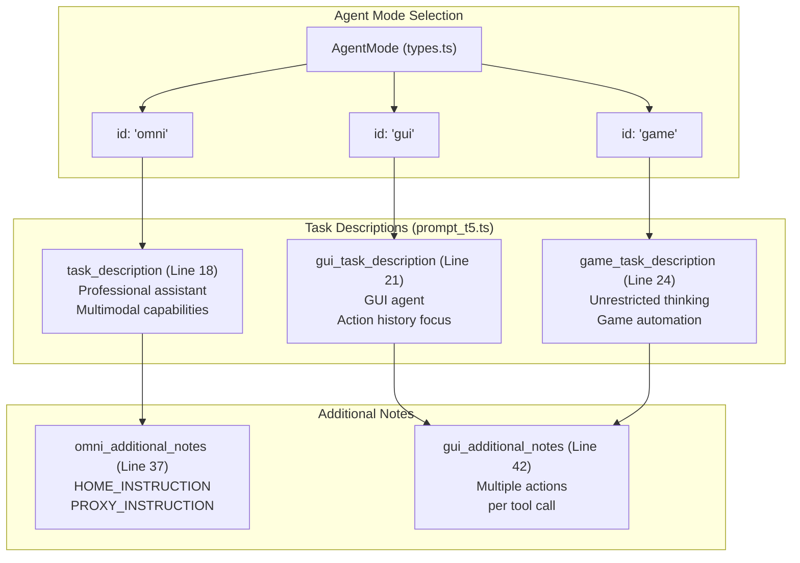
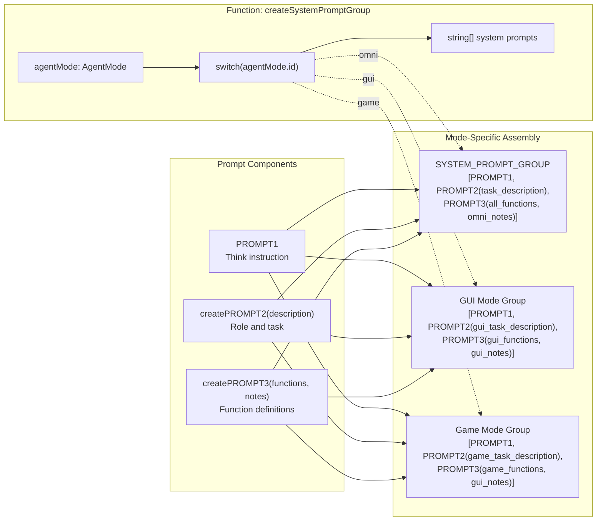
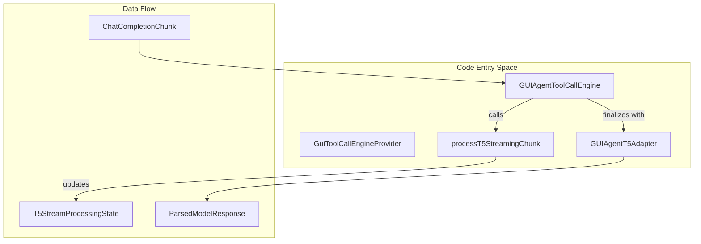

<!-- source: DeepWiki mcp.deepwiki.com · repo bytedance/UI-TARS-desktop · page 3.7 T5 Prompt Format and Streaming Parser · fetched 2026-10-30 -->

# T5 Prompt Format and Streaming Parser

<details>
<summary>Relevant source files</summary>

The following files were used as context for generating this wiki page:

- [multimodal/omni-tars/core/src/environments/prompt_t5.ts](multimodal/omni-tars/core/src/environments/prompt_t5.ts)
- [multimodal/omni-tars/core/src/index.ts](multimodal/omni-tars/core/src/index.ts)
- [multimodal/omni-tars/core/src/types.ts](multimodal/omni-tars/core/src/types.ts)
- [multimodal/omni-tars/core/src/utils/streamingParserT5/index.ts](multimodal/omni-tars/core/src/utils/streamingParserT5/index.ts)
- [multimodal/omni-tars/gui-agent/src/GUIAgentToolCallEngine.ts](multimodal/omni-tars/gui-agent/src/GUIAgentToolCallEngine.ts)
- [multimodal/omni-tars/gui-agent/src/GuiToolCallEngineProvider.ts](multimodal/omni-tars/gui-agent/src/GuiToolCallEngineProvider.ts)
- [multimodal/omni-tars/omni-agent/src/options.ts](multimodal/omni-tars/omni-agent/src/options.ts)

</details>


This document describes the T5 prompt engineering format and its associated streaming parser used in the Omni-TARS agent system. The T5 format uses XML-like tags to structure LLM output into distinct sections for reasoning, tool calls, and chat content. This enables real-time parsing of streaming responses and clear separation of agent thinking from actions.

For information about how tool call engines implement this format, see [3.6 Agent Mode Configuration and Tool Call Engines](). For details on how different agent plugins use these tools, see [3.3 GUI Agent Plugin and Screenshot Processing]().

## T5 Prompt Format Overview

The T5 format is a prompt engineering approach that instructs LLMs to output structured text using specific XML-like tags. This format enables:

- **Reasoning separation**: Think tokens wrap internal reasoning.
- **Tool call structuring**: Nested XML tags define function calls and parameters.
- **Content streaming**: Incremental parsing during LLM response streaming.
- **Multi-function calls**: Multiple tool invocations in a single response.

The format is defined in `multimodal/omni-tars/core/src/environments/prompt_t5.ts` and used across different agent modes (omni, gui, game) with mode-specific variations.

**Sources**: [multimodal/omni-tars/core/src/environments/prompt_t5.ts:1-161]()

## Prompt Structure Components

### Think Token Configuration

The T5 format uses configurable think tokens to wrap reasoning content. These are controlled via environment variables:

| Configuration | Environment Variable | Default Value | Description |
|--------------|---------------------|---------------|-------------|
| `think_token` | `THINK_TOKEN` | `"thinkt"` | Tag name for reasoning sections [multimodal/omni-tars/core/src/environments/prompt_t5.ts:11]() |
| `use_native_thinking` | `NATIVE_THINKING=true` | `false` | Use native model thinking if supported [multimodal/omni-tars/core/src/environments/prompt_t5.ts:12]() |
| `bypass_native_thinking` | `NATIVE_THINKING=bypass` | `false` | Skip thinking prompt instructions [multimodal/omni-tars/core/src/environments/prompt_t5.ts:13]() |

The think token is used in prompt templates like:
`<thinkt> reasoning process here </thinkt> answer here.` [multimodal/omni-tars/core/src/environments/prompt_t5.ts:25]()

### Task Descriptions by Agent Mode

The system provides different task descriptions based on the `AgentMode` [multimodal/omni-tars/core/src/types.ts:65-69]:



**Omni Mode Task Description**: Defines the agent as a "professional personal assistant (Doubao)" with access to various tools for solving user problems. [multimodal/omni-tars/core/src/environments/prompt_t5.ts:18-19]()

**GUI Mode Task Description**: Focuses on GUI automation with task completion using screenshots and action history. [multimodal/omni-tars/core/src/environments/prompt_t5.ts:21-22]()

**Game Mode Task Description**: Includes detailed thinking mode instructions (unrestricted, efficient, no-think, budgeted) and emphasizes trying alternative actions if repeated actions produce no changes. [multimodal/omni-tars/core/src/environments/prompt_t5.ts:24-34]()

**Sources**: [multimodal/omni-tars/core/src/environments/prompt_t5.ts:18-42](), [multimodal/omni-tars/core/src/types.ts:65-69]()

### Function Definitions

The T5 prompt embeds function definitions as JSON strings that describe available tools. These are organized by category:

| Function Category | Variable | Description |
|------------------|----------|-------------|
| MCP Functions | `mcp_functions` | `LinkReader`, `Search` for web access [multimodal/omni-tars/core/src/environments/prompt_t5.ts:44-47]() |
| Code Functions | `code_functions` | `execute_bash`, `str_replace_editor` [multimodal/omni-tars/core/src/environments/prompt_t5.ts:48-52]() |
| GUI Functions | `gui_functions` | Mouse/keyboard actions, navigation [multimodal/omni-tars/core/src/environments/prompt_t5.ts:53-69]() |
| Game Functions | `game_functions` | GUI actions without navigation [multimodal/omni-tars/core/src/environments/prompt_t5.ts:71-85]() |

**Sources**: [multimodal/omni-tars/core/src/environments/prompt_t5.ts:44-85]()

### System Prompt Assembly

The `createSystemPromptGroup` function selects the appropriate prompt components based on agent mode. [multimodal/omni-tars/core/src/environments/prompt_t5.ts:140-161]()



**Sources**: [multimodal/omni-tars/core/src/environments/prompt_t5.ts:87-161]()

## Tool Call Syntax

The T5 format uses nested XML-like tags for tool calls. A single `<seed:tool_call>` block can contain multiple `<function>` elements. [multimodal/omni-tars/core/src/environments/prompt_t5.ts:42]()

### GUI Tool Call Examples

```xml
<seed:tool_call>
<function=click>
<parameter=point><point>450 320</point></parameter>
</function>

<function=type>
<parameter=content>Hello world\n</parameter>
</function>
</seed:tool_call>
```

**Sources**: [multimodal/omni-tars/core/src/environments/prompt_t5.ts:42](), [multimodal/omni-tars/core/src/environments/prompt_t5.ts:53-69]()

## Streaming Parser Architecture

The T5 streaming parser processes LLM response chunks incrementally, extracting reasoning, tool calls, and chat content in real-time.

### T5StreamProcessingState Interface

The parser maintains state across streaming chunks using the `T5StreamProcessingState` interface:

| State Field | Type | Purpose |
|------------|------|---------|
| `currentTag` | `'think' \| 'chat_content' \| 'tool_call' \| null` | Current parsing context [multimodal/omni-tars/core/src/utils/streamingParserT5/index.ts:17]() |
| `insideThink` | `boolean` | Inside think tag [multimodal/omni-tars/core/src/utils/streamingParserT5/index.ts:18]() |
| `thinkBuffer` | `string` | Accumulated reasoning content [multimodal/omni-tars/core/src/utils/streamingParserT5/index.ts:20]() |
| `insideToolCall` | `boolean` | Inside tool call block [multimodal/omni-tars/core/src/utils/streamingParserT5/index.ts:27]() |
| `toolCallBuffer` | `string` | Raw tool call text [multimodal/omni-tars/core/src/utils/streamingParserT5/index.ts:28]() |
| `insideFunction` | `boolean` | Inside function tag [multimodal/omni-tars/core/src/utils/streamingParserT5/index.ts:34]() |
| `currentToolName` | `string` | Current function name [multimodal/omni-tars/core/src/utils/streamingParserT5/index.ts:29]() |
| `insideParameter` | `boolean` | Inside parameter tag [multimodal/omni-tars/core/src/utils/streamingParserT5/index.ts:33]() |
| `currentParameters` | `Record<string, string>` | Accumulated parameters [multimodal/omni-tars/core/src/utils/streamingParserT5/index.ts:30]() |
| `functionCount` | `number` | Count of functions in current tool call [multimodal/omni-tars/core/src/utils/streamingParserT5/index.ts:37]() |

**Sources**: [multimodal/omni-tars/core/src/utils/streamingParserT5/index.ts:15-38]()

### Chunk Processing Flow

The `processT5StreamingChunk` function orchestrates parsing [multimodal/omni-tars/core/src/utils/streamingParserT5/index.ts:88-153]():

1. Extracts `delta.content` from chunk.
2. Appends to `contentBuffer` for full text tracking.
3. Calls extraction functions in sequence:
   - `extractThinkT5`: Returns incremental reasoning content [multimodal/omni-tars/core/src/utils/streamingParserT5/index.ts:114]().
   - `extractToolCallT5`: Returns tool call updates [multimodal/omni-tars/core/src/utils/streamingParserT5/index.ts:117]().
   - `extractChatContentT5`: Returns incremental chat content [multimodal/omni-tars/core/src/utils/streamingParserT5/index.ts:123]().
4. Returns `StreamChunkResult` with all extracted information.

**Sources**: [multimodal/omni-tars/core/src/utils/streamingParserT5/index.ts:88-153]()

## Integration with Tool Call Engines

### Engine Implementations

Multiple specialized engines utilize the T5 parsing logic:

- **GUIAgentToolCallEngine**: Orchestrates GUI-specific T5 parsing. It uses `omniProcessStreamingChunk` [multimodal/omni-tars/gui-agent/src/GUIAgentToolCallEngine.ts:79-84]() and a `GUIAgentT5Adapter` [multimodal/omni-tars/gui-agent/src/GUIAgentToolCallEngine.ts:36]() to convert tool calls into standardized browser/vision control calls [multimodal/omni-tars/gui-agent/src/GUIAgentToolCallEngine.ts:96-108]().
- **CodeToolCallEngine**: Specialized for sandbox code execution. It uses the base T5 prompt logic to handle tool interactions within the code sandbox environment [multimodal/omni-tars/omni-agent/src/options.ts:68]().
- **McpToolCallEngine**: Handles MCP-based tool calls using similar prompt engineering strategies [multimodal/omni-tars/omni-agent/src/options.ts:67]().

### Tool Call Engine Provider Selection

The `GuiToolCallEngineProvider` determines if it can handle a request by checking for GUI-related tool names (e.g., `click`, `drag`, `scroll`, `type`) or specific tags like `<computer_env>` in the model output. [multimodal/omni-tars/gui-agent/src/GuiToolCallEngineProvider.ts:25-69]()



**Sources**: [multimodal/omni-tars/omni-agent/src/options.ts:30-86](), [multimodal/omni-tars/gui-agent/src/GuiToolCallEngineProvider.ts:25-69](), [multimodal/omni-tars/gui-agent/src/GUIAgentToolCallEngine.ts:34-108]()

## T5 Format Export

The T5 format components are exported from `@omni-tars/core` for system-wide use:

```typescript
export { 
  SYSTEM_PROMPT_GROUP, 
  createSystemPromptGroup, 
  think_token 
} from './environments/prompt_t5';

export * from './utils/streamingParserT5';
```

**Sources**: [multimodal/omni-tars/core/src/index.ts:19-21]()

---

