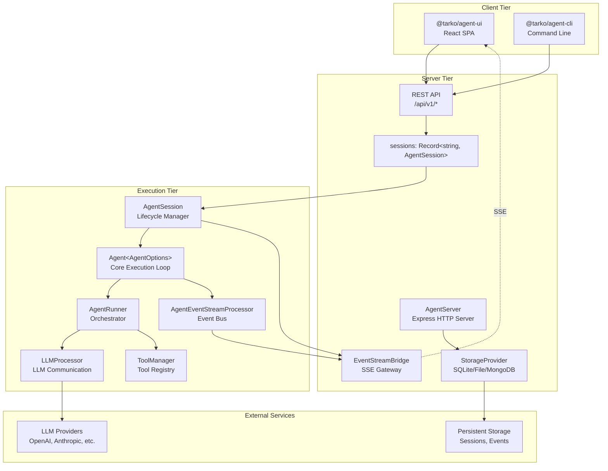
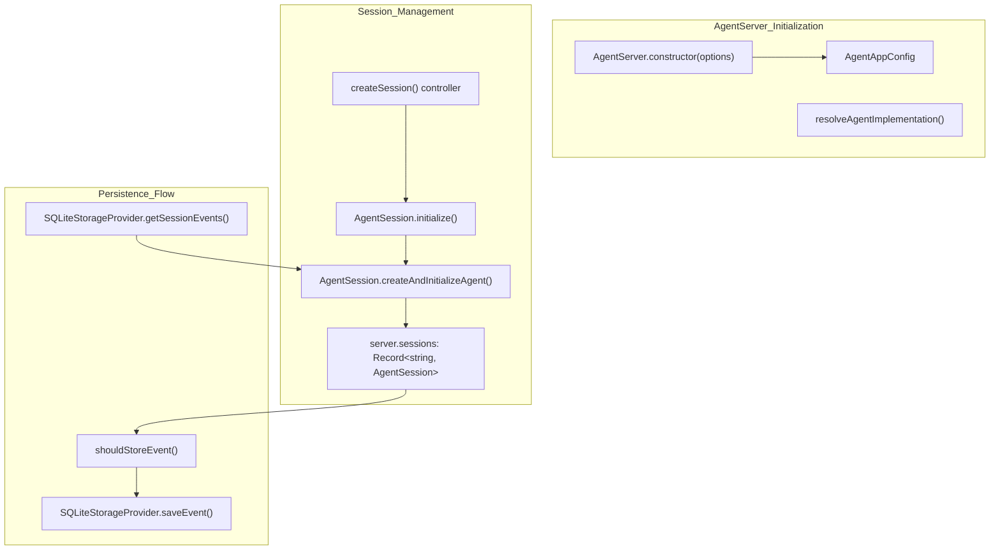
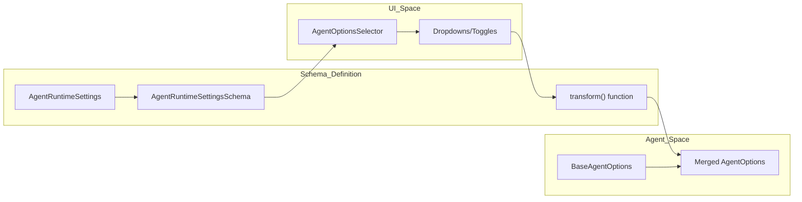

<!-- source: DeepWiki mcp.deepwiki.com · repo bytedance/UI-TARS-desktop · page 4 Tarko Framework · fetched 2026-10-30 -->

# Tarko Framework

Relevant source files

The following files were used as context for generating this wiki page:

- [multimodal/tarko/agent-interface/src/agent-event-stream.ts](multimodal/tarko/agent-interface/src/agent-event-stream.ts)
- [multimodal/tarko/agent-interface/src/agent-options.ts](multimodal/tarko/agent-interface/src/agent-options.ts)
- [multimodal/tarko/agent-server/src/api/controllers/oneshot.ts](multimodal/tarko/agent-server/src/api/controllers/oneshot.ts)
- [multimodal/tarko/agent-server/src/api/controllers/sessions.ts](multimodal/tarko/agent-server/src/api/controllers/sessions.ts)
- [multimodal/tarko/agent-server/src/api/controllers/system.ts](multimodal/tarko/agent-server/src/api/controllers/system.ts)
- [multimodal/tarko/agent-server/src/api/routes/system.ts](multimodal/tarko/agent-server/src/api/routes/system.ts)
- [multimodal/tarko/agent-server/src/core/AgentSession.ts](multimodal/tarko/agent-server/src/core/AgentSession.ts)
- [multimodal/tarko/agent-server/src/server.ts](multimodal/tarko/agent-server/src/server.ts)
- [multimodal/tarko/agent-server/src/storage/SQLiteStorageProvider.ts](multimodal/tarko/agent-server/src/storage/SQLiteStorageProvider.ts)
- [multimodal/tarko/agent-server/src/storage/compatibility.ts](multimodal/tarko/agent-server/src/storage/compatibility.ts)
- [multimodal/tarko/agent-server/src/storage/types.ts](multimodal/tarko/agent-server/src/storage/types.ts)
- [multimodal/tarko/agent-snapshot/src/utils/snapshot-normalizer.ts](multimodal/tarko/agent-snapshot/src/utils/snapshot-normalizer.ts)
- [multimodal/tarko/agent-ui/rsbuild.config.ts](multimodal/tarko/agent-ui/rsbuild.config.ts)
- [multimodal/tarko/agent-ui/src/common/constants/index.ts](multimodal/tarko/agent-ui/src/common/constants/index.ts)
- [multimodal/tarko/agent-ui/src/common/services/apiService.ts](multimodal/tarko/agent-ui/src/common/services/apiService.ts)
- [multimodal/tarko/agent-ui/src/common/state/actions/connectionActions.ts](multimodal/tarko/agent-ui/src/common/state/actions/connectionActions.ts)
- [multimodal/tarko/agent-ui/src/common/types/env.d.ts](multimodal/tarko/agent-ui/src/common/types/env.d.ts)
- [multimodal/tarko/agent-ui/src/config/config-loader.ts](multimodal/tarko/agent-ui/src/config/config-loader.ts)
- [multimodal/tarko/agent-ui/src/config/web-ui-config.ts](multimodal/tarko/agent-ui/src/config/web-ui-config.ts)
- [multimodal/tarko/agent-ui/src/config/webui-config-provider.tsx](multimodal/tarko/agent-ui/src/config/webui-config-provider.tsx)
- [multimodal/tarko/agent-ui/src/entry.tsx](multimodal/tarko/agent-ui/src/entry.tsx)
- [multimodal/tarko/agent-ui/src/standalone/app/App.tsx](multimodal/tarko/agent-ui/src/standalone/app/App.tsx)
- [multimodal/tarko/agent-ui/src/standalone/app/index.tsx](multimodal/tarko/agent-ui/src/standalone/app/index.tsx)
- [multimodal/tarko/agent-ui/src/standalone/share/shareService.ts](multimodal/tarko/agent-ui/src/standalone/share/shareService.ts)
- [multimodal/tarko/agent/snapshot/__snapshots__/index.test.ts.snap](multimodal/tarko/agent/snapshot/__snapshots__/index.test.ts.snap)
- [multimodal/tarko/agent/src/agent/agent-runner.ts](multimodal/tarko/agent/src/agent/agent-runner.ts)
- [multimodal/tarko/agent/src/agent/agent.ts](multimodal/tarko/agent/src/agent/agent.ts)
- [multimodal/tarko/agent/src/agent/runner/llm-processor.ts](multimodal/tarko/agent/src/agent/runner/llm-processor.ts)
- [multimodal/tarko/agent/src/utils/tool-filter.ts](multimodal/tarko/agent/src/utils/tool-filter.ts)
- [multimodal/tarko/agent/tests/agent/llm-processor-usage-streaming.test.ts](multimodal/tarko/agent/tests/agent/llm-processor-usage-streaming.test.ts)
- [multimodal/tarko/interface/src/server.ts](multimodal/tarko/interface/src/server.ts)
- [multimodal/tarko/shared-utils/src/index.ts](multimodal/tarko/shared-utils/src/index.ts)

The Tarko Framework is a modular, event-driven agent framework that provides the foundational infrastructure for building and deploying multimodal LLM agents. It consists of three primary layers: a core agent execution engine (`@tarko/agent`), a server framework for session management and API endpoints (`@tarko/agent-server`), and a React-based web UI (`@tarko/agent-ui`).

This page provides an architectural overview of Tarko's design and component structure. For detailed implementation of specific subsystems, see [Core Agent Execution Framework](#4.1), [Tarko Agent Server Framework](#4.2), [Tarko Agent Web UI](#4.3), and [Agent TARS CLI](#4.4). For information about higher-level agent implementations that extend Tarko, see [Multimodal Agent Stack (Agent TARS / OmniTARS)](#3).

---

## Architecture Overview

Tarko follows a three-tier architecture separating execution logic, session management, and user interface concerns:

### System Architecture Diagram

**Sources:** [multimodal/tarko/agent-server/src/core/AgentSession.ts:65-90](), [multimodal/tarko/agent/src/agent/agent.ts:55-172](), [multimodal/tarko/agent-server/src/server.ts:37-103]()

---

## Core Components

### Agent Execution Layer

The execution layer is implemented in `@tarko/agent` and centered around the `Agent` class, which provides the main entry point for reasoning loops.

| Component | Class/File | Responsibility |
|-----------|------------|----------------|
| **Core Agent** | `Agent<T extends AgentOptions>` | Main entry point for agent execution, manages lifecycle and configuration [multimodal/tarko/agent/src/agent/agent.ts:55-58]() |
| **Runner** | `AgentRunner` | Orchestrates the reasoning loop, coordinates LLM and tool execution [multimodal/tarko/agent/src/agent/agent.ts:154-168]() |
| **Event Stream** | `AgentEventStreamProcessor` | Manages event creation, subscription, and distribution [multimodal/tarko/agent/src/agent/agent.ts:105-108]() |
| **Tool Manager** | `ToolManager` | Maintains tool registry and execution context [multimodal/tarko/agent/src/agent/agent.ts:111-111]() |

**Agent Construction Pattern:**
The `Agent` is initialized with `AgentOptions`, including instructions, tools, and model configuration [multimodal/tarko/agent/src/agent/agent.ts:86-172](). It uses an internal `AgentRunner` to manage the multi-turn reasoning process. For details, see [Core Agent Execution Framework](#4.1).

**Sources:** [multimodal/tarko/agent/src/agent/agent.ts:55-172](), [multimodal/tarko/agent/src/agent/runner/llm-processor.ts:37-63]()

---

### Server Framework Layer

The server layer is implemented in `@tarko/agent-server` and provides HTTP API, session management, and persistence.

### Server Session and Storage Logic

**Sources:** [multimodal/tarko/agent-server/src/api/controllers/sessions.ts:45-142](), [multimodal/tarko/agent-server/src/core/AgentSession.ts:152-220](), [multimodal/tarko/agent-server/src/server.ts:37-103](), [multimodal/tarko/agent-server/src/storage/SQLiteStorageProvider.ts:53-120]()

**Session Lifecycle:**
1. **Creation:** The `createSession` controller generates a `nanoid` ID and initializes `SessionInfo` metadata [multimodal/tarko/agent-server/src/api/controllers/sessions.ts:52-95]().
2. **Initialization:** `AgentSession.initialize()` creates the underlying `IAgent` instance, applying runtime settings transforms [multimodal/tarko/agent-server/src/core/AgentSession.ts:92-107]().
3. **Execution:** Queries are handled via `AgentSession`, which connects the agent's `AgentEventStream` to an `EventStreamBridge` for client delivery [multimodal/tarko/agent-server/src/core/AgentSession.ts:65-90]().

For details, see [Tarko Agent Server Framework](#4.2).

**Sources:** [multimodal/tarko/agent-server/src/api/controllers/sessions.ts:45-142](), [multimodal/tarko/agent-server/src/core/AgentSession.ts:65-220]()

---

### Web UI Layer

The web UI is a React application that communicates with the `AgentServer` via a dedicated `ApiService`.

| Component | Location | Purpose |
|-----------|----------|---------|
| **API Service** | `src/common/services/apiService.ts` | HTTP client for session and query management [multimodal/tarko/agent-ui/src/common/services/apiService.ts:34-115]() |
| **Application Router** | `src/standalone/app/App.tsx` | Manages routing between Home, Creating, and Session pages [multimodal/tarko/agent-ui/src/standalone/app/App.tsx:58-103]() |
| **Config Provider** | `src/config/web-ui-config.ts` | Utilities for loading layout and feature flags [multimodal/tarko/agent-ui/src/config/web-ui-config.ts:113-152]() |

**API Communication:**
The `ApiService` handles CSRF token management and provides methods for creating sessions, fetching event history, and monitoring server health [multimodal/tarko/agent-ui/src/common/services/apiService.ts:42-134](). For details, see [Tarko Agent Web UI](#4.3).

**Sources:** [multimodal/tarko/agent-ui/src/common/services/apiService.ts:1-240](), [multimodal/tarko/agent-ui/src/standalone/app/App.tsx:13-105]()

---

### CLI Infrastructure

The `AgentCLI` provides the command-line entry point for launching the framework in various modes.

- **Serve Mode:** Launches a headless `AgentServer` using the provided configuration.
- **Run Mode:** Executes an agent in either an interactive UI or headless mode.
- **Config Builder:** Merges CLI arguments, environment variables, and workspace configuration files into a unified configuration object.

For details, see [Agent TARS CLI](#4.4).

---

## Configuration and Runtime Settings

Tarko uses a schema-driven configuration system that allows agents to expose adjustable parameters to the UI.

### Configuration Flow

**Sources:** [multimodal/tarko/agent-server/src/core/AgentSession.ts:172-189](), [multimodal/tarko/interface/src/server.ts:4-64]()

**Key Configuration Concepts:**
- **Runtime Settings Schema:** A JSON-schema based definition of properties (boolean, string, number) with UI extensions like `enumLabels` and `icon` [multimodal/tarko/interface/src/server.ts:26-64]().
- **Transformation:** The `transform` function converts UI-friendly settings into the specific options required by the agent's constructor [multimodal/tarko/agent-server/src/core/AgentSession.ts:172-182]().
- **Persistence:** Settings are stored in the session metadata and applied during agent recreation [multimodal/tarko/agent-server/src/api/controllers/sessions.ts:83-86]().

**Sources:** [multimodal/tarko/agent-server/src/api/controllers/sessions.ts:69-95](), [multimodal/tarko/agent-server/src/core/AgentSession.ts:172-189](), [multimodal/tarko/interface/src/server.ts:1-64]()

---

## Event Stream Architecture

Tarko uses a standardized event stream for all agent-client communication.

- **Event Types:** Includes `user_message`, `assistant_message`, `tool_call`, and `assistant_thinking_message` [multimodal/tarko/agent-interface/src/agent-event-stream.ts:37-77]().
- **Streaming:** Real-time updates are delivered via `assistant_streaming_message` and `assistant_streaming_tool_call` to provide immediate feedback [multimodal/tarko/agent-interface/src/agent-event-stream.ts:169-212]().
- **Storage Filtering:** The server filters out high-frequency streaming events (e.g., `assistant_streaming_message`) before persisting to the database to optimize performance [multimodal/tarko/agent-server/src/core/AgentSession.ts:30-40]().

**Sources:** [multimodal/tarko/agent-interface/src/agent-event-stream.ts:29-212](), [multimodal/tarko/agent-server/src/core/AgentSession.ts:30-40]()

---

