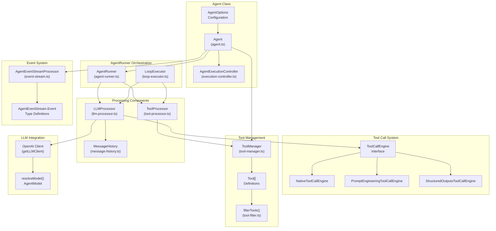
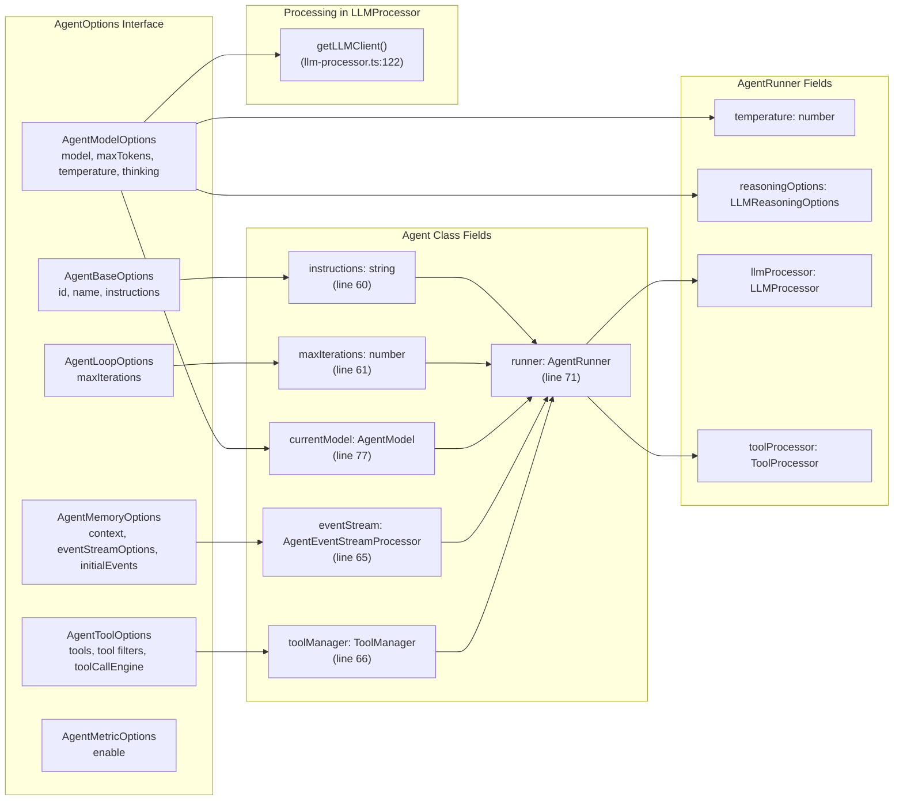
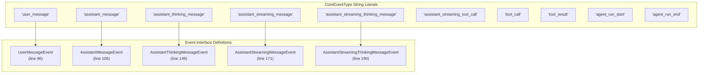

<!-- source: DeepWiki mcp.deepwiki.com · repo bytedance/UI-TARS-desktop · page 4.1 Core Agent Execution Framework · fetched 2026-10-30 -->

# Core Agent Execution Framework

Relevant source files

The following files were used as context for generating this wiki page:

- [multimodal/agent-tars/core/src/environments/local/browser/browser-manager.ts](multimodal/agent-tars/core/src/environments/local/browser/browser-manager.ts)
- [multimodal/tarko/agent-interface/src/agent-event-stream.ts](multimodal/tarko/agent-interface/src/agent-event-stream.ts)
- [multimodal/tarko/agent-interface/src/agent-options.ts](multimodal/tarko/agent-interface/src/agent-options.ts)
- [multimodal/tarko/agent-interface/src/agent.ts](multimodal/tarko/agent-interface/src/agent.ts)
- [multimodal/tarko/agent-interface/src/tool-call-engine.ts](multimodal/tarko/agent-interface/src/tool-call-engine.ts)
- [multimodal/tarko/agent-snapshot/src/utils/snapshot-normalizer.ts](multimodal/tarko/agent-snapshot/src/utils/snapshot-normalizer.ts)
- [multimodal/tarko/agent/snapshot/__snapshots__/index.test.ts.snap](multimodal/tarko/agent/snapshot/__snapshots__/index.test.ts.snap)
- [multimodal/tarko/agent/src/agent/agent-runner.ts](multimodal/tarko/agent/src/agent/agent-runner.ts)
- [multimodal/tarko/agent/src/agent/agent.ts](multimodal/tarko/agent/src/agent/agent.ts)
- [multimodal/tarko/agent/src/agent/runner/llm-processor.ts](multimodal/tarko/agent/src/agent/runner/llm-processor.ts)
- [multimodal/tarko/agent/src/utils/tool-filter.ts](multimodal/tarko/agent/src/utils/tool-filter.ts)
- [multimodal/tarko/agent/tests/agent/llm-processor-usage-streaming.test.ts](multimodal/tarko/agent/tests/agent/llm-processor-usage-streaming.test.ts)
- [multimodal/tarko/llm-client/README.md](multimodal/tarko/llm-client/README.md)
- [multimodal/tarko/llm-client/src/handlers/openai-compatible.ts](multimodal/tarko/llm-client/src/handlers/openai-compatible.ts)
- [multimodal/tarko/llm/README.md](multimodal/tarko/llm/README.md)

## Purpose and Scope

The Core Agent Execution Framework provides the foundational infrastructure for building and running autonomous AI agents in the Tarko framework. This page documents the base agent execution architecture including the `Agent` class, runner orchestration, and core processing logic.

This framework handles:
- Agent lifecycle management and initialization.
- LLM request/response processing and streaming.
- Tool registration, filtering, and execution.
- Multi-turn reasoning loops with iteration control.
- Event-driven communication via `AgentEventStream`.
- Execution control with abort capabilities.

For detailed information on specific components, see:
- Agent class implementation and configuration: [Agent Class and Configuration Options](#4.1.1)
- Runner orchestration and loop execution: [Agent Runner and Loop Executor](#4.1.2)
- LLM integration and streaming: [LLM Processing and Streaming Pipeline](#4.1.3)
- Tool call strategies: [Tool Call Engine Interface and Strategies](#4.1.4)
- Agent event architecture: [Agent Event Stream Architecture](#4.1.5)

For server-side session management built on top of this framework, see [Tarko Agent Server Framework](#4.2).

**Sources:** [multimodal/tarko/agent/src/agent/agent.ts:1-172](), [multimodal/tarko/agent-interface/src/agent.ts:34-138]()

## Architecture Overview

The Core Agent Execution Framework follows a modular architecture where the `Agent` class serves as the main entry point, delegating specialized tasks to dedicated components. The framework supports both streaming and non-streaming execution modes, with comprehensive event tracking throughout the execution lifecycle.

### Component Architecture Diagram

**Sources:** [multimodal/tarko/agent/src/agent/agent.ts:55-172](), [multimodal/tarko/agent/src/agent/runner/llm-processor.ts:37-63](), [multimodal/tarko/agent-interface/src/tool-call-engine.ts:188-235]()

## Key Components and Their Roles

### Agent Class

The `Agent` class ([multimodal/tarko/agent/src/agent/agent.ts:55-172]()) is the primary interface for creating and running agents. It extends `BaseAgent` and implements the `IAgent` interface, providing:

- **Configuration Management**: Accepts `AgentOptions` covering instructions, tools, model settings, loop control, memory, and metrics ([multimodal/tarko/agent-interface/src/agent-options.ts:1-237]()).
- **Tool Registration**: Via `registerTool()` ([multimodal/tarko/agent/src/agent/agent.ts:203-205]()) and `getTools()` ([multimodal/tarko/agent-interface/src/agent.ts:109-113]()).
- **Execution Entry Points**: Overloaded `run()` methods supporting string input, streaming, and non-streaming modes ([multimodal/tarko/agent-interface/src/agent.ts:51-69]()).
- **Lifecycle Hooks**: Methods like `onLLMRequest`, `onLLMResponse`, and `onEachAgentLoopStart` allow subclasses to intercept and customize behavior ([multimodal/tarko/agent-interface/src/agent.ts:140-216]()).
- **Abort Control**: Via `AgentExecutionController` ([multimodal/tarko/agent/src/agent/agent.ts:171]()).
- **LLM Access**: `setCustomLLMClient()` for testing and custom implementations ([multimodal/tarko/agent/src/agent/agent.ts:181-185]()).

**Sources:** [multimodal/tarko/agent/src/agent/agent.ts:55-217](), [multimodal/tarko/agent-interface/src/agent-options.ts:1-260](), [multimodal/tarko/agent-interface/src/agent.ts:38-137]()

### AgentRunner and LLMProcessor

The `AgentRunner` coordinates execution ([multimodal/tarko/agent/src/agent/agent-runner.ts:55-117]()), while the `LLMProcessor` class ([multimodal/tarko/agent/src/agent/runner/llm-processor.ts:37-63]()) manages all LLM interactions:

- **Request Preparation**: Builds message history and integrates tool definitions via `onPrepareRequest` ([multimodal/tarko/agent/src/agent/runner/llm-processor.ts:160-189]()).
- **Streaming Processing**: Handles chunk-by-chunk processing with state accumulation via `processStreamingChunk` ([multimodal/tarko/agent-interface/src/tool-call-engine.ts:225]()).
- **Event Emission**: Creates streaming message, thinking, and tool call events.
- **Metrics Tracking**: Calculates TTFT (Time to First Token) and TTLT (Time to Last Token) when enabled ([multimodal/tarko/agent/src/agent/runner/llm-processor.ts:55-62]()).
- **Hook Integration**: Intercepts requests to allow the agent to modify them via `onLLMRequest` ([multimodal/tarko/agent/src/agent/runner/llm-processor.ts:127-134]()).

**Sources:** [multimodal/tarko/agent/src/agent/runner/llm-processor.ts:1-202](), [multimodal/tarko/agent-interface/src/tool-call-engine.ts:225-235](), [multimodal/tarko/agent/src/agent/agent-runner.ts:55-117]()

### ToolManager and Tool Filtering

The `ToolManager` handles tool registration and retrieval ([multimodal/tarko/agent/src/agent/agent.ts:111]()), while the `filterTools()` utility ([multimodal/tarko/agent/src/utils/tool-filter.ts:16-18]()) applies include/exclude patterns defined in `AgentToolFilterOptions` ([multimodal/tarko/agent-interface/src/agent-options.ts:107]()).

Tool filtering supports:
- `include`: Array of strings to match tool names (applied first).
- `exclude`: Array of strings to exclude tool names (applied after include).

**Sources:** [multimodal/tarko/agent/src/utils/tool-filter.ts:1-18](), [multimodal/tarko/agent-interface/src/agent-options.ts:107-147]()

### Event Stream System

The `AgentEventStream` namespace ([multimodal/tarko/agent-interface/src/agent-event-stream.ts:29-77]()) defines a comprehensive event type system for tracking agent execution:

**Event Categories:**
- **Conversation**: `user_message`, `assistant_message`, `assistant_thinking_message` ([multimodal/tarko/agent-interface/src/agent-event-stream.ts:41-43]()).
- **Streaming**: `assistant_streaming_message`, `assistant_streaming_thinking_message`, `assistant_streaming_tool_call` ([multimodal/tarko/agent-interface/src/agent-event-stream.ts:48-50]()).
- **Tools**: `tool_call`, `tool_result` ([multimodal/tarko/agent-interface/src/agent-event-stream.ts:55-56]()).
- **Lifecycle**: `agent_run_start`, `agent_run_end` ([multimodal/tarko/agent-interface/src/agent-event-stream.ts:62-63]()).
- **Environment**: `environment_input`, `plan_start`, `plan_update`, `plan_finish` ([multimodal/tarko/agent-interface/src/agent-event-stream.ts:68-71]()).
- **Final Output**: `final_answer`, `final_answer_streaming` ([multimodal/tarko/agent-interface/src/agent-event-stream.ts:76-77]()).

The `AgentEventStreamProcessor` implements the event management logic, handling initial events and real-time emission ([multimodal/tarko/agent/src/agent/agent.ts:105-108]()).

**Sources:** [multimodal/tarko/agent-interface/src/agent-event-stream.ts:1-208](), [multimodal/tarko/agent/src/agent/agent.ts:105-108]()

## Code Entity Mapping

### Agent Configuration to Code Entities

The following diagram maps configuration options from `AgentOptions` to their corresponding code entities and processing locations:

**Sources:** [multimodal/tarko/agent/src/agent/agent.ts:86-172](), [multimodal/tarko/agent-interface/src/agent-options.ts:35-226](), [multimodal/tarko/agent/src/agent/runner/llm-processor.ts:121-136]()

### Event Types to Event Stream Definitions

This diagram maps the event type strings defined in `AgentEventStream` to the actual event interfaces:

**Sources:** [multimodal/tarko/agent-interface/src/agent-event-stream.ts:37-78](), [multimodal/tarko/agent-interface/src/agent-event-stream.ts:96-204]()

## Tool Call Engine Strategy Pattern

The framework uses a strategy pattern for tool calling, supporting three built-in implementations:

| Engine Type | Class Name | Use Case |
|-------------|-----------|----------|
| `'native'` | `NativeToolCallEngine` | OpenAI-compatible native function calling |
| `'prompt_engineering'` | `PromptEngineeringToolCallEngine` | Prompt-based tool calling for non-compatible models |
| `'structured_outputs'` | `StructuredOutputsToolCallEngine` | JSON schema-based structured outputs |

Custom engines can be provided by passing a constructor function to `toolCallEngine` in `AgentOptions` ([multimodal/tarko/agent-interface/src/agent-options.ts:126-146]()). The engine is responsible for preparing prompts, requests, and processing streaming chunks ([multimodal/tarko/agent-interface/src/tool-call-engine.ts:188-235]()).

**Sources:** [multimodal/tarko/agent-interface/src/tool-call-engine.ts:188-235](), [multimodal/tarko/agent-interface/src/agent-options.ts:126-146]()

## Metrics and Performance Tracking

When `metric.enable` is set to `true` in `AgentOptions` ([multimodal/tarko/agent-interface/src/agent-options.ts:201-209]()), the framework tracks:

- **TTFT (Time to First Token)**: Measured from request start to first content chunk ([multimodal/tarko/agent-interface/src/agent-event-stream.ts:128]()).
- **TTLT (Time to Last Token)**: Measured from request start to response completion ([multimodal/tarko/agent-interface/src/agent-event-stream.ts:137]()).
- **Thinking Duration**: Time spent generating reasoning content ([multimodal/tarko/agent-interface/src/agent-event-stream.ts:159]()).

These metrics are extracted from LLM responses and chunks, then included in the corresponding event objects ([multimodal/tarko/agent/tests/agent/llm-processor-usage-streaming.test.ts:15-100]()).

**Sources:** [multimodal/tarko/agent/src/agent/runner/llm-processor.ts:55-62](), [multimodal/tarko/agent-interface/src/agent-event-stream.ts:128-159](), [multimodal/tarko/agent/tests/agent/llm-processor-usage-streaming.test.ts:15-100]()

## Streaming Tool Call Events

By default, the framework does not emit `assistant_streaming_tool_call` events. This can be enabled by setting `enableStreamingToolCallEvents: true` in `AgentOptions` ([multimodal/tarko/agent-interface/src/agent-options.ts:180-186]()).

When enabled, the system emits incremental updates via `assistant_streaming_tool_call` events. The `argumentsDelta` field contains only the incremental part to optimize performance ([multimodal/tarko/agent-interface/src/tool-call-engine.ts:133]()).

**Note:** `StructuredOutputsToolCallEngine` does not support streaming tool call events ([multimodal/tarko/agent/src/agent/runner/llm-processor.ts:110-118]()).

**Sources:** [multimodal/tarko/agent/src/agent/runner/llm-processor.ts:110-118](), [multimodal/tarko/agent-interface/src/tool-call-engine.ts:125-137](), [multimodal/tarko/agent-interface/src/agent-options.ts:180-186]()

---

