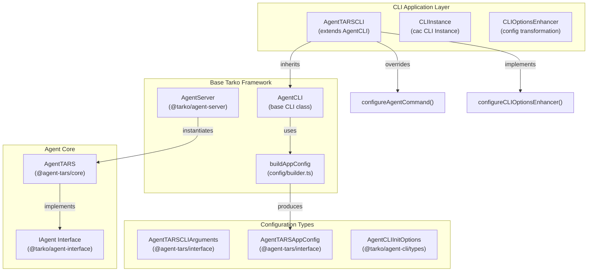
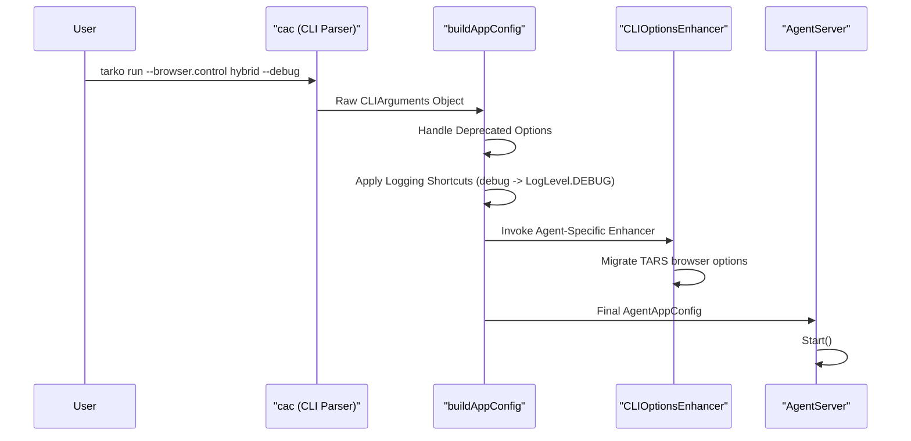
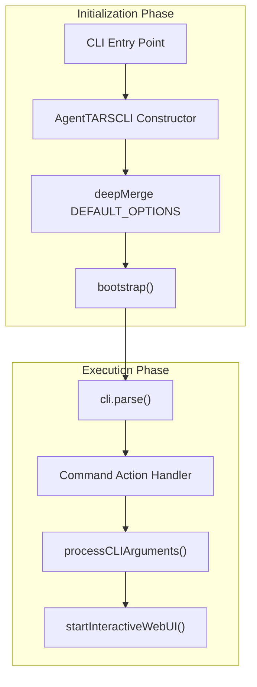

<!-- source: DeepWiki mcp.deepwiki.com · repo bytedance/UI-TARS-desktop · page 4.4 Agent TARS CLI · fetched 2026-10-30 -->

# Agent TARS CLI

Relevant source files

The following files were used as context for generating this wiki page:

- [multimodal/agent-tars/cli/src/index.ts](multimodal/agent-tars/cli/src/index.ts)
- [multimodal/agent-tars/interface/src/constants.ts](multimodal/agent-tars/interface/src/constants.ts)
- [multimodal/omni-tars/core/README.md](multimodal/omni-tars/core/README.md)
- [multimodal/omni-tars/core/tsconfig.json](multimodal/omni-tars/core/tsconfig.json)
- [multimodal/omni-tars/omni-agent/src/index.ts](multimodal/omni-tars/omni-agent/src/index.ts)
- [multimodal/tarko/agent-cli/README.md](multimodal/tarko/agent-cli/README.md)
- [multimodal/tarko/agent-cli/src/config/builder.ts](multimodal/tarko/agent-cli/src/config/builder.ts)
- [multimodal/tarko/agent-cli/src/config/loader.ts](multimodal/tarko/agent-cli/src/config/loader.ts)
- [multimodal/tarko/agent-cli/src/config/paths.ts](multimodal/tarko/agent-cli/src/config/paths.ts)
- [multimodal/tarko/agent-cli/src/core/cli.ts](multimodal/tarko/agent-cli/src/core/cli.ts)
- [multimodal/tarko/agent-cli/src/core/commands/start.ts](multimodal/tarko/agent-cli/src/core/commands/start.ts)
- [multimodal/tarko/agent-cli/src/core/options.ts](multimodal/tarko/agent-cli/src/core/options.ts)
- [multimodal/tarko/agent-cli/src/utils/workspace-path.ts](multimodal/tarko/agent-cli/src/utils/workspace-path.ts)
- [multimodal/tarko/agent-cli/tests/config-builder.test.ts](multimodal/tarko/agent-cli/tests/config-builder.test.ts)
- [multimodal/tarko/agent-interface/src/agent-constructor.ts](multimodal/tarko/agent-interface/src/agent-constructor.ts)
- [multimodal/tarko/agent-server/src/types.ts](multimodal/tarko/agent-server/src/types.ts)
- [multimodal/tarko/agent-ui/src/standalone/components/ThemeToggle.tsx](multimodal/tarko/agent-ui/src/standalone/components/ThemeToggle.tsx)
- [multimodal/tarko/agent-ui/src/standalone/components/index.ts](multimodal/tarko/agent-ui/src/standalone/components/index.ts)
- [multimodal/tarko/agent-ui/src/standalone/home/CreatingPage.tsx](multimodal/tarko/agent-ui/src/standalone/home/CreatingPage.tsx)
- [multimodal/tarko/agent-ui/src/standalone/home/WelcomeCards.tsx](multimodal/tarko/agent-ui/src/standalone/home/WelcomeCards.tsx)
- [multimodal/tarko/agent-ui/src/standalone/home/WelcomePage.tsx](multimodal/tarko/agent-ui/src/standalone/home/WelcomePage.tsx)
- [multimodal/tarko/interface/src/cli.ts](multimodal/tarko/interface/src/cli.ts)
- [multimodal/tarko/interface/src/web-ui-implementation.ts](multimodal/tarko/interface/src/web-ui-implementation.ts)
- [multimodal/websites/tarko/docs/en/guide/cli/_meta.json](multimodal/websites/tarko/docs/en/guide/cli/_meta.json)
- [multimodal/websites/tarko/docs/en/guide/cli/built-in-agents.mdx](multimodal/websites/tarko/docs/en/guide/cli/built-in-agents.mdx)
- [multimodal/websites/tarko/docs/en/guide/cli/commands.mdx](multimodal/websites/tarko/docs/en/guide/cli/commands.mdx)
- [multimodal/websites/tarko/docs/en/guide/cli/configuration.mdx](multimodal/websites/tarko/docs/en/guide/cli/configuration.mdx)
- [multimodal/websites/tarko/docs/en/guide/cli/overview.mdx](multimodal/websites/tarko/docs/en/guide/cli/overview.mdx)
- [multimodal/websites/tarko/docs/en/guide/deployment/cli.mdx](multimodal/websites/tarko/docs/en/guide/deployment/cli.mdx)
- [multimodal/websites/tarko/docs/zh/guide/cli/_meta.json](multimodal/websites/tarko/docs/zh/guide/cli/_meta.json)
- [multimodal/websites/tarko/docs/zh/guide/cli/built-in-agents.mdx](multimodal/websites/tarko/docs/zh/guide/cli/built-in-agents.mdx)
- [multimodal/websites/tarko/docs/zh/guide/deployment/cli.mdx](multimodal/websites/tarko/docs/zh/guide/deployment/cli.mdx)

## Purpose and Scope

This document describes the **Agent TARS CLI** application, a command-line interface for executing Agent TARS multimodal agents. The CLI provides a terminal-based interface for configuring and running agents with browser control, planning, and search capabilities. It extends the base Tarko CLI framework with Agent TARS-specific configuration options and initialization logic.

For information about the underlying CLI framework that Agent TARS extends, see the base Tarko framework documentation under [Core Agent Execution Framework](). For details about the web-based user interface, see [Tarko Agent Web UI](). For the desktop application, see [UI-TARS Desktop Application]().

## Architecture Overview

The Agent TARS CLI is implemented as an extension of the Tarko `AgentCLI` base class [multimodal/tarko/agent-cli/src/core/cli.ts:39-40](), adding Agent TARS-specific configuration options while inheriting core functionality like session management, streaming execution, and storage configuration.

### System to Code Entity Mapping

The following diagram maps high-level CLI concepts to their specific implementations in the codebase.

**Diagram: Agent TARS CLI Code Entity Map**

Sources: [multimodal/agent-tars/cli/src/index.ts:56-155](), [multimodal/tarko/agent-cli/src/core/cli.ts:39-71](), [multimodal/tarko/agent-cli/src/config/builder.ts:38-47]()

## Class Structure and Inheritance

The `AgentTARSCLI` class serves as the entry point for the command-line application. It inherits from the base `AgentCLI` framework and overrides specific methods to customize behavior [multimodal/agent-tars/cli/src/index.ts:56-155]().

### Key Components

| Component | Purpose | Location |
|-----------|---------|----------|
| `AgentTARSCLI` | Main CLI class extending base framework | [multimodal/agent-tars/cli/src/index.ts:56-155]() |
| `DEFAULT_OPTIONS` | Default initialization configuration including `AgentTARS` constructor | [multimodal/agent-tars/cli/src/index.ts:28-51]() |
| `configureAgentCommand` | Adds Agent TARS-specific CLI options (browser, planner, search) | [multimodal/agent-tars/cli/src/index.ts:62-93]() |
| `configureCLIOptionsEnhancer` | Transforms CLI arguments to app config with backward compatibility | [multimodal/agent-tars/cli/src/index.ts:99-125]() |
| `printLogo` | Displays custom ASCII art welcome screen | [multimodal/agent-tars/cli/src/index.ts:130-154]() |

Sources: [multimodal/agent-tars/cli/src/index.ts:28-155]()

## Execution Modes

The CLI supports multiple execution modes through different commands registered in the base `AgentCLI` class [multimodal/tarko/agent-cli/src/core/cli.ts:123-128]().

| Command | Execution Mode | Behavior |
|---------|----------------|----------|
| `tarko run` | **Interactive/Headless** | Default command. Launches Web UI or runs direct query if `--headless` is set [multimodal/tarko/agent-cli/src/core/cli.ts:176-202](). |
| `tarko serve` | **Headless Server** | Launches a headless Agent Server for API-based integration [multimodal/tarko/agent-cli/src/core/cli.ts:144-170](). |
| `tarko request` | **Direct LLM** | Direct LLM requests for debugging and testing [multimodal/tarko/agent-cli/src/core/cli.ts:126]() |
| `tarko workspace`| **Management** | Workspace utilities (init, open, status) [multimodal/tarko/agent-cli/src/core/cli.ts:127]() |

Sources: [multimodal/tarko/agent-cli/src/core/cli.ts:111-128](), [multimodal/tarko/agent-cli/README.md:52-104]()

## Command-Line Options

The CLI extends the base framework's common options [multimodal/tarko/agent-cli/src/core/options.ts:17-140]() with Agent TARS-specific configuration for browser control, planning, and search functionality.

### Common Options (Tarko Framework)

The `addCommonOptions` function populates commands with standard parameters [multimodal/tarko/agent-cli/src/core/options.ts:17-140]().

| Option | Description | Default |
|--------|-------------|---------|
| `--port` | Server port | `8888` [multimodal/tarko/agent-cli/src/core/options.ts:12]() |
| `--config, -c` | Path to config files/URLs | `agent.config.*` [multimodal/tarko/agent-cli/src/core/options.ts:35]() |
| `--logLevel` | debug, info, warn, error | - |
| `--debug` | Enable debug mode (highest priority) | `false` [multimodal/tarko/agent-cli/src/core/options.ts:42]() |
| `--model.provider`| LLM provider name | - |
| `--model.id` | Model identifier | - |
| `--tool.include` | Include specific tools | - |
| `--mcpServer.include`| Include specific MCP servers | - |

Sources: [multimodal/tarko/agent-cli/src/core/options.ts:17-140]()

### Agent TARS Specific Options

Registered via `configureAgentCommand` in the `AgentTARSCLI` subclass [multimodal/agent-tars/cli/src/index.ts:62-93]().

| Option | Description | Supported Values |
|--------|-------------|------------------|
| `--browser.control` | Browser control mode | `hybrid`, `dom`, `visual-grounding` [multimodal/agent-tars/cli/src/index.ts:75]() |
| `--browser.cdpEndpoint` | CDP endpoint URL | e.g. `http://127.0.0.1:9222` [multimodal/agent-tars/cli/src/index.ts:77-79]() |
| `--planner.enable` | Enable task planning | `true` / `false` [multimodal/agent-tars/cli/src/index.ts:82]() |
| `--search.provider` | Search engine | `browser_search`, `tavily`, `bing_search` [multimodal/agent-tars/cli/src/index.ts:87-89]() |
| `--search.count` | Result count | `10` (default) [multimodal/agent-tars/cli/src/index.ts:90]() |

Sources: [multimodal/agent-tars/cli/src/index.ts:65-92]()

## Configuration Transformation Flow

The CLI implements a transformation system that converts raw CLI arguments into the structured `AgentAppConfig` format used by the server and agent runner. This is orchestrated by `buildAppConfig` [multimodal/tarko/agent-cli/src/config/builder.ts:38-47]().

**Diagram: Configuration Transformation Flow**

### Deprecated Option Handling

The `configureCLIOptionsEnhancer` method implements backward compatibility by detecting deprecated options and migrating them to the new format [multimodal/agent-tars/cli/src/index.ts:99-125]():

1. **Detection**: Check for `browserControl` or `browserCdpEndpoint` in CLI arguments [multimodal/agent-tars/cli/src/index.ts:104]().
2. **Migration**: 
   - Map `--browser-control` → `browser.control` [multimodal/agent-tars/cli/src/index.ts:115-117]().
   - Map `--browser-cdp-endpoint` → `browser.cdpEndpoint` [multimodal/agent-tars/cli/src/index.ts:120-122]().

Sources: [multimodal/agent-tars/cli/src/index.ts:99-125](), [multimodal/tarko/agent-cli/src/config/builder.ts:85-112]()

## Initialization and Execution Flow

The initialization process involves merging default configuration, setting up the agent server, and preparing for agent execution.

**Diagram: CLI Initialization and Execution Flow**

### Interactive UI Start

When running in interactive mode (default), the CLI invokes `startInteractiveWebUI` [multimodal/tarko/agent-cli/src/core/commands/start.ts:26-28](). This function:
1. Validates the Web UI static path [multimodal/tarko/agent-cli/src/core/commands/start.ts:35-41]().
2. Instantiates `AgentServer` with the processed options [multimodal/tarko/agent-cli/src/core/commands/start.ts:48]().
3. Configures Express to serve the React-based Web UI and injects the runtime configuration into `window.AGENT_WEB_UI_CONFIG` [multimodal/tarko/agent-cli/src/core/commands/start.ts:127-134]().

Sources: [multimodal/tarko/agent-cli/src/core/commands/start.ts:26-109](), [multimodal/tarko/agent-cli/src/core/cli.ts:62-71]()

## Welcome Logo Customization

The CLI displays a custom ASCII art logo when starting up. The `printLogo` method overrides the base implementation to display dual ASCII art renderings: "AGENT" and "TARS" [multimodal/agent-tars/cli/src/index.ts:130-154]().

### Build Metadata

Version information and build metadata are injected during the build process:
- **version**: From `package.json` [multimodal/agent-tars/cli/src/index.ts:31]().
- **buildTime**: Compile-time constant `__BUILD_TIME__` [multimodal/agent-tars/cli/src/index.ts:32]().
- **gitHash**: Compile-time constant `__GIT_HASH__` [multimodal/agent-tars/cli/src/index.ts:33]().

Sources: [multimodal/agent-tars/cli/src/index.ts:28-51](), [multimodal/agent-tars/cli/src/index.ts:130-154]()

---

