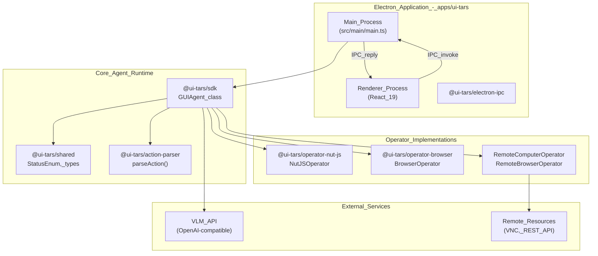
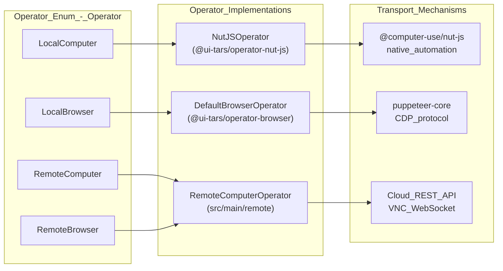
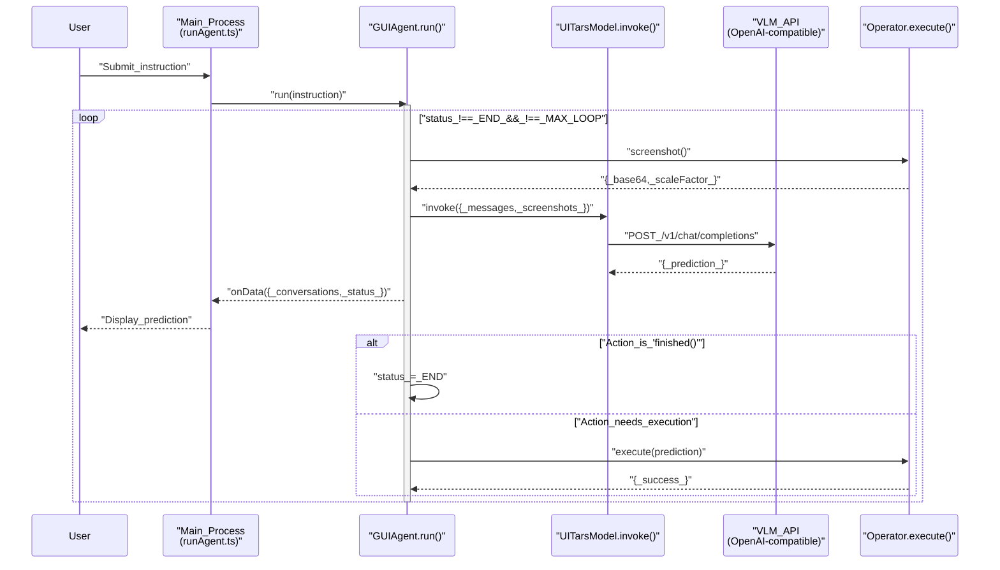
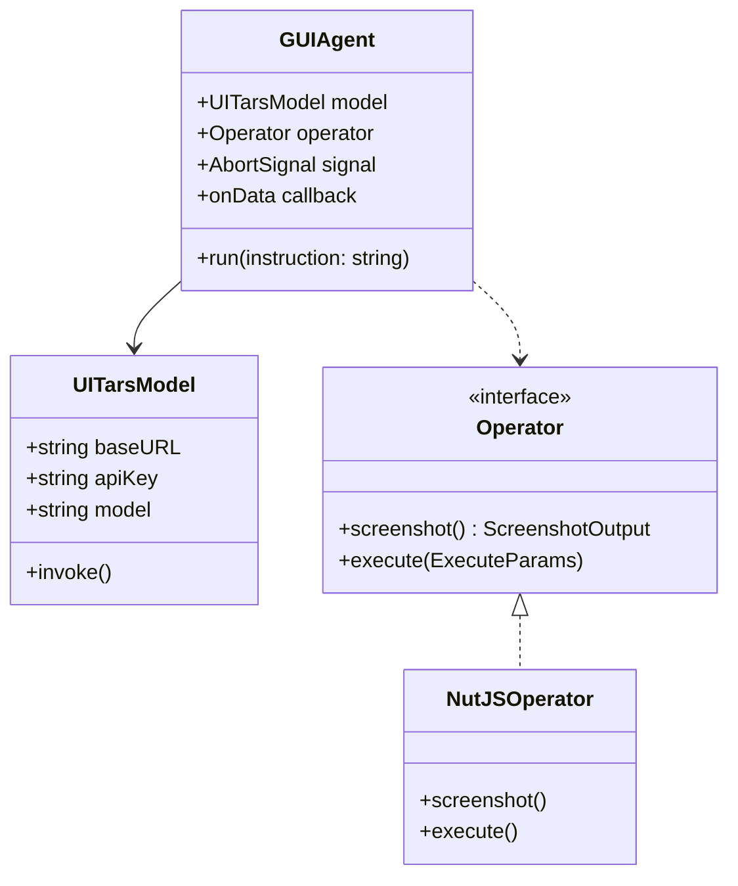
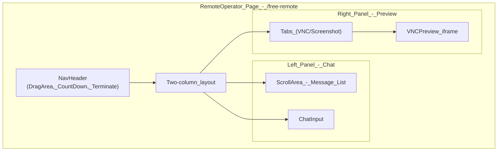

<!-- source: DeepWiki mcp.deepwiki.com · repo bytedance/UI-TARS-desktop · page 5 UI-TARS Desktop Application · fetched 2026-10-30 -->

# UI-TARS Desktop Application

Relevant source files

The following files were used as context for generating this wiki page:

- [README.md](README.md)
- [README.zh-CN.md](README.zh-CN.md)
- [apps/ui-tars/forge.config.ts](apps/ui-tars/forge.config.ts)
- [apps/ui-tars/images/mac_app.png](apps/ui-tars/images/mac_app.png)
- [apps/ui-tars/images/quick_start/base_url.png](apps/ui-tars/images/quick_start/base_url.png)
- [apps/ui-tars/images/quick_start/start_button.png](apps/ui-tars/images/quick_start/start_button.png)
- [apps/ui-tars/package.json](apps/ui-tars/package.json)
- [apps/ui-tars/resources/app-update.yml](apps/ui-tars/resources/app-update.yml)
- [apps/ui-tars/src/main/electron-updater/GitHubProvider.ts](apps/ui-tars/src/main/electron-updater/GitHubProvider.ts)
- [apps/ui-tars/src/main/ipcRoutes/window.ts](apps/ui-tars/src/main/ipcRoutes/window.ts)
- [apps/ui-tars/src/main/main.ts](apps/ui-tars/src/main/main.ts)
- [apps/ui-tars/src/main/remote/shared.ts](apps/ui-tars/src/main/remote/shared.ts)
- [apps/ui-tars/src/main/shared/constants.ts](apps/ui-tars/src/main/shared/constants.ts)
- [apps/ui-tars/src/main/utils/updateApp.ts](apps/ui-tars/src/main/utils/updateApp.ts)
- [apps/ui-tars/src/main/window/createWindow.ts](apps/ui-tars/src/main/window/createWindow.ts)
- [apps/ui-tars/src/renderer/src/components/CountDown/index.tsx](apps/ui-tars/src/renderer/src/components/CountDown/index.tsx)
- [apps/ui-tars/src/renderer/src/const/index.ts](apps/ui-tars/src/renderer/src/const/index.ts)
- [apps/ui-tars/src/renderer/src/pages/home/index.tsx](apps/ui-tars/src/renderer/src/pages/home/index.tsx)
- [apps/ui-tars/src/renderer/src/pages/remote/cast/vnc.tsx](apps/ui-tars/src/renderer/src/pages/remote/cast/vnc.tsx)
- [apps/ui-tars/src/renderer/src/pages/remote/free.tsx](apps/ui-tars/src/renderer/src/pages/remote/free.tsx)
- [docs/quick-start.md](docs/quick-start.md)
- [packages/common/electron-build/rslib.config.ts](packages/common/electron-build/rslib.config.ts)
- [packages/common/electron-build/src/findUp.ts](packages/common/electron-build/src/findUp.ts)
- [packages/common/electron-build/src/getPackageDependencies.ts](packages/common/electron-build/src/getPackageDependencies.ts)
- [packages/common/electron-build/src/hooks/postMake.ts](packages/common/electron-build/src/hooks/postMake.ts)
- [packages/ui-tars/sdk/README.md](packages/ui-tars/sdk/README.md)
- [packages/ui-tars/sdk/src/index.ts](packages/ui-tars/sdk/src/index.ts)

UI-TARS Desktop is a standalone Electron application that enables natural language control of computers and browsers. Unlike [Multimodal Agent Stack (Agent TARS / OmniTARS)](#3) (which runs as a CLI/Web UI for multimodal agent tasks), UI-TARS Desktop is a native desktop application specifically designed for GUI automation using the UI-TARS vision-language model.

This page provides an overview of the application architecture, operator modes, and key components. For implementation details, see the sub-pages:

- [Electron Application Architecture](#5.1) — Main/renderer processes, IPC, window management
- [GUIAgent SDK and Operator System](#5.2) — Core agent loop and operator interface
- [Operator Implementations](#5.3) — NutJS, Browser, ADB operator details
- [Local and Remote Operation Modes](#5.4) — Resource management and VNC integration
- [VLM Provider Configuration and Model Integration](#5.5) — Model setup and action parsing
- [Build System and Distribution](#5.6) — Packaging and release process

---

## Overview and Positioning

**UI-TARS Desktop vs. Agent TARS:**

| Aspect | UI-TARS Desktop | Agent TARS |
|--------|-----------------|------------|
| **Type** | Native Electron desktop app | CLI tool + Web UI (Express server) |
| **Use Case** | GUI automation on local/remote systems | Multimodal task completion with code/browser/MCP tools |
| **Model** | UI-TARS 1.5, Doubao-1.5-UI-TARS | Any OpenAI-compatible VLM |
| **Location** | `apps/ui-tars/` | `apps/agent-tars/`, `packages/tarko/`, `packages/omni-tars/` |
| **Execution** | Screenshot → VLM → GUI action loop | LLM reasoning loop with tool calls |

The application resides in the monorepo at `apps/ui-tars/` and depends on several shared packages under `packages/ui-tars/`.

Sources: [README.md:13-49](), [README.zh-CN.md:11-46](), [apps/ui-tars/package.json:2-7]()

---

## Application Purpose

UI-TARS Desktop allows users to control graphical user interfaces through natural language instructions. The application:

1. Captures screenshots of the target system (local desktop, browser, or remote environment).
2. Sends screenshots and instructions to a Vision-Language Model via OpenAI-compatible API.
3. Receives action predictions from the model (click, type, scroll, etc.).
4. Executes those actions on the target system through specialized operators.

**Supported Target Systems:**

- **Local Computer** — Direct control of the host machine via `@computer-use/nut-js` [apps/ui-tars/package.json:69-69]().
- **Local Browser** — Control Chrome/Edge/Firefox via Puppeteer CDP [docs/quick-start.md:11-11]().
- **Remote Computer** — Control cloud-based virtual machines via REST API + VNC preview [apps/ui-tars/src/renderer/src/pages/remote/free.tsx:77-78]().
- **Remote Browser** — Control cloud-based browser instances via REST API + VNC preview [apps/ui-tars/src/renderer/src/pages/remote/free.tsx:79-79]().

Sources: [README.md:39-46](), [docs/quick-start.md:1-12](), [packages/ui-tars/sdk/README.md:7-10]()

---

## Architecture Layers

**UI-TARS Desktop Component Stack:**

**Package Responsibilities:**

| Package | Location | Exports |
|---------|----------|---------|
| Electron app | `apps/ui-tars/` | Main process logic, renderer UI, IPC handlers |
| GUIAgent SDK | `packages/ui-tars/sdk/` | `GUIAgent` class, `UITarsModel`, `Operator` interface [packages/ui-tars/sdk/README.md:12-29]() |
| Shared types | `packages/ui-tars/shared/` | `StatusEnum`, `PredictionParsed`, `GUIAgentData`, `IMAGE_PLACEHOLDER` [apps/ui-tars/src/renderer/src/pages/remote/free.tsx:21-36]() |
| IPC bridge | `packages/ui-tars/electron-ipc/` | Type-safe IPC channel definitions [apps/ui-tars/package.json:93-93]() |
| Action parser | `packages/ui-tars/action-parser/` | `parseAction(prediction: string)` → `PredictionParsed[]` [apps/ui-tars/package.json:92-92]() |
| NutJS operator | `packages/ui-tars/operator-nut-js/` | `NutJSOperator` — desktop mouse/keyboard control [packages/ui-tars/sdk/README.md:118-118]() |
| Browser operator | `packages/ui-tars/operator-browser/` | `BrowserOperator` — Puppeteer-based browser control [apps/ui-tars/package.json:95-95]() |
| Telemetry | `packages/ui-tars/utio/` | `UTIOService` for usage analytics [apps/ui-tars/src/main/main.ts:25-25]() |

**Technology Stack:**

- **Renderer:** React, Zustand (state), Radix UI (components), Tailwind CSS 4, SWR (data fetching) [apps/ui-tars/package.json:123-128]().
- **Main:** Electron 34, `electron-store` (settings), `electron-log` (logging), `electron-updater` (auto-update) [apps/ui-tars/package.json:103-122]().
- **Build:** Vite 6, `@electron-forge/cli`, `@tailwindcss/vite` [apps/ui-tars/package.json:123-128]().

Sources: [apps/ui-tars/package.json:81-130](), [packages/ui-tars/sdk/README.md:1-10](), [apps/ui-tars/src/main/main.ts:1-33]()

---

## Operator Modes and Implementations

UI-TARS Desktop provides multiple operator modes, each implementing the `Operator` interface from `@ui-tars/sdk`.

**Operator Mode Mapping:**

**Implementation Details:**

| Operator | Class | Screenshot Method | Action Execution |
|----------|-------|-------------------|------------------|
| `LocalComputer` | `NutJSOperator` | `screenshot()` via NutJS [packages/ui-tars/sdk/README.md:31-34]() | Direct OS calls (mouse, keyboard) |
| `LocalBrowser` | `DefaultBrowserOperator` | Browser capture | CDP commands via Puppeteer |
| `RemoteComputer` | `RemoteComputerOperator` | Remote API capture | VM executes action |
| `RemoteBrowser` | `RemoteBrowserOperator` | Remote API capture | Browser pod executes |

The `Operator` enum is defined in the application store types and used throughout both main and renderer processes [apps/ui-tars/src/renderer/src/pages/remote/free.tsx:37-37]().

Sources: [packages/ui-tars/sdk/README.md:11-51](), [apps/ui-tars/src/renderer/src/pages/remote/free.tsx:77-80]()

---

## GUIAgent Execution Loop

The `GUIAgent` class at `packages/ui-tars/sdk/src/index.ts` orchestrates the core agent loop. It receives a `model` configuration (OpenAI-compatible API), an `operator` instance, and callbacks for streaming data and error handling.

**Agent Execution Sequence:**

**GUIAgent Configuration (GUIAgentConfig):**

| Field | Type | Purpose |
|-------|------|---------|
| `model` | `UITarsModel` | VLM endpoint (`baseURL`, `apiKey`, `model`) [packages/ui-tars/sdk/README.md:160-164]() |
| `operator` | `Operator` | Implementation of screenshot/execute methods [packages/ui-tars/sdk/README.md:165-165]() |
| `signal` | `AbortSignal` | Cancellation support via `AbortController` [packages/ui-tars/sdk/README.md:166-166]() |
| `onData` | `(data: GUIAgentData) => void` | Callback receiving delta conversations and status updates [packages/ui-tars/sdk/README.md:167-178]() |
| `maxLoopCount` | `number` | Loop limit setting (default: 25) [packages/ui-tars/sdk/README.md:181-181]() |

The `StatusEnum` enum is defined in `@ui-tars/shared/types`. Values include `INIT`, `RUNNING`, `END`, and `MAX_LOOP` [packages/ui-tars/sdk/README.md:174-178]().

Sources: [packages/ui-tars/sdk/README.md:72-103](), [packages/ui-tars/sdk/README.md:156-181](), [packages/ui-tars/sdk/README.md:185-194]()

---

## Core Class Structure

**GUIAgent and Operator Relationships:**

Sources: [packages/ui-tars/sdk/README.md:12-51]()

---

## Renderer Application Structure

The renderer process is a React application using React Router for navigation.

**Application Routing:**

| Route Path | Component File | Operator Mode | Purpose |
|-----------|----------------|---------------|---------|
| `/` | `src/renderer/src/pages/home/index.tsx` | N/A | Operator mode selection screen |
| `/free-remote` | `src/renderer/src/pages/remote/free.tsx` | `RemoteComputer` or `RemoteBrowser` | Remote operator UI with VNC [apps/ui-tars/src/renderer/src/pages/remote/free.tsx:215-222]() |

**Remote Operator Page Structure:**

**Key UI Components:**

| Component | Location | Responsibility |
|-----------|----------|----------------|
| `NavHeader` | `src/renderer/src/components/Detail/NavHeader.tsx` | Top bar with navigation and countdown [apps/ui-tars/src/renderer/src/pages/remote/free.tsx:15-15](). |
| `CountDown` | `src/renderer/src/components/CountDown/index.tsx` | Displays free-tier time remaining [apps/ui-tars/src/renderer/src/components/CountDown/index.tsx:40-69](). |
| `VNCPreview` | `src/renderer/src/pages/remote/cast/vnc.tsx` | Component displaying VNC session via iframe [apps/ui-tars/src/renderer/src/pages/remote/free.tsx:40-40](). |
| `ChatInput` | `src/renderer/src/components/ChatInput/index.tsx` | Text input for submitting instructions [apps/ui-tars/src/renderer/src/pages/remote/free.tsx:32-32](). |

**State Management:**

The renderer uses Zustand for global state and SWR for remote data fetching:

- **`useStore`** hook — Manages `status`, `messages`, `thinking`, `errorMsg` from main process [apps/ui-tars/src/renderer/src/pages/remote/free.tsx:56-56]().
- **`useSession`** hook — Session CRUD operations and message history [apps/ui-tars/src/renderer/src/pages/remote/free.tsx:61-67]().
- **`useRemoteResource`** hook — Remote resource lifecycle (`status`, `rdpUrl`, `releaseResource()`) [apps/ui-tars/src/renderer/src/pages/remote/free.tsx:69-75]().

Sources: [apps/ui-tars/src/renderer/src/pages/remote/free.tsx:51-113](), [apps/ui-tars/src/renderer/src/components/CountDown/index.tsx:40-69]()

---

## macOS System Permissions

Local computer control on macOS requires system-level permissions.

**Required Permissions:**

| Permission | Purpose |
|------------|---------|
| **Screen Recording** | Screenshot capture for VLM analysis [docs/quick-start.md:37-37](). |
| **Accessibility** | Mouse and keyboard control execution [docs/quick-start.md:36-36](). |

The application uses `@computer-use/mac-screen-capture-permissions` and `@computer-use/node-mac-permissions` to manage these authorizations [apps/ui-tars/package.json:60-68]().

Sources: [docs/quick-start.md:35-38](), [apps/ui-tars/package.json:60-68]()

---

## VLM Provider Configuration

UI-TARS Desktop connects to Vision-Language Models via OpenAI-compatible APIs.

**Supported VLM Providers:**

| Provider | Model Example | Base URL |
|----------|--------------|----------|
| **Hugging Face for UI-TARS-1.5** | `UI-TARS-1.5-7B` | `https://xxx.endpoints.huggingface.cloud/v1/` [docs/quick-start.md:77-83]() |
| **VolcEngine Ark for Doubao-1.5-UI-TARS** | `doubao-1.5-ui-tars-250328` | `https://ark.cn-beijing.volces.com/api/v3` [docs/quick-start.md:127-133]() |

**Configuration Parameters:**

- **VLM Base URL** — OpenAI-compatible API endpoint [docs/quick-start.md:80-80]().
- **VLM API Key** — Authentication token [docs/quick-start.md:81-81]().
- **VLM Model Name** — Model identifier [docs/quick-start.md:82-82]().

Sources: [docs/quick-start.md:63-150]()

---

## Remote Resource Management

Remote operator sessions are provisioned through cloud services. The `useRemoteResource` hook in the renderer manages the session lifecycle:

- `status`: connection status (`connected`, `unavailable`) [apps/ui-tars/src/renderer/src/pages/remote/free.tsx:69-70]().
- `rdpUrl`: the VNC URL loaded into the preview component [apps/ui-tars/src/renderer/src/pages/remote/free.tsx:69-70]().
- `releaseResource()`: called on session end or navigation away [apps/ui-tars/src/renderer/src/pages/remote/free.tsx:149-149]().

Free sessions expire after **30 minutes** [apps/ui-tars/src/renderer/src/pages/remote/free.tsx:100-113](). The `CountDown` component displays an upgrade prompt when the limit is reached [apps/ui-tars/src/renderer/src/components/CountDown/index.tsx:44-46]().

Sources: [apps/ui-tars/src/renderer/src/pages/remote/free.tsx:69-113](), [apps/ui-tars/src/renderer/src/components/CountDown/index.tsx:40-69]()

---

