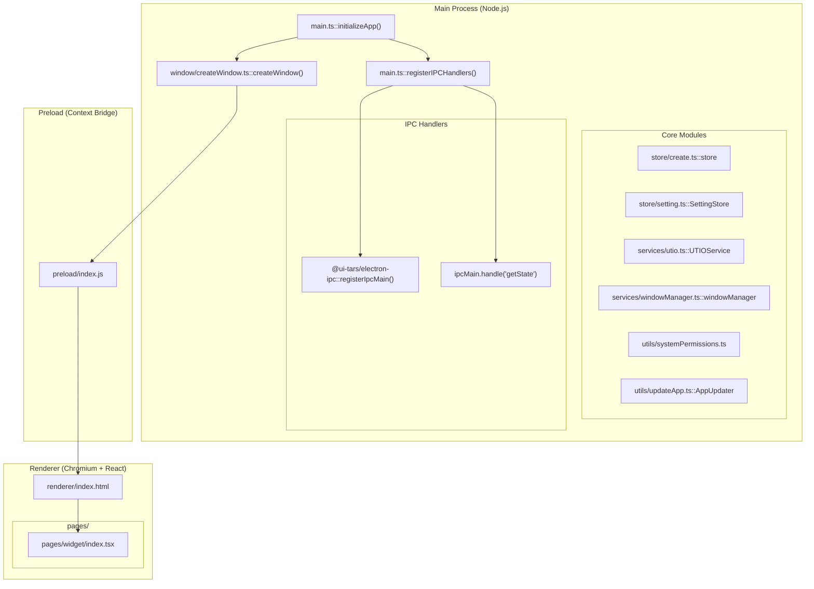
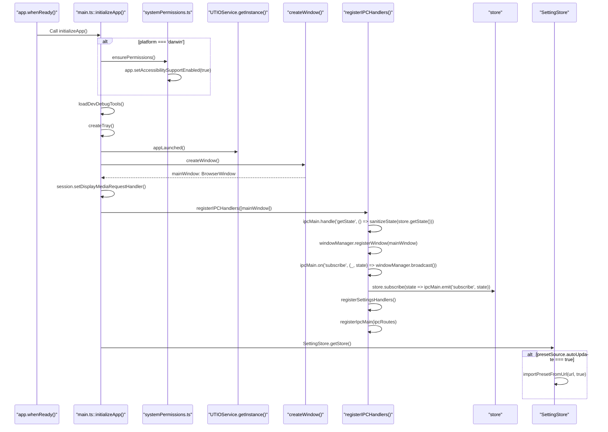

<!-- source: DeepWiki mcp.deepwiki.com · repo bytedance/UI-TARS-desktop · page 5.1 Electron Application Architecture · fetched 2026-10-30 -->

# Electron Application Architecture

Relevant source files

The following files were used as context for generating this wiki page:

- [apps/ui-tars/forge.config.ts](apps/ui-tars/forge.config.ts)
- [apps/ui-tars/package.json](apps/ui-tars/package.json)
- [apps/ui-tars/resources/app-update.yml](apps/ui-tars/resources/app-update.yml)
- [apps/ui-tars/src/main/electron-updater/GitHubProvider.ts](apps/ui-tars/src/main/electron-updater/GitHubProvider.ts)
- [apps/ui-tars/src/main/ipcRoutes/window.ts](apps/ui-tars/src/main/ipcRoutes/window.ts)
- [apps/ui-tars/src/main/logger.ts](apps/ui-tars/src/main/logger.ts)
- [apps/ui-tars/src/main/main.ts](apps/ui-tars/src/main/main.ts)
- [apps/ui-tars/src/main/menu.ts](apps/ui-tars/src/main/menu.ts)
- [apps/ui-tars/src/main/shared/constants.ts](apps/ui-tars/src/main/shared/constants.ts)
- [apps/ui-tars/src/main/tray.ts](apps/ui-tars/src/main/tray.ts)
- [apps/ui-tars/src/main/utils/updateApp.ts](apps/ui-tars/src/main/utils/updateApp.ts)
- [apps/ui-tars/src/main/window/createWindow.ts](apps/ui-tars/src/main/window/createWindow.ts)
- [packages/common/electron-build/rslib.config.ts](packages/common/electron-build/rslib.config.ts)
- [packages/common/electron-build/src/findUp.ts](packages/common/electron-build/src/findUp.ts)
- [packages/common/electron-build/src/getPackageDependencies.ts](packages/common/electron-build/src/getPackageDependencies.ts)
- [packages/common/electron-build/src/hooks/postMake.ts](packages/common/electron-build/src/hooks/postMake.ts)

## Purpose and Scope

This document describes the Electron-based desktop application architecture for UI-TARS Desktop. The application provides a native desktop interface for the UI-TARS multimodal agent system, enabling both local GUI automation (using native operators like `NutJSOperator`) and remote cloud-based execution (via UI-TARS Proxy).

The architecture follows Electron's multi-process security model with strict process isolation, controlled IPC communication, and platform-specific system integrations. The application is located at `apps/ui-tars/` and depends on the `@ui-tars/*` packages for agent execution and operators.

Related documentation:
- **Agent Execution**: See page 5.2 for `GUIAgent` class, `Operator` interface, and action space definitions
- **Operator Implementations**: See page 5.3 for `NutJSOperator`, `WebOperator`, and `ADBOperator` details
- **Build and Distribution**: See page 5.6 for Electron Forge configuration and release process

---

## Process Architecture Overview

The UI-TARS Desktop application follows Electron's multi-process architecture with three isolated processes: main (Node.js), preload (contextBridge), and renderer (Chromium). Each process has distinct responsibilities and communicates through typed IPC channels.

### Process Model and Module Layout

**Electron process topology mapping code modules to runtime processes**

Sources: [apps/ui-tars/src/main/main.ts:1-234](), [apps/ui-tars/src/main/window/createWindow.ts:18-115](), [apps/ui-tars/src/main/store/create.ts:1-20]()

---

## Main Process Architecture

The main process serves as the application's privileged backend, handling system-level operations, agent execution, and native API access.

### Main Process File Structure

| Component | File Path | Responsibility |
|-----------|-----------|----------------|
| Entry Point | `src/main/main.ts` | `initializeApp()`, `registerIPCHandlers()`, app lifecycle [apps/ui-tars/src/main/main.ts:74-203]() |
| Window Creation | `src/main/window/createWindow.ts` | `createWindow()` — configures `BrowserWindow` and vibrancy [apps/ui-tars/src/main/window/createWindow.ts:18-115]() |
| IPC Routes | `src/main/ipcRoutes/` | Typed route handlers registered via `registerIpcMain(ipcRoutes)` [apps/ui-tars/src/main/main.ts:200-200]() |
| Main Store | `src/main/store/create.ts` | Zustand store; state broadcast to renderer via `windowManager` [apps/ui-tars/src/main/main.ts:189-191]() |
| Settings Store | `src/main/store/setting.ts` | `SettingStore` class wrapping `electron-store` [apps/ui-tars/src/main/main.ts:152-162]() |
| Window Manager | `src/main/services/windowManager.ts` | `windowManager.registerWindow()`, `windowManager.broadcast()` [apps/ui-tars/src/main/main.ts:176-187]() |
| Auto-Updater | `src/main/utils/updateApp.ts` | `AppUpdater` class using `CustomGitHubProvider` [apps/ui-tars/src/main/utils/updateApp.ts:12-152]() |
| System Tray | `src/main/tray.ts` | `createTray()` — manages icon state and pause/stop actions [apps/ui-tars/src/main/tray.ts:18-90]() |

Sources: [apps/ui-tars/src/main/main.ts:25-32](), [apps/ui-tars/src/main/utils/updateApp.ts:12-152](), [apps/ui-tars/src/main/tray.ts:18-90]()

### Main Process Initialization Flow

**Startup sequence from `app.whenReady()` through window creation and IPC registration**

Sources: [apps/ui-tars/src/main/main.ts:74-163](), [apps/ui-tars/src/main/main.ts:168-203](), [apps/ui-tars/src/main/window/createWindow.ts:18-115]()

---

## Preload Scripts and IPC Bridge

The preload script provides a controlled API surface between the isolated renderer and privileged main process.

### Key IPC Channels

The `registerIPCHandlers()` function at [apps/ui-tars/src/main/main.ts:168-203]() registers several types of IPC handlers:

**Direct `ipcMain` handlers** (raw string channels):

| Channel | Type | Handler Location | Implementation |
|---------|------|------------------|----------------|
| `'getState'` | `ipcMain.handle()` | main.ts:171 | `() => sanitizeState(store.getState())` |
| `'subscribe'` | `ipcMain.on()` | main.ts:184 | `(_, state) => windowManager.broadcast('subscribe', state)` |
| `'utio:shareReport'` | `ipcMain.handle()` | main.ts:194 | `(_, params) => UTIOService.getInstance().shareReport(params)` |

**State subscription bridge:**
The main process subscribes to the Zustand store and emits changes over IPC to the renderer [apps/ui-tars/src/main/main.ts:189-191]().

**Typed procedures** (via `@ui-tars/electron-ipc`):
The typed routes are registered via `registerIpcMain(ipcRoutes)` at [apps/ui-tars/src/main/main.ts:200](), where `ipcRoutes` defines the service mapping for the agent and window operations.

Sources: [apps/ui-tars/src/main/main.ts:168-203]()

---

## Auto-Update System

The application implements a custom auto-update mechanism using `electron-updater` and a specialized GitHub provider.

### AppUpdater Class

The `AppUpdater` class (at `src/main/utils/updateApp.ts`) manages the update lifecycle:

- **Initialization**: Configures `autoUpdater` with a `CustomGitHubProvider` to handle repository structures [apps/ui-tars/src/main/utils/updateApp.ts:27-34]().
- **Update Check**: Verifies release names against patterns like `/ui[-.\s]?tars/i` to ensure correct artifacts are downloaded [apps/ui-tars/src/main/utils/updateApp.ts:15-21]().
- **Download & Install**: Listens for `update-available` to trigger background downloads [apps/ui-tars/src/main/utils/updateApp.ts:41-50]() and `update-downloaded` to prompt the user for installation via a native dialog [apps/ui-tars/src/main/utils/updateApp.ts:59-75]().

### Custom GitHub Provider
The `CustomGitHubProvider` at [apps/ui-tars/src/main/electron-updater/GitHubProvider.ts:37-44]() extends `BaseGitHubProvider` to support pre-releases and specific channel mapping (alpha/beta) when checking the GitHub releases feed [apps/ui-tars/src/main/electron-updater/GitHubProvider.ts:73-121]().

Sources: [apps/ui-tars/src/main/utils/updateApp.ts:12-152](), [apps/ui-tars/src/main/electron-updater/GitHubProvider.ts:37-204](), [apps/ui-tars/resources/app-update.yml:1-3]()

---

## Permission Handling

UI-TARS Desktop requires specific system permissions to operate, especially for local GUI control on macOS.

- **Accessibility & Screen Capture**: The `initializeApp` function checks and requests these permissions on macOS [apps/ui-tars/src/main/main.ts:75-83]().
- **Force Accessibility**: The application appends the `force-renderer-accessibility` switch to the command line during startup to ensure GUI tree access [apps/ui-tars/src/main/main.ts:37-37]().
- **Display Media Request**: The application overrides the default display media request handler to programmatically select the primary screen for capture without showing the system picker [apps/ui-tars/src/main/main.ts:101-113]().

Sources: [apps/ui-tars/src/main/main.ts:37-113]()

---

## Build System and Distribution

The application uses a modern build pipeline combining Vite for frontend bundling and Electron Forge for packaging.

### Build Tools Configuration

| Tool | Configuration File | Purpose |
|------|-------------------|---------|
| Electron Vite | `package.json` | Main/Renderer/Preload bundling via `electron-vite build` [apps/ui-tars/package.json:29-29]() |
| Electron Forge | `forge.config.ts` | Application packaging and distribution [apps/ui-tars/forge.config.ts:153-230]() |

### Packaging and Makers

The `forge.config.ts` defines how the application is packaged for different platforms:

- **macOS**: Uses `MakerZIP` and `MakerDMG` [apps/ui-tars/forge.config.ts:199-218](). Includes logic for code signing and notarization if environment variables (`APPLE_ID`, etc.) are present [apps/ui-tars/forge.config.ts:170-184]().
- **Windows**: Uses `MakerSquirrel` to create installers with a custom icon [apps/ui-tars/forge.config.ts:200-204]().
- **Resource Management**: A `cleanSources` hook ensures only necessary files (`dist`, `node_modules`, `package.json`, `resources`) are included in the final package [apps/ui-tars/forge.config.ts:54-94]().

### Post-Make Hooks and YML Generation
A custom `postMake` hook (at `packages/common/electron-build/src/hooks/postMake.ts`) generates the `latest.yml` (or platform-specific equivalent like `latest-mac.yml`) required by `electron-updater` [packages/common/electron-build/src/hooks/postMake.ts:25-109](). It calculates SHA512 hashes for all generated artifacts [packages/common/electron-build/src/hooks/postMake.ts:48-60]().

Sources: [apps/ui-tars/forge.config.ts:1-230](), [apps/ui-tars/package.json:9-37](), [packages/common/electron-build/src/hooks/postMake.ts:25-109]()

---

