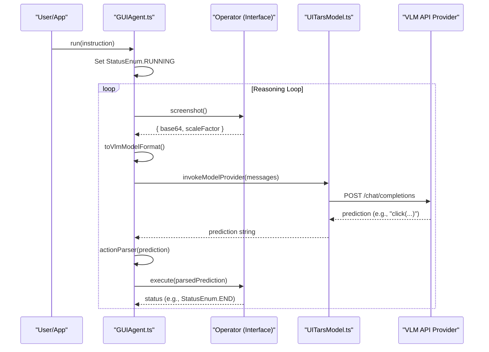

<!-- source: DeepWiki mcp.deepwiki.com · repo bytedance/UI-TARS-desktop · page 5.2 GUIAgent SDK and Operator System · fetched 2026-10-30 -->

# GUIAgent SDK and Operator System

<details>
<summary>Relevant source files</summary>

The following files were used as context for generating this wiki page:

- [README.md](README.md)
- [README.zh-CN.md](README.zh-CN.md)
- [apps/ui-tars/images/mac_app.png](apps/ui-tars/images/mac_app.png)
- [apps/ui-tars/images/quick_start/base_url.png](apps/ui-tars/images/quick_start/base_url.png)
- [apps/ui-tars/images/quick_start/start_button.png](apps/ui-tars/images/quick_start/start_button.png)
- [apps/ui-tars/src/main/ipcRoutes/index.ts](apps/ui-tars/src/main/ipcRoutes/index.ts)
- [apps/ui-tars/src/main/remote/shared.ts](apps/ui-tars/src/main/remote/shared.ts)
- [apps/ui-tars/src/main/store/setting.ts](apps/ui-tars/src/main/store/setting.ts)
- [apps/ui-tars/src/main/store/validate.ts](apps/ui-tars/src/main/store/validate.ts)
- [apps/ui-tars/src/renderer/src/components/CountDown/index.tsx](apps/ui-tars/src/renderer/src/components/CountDown/index.tsx)
- [apps/ui-tars/src/renderer/src/const/index.ts](apps/ui-tars/src/renderer/src/const/index.ts)
- [apps/ui-tars/src/renderer/src/pages/home/index.tsx](apps/ui-tars/src/renderer/src/pages/home/index.tsx)
- [apps/ui-tars/src/renderer/src/pages/remote/cast/vnc.tsx](apps/ui-tars/src/renderer/src/pages/remote/cast/vnc.tsx)
- [apps/ui-tars/src/renderer/src/pages/remote/free.tsx](apps/ui-tars/src/renderer/src/pages/remote/free.tsx)
- [docs/quick-start.md](docs/quick-start.md)
- [packages/ui-tars/sdk/README.md](packages/ui-tars/sdk/README.md)
- [packages/ui-tars/sdk/src/GUIAgent.ts](packages/ui-tars/sdk/src/GUIAgent.ts)
- [packages/ui-tars/sdk/src/Model.ts](packages/ui-tars/sdk/src/Model.ts)
- [packages/ui-tars/sdk/src/index.ts](packages/ui-tars/sdk/src/index.ts)
- [packages/ui-tars/sdk/src/types.ts](packages/ui-tars/sdk/src/types.ts)
- [packages/ui-tars/sdk/src/utils.test.ts](packages/ui-tars/sdk/src/utils.test.ts)
- [packages/ui-tars/sdk/src/utils.ts](packages/ui-tars/sdk/src/utils.ts)
- [packages/ui-tars/sdk/tests/Model.test.ts](packages/ui-tars/sdk/tests/Model.test.ts)

</details>


## Overview

The GUIAgent SDK (`@ui-tars/sdk`) is a cross-platform toolkit designed for building GUI automation agents. It provides a flexible framework that allows agents to interact with graphical user interfaces across various devices and platforms, including desktop, web, and mobile [packages/ui-tars/sdk/README.md:5-10](). The SDK implements a multimodal reasoning loop powered by Vision-Language Models (VLM) like UI-TARS-1.5 [docs/quick-start.md:3-5](). It abstracts the complexity of screen capture, VLM communication, and action execution into a composable architecture that runs on both **Node.js** and **Web Browser** environments [packages/ui-tars/sdk/README.md:9-10]().

**Sources**: [packages/ui-tars/sdk/README.md:1-10](), [packages/ui-tars/sdk/src/GUIAgent.ts:39-64]()

## Core Architecture

### System Components

The SDK architecture is divided into three primary functional areas:

| Component | Code Entity | Role |
| :--- | :--- | :--- |
| **Orchestrator** | `GUIAgent<T extends Operator>` | Manages the execution loop, session state, pause/resume logic, and event callbacks [packages/ui-tars/sdk/src/GUIAgent.ts:39-51](). |
| **Model Wrapper** | `UITarsModel` | Handles VLM API calls (OpenAI-compatible), image resizing, and sliding window context [packages/ui-tars/sdk/src/Model.ts:52-56](). |
| **Platform Abstraction** | `Operator` (Interface) | Defines the contract for platform-specific interactions like `screenshot()` and `execute()` [packages/ui-tars/sdk/src/types.ts:66-73](). |

**Sources**: [packages/ui-tars/sdk/src/GUIAgent.ts:39-64](), [packages/ui-tars/sdk/src/Model.ts:52-56](), [packages/ui-tars/sdk/src/types.ts:66-77]()

### Natural Language to Code Entity Space

The following diagram maps high-level system concepts to specific classes and interfaces found in the codebase.

**Component Mapping**
```mermaid
graph TB
    subgraph "SDK_Core_(@ui-tars/sdk)"
        GA["GUIAgent&lt;T&gt;<br/>(GUIAgent.ts)"]
        MODEL["UITarsModel<br/>(Model.ts)"]
        BASE["BaseGUIAgent<br/>(base.ts)"]
    end
    
    subgraph "Operator_Space"
        OP_IF["Operator_Interface<br/>(types.ts)"]
        NUT["NutJSOperator<br/>(@ui-tars/operator-nut-js)"]
        BROWSER["BrowserOperator<br/>(@ui-tars/operator-browser)"]
        ADB["ADBOperator<br/>(@ui-tars/operator-adb)"]
    end
    
    subgraph "Data_Entities"
        GAD["GUIAgentData<br/>(shared/types.ts)"]
        SP["SYSTEM_PROMPT<br/>(constants.ts)"]
    end

    GA -->|extends| BASE
    GA -->|uses| MODEL
    GA -->|uses| OP_IF
    OP_IF <|.. NUT
    OP_IF <|.. BROWSER
    OP_IF <|.. ADB
    GA -.->|emits| GAD
```
**Sources**: [packages/ui-tars/sdk/src/GUIAgent.ts:39-43](), [packages/ui-tars/sdk/src/Model.ts:52-52](), [packages/ui-tars/sdk/src/types.ts:66-73](), [packages/ui-tars/sdk/README.md:11-51]()

## GUIAgent Class

### Configuration Interface

The `GUIAgent` constructor requires a `GUIAgentConfig` object [packages/ui-tars/sdk/src/GUIAgent.ts:53-64]():

*   **Model**: Can be a `UITarsModel` instance or a configuration object (e.g., `baseURL`, `apiKey`, `model`) for an OpenAI-compatible endpoint [packages/ui-tars/sdk/src/GUIAgent.ts:57-60]().
*   **Operator**: An implementation of the `Operator` interface (e.g., `NutJSOperator`) [packages/ui-tars/sdk/src/GUIAgent.ts:55-55]().
*   **Loop Limits**: `maxLoopCount` defines the maximum turns before the agent stops (default is 25) [packages/ui-tars/sdk/src/GUIAgent.ts:77-78]().
*   **Callbacks**: `onData` for streaming `GUIAgentData` updates and `onError` for handling `GUIAgentError` [packages/ui-tars/sdk/src/GUIAgent.ts:74-75]().
*   **Versioning**: `uiTarsVersion` (e.g., `V1_0`, `V1_5`) affects internal token limits and image processing logic [packages/ui-tars/sdk/src/GUIAgent.ts:62-62](), [packages/ui-tars/sdk/src/Model.ts:110-110]().

### Execution Loop Logic

The `run` method initiates a loop that orchestrates the perception-action cycle [packages/ui-tars/sdk/src/GUIAgent.ts:66-130]().

**Agent Execution Sequence**

**Sources**: [packages/ui-tars/sdk/src/GUIAgent.ts:66-231](), [packages/ui-tars/sdk/src/Model.ts:88-103](), [packages/ui-tars/sdk/README.md:73-103]()

### Status State Machine

The agent transitions through several states defined in `StatusEnum` [packages/ui-tars/shared/types.ts]():

| Status | Trigger |
| :--- | :--- |
| `INIT` | Set at the start of the `run` method [packages/ui-tars/sdk/src/GUIAgent.ts:86-86](). |
| `RUNNING` | Active state during the loop execution [packages/ui-tars/sdk/src/GUIAgent.ts:122-122](). |
| `PAUSE` | Triggered by setting `isPaused = true`. The loop waits for `resumePromise` to resolve [packages/ui-tars/sdk/src/GUIAgent.ts:133-149](). |
| `ERROR` | Reaching `maxLoopCount` or failing screenshot capture multiple times [packages/ui-tars/sdk/src/GUIAgent.ts:164-178](). |
| `USER_STOPPED` | Triggered by an `AbortSignal` or manual stop command [packages/ui-tars/sdk/src/GUIAgent.ts:158-158](). |

**Sources**: [packages/ui-tars/sdk/src/GUIAgent.ts:130-182](), [packages/ui-tars/sdk/README.md:185-194]()

## Operator Interface

### Core Methods

Every operator must extend the `Operator` abstract class [packages/ui-tars/sdk/src/types.ts:66-73]():

1.  **`screenshot()`**: Captures the current screen. It returns a `ScreenshotOutput` containing the `base64` image data and the `scaleFactor` (Device Pixel Ratio) [packages/ui-tars/sdk/src/types.ts:71-71]().
2.  **`execute(params: ExecuteParams)`**: Executes a predicted action. It receives the `prediction` string, `parsedPrediction` (from `actionParser`), and physical device resolution (`screenWidth`, `screenHeight`) [packages/ui-tars/sdk/src/types.ts:72-72]().

### Action Spaces

Operators define their capabilities via `ACTION_SPACES` [packages/ui-tars/sdk/src/types.ts:68-68](). These descriptions (e.g., how to use `click`, `scroll`, or `type`) are injected into the `systemPrompt` to inform the VLM of the available tools [packages/ui-tars/sdk/src/GUIAgent.ts:102-109]().

**Sources**: [packages/ui-tars/sdk/src/types.ts:66-73](), [packages/ui-tars/sdk/README.md:198-201]()

## UITarsModel Integration

### Model Invocation and Image Processing

The `UITarsModel` class manages the VLM interaction pipeline:

*   **Image Preprocessing**: Images are resized using `preprocessResizeImage` based on model-specific limits like `MAX_PIXELS_V1_5` or `MAX_PIXELS_DOUBAO` to ensure compatibility and performance [packages/ui-tars/sdk/src/Model.ts:25-27](), [packages/ui-tars/sdk/src/utils.ts:193-226]().
*   **Response API**: Supports the OpenAI Responses API for incremental updates. It manages a `headImageContext` to track and delete old images from the session context as the interaction window slides [packages/ui-tars/sdk/src/Model.ts:146-235]().
*   **Sliding Window**: Context is managed by `processVlmParams`, which limits the number of historical screenshots (defaulting to a maximum of 5) to prevent context overflow [packages/ui-tars/sdk/src/utils.ts:58-88]().

**Sources**: [packages/ui-tars/sdk/src/Model.ts:88-156](), [packages/ui-tars/sdk/src/utils.ts:152-187]()

### Coordinate Transformation

The VLM predicts coordinates in a normalized training space (usually 0-1000). The SDK uses `parseBoxToScreenCoords` to convert these normalized values into physical screen coordinates based on the device's actual resolution and the model's `factors` [packages/ui-tars/sdk/src/utils.ts:29-56]().

```typescript
// Coordinate conversion example from packages/ui-tars/sdk/src/utils.ts
export const parseBoxToScreenCoords = ({
  boxStr, // e.g., "[0.5, 0.5]"
  screenWidth,
  screenHeight,
  factors = DEFAULT_FACTORS, // [1000, 1000]
}) => {
  // Logic to map normalized 0.5 to screenWidth/2
};
```

**Sources**: [packages/ui-tars/sdk/src/utils.ts:29-56](), [packages/ui-tars/sdk/src/constants.ts:67-69]()

## Execution Loop Details

### Error Recovery

The loop includes resilience mechanisms:
*   **Retry Logic**: The `screenshot()` call is wrapped in `asyncRetry` to handle temporary platform failures [packages/ui-tars/sdk/src/GUIAgent.ts:185-189]().
*   **Error Thresholds**: If `snapshotErrCnt` exceeds `MAX_SNAPSHOT_ERR_CNT` (default 3), the agent stops to prevent infinite failing loops [packages/ui-tars/sdk/src/GUIAgent.ts:172-180]().

### Pause and Abort Handling

*   **Pause**: When `isPaused` is true, the loop halts and emits a `StatusEnum.PAUSE` event until `resumePromise` resolves [packages/ui-tars/sdk/src/GUIAgent.ts:133-149]().
*   **Abort**: The agent monitors an `AbortSignal`. If `signal.aborted` is detected, it immediately updates the status to `USER_STOPPED` and terminates the loop [packages/ui-tars/sdk/src/GUIAgent.ts:155-160]().

**Sources**: [packages/ui-tars/sdk/src/GUIAgent.ts:130-161](), [packages/ui-tars/sdk/README.md:138-154]()

---

