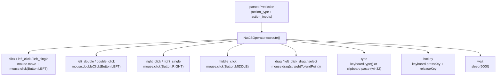
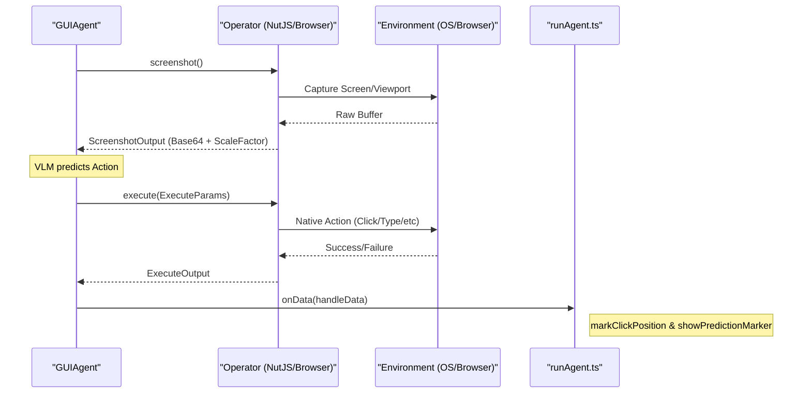

<!-- source: DeepWiki mcp.deepwiki.com · repo bytedance/UI-TARS-desktop · page 5.3 Operator Implementations · fetched 2026-10-30 -->

# Operator Implementations

<details>
<summary>Relevant source files</summary>

The following files were used as context for generating this wiki page:

- [apps/ui-tars/src/main/agent/prompts.ts](apps/ui-tars/src/main/agent/prompts.ts)
- [apps/ui-tars/src/main/services/runAgent.ts](apps/ui-tars/src/main/services/runAgent.ts)
- [apps/ui-tars/src/renderer/src/components/RunMessages/Messages.tsx](apps/ui-tars/src/renderer/src/components/RunMessages/Messages.tsx)
- [apps/ui-tars/src/renderer/src/components/RunMessages/index.tsx](apps/ui-tars/src/renderer/src/components/RunMessages/index.tsx)
- [apps/ui-tars/src/renderer/src/components/ThoughtChain/index.tsx](apps/ui-tars/src/renderer/src/components/ThoughtChain/index.tsx)
- [apps/ui-tars/src/renderer/src/components/ui/alert.tsx](apps/ui-tars/src/renderer/src/components/ui/alert.tsx)
- [packages/agent-infra/browser/package.json](packages/agent-infra/browser/package.json)
- [packages/agent-infra/browser/src/base-browser.ts](packages/agent-infra/browser/src/base-browser.ts)
- [packages/agent-infra/browser/src/browser-finder/chrome-paths.ts](packages/agent-infra/browser/src/browser-finder/chrome-paths.ts)
- [packages/agent-infra/browser/src/browser-finder/firefox-paths.ts](packages/agent-infra/browser/src/browser-finder/firefox-paths.ts)
- [packages/agent-infra/browser/src/browser-finder/index.test.ts](packages/agent-infra/browser/src/browser-finder/index.test.ts)
- [packages/agent-infra/browser/src/browser-finder/index.ts](packages/agent-infra/browser/src/browser-finder/index.ts)
- [packages/agent-infra/browser/src/local-browser.ts](packages/agent-infra/browser/src/local-browser.ts)
- [packages/agent-infra/browser/src/remote-browser.ts](packages/agent-infra/browser/src/remote-browser.ts)
- [packages/agent-infra/browser/src/types.ts](packages/agent-infra/browser/src/types.ts)
- [packages/ui-tars/operators/browser-operator/examples/default.ts](packages/ui-tars/operators/browser-operator/examples/default.ts)
- [packages/ui-tars/operators/browser-operator/src/browser-operator.ts](packages/ui-tars/operators/browser-operator/src/browser-operator.ts)
- [packages/ui-tars/operators/browser-operator/src/key-map.ts](packages/ui-tars/operators/browser-operator/src/key-map.ts)
- [packages/ui-tars/operators/browser-operator/src/shortcuts.ts](packages/ui-tars/operators/browser-operator/src/shortcuts.ts)
- [packages/ui-tars/operators/browser-operator/src/types.ts](packages/ui-tars/operators/browser-operator/src/types.ts)
- [packages/ui-tars/operators/nut-js/src/index.ts](packages/ui-tars/operators/nut-js/src/index.ts)
- [packages/ui-tars/operators/nut-js/test/execute.test.ts](packages/ui-tars/operators/nut-js/test/execute.test.ts)
- [packages/ui-tars/shared/src/types/agent.ts](packages/ui-tars/shared/src/types/agent.ts)

</details>


This page documents the concrete operator implementations that enable UI-TARS to control different environments (desktop, browser, mobile) and execution modes (local, remote). Operators implement the platform-specific logic for taking screenshots and executing actions predicted by the VLM.

---

## Overview

Operator packages are provided in the monorepo under `packages/ui-tars/operators/`:

| Package | Main Class(es) | Execution Environment | Underlying Library |
|---------|---------------|----------------------|--------------------|
| `@ui-tars/operator-nut-js` | `NutJSOperator` | Local desktop (Win/macOS/Linux) | `@computer-use/nut-js` |
| `@ui-tars/operator-browser` | `BrowserOperator` | Local or remote browser | `puppeteer-core` via `@agent-infra/browser` |
| `@ui-tars/operator-adb` | `ADBOperator` | Mobile (Android) | `adb-commander` |

The `runAgent` service in the desktop application dynamically selects and initializes these operators based on the `settings.operator` configuration [apps/ui-tars/src/main/services/runAgent.ts:128-165]().

Sources: [packages/ui-tars/operators/nut-js/src/index.ts:36-36](), [packages/ui-tars/operators/browser-operator/src/browser-operator.ts:32-32](), [apps/ui-tars/src/main/services/runAgent.ts:128-165]()

---

## Operator Class Hierarchy

**Class hierarchy for operator implementations**

```mermaid
classDiagram
    class "Operator" {
        <<abstract>>
        +screenshot() Promise~ScreenshotOutput~
        +execute(params ExecuteParams) Promise~ExecuteOutput~
    }

    class "NutJSOperator" {
        +MANUAL ACTION_SPACES string[]
        +screenshot() Promise~ScreenshotOutput~
        +execute(params ExecuteParams) Promise~ExecuteOutput~
    }

    class "BrowserOperator" {
        -browser BrowserInterface
        -currentPage Page
        -uiHelper UIHelper
        -highlightClickableElements bool
        -showActionInfo bool
        -showWaterFlowEffect bool
        +screenshot() Promise~ScreenshotOutput~
        +execute(params ExecuteParams) Promise~ExecuteOutput~
        +setHighlightClickableElements(enable bool)
        +setShowWaterFlow(enable bool)
    }

    class "ADBOperator" {
        +screenshot() Promise~ScreenshotOutput~
        +execute(params ExecuteParams) Promise~ExecuteOutput~
    }

    "Operator" <|-- "NutJSOperator"
    "Operator" <|-- "BrowserOperator"
    "Operator" <|-- "ADBOperator"
```

Sources: [packages/ui-tars/operators/nut-js/src/index.ts:36-36](), [packages/ui-tars/operators/browser-operator/src/browser-operator.ts:32-32](), [packages/ui-tars/sdk/core/index.ts:1-20]() (inferred from imports in `nut-js/src/index.ts:5-13`)

---

## NutJSOperator (Desktop Automation)

`NutJSOperator` wraps `@computer-use/nut-js`, providing native OS API access for mouse, keyboard, and screen capture. It is primarily used when the user selects `Operator.LocalComputer` [apps/ui-tars/src/main/services/runAgent.ts:129-132]().

**NutJSOperator action dispatch and native OS API flow**



Sources: [packages/ui-tars/operators/nut-js/src/index.ts:170-217]()

### Supported Actions

`NutJSOperator.MANUAL.ACTION_SPACES` declares the action vocabulary injected into the system prompt:

| Action | Signature in `MANUAL.ACTION_SPACES` | Implementation Details |
|--------|-------------------------------------|------------------------|
| `click` | `click(start_box='[x1, y1, x2, y2]')` | Uses `mouse.click(Button.LEFT)` [packages/ui-tars/operators/nut-js/src/index.ts:188-188]() |
| `drag` | `drag(start_box='...', end_box='...')` | Uses `mouse.drag(straightTo(...))` [packages/ui-tars/operators/nut-js/src/index.ts:214-217]() |
| `hotkey` | `hotkey(key='')` | Mapped via `getHotkeys` helper [packages/ui-tars/operators/nut-js/src/index.ts:120-168]() |
| `type` | `type(content='')` | Implementation logic for keyboard interaction [packages/ui-tars/operators/nut-js/src/index.ts:44-44]() |
| `scroll` | `scroll(start_box='...', direction='...')` | Mapped to native scroll directions [packages/ui-tars/operators/nut-js/src/index.ts:45-45]() |

Sources: [packages/ui-tars/operators/nut-js/src/index.ts:37-50](), [packages/ui-tars/operators/nut-js/src/index.ts:170-217]()

### Screenshot Capture

`NutJSOperator.screenshot()` handles high-DPI scaling:
1. Calls `screen.grab()` to capture the raw desktop image [packages/ui-tars/operators/nut-js/src/index.ts:54-54]().
2. Extracts `pixelDensity.scaleX` to determine the system's `scaleFactor` [packages/ui-tars/operators/nut-js/src/index.ts:57-57]().
3. Uses `Jimp` to resize the physical pixel buffer back to logical coordinates [packages/ui-tars/operators/nut-js/src/index.ts:67-81]().
4. Returns the result as a Base64 string [packages/ui-tars/operators/nut-js/src/index.ts:84-86]().

---

## BrowserOperator (Browser Automation)

`BrowserOperator` drives a browser via Puppeteer through the `BrowserInterface` abstraction.

**BrowserOperator execution flow**

```mermaid
graph LR
    "GUIAgent"["GUIAgent\n(@ui-tars/sdk)"]
    "BrowserOperator"["BrowserOperator\n(browser-operator.ts)"]
    "BrowserInterface"["BrowserInterface\n(@agent-infra/browser)"]
    "UIHelper"["UIHelper\n(ui-helper.ts)"]
    "LocalBrowser"["LocalBrowser\n(local-browser.ts)"]
    "RemoteBrowser"["RemoteBrowser\n(remote-browser.ts)"]

    "GUIAgent" --> "BrowserOperator"
    "BrowserOperator" --> "BrowserInterface"
    "BrowserOperator" --> "UIHelper"
    "BrowserInterface" <|.. "LocalBrowser"
    "BrowserInterface" <|.. "RemoteBrowser"
```

Sources: [packages/ui-tars/operators/browser-operator/src/browser-operator.ts:32-75](), [packages/agent-infra/browser/src/types.ts:148-185]()

### UI Enhancement and Visuals
The `BrowserOperator` uses a `UIHelper` to provide visual feedback and improve VLM accuracy:
- **Clickable Highlighting**: Injects CSS/JS into the page to highlight interactive elements before taking a screenshot [packages/ui-tars/operators/browser-operator/src/browser-operator.ts:130-130]().
- **Action Info**: Displays the current predicted action as an overlay on the browser page [packages/ui-tars/operators/browser-operator/src/browser-operator.ts:195-197]().
- **Water Flow**: An optional visual effect triggered during the screenshot process [packages/ui-tars/operators/browser-operator/src/browser-operator.ts:116-118]().

### Action Implementation

The `execute` method [packages/ui-tars/operators/browser-operator/src/browser-operator.ts:189-214]() translates parsed predictions into browser commands. It uses `parseBoxToScreenCoords` to convert VLM coordinates into screen pixels, then adjusts by `deviceScaleFactor` to ensure accuracy on high-DPI displays [packages/ui-tars/operators/browser-operator/src/browser-operator.ts:205-212]().

Sources: [packages/ui-tars/operators/browser-operator/src/browser-operator.ts:189-214]()

---

## Browser Infrastructure (`@agent-infra/browser`)

### LocalBrowser
`LocalBrowser` extends `BaseBrowser` to manage local Puppeteer instances [packages/agent-infra/browser/src/local-browser.ts:16-16]().
- **Launch Strategy**: It uses a specific set of arguments to disable automation indicators, such as `--disable-blink-features=AutomationControlled` [packages/agent-infra/browser/src/local-browser.ts:50-50]().
- **Binary Detection**: If no `executablePath` is provided, it invokes `BrowserFinder` to scan the host system [packages/agent-infra/browser/src/local-browser.ts:117-120]().

### BrowserFinder
The `BrowserFinder` utility performs fast binary lookups without expensive OS commands [packages/agent-infra/browser/src/browser-finder/chrome-paths.ts:11-16]().
- **Windows**: Checks `LOCALAPPDATA` and `PROGRAMFILES` for `chrome.exe` [packages/agent-infra/browser/src/browser-finder/chrome-paths.ts:45-64]().
- **macOS**: Checks `/Applications/` and user home directories [packages/agent-infra/browser/src/browser-finder/chrome-paths.ts:66-84]().
- **Linux**: Uses `which` to find `google-chrome` or `chromium` [packages/agent-infra/browser/src/browser-finder/chrome-paths.ts:23-43]().

Sources: [packages/agent-infra/browser/src/local-browser.ts:16-144](), [packages/agent-infra/browser/src/browser-finder/chrome-paths.ts:1-177]()

---

## Action Execution Loop

The `GUIAgent` in `@ui-tars/sdk` orchestrates the loop between the VLM and these operators. In the desktop app, `runAgent` handles the integration, including UI updates via `setState` [apps/ui-tars/src/main/services/runAgent.ts:39-119]().

**GUIAgent to Operator Data Flow**



Sources: [apps/ui-tars/src/main/services/runAgent.ts:52-119](), [packages/ui-tars/operators/browser-operator/src/browser-operator.ts:113-182](), [packages/ui-tars/operators/nut-js/src/index.ts:52-92]()

---

