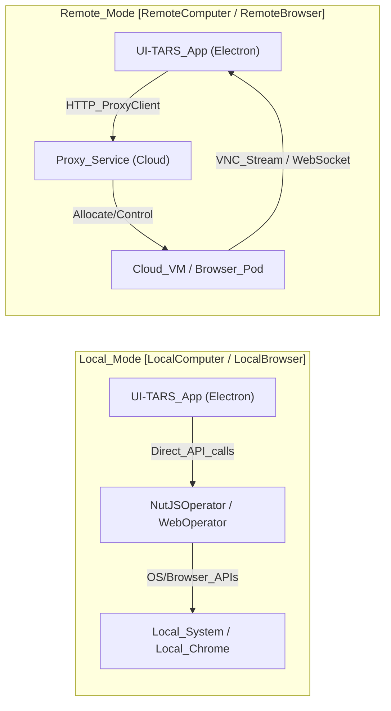
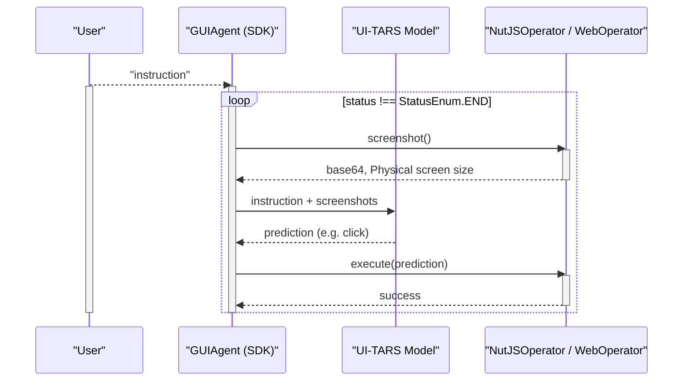
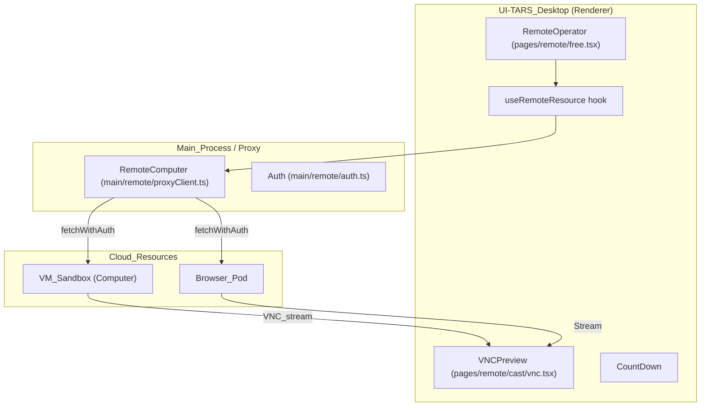

<!-- source: DeepWiki mcp.deepwiki.com · repo bytedance/UI-TARS-desktop · page 5.4 Local and Remote Operation Modes · fetched 2026-10-30 -->

# Local and Remote Operation Modes

Relevant source files

The following files were used as context for generating this wiki page:

- [README.md](README.md)
- [README.zh-CN.md](README.zh-CN.md)
- [apps/ui-tars/images/mac_app.png](apps/ui-tars/images/mac_app.png)
- [apps/ui-tars/images/quick_start/base_url.png](apps/ui-tars/images/quick_start/base_url.png)
- [apps/ui-tars/images/quick_start/start_button.png](apps/ui-tars/images/quick_start/start_button.png)
- [apps/ui-tars/src/main/ipcRoutes/agent.ts](apps/ui-tars/src/main/ipcRoutes/agent.ts)
- [apps/ui-tars/src/main/ipcRoutes/remoteResource.ts](apps/ui-tars/src/main/ipcRoutes/remoteResource.ts)
- [apps/ui-tars/src/main/remote/proxyClient.ts](apps/ui-tars/src/main/remote/proxyClient.ts)
- [apps/ui-tars/src/main/remote/shared.ts](apps/ui-tars/src/main/remote/shared.ts)
- [apps/ui-tars/src/main/store/create.ts](apps/ui-tars/src/main/store/create.ts)
- [apps/ui-tars/src/main/store/types.ts](apps/ui-tars/src/main/store/types.ts)
- [apps/ui-tars/src/main/window/ScreenMarker.ts](apps/ui-tars/src/main/window/ScreenMarker.ts)
- [apps/ui-tars/src/renderer/index.html](apps/ui-tars/src/renderer/index.html)
- [apps/ui-tars/src/renderer/src/components/ChatInput/index.tsx](apps/ui-tars/src/renderer/src/components/ChatInput/index.tsx)
- [apps/ui-tars/src/renderer/src/components/ChatInput/vlmDialog.tsx](apps/ui-tars/src/renderer/src/components/ChatInput/vlmDialog.tsx)
- [apps/ui-tars/src/renderer/src/components/CountDown/index.tsx](apps/ui-tars/src/renderer/src/components/CountDown/index.tsx)
- [apps/ui-tars/src/renderer/src/components/ImageGallery/index.tsx](apps/ui-tars/src/renderer/src/components/ImageGallery/index.tsx)
- [apps/ui-tars/src/renderer/src/components/Settings/remote.tsx](apps/ui-tars/src/renderer/src/components/Settings/remote.tsx)
- [apps/ui-tars/src/renderer/src/const/actions.tsx](apps/ui-tars/src/renderer/src/const/actions.tsx)
- [apps/ui-tars/src/renderer/src/const/index.ts](apps/ui-tars/src/renderer/src/const/index.ts)
- [apps/ui-tars/src/renderer/src/hooks/useRemoteResource.ts](apps/ui-tars/src/renderer/src/hooks/useRemoteResource.ts)
- [apps/ui-tars/src/renderer/src/hooks/useRunAgent.ts](apps/ui-tars/src/renderer/src/hooks/useRunAgent.ts)
- [apps/ui-tars/src/renderer/src/pages/home/index.tsx](apps/ui-tars/src/renderer/src/pages/home/index.tsx)
- [apps/ui-tars/src/renderer/src/pages/remote/cast/vnc.tsx](apps/ui-tars/src/renderer/src/pages/remote/cast/vnc.tsx)
- [apps/ui-tars/src/renderer/src/pages/remote/free.tsx](apps/ui-tars/src/renderer/src/pages/remote/free.tsx)
- [apps/ui-tars/src/renderer/src/pages/widget/index.tsx](apps/ui-tars/src/renderer/src/pages/widget/index.tsx)
- [apps/ui-tars/src/renderer/src/store/session.ts](apps/ui-tars/src/renderer/src/store/session.ts)
- [docs/quick-start.md](docs/quick-start.md)
- [packages/ui-tars/sdk/README.md](packages/ui-tars/sdk/README.md)
- [packages/ui-tars/sdk/src/index.ts](packages/ui-tars/sdk/src/index.ts)

This page explains the two fundamental operation modes in UI-TARS Desktop: **Local Operation** (agent runs on the user's machine) and **Remote Operation** (agent runs on a cloud-provisioned resource). It covers the architecture differences, resource management, time limits for free remote sessions, and how the application manages permissions and cleanup.

For details on the operator implementations themselves (classes like `NutJSOperator`, `BrowserOperator`), see [Operator Implementations](). For the GUIAgent SDK execution loop, see [GUIAgent SDK and Operator System]().

---

## Overview

UI-TARS Desktop supports four operator modes across two execution environments:

| Mode | `Operator` Enum | Execution Environment | Control Mechanism |
|---|---|---|---|
| **Local Computer** | `Operator.LocalComputer` | User's machine | NutJS (native desktop automation) |
| **Local Browser** | `Operator.LocalBrowser` | User's machine | Puppeteer (Chrome DevTools Protocol) |
| **Remote Computer** | `Operator.RemoteComputer` | Cloud VM sandbox | VNC streaming + proxy API |
| **Remote Browser** | `Operator.RemoteBrowser` | Cloud browser pod | CDP over WebSocket |

**Key Architectural Difference:**

Title: Architecture of Local vs Remote Modes

- **Local:** Direct instantiation of operator classes in the Electron main process. `GUIAgent` creates either a `NutJSOperator` or a `WebOperator`. [packages/ui-tars/sdk/README.md:116-136]()
- **Remote:** Orchestrated via `RemoteComputer` proxy client and specialized remote operators. Visual output streams back via VNC or specialized protocols. [apps/ui-tars/src/main/remote/proxyClient.ts:70-76]()

Sources: [apps/ui-tars/src/main/store/types.ts:57-62](), [README.md:13-46](), [apps/ui-tars/src/main/remote/proxyClient.ts:70-76](), [packages/ui-tars/sdk/README.md:12-51]()

---

## Local Operation Mode

### Architecture

In local mode, the `GUIAgent` runs entirely on the user's machine. The UI-TARS Desktop application directly instantiates and controls the `NutJSOperator` (for computer) or `WebOperator` (for browser).

Title: Local GUIAgent Execution Flow

Sources: [packages/ui-tars/sdk/README.md:11-51](), [packages/ui-tars/sdk/README.md:73-103](), [apps/ui-tars/src/renderer/src/components/ChatInput/index.tsx:98-125]()

### System Permissions (macOS)

Local operation on macOS requires specific system permissions. The application checks these permissions at startup using `ensurePermissions`:

| Permission | Purpose |
|---|---|
| **Accessibility** | Required for `execute()` to simulate mouse clicks and keyboard events. [docs/quick-start.md:36-36]() |
| **Screen Recording** | Required for `screenshot()` to capture the desktop state. [docs/quick-start.md:37-37]() |

Sources: [docs/quick-start.md:30-42](), [apps/ui-tars/src/main/store/types.ts:26-26]()

### Configuration Requirements

To use local mode, users must configure VLM (Vision-Language Model) settings. The application reads these from the `useSetting` hook in the renderer or store in main.

**Supported VLM Providers:**
- **Hugging Face for UI-TARS-1.5**: Optimized for the open-source UI-TARS models. [apps/ui-tars/src/main/store/types.ts:46-46]()
- **VolcEngine Ark for Doubao-1.5-UI-TARS**: Optimized for Doubao models. [apps/ui-tars/src/main/store/types.ts:47-47]()

Sources: [docs/quick-start.md:63-151](), [apps/ui-tars/src/main/store/types.ts:44-49]()

---

## Remote Operation Mode

### Architecture

Remote mode connects to an external proxy service that provisions cloud resources (VM sandbox or browser pod) on demand. The remote screen is streamed back to the UI via an embedded VNC iframe.

Title: Remote Resource Management and Control

Sources: [apps/ui-tars/src/renderer/src/pages/remote/free.tsx:69-75](), [apps/ui-tars/src/main/remote/proxyClient.ts:33-68](), [apps/ui-tars/src/main/remote/proxyClient.ts:70-76]()

### Remote Resource Lifecycle

The `useRemoteResource` hook manages the lifecycle of cloud resources:

1.  **Allocation**: Requests a resource via the remote resource IPC routes. [apps/ui-tars/src/renderer/src/pages/remote/free.tsx:69-75]()
2.  **Status Polling**: Monitors if the resource is `'connected'`, `'pending'`, or `'queued'`. [apps/ui-tars/src/renderer/src/pages/remote/free.tsx:127-136]()
3.  **VNC Connection**: Once `'connected'`, a `rdpUrl` is provided to the `VNCPreview` component. [apps/ui-tars/src/renderer/src/pages/remote/cast/vnc.tsx:58-62]()
4.  **Deallocation**: `releaseResource()` is called when the session ends or component unmounts. [apps/ui-tars/src/renderer/src/pages/remote/free.tsx:148-151]()

Sources: [apps/ui-tars/src/renderer/src/pages/remote/free.tsx:69-75](), [apps/ui-tars/src/renderer/src/pages/remote/free.tsx:146-151]()

### VNC Screen Preview

The `VNCPreview` component renders the remote screen inside a scaled `<iframe>`. It calculates a `scale` factor based on the available window dimensions to ensure the remote desktop (usually 1280x960) fits the local UI. [apps/ui-tars/src/renderer/src/pages/remote/cast/vnc.tsx:19-53]()

Sources: [apps/ui-tars/src/renderer/src/pages/remote/cast/vnc.tsx:14-15](), [apps/ui-tars/src/renderer/src/pages/remote/cast/vnc.tsx:19-53]()

---

## Resource Management and Time Limits

### Free Remote Session Time Limit (30 Minutes)

Free-tier remote sessions are limited to **30 minutes** of total elapsed time. This is enforced through periodic polling of the time balance.

**Time tracking flow:**
1.  **Polling**: `useSWR` calls `getTimeBalance()` every 10 seconds. [apps/ui-tars/src/renderer/src/pages/remote/free.tsx:87-95]()
2.  **Check**: If `timeBalance` exceeds 1800000ms (30 mins), a release sequence is triggered. [apps/ui-tars/src/renderer/src/pages/remote/free.tsx:100-113]()
3.  **Cleanup**: The app stops the agent via `api.stopRun()`, clears history, and releases the remote resource. [apps/ui-tars/src/renderer/src/pages/remote/free.tsx:103-105]()

Sources: [apps/ui-tars/src/renderer/src/pages/remote/free.tsx:87-113](), [apps/ui-tars/src/renderer/src/components/CountDown/index.tsx:44-47](), [apps/ui-tars/src/main/remote/proxyClient.ts:20-20]()

### Resource Release and Cleanup

Remote resources are deallocated in several scenarios:
- **Time Limit**: Automatically when the 30-minute limit is reached. [apps/ui-tars/src/renderer/src/pages/remote/free.tsx:113]()
- **Manual Termination**: When the user clicks the "Terminate" button in the UI, triggering `onTerminateConfirm`. [apps/ui-tars/src/renderer/src/pages/remote/free.tsx:121-126]()
- **Navigation**: When the user leaves the remote page (e.g., going back to Home or starting a New Chat), a `NavDialog` or `TerminateDialog` ensures resources are cleaned up. [apps/ui-tars/src/renderer/src/pages/remote/free.tsx:230-242]()
- **Unmount**: The `useEffect` cleanup function in `RemoteOperator` calls `releaseResource(false)`. [apps/ui-tars/src/renderer/src/pages/remote/free.tsx:146-151]()

Sources: [apps/ui-tars/src/renderer/src/pages/remote/free.tsx:121-125](), [apps/ui-tars/src/renderer/src/pages/remote/free.tsx:146-151](), [apps/ui-tars/src/renderer/src/pages/remote/free.tsx:230-242]()

### UI State and Availability

The UI dynamically reacts to the resource status. If the status is not `'connected'`, the chat input and action buttons are disabled to prevent invalid operations. [apps/ui-tars/src/renderer/src/pages/remote/free.tsx:127-136]()

Sources: [apps/ui-tars/src/renderer/src/pages/remote/free.tsx:127-136]()

---

