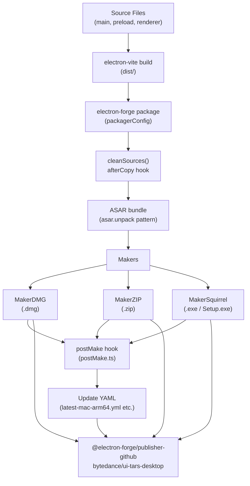
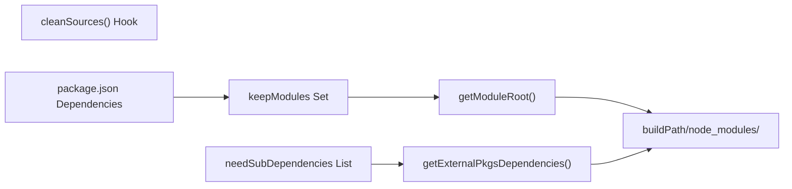
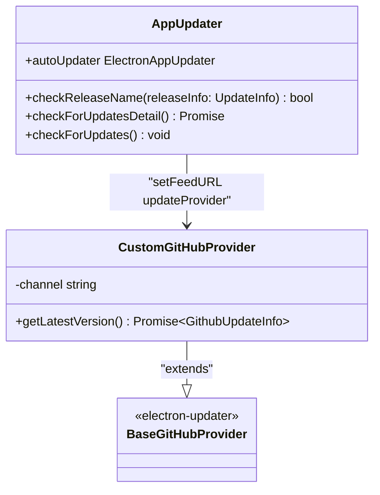

<!-- source: DeepWiki mcp.deepwiki.com · repo bytedance/UI-TARS-desktop · page 5.6 Build System and Distribution · fetched 2026-10-30 -->

# Build System and Distribution

Relevant source files

The following files were used as context for generating this wiki page:

- [.github/workflows/agent_tars_test.yml](.github/workflows/agent_tars_test.yml)
- [.github/workflows/benchmark.yml](.github/workflows/benchmark.yml)
- [.github/workflows/e2e-ui-tars.yml](.github/workflows/e2e-ui-tars.yml)
- [.github/workflows/release-ui-tars.yml](.github/workflows/release-ui-tars.yml)
- [.github/workflows/scorecard.yml](.github/workflows/scorecard.yml)
- [.github/workflows/secret-scan.yml](.github/workflows/secret-scan.yml)
- [.github/workflows/secretlint.yml](.github/workflows/secretlint.yml)
- [.github/workflows/test.yml](.github/workflows/test.yml)
- [apps/ui-tars/forge.config.ts](apps/ui-tars/forge.config.ts)
- [apps/ui-tars/package.json](apps/ui-tars/package.json)
- [apps/ui-tars/resources/app-update.yml](apps/ui-tars/resources/app-update.yml)
- [apps/ui-tars/src/main/electron-updater/GitHubProvider.ts](apps/ui-tars/src/main/electron-updater/GitHubProvider.ts)
- [apps/ui-tars/src/main/ipcRoutes/window.ts](apps/ui-tars/src/main/ipcRoutes/window.ts)
- [apps/ui-tars/src/main/main.ts](apps/ui-tars/src/main/main.ts)
- [apps/ui-tars/src/main/shared/constants.ts](apps/ui-tars/src/main/shared/constants.ts)
- [apps/ui-tars/src/main/utils/updateApp.ts](apps/ui-tars/src/main/utils/updateApp.ts)
- [apps/ui-tars/src/main/window/createWindow.ts](apps/ui-tars/src/main/window/createWindow.ts)
- [packages/common/electron-build/rslib.config.ts](packages/common/electron-build/rslib.config.ts)
- [packages/common/electron-build/src/findUp.ts](packages/common/electron-build/src/findUp.ts)
- [packages/common/electron-build/src/getPackageDependencies.ts](packages/common/electron-build/src/getPackageDependencies.ts)
- [packages/common/electron-build/src/hooks/postMake.ts](packages/common/electron-build/src/hooks/postMake.ts)

This page covers the build pipeline, packaging configuration, artifact generation, and auto-update mechanism for the UI-TARS Desktop Electron application located in `apps/ui-tars/`. It describes how source code is compiled, packaged into platform-specific installers, published to GitHub Releases, and how running instances receive update notifications.

UI-TARS Desktop is a native GUI agent application powered by the UI-TARS vision-language model, providing both local computer control (via NutJS) and remote operator capabilities (browser and computer). The build system must handle native dependencies, code signing, notarization, and cross-platform distribution.

Sources: [apps/ui-tars/package.json:1-134](), [apps/ui-tars/src/main/main.ts:1-34]()

---

## Toolchain Overview

The build process has two distinct phases:

| Phase | Tool | Purpose |
|---|---|---|
| Compilation | `electron-vite` | Transpiles TypeScript for main, preload, and renderer processes |
| Packaging | `electron-forge` | Bundles the app, applies code signing, produces installers |
| Publishing | `@electron-forge/publisher-github` | Uploads artifacts to GitHub Releases |
| Updates | `electron-updater` + `CustomGitHubProvider` | Runtime update checks and downloads |

The monorepo uses `pnpm@9.10.0` for package management [apps/ui-tars/package.json:6-6](). Node.js >= 20.x is required [apps/ui-tars/package.json:131-133](). Task orchestration for testing and type-checking across the repository is managed by `turbo` [ .github/workflows/test.yml:57-59]().

Sources: [apps/ui-tars/package.json:6-133](), [.github/workflows/test.yml:44-59]()

---

## Build Scripts

All scripts are defined in `apps/ui-tars/package.json` and are invoked via `pnpm run <script>` from that directory.

| Script | Command | Description |
|---|---|---|
| `dev` | `electron-vite dev` | Development server with HMR [apps/ui-tars/package.json:16-16]() |
| `build:dist` | `cross-env NODE_ENV=production electron-vite build` | Compiles all processes for production [apps/ui-tars/package.json:29-29]() |
| `build` | `clean → typecheck → build:dist → electron-forge make` | Full production build + make [apps/ui-tars/package.json:30-30]() |
| `package` | `electron-forge package` | Package only (no installer) [apps/ui-tars/package.json:21-21]() |
| `make` | `electron-forge make` | Produce installers from a packaged app [apps/ui-tars/package.json:31-31]() |
| `publish:mac-arm64` | `build + electron-forge publish --arch=arm64 --platform=darwin` | Build and publish macOS arm64 [apps/ui-tars/package.json:33-33]() |
| `publish:win32` | `build + electron-forge publish --arch=x64 --platform=win32` | Build and publish Windows x64 [apps/ui-tars/package.json:34-34]() |
| `build:e2e` | `build:dist + cross-env CI=e2e package` | Build for E2E testing (no Fuses) [apps/ui-tars/package.json:26-26]() |
| `asar:analyze` | `asar extract ...` | Extract the built ASAR for inspection [apps/ui-tars/package.json:20-20]() |

Sources: [apps/ui-tars/package.json:9-37]()

---

## Electron Forge Configuration

The Forge configuration is in `apps/ui-tars/forge.config.ts`. It defines four key sections: `packagerConfig`, `makers`, `publishers`, and `plugins`.

**Build pipeline diagram:**

Sources: [apps/ui-tars/forge.config.ts:153-245](), [packages/common/electron-build/src/hooks/postMake.ts:25-109]()

### packagerConfig

| Option | Value | Notes |
|---|---|---|
| `name` | `UI TARS` | App display name [apps/ui-tars/forge.config.ts:155-155]() |
| `executableName` | `UI-TARS` | Binary name on all platforms [apps/ui-tars/forge.config.ts:169-169]() |
| `icon` | `resources/icon` | Platform extension resolved automatically [apps/ui-tars/forge.config.ts:156-156]() |
| `extraResource` | `['./resources/app-update.yml']` | Bundled into app Resources/ [apps/ui-tars/forge.config.ts:157-157]() |
| `asar.unpack` | `unpack` (pattern) | Native modules stay unpacked [apps/ui-tars/forge.config.ts:158-160]() |
| `ignore` | `[ignorePattern]` | Excludes non-kept node_modules [apps/ui-tars/forge.config.ts:161-161]() |
| `prune` | `false` | Forge pruning disabled; manual cleanup used instead [apps/ui-tars/forge.config.ts:162-162]() |
| `osxSign` | conditional on `APPLE_ID` env | Signs with keychain on CI [apps/ui-tars/forge.config.ts:170-177]() |
| `osxNotarize` | conditional on `APPLE_ID` env | Notarizes via Apple ID credentials [apps/ui-tars/forge.config.ts:178-182]() |

Sources: [apps/ui-tars/forge.config.ts:153-185]()

### Native Module Handling

Native modules cannot be bundled inside ASAR. `forge.config.ts` maintains two lists:

- **`keepModules`** — built from `getExternalPkgs()` plus `@computer-use/mac-screen-capture-permissions` [apps/ui-tars/forge.config.ts:27-30]().
- **`needSubDependencies`** — `['@computer-use/node-mac-permissions', 'sharp']` — their transitive native deps are also resolved and copied via `getExternalPkgsDependencies()` [apps/ui-tars/forge.config.ts:31-31]().

The `cleanSources()` `afterCopy` hook removes everything from the packaged directory except `dist/`, `node_modules/`, `package.json`, and `resources/` [apps/ui-tars/forge.config.ts:62-67](), then repopulates only the required native module directories by copying them from the project root [apps/ui-tars/forge.config.ts:98-121]().

**Native Module Resolution Flow:**

Sources: [apps/ui-tars/forge.config.ts:27-148]()

### Makers

| Maker | Target Platform | Output |
|---|---|---|
| `MakerZIP` | `darwin` | `.zip` archive [apps/ui-tars/forge.config.ts:199-199]() |
| `MakerSquirrel` | `win32` | Squirrel installer — `UiTars-Setup.exe` [apps/ui-tars/forge.config.ts:200-204]() |
| `MakerDMG` | `darwin` | `.dmg` disk image (UDZO format, 660×400 window) [apps/ui-tars/forge.config.ts:206-217]() |

The `MakerDMG` uses `static/dmg-background.png` as the background and places the app icon at (180, 170) with an `/Applications` symlink at (480, 170) [apps/ui-tars/forge.config.ts:208-216]().

Sources: [apps/ui-tars/forge.config.ts:198-218]()

### Plugins

| Plugin | Purpose |
|---|---|
| `AutoUnpackNativesPlugin` | Automatically unpacks `.node` binaries from ASAR [apps/ui-tars/forge.config.ts:220-220]() |
| `FusesPlugin` | Applies Electron security fuses at package time [apps/ui-tars/forge.config.ts:227-245]() |

The `FusesPlugin` is disabled when `process.env.CI === 'e2e'` to allow testing [apps/ui-tars/forge.config.ts:224-226](). It sets the following fuses:

| Fuse | Setting |
|---|---|
| `RunAsNode` | `false` |
| `EnableCookieEncryption` | `true` |
| `EnableNodeOptionsEnvironmentVariable` | `false` |
| `EnableNodeCliInspectArguments` | `false` |
| `EnableEmbeddedAsarIntegrityValidation` | `true` |
| `OnlyLoadAppFromAsar` | `true` |

Sources: [apps/ui-tars/forge.config.ts:219-245]()

### postMake Hook

The `postMake` hook is implemented in `packages/common/electron-build/src/hooks/postMake.ts`.

It performs:
1. Iterates all produced artifacts matching `.*\.(exe|dmg|AppImage|zip)$` [packages/common/electron-build/src/hooks/postMake.ts:44-44]().
2. Renames artifacts replacing whitespace with hyphens [packages/common/electron-build/src/hooks/postMake.ts:45-46]().
3. Computes a SHA-512 hash of each artifact file [packages/common/electron-build/src/hooks/postMake.ts:50-53]().
4. Builds a YAML document with `version`, `files[]` (url, sha512, size), and `releaseDate` [packages/common/electron-build/src/hooks/postMake.ts:29-40]().
5. Writes the YAML to the artifact directory and also to `out/<updateYmlName>` [packages/common/electron-build/src/hooks/postMake.ts:90-99]().

The YAML filename is determined by `updateYmlMap`:

| Platform/Arch key | YAML filename |
|---|---|
| `darwin_universal` | `latest-mac.yml` |
| `darwin_x64` | `latest-mac-x64.yml` |
| `darwin_arm64` | `latest-mac-arm64.yml` |
| `win32` | `latest.yml` |

Sources: [packages/common/electron-build/src/hooks/postMake.ts:17-109]()

---

## Auto-Update Mechanism

The auto-update system is implemented in `apps/ui-tars/src/main/utils/updateApp.ts`. It uses `electron-updater` with a custom provider to fetch updates from GitHub Releases.

**Update system class diagram:**

Sources: [apps/ui-tars/src/main/utils/updateApp.ts:12-152](), [apps/ui-tars/src/main/electron-updater/GitHubProvider.ts:37-44]()

### AppUpdater

`AppUpdater` is instantiated in the main process. On construction it:

1. Sets `autoUpdater.autoDownload = false` [apps/ui-tars/src/main/utils/updateApp.ts:25-25]().
2. Calls `autoUpdater.setFeedURL()` with `provider: 'custom'` and injects `CustomGitHubProvider` [apps/ui-tars/src/main/utils/updateApp.ts:27-34]().
3. Wires event handlers:
   - `error` → logs error and sends to renderer via `mainWindow.webContents.send('main:error', error)` [apps/ui-tars/src/main/utils/updateApp.ts:36-39]().
   - `update-available` → validates release name via `checkReleaseName()`, then calls `downloadUpdate()` [apps/ui-tars/src/main/utils/updateApp.ts:41-50]().
   - `update-downloaded` → shows a native dialog via `dialog.showMessageBox` prompting the user to install [apps/ui-tars/src/main/utils/updateApp.ts:59-75]().
4. If `app.isPackaged`, immediately calls `checkForUpdatesAndNotify()` [apps/ui-tars/src/main/utils/updateApp.ts:79-83]().

The `checkReleaseName()` method validates that the update artifact URL contains `ui[-.\s]?tars` using a case-insensitive regex [apps/ui-tars/src/main/utils/updateApp.ts:15-21]().

Sources: [apps/ui-tars/src/main/utils/updateApp.ts:12-152]()

### CustomGitHubProvider

`CustomGitHubProvider` extends `BaseGitHubProvider` [apps/ui-tars/src/main/electron-updater/GitHubProvider.ts:37-37](). It fetches the GitHub Atom releases feed and:

- Respects `allowPrerelease` and channel matching (stable, alpha, beta) [apps/ui-tars/src/main/electron-updater/GitHubProvider.ts:73-121]().
- Downloads the appropriate channel file (e.g., `latest-mac.yml`) from the release assets [apps/ui-tars/src/main/electron-updater/GitHubProvider.ts:152-190]().
- Merges release notes from the GitHub API response or the Atom feed [apps/ui-tars/src/main/electron-updater/GitHubProvider.ts:194-213]().

Sources: [apps/ui-tars/src/main/electron-updater/GitHubProvider.ts:37-273]()

### GitHub Actions Integration

Release automation is handled via `.github/workflows/release-ui-tars.yml`. This workflow:
1. Runs on `macos-latest` (for arm64) and `macos-13` (for x64) [ .github/workflows/release-ui-tars.yml:20-86]().
2. Installs Apple certificates and provisioning profiles for code signing [ .github/workflows/release-ui-tars.yml:37-65]().
3. Executes `pnpm run publish:mac-arm64` and `pnpm run publish:mac-x64` [ .github/workflows/release-ui-tars.yml:77-143]().
4. Merges the generated `.yml` artifacts to provide a unified update manifest [ .github/workflows/release-ui-tars.yml:151-177]().

Sources: [ .github/workflows/release-ui-tars.yml:1-177]()

---

## Platform Artifact Summary

| Platform | Architecture | Installer | Update Manifest |
|---|---|---|---|
| macOS | arm64 | `.dmg`, `.zip` | `latest-mac-arm64.yml` |
| macOS | x64 | `.dmg`, `.zip` | `latest-mac-x64.yml` |
| Windows | x64 | `UiTars-Setup.exe` | `latest.yml` |

Sources: [apps/ui-tars/forge.config.ts:198-218](), [packages/common/electron-build/src/hooks/postMake.ts:17-23]()

---

